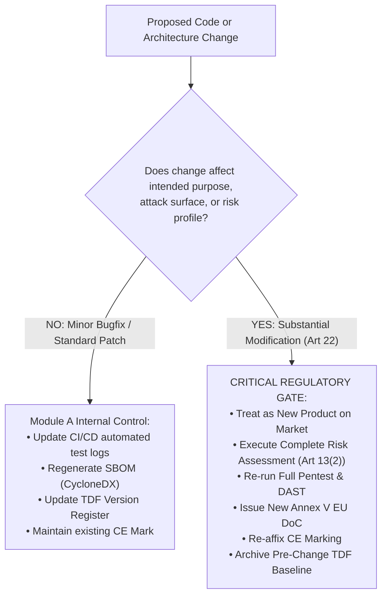

# EU Cyber Resilience Act (CRA) — Regulation (EU) 2024/2847
# Annex VII Technical Documentation File (TDF) & Annex V EU Declaration of Conformity Blueprint

**Document Reference:** `CRA-TDF-MOD-A-01`  
**Classification:** Internal Regulatory & Engineering Baseline / Module A Conformity Dossier  
**Statutory Baseline:** Regulation (EU) 2024/2847, Articles 13, 24, 28, 29, 31; Annex II, Annex V, Annex VII, Annex VIII  
**Applicability:** Standard Commercial Products with Digital Elements (Default Category / Module A Internal Production Control)  
**Retention Mandate:** 10 Years post-market placement or until support period end date (whichever is longer) (Article 13(10))

---

## 1. Executive Summary & Statutory Framework

Under **Regulation (EU) 2024/2847 (Cyber Resilience Act — CRA)**, the **Technical Documentation File (TDF)** is the mandatory evidentiary dossier that manufacturers must compile before affixing the **CE marking** and placing a product with digital elements (PDE) on the European Union single market (**Article 31**).

For products in the **Default Category** (representing ~90% of commercial software, SaaS backends/RDPS, IoT devices, and industrial controllers not classified under Annex III or Annex IV), conformity assessment is performed via **Module A (Internal Production Control)** under **Annex VIII**. Under Module A, the manufacturer carries 100% legal responsibility for verifying that the product meets the **Essential Requirements of Annex I**.

```
┌────────────────────────────────────────────────────────────────────────────────────────┐
│                        MODULE A CONFORMITY CHAIN (ANNEX VIII)                          │
├─────────────────────┬─────────────────────────────────┬────────────────────────────────┤
│ 1. Engineering SDLC │   2. Technical Dossier (TDF)    │   3. Market Placement (CE)     │
│   • Threat Models   │     • 10 Mandatory Sections     │     • Annex V EU DoC Signed    │
│   • CI/CD Quality   │     • Cryptographic Signatures  │     • CE Marking Affixed       │
│   • SCA & SAST/DAST │     • Machine-Readable SBOM     │     • User Instructions Issued │
│   • Pentest Evidence│     • 10-Year Archival Custody  │     • 5-Year RUN Support Active│
└─────────────────────┴─────────────────────────────────┴────────────────────────────────┘
```

> [!IMPORTANT]
> **Statutory Purpose of the TDF (Article 31(1)):**  
> The technical documentation must contain all relevant data or details of the means used by the manufacturer to ensure that the product with digital elements complies with the essential requirements set out in **Annex I**. It must be drawn up before the product is placed on the market and continuously updated throughout the product's support period.

---

## 2. Statutory Custody, Language & Retention Rules

### 2.1 Retention Period (Article 13(10))
* **10-Year Statutory Clock:** The manufacturer must keep the Technical Documentation File and the EU Declaration of Conformity at the disposal of **Market Surveillance Authorities (MSAs)** for **at least 10 years after the product has been placed on the market**, or for the support period of the product, whichever is longer.
* **Continuous Maintenance:** If the product support period is 5 years, and product units are placed on the market between 2027 and 2030, the TDF must be retained and maintained up to **2040** (10 years after the last unit of that release was placed on the market).
* **Immutability & Integrity:** The dossier must be stored in a WORM (Write Once, Read Many) or cryptographically sealed repository (e.g., git tag with GPG signature + SHA-256 manifest) to guarantee tamper-evidence during regulatory inspections.

### 2.2 Language Requirements (Article 31(2))
* The technical documentation must be drawn up in an official language of the Member State in which the market surveillance authority is located, or in a language easily understood by that authority (in practice, **English** is accepted across all 27 EU MSAs for technical engineering dossiers).
* **User Information & Instructions (Annex II):** Must be provided in the national languages determined by the Member States where the product is made available on the market.

### 2.3 Production on Demand (Article 54)
* Following a reasoned request from an MSA, the manufacturer must provide the TDF in paper or electronic format **within the timeframe specified by the authority (typically 10 to 30 calendar days)**.
* Failure to provide the complete TDF constitutes formal non-compliance under **Article 64**, subjecting the economic operator to administrative fines of up to **€15,000,000 or 2.5% of total worldwide annual turnover**.

---

## 3. Master TDF Architecture: The 10 Mandatory Annex VII Sections

The Technical Documentation File must follow a standardized structure reflecting the **10 statutory points of Annex VII**:

```
TDF-ROOT/
├── 01_General_Description/             ── Annex VII, Point 1
├── 02_Design_Manufacturing_RDPS/       ── Annex VII, Point 2
├── 03_Cybersecurity_Risk_Assessment/   ── Annex VII, Point 3 & Art 13(2)
├── 04_Standards_and_Specifications/    ── Annex VII, Point 4 & Art 24
├── 05_Annex_I_Technical_Solutions/     ── Annex VII, Point 5 (Part I & II)
├── 06_Design_Calculations_Evaluations/ ── Annex VII, Point 6
├── 07_Test_Reports_and_Verification/   ── Annex VII, Point 7
├── 08_EU_Declaration_of_Conformity_CE/ ── Annex VII, Point 8 & Annex V
├── 09_Machine_Readable_SBOM/           ── Annex VII, Point 9 & Annex I Part II(1)
└── 10_User_Information_Annex_II/       ── Annex VII, Point 10 & Annex II
```

---

### Section 1: General Description of the Product (Annex VII, Point 1)

This section provides the formal identification and context of the Product with Digital Elements (PDE).

#### 1.1 Product Identification Matrix
| Field | Statutory Requirement | Implementation Baseline |
|---|---|---|
| **Trade Name & Brand** | Art. 13(7), Annex VII(1)(a) | e.g., `SecureEdge Gateway 5000` / `Enterprise Core API Platform` |
| **Model / Type Reference** | Art. 13(7), Annex VII(1)(a) | e.g., `SEG-5000-EU-v2` / `ECAP-v3.4.0` |
| **Unique Batch / Serial / Version** | Art. 13(7) | Release Commit Hash: `git-rev:9a4b3c2` / Semantic Version: `3.4.0-build.1042` |
| **Manufacturer Legal Identity** | Art. 13(7) | Full registered legal entity name, corporate address, single postal contact, and verified email |
| **Intended Purpose (Recital 33)** | Annex VII(1)(a) | Precise functional scope, operational domain, target environment, and commercial user profile |
| **Foreseeable Misuse** | Art. 13(2), Annex VII(1)(a) | Excluded operating environments, non-supported network architectures, and hazardous use cases |
| **Hardware / OS Environment** | Annex VII(1)(a) | Target architecture (x86_64, aarch64), OS kernel baseline, minimum RAM/storage requirements |

#### 1.2 Visual Identifiers & Physical/Digital Illustrations
* High-resolution diagrams, component exploded views, or UI landing screenshots displaying exact CE marking placement, type labels, and physical tamper-evident seals.

---

### Section 2: Design, Manufacturing, Architecture & RDPS Dependencies (Annex VII, Point 2)

Covers the technical architecture, interconnectivity, and backend services essential to product functioning.

#### 2.1 Software & Hardware Architecture
* **Block Diagram:** Detailed system schematic showing data processing units, buses, memory segments, storage controllers, network controllers, and cryptographic co-processors.
* **Component Demarcation:** Breakdown of custom application software, middleware, firmware, and underlying OS layers.
* **External Interfaces:** Exhaustive catalog of physical ports (USB, Ethernet, JTAG, serial) and logical network interfaces (listening TCP/UDP ports, REST APIs, gRPC endpoints, WebSocket channels).

#### 2.2 Remote Data Processing Solutions (RDPS) in Scope (Article 3(2))
> [!WARNING]
> **Statutory Scope Boundary:** Any cloud backend, SaaS telemetry cluster, or remote API developed by or under the control of the manufacturer, **without which the product cannot fulfill its functions**, is legally an integral part of the PDE under **Article 3(2)**.
* **RDPS Catalog:** URL endpoints, identity providers, telemetry ingress endpoints, and update delivery servers.
* **Shared Responsibility Matrix:** Formal demarcation between cloud infrastructure provider (e.g., AWS/Azure/GCP ISO 27001/SOC 2 controls) and manufacturer-managed application logic.

#### 2.3 Manufacturing & Production Controls
* Description of the secure assembly line, hardware flashing procedures, factory root-of-trust injection, cryptographic key burning, and tamper-resistant packaging.

---

### Section 3: Cybersecurity Risk Assessment (Annex VII, Point 3 & Article 13(2))

The risk assessment is the foundational document of CRA conformity. Under Article 13(2), it must be carried out **prior to development**, maintained throughout the lifecycle, and documented in the TDF.

#### 3.1 Risk Assessment Methodology & Standard Applied
* Methodology aligned with **ISO/IEC 27005**, **IEC 62443-4-1 (Practice 2: Threat Modeling)**, or **BSI Standard 200-3**.
* Threat modeling framework: **STRIDE** or **TARA (Threat Analysis and Risk Assessment)**.

#### 3.2 Attack Surface & Threat Scenario Catalog
| Threat ID | Lifecycle Asset | STRIDE Category | Threat Scenario & Vector | Inherent Risk (Impact × Likelihood) | Mandatory Technical Control (Annex I) | Residual Risk |
|---|---|---|---|:---:|---|:---:|
| `THR-01` | Firmware Image | Tampering | Attacker injects malicious payload into over-the-air update. | **CRITICAL** (5 × 5) | Ed25519 digital signature validation before flashing; hardware rollback protection (Annex I Part II(5)). | **LOW** (1 × 2) |
| `THR-02` | Admin REST API | Elevation of Privilege | Broken object-level authorization allows unprivileged tenant access. | **HIGH** (4 × 4) | OAuth 2.0 / mTLS with RBAC enforcement in API gateway; zero unauthenticated endpoints (Annex I Part I(3)(a)). | **LOW** (1 × 1) |
| `THR-03` | Local Storage | Information Disclosure | Forensic extraction of flash memory exposes credentials. | **HIGH** (4 × 4) | AES-256-XTS full-disk encryption with keys sealed in hardware TPM 2.0 / Secure Enclave (Annex I Part I(3)(d)). | **LOW** (1 × 2) |
| `THR-04` | RDPS Telemetry | Denial of Service | Volumetric flood on telemetry ingress disrupts product operation. | **MEDIUM** (3 × 4) | Cloudflare rate limiting, auto-scaling ingress, and offline queueing on edge device (Annex I Part I(3)(c)). | **LOW** (1 × 2) |

---

### Section 4: Applied Standards, Common Specifications & Technical State-of-the-Art (Annex VII, Point 4)

Documents the normative benchmarks conferring presumption of conformity or proving state-of-the-art compliance.

#### 4.1 Harmonised Standards Register (Article 24)
> [!NOTE]
> **Harmonisation Status (October 2026):** Under European Commission Standardisation Request **M/60x**, CEN/CENELEC/ETSI are drafting harmonised European standards (HENs). Until citation in the Official Journal, no standard confers statutory *Presumption of Conformity*. The manufacturer must benchmark against state-of-the-art standards.

| Standard Reference | Standard Title | Scope of Application | Presumption of Conformity Status |
|---|---|---|:---:|
| **ETSI EN 303 645 v2.1.1** | Cyber Security for Consumer Internet of Things: Baseline Requirements | Baseline security controls, secure password policy, vulnerability reporting | State of the Art Benchmark |
| **IEC 62443-4-1:2018** | Security for industrial automation - Secure product development lifecycle requirements | SDLC security governance, risk assessment, static/dynamic testing | State of the Art Benchmark |
| **IEC 62443-4-2:2019** | Security for industrial automation - Technical security requirements for IACS components | Component-level access control, data integrity, audit logging | State of the Art Benchmark |
| **ISO/IEC 29147:2018** | Information technology - Vulnerability disclosure | Coordinated Vulnerability Disclosure (CVD) process and researcher contact point | State of the Art Benchmark |
| **ISO/IEC 30111:2019** | Information technology - Vulnerability handling processes | Internal triage, root cause analysis, security advisory workflows | State of the Art Benchmark |
| **ISO/IEC 27001:2022** | Information security management systems - Requirements | ISMS controls, access management, secure software engineering | State of the Art Benchmark |

#### 4.2 Common Specifications (Article 25)
* If the Commission adopts common specifications via Implementing Acts where harmonised standards are absent or deficient, list the applicable Commission Implementing Regulation and exact technical clauses applied.

---

### Section 5: Technical Solutions for Annex I Essential Requirements (Annex VII, Point 5)

Detailed matrix mapping engineering controls directly to each clause of **Annex I, Part I (Security Properties)** and **Annex I, Part II (Vulnerability Handling)**:

#### 5.1 Annex I, Part I — Cybersecurity Properties
| Annex I Clause | Essential Requirement | Technical Solution Adopted | Evidence Document Reference |
|---|---|---|---|
| **Part I, (1)** | **Appropriate Cybersecurity Level** | Defense-in-depth architecture, least privilege microservices, memory-safe compilation (Rust/Go for network parsers). | `ARCH-SPEC-v3.pdf`, Sec 4 |
| **Part I, (2)** | **Secure by Default Configuration** | Zero default passwords; unique per-device factory credentials; all unused network ports (SSH, Telnet, debugging) disabled in factory build. | `HARDENING-GUIDE-v2.md` |
| **Part I, (3)(a)** | **Access Control & Protection from Unauthorized Access** | Hardware-backed authentication (FIDO2 / mTLS); PBKDF2/Argon2id password hashing; role-based access control (RBAC). | `AUTH-SPEC-v1.pdf` |
| **Part I, (3)(b)** | **Confidentiality of Data** | TLS 1.3 with cipher suites enforcing forward secrecy (ECDHE-ECDSA-AES256-GCM); AES-256 at rest. | `CRYPTO-INVENTORY-2026.json` |
| **Part I, (3)(c)** | **Integrity of Data & Commands** | HMAC-SHA256 message authentication; digital signature validation on command payloads; write-protected boot partitions. | `INTEGRITY-CONTROLS.pdf` |
| **Part I, (3)(d)** | **Data Minimisation** | PII and telemetry filtered at edge; log anonymisation; zero transmission of raw operational data unless strictly necessary. | `DPIA-REPORT-2026.pdf` |
| **Part I, (3)(e)** | **Availability & Resiliency** | Memory cgroups, watchdog timers, rate-limiting reverse proxy, graceful degradation during network partitioning. | `RESILIENCY-TEST-PLAN.pdf` |
| **Part I, (3)(f)** | **Attack Surface Minimisation** | Removal of build toolchains, debug symbols, and test code from production containers; compiler flags `-fstack-protector-strong -D_FORTIFY_SOURCE=2`. | `CI-HARDENING-LOG.json` |
| **Part I, (3)(g)** | **Security Logging & Monitoring** | Structured JSON audit logging of all authentication events, privilege escalations, and configuration changes; tamper-resistant remote forwarding. | `AUDIT-LOG-SPEC.pdf` |
| **Part I, (3)(h)** | **Secure Factory Reset** | Cryptographic key wiping via hardware secure erase (`blkdiscard` / TPM clear); zero retention of user credentials post-reset. | `DECOMMISSION-RUNBOOK.md` |

#### 5.2 Annex I, Part II — Vulnerability Handling Requirements
| Annex I Clause | Essential Requirement | Technical Solution Adopted | Evidence Document Reference |
|---|---|---|---|
| **Part II, (1)** | **SBOM & Component Tracking** | Automated build-time generation of CycloneDX v1.5 / SPDX v2.3 SBOM; continuous monitoring in Dependency-Track. | `SBOM-CycloneDX-3.4.0.json` |
| **Part II, (2)** | **Security Updates Free of Charge** | Over-the-air update pipeline with automated rollback; separate delivery of functional vs security updates; 5-year guarantee. | `UPDATE-MECHANISM-SOP.pdf` |
| **Part II, (3)** | **Coordinated Vulnerability Disclosure (CVD)** | Published CVD policy on website and `security.txt` (RFC 9116); PGP encrypted intake inbox; 48h response SLA. | `CVD-POLICY-2026.md` |
| **Part II, (4)** | **Secure Vulnerability Reporting Interface** | Single public contact point: `security@company.com` and web intake portal; ISO/IEC 29147 compliant workflow. | `VULN-INTAKE-SOP.pdf` |
| **Part II, (5)** | **Secure Update Distribution** | Updates delivered over TLS 1.3, signed with Ed25519 offline root-of-trust; cryptographic verification before execution. | `SECURE-OTA-ARCH.pdf` |
| **Part II, (6)** | **Public Security Advisories & CVE/VEX** | Publication of machine-readable CSAF 2.0 advisories and OpenVEX exploitability statements within 24h of patch release. | `CSAF-REPOSITORY-LINK.txt` |
| **Part II, (7)** | **Pre-Release Update Validation** | Automated regression testing and security verification suite in staging environment before patch distribution. | `PATCH-VALIDATION-SUITE.py` |
| **Part II, (8)** | **Post-Market Incident Reporting** | Article 14 ENISA Single Reporting Platform (SRP) procedures; automated 24h Early Warning triggers for active exploits. | `CRA_Article_14_Operational_Runbook.md` |

---

### Section 6: Design Calculations, Static/Dynamic Security Evaluations (Annex VII, Point 6)

Contains the engineering records and quantitative evaluations supporting compliance:
* **Cryptographic Strength Calculations:** Verification that key lengths (RSA $\ge 3072$-bit, ECC $\ge 256$-bit, AES $\ge 128$-bit) comply with SOG-IS / BSI TR-02102 cryptographic lifetime recommendations through 2035.
* **Attack Surface Quantification:** Listening port audit, exposed API attack surface area calculations, and container image layer minimalization analysis.
* **Fail-Safe & Watchdog Timing Analysis:** Hardware watchdog timeout calculations ensuring reboot and safe recovery within $\le 5$ seconds during hardware freeze or denial-of-service.

---

### Section 7: Verification & Validation Test Reports (Annex VII, Point 7)

Formal audit records verifying that all security controls function as specified:

#### 7.1 Required Audit Test Reports
1. **Static Application Security Testing (SAST) Report:**
   * Tools: Coverity / SonarQube.
   * Acceptance Criteria: Zero Critical or High OWASP/CWE security vulnerabilities; clean build gate approval log.
2. **Software Composition Analysis (SCA) Report:**
   * Tools: Nexus IQ / Black Duck / Dependency-Track.
   * Acceptance Criteria: Zero unresolved Critical/High CVEs; zero known actively exploited vulnerabilities (CISA KEV / ENISA SRP).
3. **Dynamic Application Security Testing (DAST) Report:**
   * Tools: OWASP ZAP / Burp Suite Professional.
   * Scope: All external HTTP/REST/gRPC interfaces tested against OWASP Top 10 API Security Risks.
4. **Independent Penetration Testing Report:**
   * Performed by certified third-party testing facility (CREST / OSCP certified).
   * Scope: Black-box and gray-box penetration test against physical, network, and application attack surfaces.
   * Evidence: Executive summary, vulnerability remediation sign-off, and re-test validation certificate.
5. **Vulnerability Scanning & Infrastructure Hardening Report:**
   * Tools: Nessus / Cyberwatch.
   * Baseline: CIS Benchmark Level 1/Level 2 OS hardening compliance verification ($\ge 95\%$ compliance).

---

### Section 8: Annex V EU Declaration of Conformity & CE Marking (Annex VII, Point 8)

Contains the signed copy of the EU Declaration of Conformity and the technical drawings for CE marking.

---

## 4. Turnkey Annex V EU Declaration of Conformity (DoC) Template

```markdown
# EU DECLARATION OF CONFORMITY (No. [DOC-YYYY-XXXX])

1. Product with Digital Elements (Product, Type, Batch or Serial Number):
   - Product Name: [COMMERCIAL PRODUCT NAME]
   - Commercial Model / Type: [EXACT MODEL NUMBER]
   - Hardware Version: [HARDWARE REVISION / ARCHITECTURE]
   - Firmware / Software Version: [FIRMWARE / SOFTWARE RELEASE VERSION]
   - Unique Identification / Serial Number: [BATCH / SERIAL RANGE / HASH]

2. Name and Address of the Manufacturer:
   - Manufacturer Name: [COMPANY LEGAL NAME]
   - Registered Business Address: [FULL STREET ADDRESS, CITY, POSTAL CODE, COUNTRY]
   - Single Point of Contact Email: [compliance@company.com]
   - Contact Website: [https://www.company.com/cra-compliance]

3. This declaration of conformity is issued under the sole responsibility of the manufacturer.

4. Object of the Declaration:
   - Description: [CONCISE DESCRIPTION OF PRODUCT, ITS DIGITAL ELEMENTS, AND FUNCTION]
   - Commercial Category: Commercial Product with Digital Elements (Default Category)
   - Product Photographic / Graphic Reference: [PHOTO / DRAWING IDENTIFIER]

5. The object of the declaration described above is in conformity with the relevant Union harmonisation legislation:
   - Regulation (EU) 2024/2847 of the European Parliament and of the Council of 23 October 2024 
     on horizontal cybersecurity requirements for products with digital elements (Cyber Resilience Act)
   - [Optional: Directive 2014/53/EU (Radio Equipment Directive - RED), if applicable]
   - [Optional: Directive 2014/30/EU (Electromagnetic Compatibility - EMC), if applicable]
   - [Optional: Directive 2011/65/EU (RoHS), if applicable]

6. References to the relevant harmonised standards used or references to the common specifications or other technical specifications in relation to which conformity is declared:
   - Regulation (EU) 2024/2847, Annex I, Part I (Essential Cybersecurity Requirements)
   - Regulation (EU) 2024/2847, Annex I, Part II (Vulnerability Handling Requirements)
   - ETSI EN 303 645 v2.1.1 (Cyber Security for Consumer Internet of Things)
   - IEC 62443-4-1:2018 (Security for Industrial Automation: Secure Product Development Lifecycle)
   - IEC 62443-4-2:2019 (Technical Security Requirements for IACS Components)
   - ISO/IEC 29147:2018 (Vulnerability Disclosure)
   - ISO/IEC 30111:2019 (Vulnerability Handling Processes)

7. Conformity Assessment Procedure Followed:
   - Internal Production Control (Module A) set out in Annex VIII to Regulation (EU) 2024/2847.
   [If Notified Body involved (Class I/II)]:
   - [Notified Body Name], [Notified Body Number] performed [Module B / C / H] and issued EU-Type Examination Certificate No. [XXXXX].

8. Guaranteed Product Support Period (Article 13(8)):
   - Guaranteed Support End Date: [YYYY-MM-DD] (Minimum 5 Years from Market Placement)
   - Support Policy URL: [https://www.company.com/security/support-lifecycle]

9. Additional Information:
   - Technical Documentation Reference: [TDF-REF-2026-V1]
   - Authorized Representative (if manufacturer outside EU): [EU REP NAME, ADDRESS, EMAIL]

Signed for and on behalf of: [MANUFACTURER LEGAL ENTITY]

Place of Issue: [CITY, COUNTRY]  
Date of Issue: [YYYY-MM-DD]  

Name: [FULL LEGAL NAME]  
Function / Role: [CHIEF TECHNOLOGY OFFICER / VP OF PRODUCT SECURITY / MANAGING DIRECTOR]  

Signature: _________________________________________ [Cryptographically Signed / Physical Stamp]
```

---

## 5. CE Marking Technical Drawing & Affixation Specification (Articles 28 & 29)

### 5.1 Dimensional & Proportional Rules (Article 29 & Regulation (EC) 765/2008)
* **The CE Symbol:** Must consist of the initials "CE" taking the exact form outlined in Annex II to Regulation (EC) No 765/2008.
* **Proportions:** If the CE marking is reduced or enlarged, the proportions derived from the graduated grid must be respected.
* **Minimum Dimensions:** The vertical dimension of the CE marking must be **not less than 5 mm**. For ultra-miniature hardware, a derogation applies allowing placement on packaging or accompanying documentation.

```
       ┌──────┐              ┌──────┐
      │  ████  │            │  ████  │
     │  ██     │           │  ██     │
     │  ██     │           │  █████  │
     │  ██     │           │  ██     │
      │  ████  │            │  ████  │
       └──────┘              └──────┘
        ( C )                 ( E )
         <──────── Min 5 mm ────────>
```

### 5.2 Physical Affixation Hierarchy (Article 28)
1. **Primary Location (On the Product):** The CE marking must be affixed visibly, legibly, and indelibly to the product with digital elements or to its data plate.
2. **Secondary Location (Packaging):** Where that is not possible or not warranted on account of the nature of the product (e.g., pure software or small embedded chip), it must be affixed to the packaging and to the accompanying documentation.
3. **Digital CE Marking (Pure Software / SaaS):** For standalone software or digital firmware distributions, the CE marking must be displayed:
   * In the software's `About` / `License` / `Legal` dialog within the graphical user interface.
   * In the header of the primary user documentation or CLI command `--version` output.
   * On the official download portal alongside the cryptographic checksum and EU DoC hyperlink.

### 5.3 Accompanying Digital Identifiers
* The CE mark must be accompanied by:
  * Manufacturer identification (name, registered trade name, and single contact address).
  * Product model/batch number.
  * Direct machine-readable link (QR Code or permanent URL) leading directly to the **EU Declaration of Conformity** and **Annex II User Instructions**.

---

## 6. Section 9: Machine-Readable Software Bill of Materials (SBOM) Specification

Under **Annex VII Point 9** and **Annex I Part II Point 1**, the technical documentation must include an exhaustive, machine-readable inventory of all top-level and transitive software components.

### 6.1 SBOM Standards & Formats Accepted
* **CycloneDX v1.5 or v1.6 (JSON)** (Preferred for application and cloud components).
* **SPDX v2.3 or v3.0 (JSON)** (Accepted horizontal ISO/IEC 5962 standard).

### 6.2 Mandatory Data Fields per Component
Every third-party, commercial, or open-source component in the SBOM must include:
1. `bom-ref`: Unique deterministic URI identifier.
2. `name`: Official package name.
3. `version`: Exact semantic version string.
4. `purl`: Package URL conforming to standard specification (e.g., `pkg:golang/crypto@v0.18.0`, `pkg:npm/express@4.18.2`).
5. `supplier`: Name of the upstream organisation, vendor, or project maintainer.
6. `hashes`: Cryptographic hashes (SHA-256 and SHA-512) of the source archive or compiled binary.
7. `licenses`: Declared and concluded SPDX license identifier(s).
8. `cpe`: Common Platform Enumeration string (for automated NVD/CVE correlation).
9. `relationship`: Dependency relationship (direct vs transitive).

---

## 7. Section 10: Annex II User Information & Instructions for Use

Under **Article 13(1)** and **Annex II**, the product must be accompanied by clear, comprehensible, and accessible user instructions. The TDF must contain the exact master copy:

### 7.1 Mandatory Content Checklist (Annex II)
- [ ] **1. Manufacturer Identification:** Legal entity name, postal address, email, and digital contact point.
- [ ] **2. Single Contact Point for Vulnerabilities:** Public email (`security@company.com`), PGP key, and CVD web form URL.
- [ ] **3. Guaranteed Support Period End Date:** Explicit calendar date (e.g., `31 December 2031`) stating until when security updates are provided.
- [ ] **4. Intended Purpose & Operating Environment:** Permitted network topologies, required OS/hardware configurations.
- [ ] **5. Secure Installation & Configuration Guide:** Step-by-step hardening procedure, default credentials warning, required firewall rules.
- [ ] **6. Update Delivery & Installation Instructions:** How security updates are notified, how they are verified, and whether automatic updates are supported.
- [ ] **7. Decommissioning & Secure Data Erase Procedure:** How to perform a factory reset and securely wipe cryptographic keys and personal data.
- [ ] **8. Statement on Bespoke Deviations (Recital 64):** If delivered under bespoke commercial contracts with customer-agreed configuration variations.

---

## 8. Module A In-House Quality Assurance & Change Control SOP

To maintain continuous conformity throughout production and maintenance without triggering illegal unauthorized modifications:



### 8.1 Change Classification Criteria (Article 22 & Blue Guide)
* **Minor Modification (Standard Maintenance):**
  * Security patches fixing known CVEs without altering functional APIs.
  * Dependency upgrades that do not alter network protocols or authorization models.
  * Performance optimizations maintaining existing cryptographic boundaries.
  * *Procedure:* Update Section 5 & Section 9 (SBOM) of the TDF; document in internal engineering change log; existing EU DoC remains valid.
* **Substantial Modification (Article 22):**
  * Adding remote management or cloud telemetry capabilities to a previously isolated product.
  * Replacing the authentication engine or cryptographic root-of-trust.
  * Expanding intended purpose from benign commercial to critical infrastructure use.
  * *Procedure:* Formal new conformity assessment cycle; update all 10 TDF sections; issue new EU DoC; re-affix CE mark.

---

## 9. TDF Packaging, Cryptographic Sealing & Archival Checklist

Before market placement, the Compliance Officer and Product Security Architect must execute the following sealing sequence:

```bash
# 1. Compile final TDF documentation directory
cd /opt/compliance/TDF-SEG-5000-v3.4.0

# 2. Generate SHA-256 manifest of all 10 sections and artifacts
find . -type f -exec sha256sum {} + | sort > manifest.sha256

# 3. Cryptographically seal manifest using corporate hardware security key (GPG)
gpg --default-key compliance@company.com --armor --detach-sign manifest.sha256

# 4. Package into immutable audit archive
tar -czvf TDF-SEG-5000-v3.4.0-AUDIT-SEALED.tar.gz .

# 5. Compute archive signature and upload to 10-year WORM compliance vault
sha256sum TDF-SEG-5000-v3.4.0-AUDIT-SEALED.tar.gz > TDF-SEG-5000-v3.4.0-AUDIT-SEALED.tar.gz.sha256
```

### 9.1 Verification Sign-Off Gate

| TDF Section | Status | Verification Deliverable | Sign-Off Lead | Date |
|---|:---:|---|---|:---:|
| **Sec 1: Product Description** | **APPROVED** | Datasheet, illustrations, version manifest | Product Manager | _________ |
| **Sec 2: Design & RDPS Architecture** | **APPROVED** | Block diagrams, cloud endpoint catalog | Lead Architect | _________ |
| **Sec 3: Risk Assessment (Art 13(2))** | **APPROVED** | STRIDE threat model & residual risk register | Security Architect | _________ |
| **Sec 4: Applied Standards** | **APPROVED** | Normative standard gap audit matrix | Compliance Lead | _________ |
| **Sec 5: Annex I Essential Solutions** | **APPROVED** | Part I & Part II technical solution mapping | Principal Engineer | _________ |
| **Sec 6: Design Calculations** | **APPROVED** | Cryptographic key lifetime & watchdog logs | Crypto Engineer | _________ |
| **Sec 7: Verification Test Reports** | **APPROVED** | SAST, DAST, SCA, Pentest reports attached | QA & Pentest Lead | _________ |
| **Sec 8: Annex V EU DoC & CE Mark** | **APPROVED** | Signed EU DoC and CE vector drawings | Legal & Executive | _________ |
| **Sec 9: Machine-Readable SBOM** | **APPROVED** | Valid CycloneDX v1.5 JSON ingested | DevOps Lead | _________ |
| **Sec 10: Annex II User Instructions** | **APPROVED** | User manual, hardening guide & support date | Tech Publications | _________ |
| **FINAL MODULE A APPROVAL** | **COMPLIANT** | **TDF-AUDIT-SEALED.tar.gz archived in WORM vault** | **Chief Product Security Officer** | _________ |
