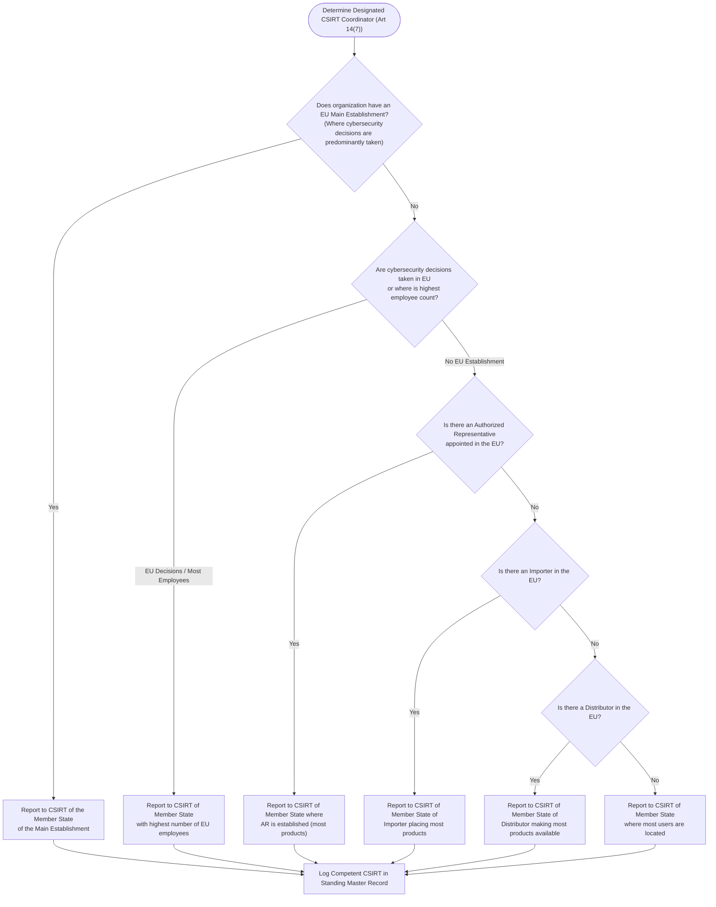
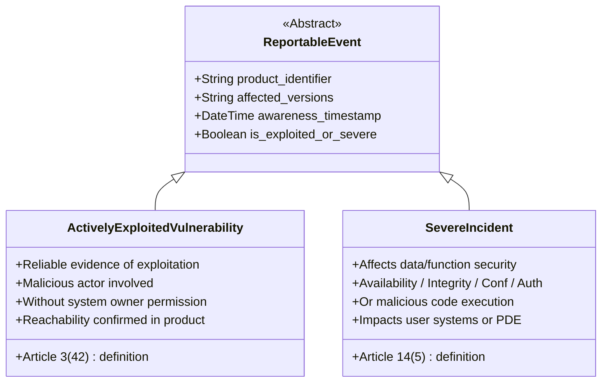
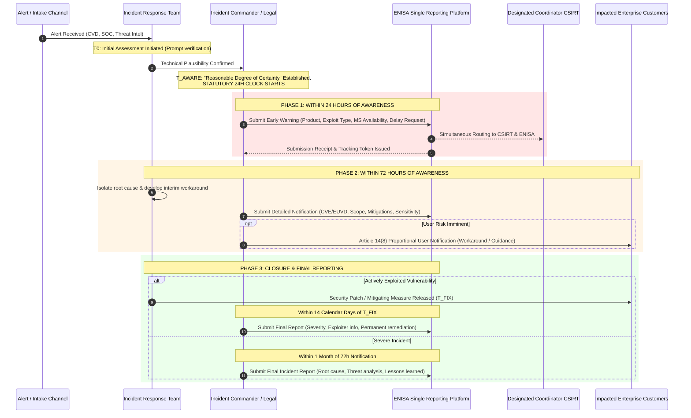

# EU Cyber Resilience Act (Regulation (EU) 2024/2847)
# Article 14 Operational Reporting Runbook & ENISA SRP Procedure

**Document Classification:** Confidential — Internal Regulatory Operational Runbook  
**Document Owner:** Chief Information Security Officer (CISO) & Legal Counsel  
**Enforcement Status:** **MANDATORY & LIVE (Statutory Law since 11 September 2026)**  
**Version:** 1.0  
**Target Systems:** All Products with Digital Elements (PDEs), Integrated Customer Solutions, and Remote Data Processing Solutions (RDPS) developed, branded, or substantially modified by our organization.

---

## 1. Executive Summary & Legal Mandate

### 1.1 Live Statutory Duty (Article 69(3))
Under **Article 69(3) of Regulation (EU) 2024/2847 (Cyber Resilience Act - CRA)**, the reporting obligations laid down in **Article 14 took full effect on 11 September 2026**. 

Unlike the general essential cybersecurity requirements (Annex I) and conformity assessment procedures (Articles 24–32), which take effect on **11 December 2027**, **Article 14 applies immediately**. Furthermore, its scope is retroactive and unbounded by support periods:
1. It applies to **all products with digital elements currently made available on the EU market**, including products placed on the market *before* 11 December 2027.
2. It continues to apply **even after a product's declared support period has ended** if the manufacturer remains aware of active exploitation.
3. Violations incur administrative fines under **Article 64(2)** of up to **€15,000,000 or 2.5% of total worldwide annual turnover**, whichever is higher.

### 1.2 Purpose of This Runbook
This Runbook establishes the binding operational standard for:
1. Detecting and establishing legal **Awareness** of reportable cybersecurity events.
2. Managing the statutory notification clocks (**24-Hour Early Warning**, **72-Hour Detailed Notification**, and **14-Day / 1-Month Final Reports**).
3. Interacting with the **ENISA Single Reporting Platform (SRP)** (`portal.cra-srp.enisa.europa.eu`) and the designated EU Member State **CSIRT Coordinator**.
4. Executing mandatory **Article 14(8)** user communications without undue delay.
5. Invoking confidentiality protections and delayed dissemination requests under **Delegated Regulation (EU) 2026/881**.
6. Conducting periodic compliance drills to ensure continuous audit readiness.

---

## 2. Jurisdictional CSIRT Allocation & Platform Architecture

### 2.1 Determination of Designated CSIRT Coordinator (Article 14(7))
Reports submitted to the ENISA SRP are routed simultaneously to ENISA and the national CSIRT designated as coordinator. To identify the competent CSIRT, our organization applies the statutory hierarchy in Article 14(7):



#### Standing Organization Record:
| Parameter | Organizational Setting | Verification Cadence |
|---|---|---|
| **Jurisdictional Basis** | Main establishment where cybersecurity R&D and incident decisions are taken | Annual / On corporate restructuring |
| **Designated Coordinator CSIRT** | *e.g., ANSSI (FR) / BSI (DE) / CCN-CERT (ES) / CSIRT-IE (IE)* | Verified against ENISA National CSIRT Directory |
| **CSIRT 24/7 Hotline & PGP Key** | Stored in Incident Management Vault | Quarterly validation |

### 2.2 ENISA Single Reporting Platform (SRP) Accounts & Credentials
The ENISA SRP (`https://portal.cra-srp.enisa.europa.eu`) is the sole statutory entry point. Submissions sent via unstructured email or phone do not satisfy Article 14 obligations.

1. **Primary Assigned Representative (PAR)**:
   - Must be formally appointed by executive management (e.g., CISO or Head of Product Security).
   - Authenticates using **EU Login** backed by FIDO2 WebAuthn hardware security keys.
   - Holds exclusive power to manage organization profile, delegate roles, and revoke platform access.
2. **Secondary Assigned Representatives (SARs)**:
   - Up to 20 authorized technical incident commanders and incident response leads.
   - Empowered to submit Early Warnings, Notifications, and Final Reports 24/7/365.
3. **Emergency "Break-Glass" Access**:
   - Backup EU Login credentials stored in corporate hardware HSM with split-knowledge passwords held by Legal Counsel and Deputy CISO.
   - Tested bi-monthly for operational validity.

---

## 3. Scope of Reportable Events & The "Awareness" Test

### 3.1 Reportable Event Categories
Article 14 mandates notifications for two distinct categories of events:



#### Category A: Actively Exploited Vulnerability (Article 14(2) & Article 3(42))
- **Definition:** Any vulnerability for which there is **reliable evidence** that an execution of malicious code or unintended system behavior has occurred without permission of the system owner.
- **Reachability & Exploitation Filter:**
  - If a vulnerability exists in an integrated third-party component (e.g., open-source library), but that component is **unreachable** or the specific vulnerable call path is not exposed in our product, it is **NOT reportable** under Article 14(2).
  - Theoretical zero-days, researcher proofs-of-concept (PoCs) in lab settings, and bug-bounty submissions without evidence of in-the-wild exploitation are **NOT reportable** under mandatory Article 14 (voluntary Article 15 reporting remains optional).

#### Category B: Severe Incident Impacting Product Security (Article 14(4) & Article 14(5))
- **Definition:** Any security incident affecting a product with digital elements (or its companion cloud backend/RDPS) that:
  1. Negatively affects, or is capable of negatively affecting, the product's ability to protect the **availability, authenticity, integrity, or confidentiality** of sensitive or important data or functions; OR
  2. Has led to, or is capable of leading to, the **introduction or execution of malicious code** within the product or within the network/information systems of a user.

### 3.2 The Statutory "Becoming Aware" Protocol (Commission Guidance Points 211–217)
The regulatory clock does **not** start upon initial intake or receipt of an unverified alert. It starts strictly at the legal moment of **Awareness**.

1. **Intake & Verification Phase (Prompt Initial Assessment)**:
   - When a ticket, researcher email, or SOC alert arrives, the Incident Response Team (IRT) must initiate a prompt initial assessment.
   - The IRT has a limited operational window (target: **< 12 hours from intake**) to confirm technical plausibility.
2. **The "Reasonable Degree of Certainty" Standard**:
   - Awareness is legally established when the IRT confirms:
     - The vulnerability actually exists in our supported code or active deployments; AND
     - Reliable evidence demonstrates active exploitation in the wild (for Category A); OR
     - The operational incident has crossed the severity threshold in Article 14(5) (for Category B).
3. **The Awareness Timestamp**:
   - The minute reasonable certainty is reached, the Incident Commander records the **Awareness Timestamp** (UTC ISO 8601).
   - **From this exact minute, the 24-hour statutory clock runs without exception.**

---

## 4. Master Statutory Timelines & Operational Workflow

### 4.1 Comparison of Statutory Deadlines

| Phase | Actively Exploited Vulnerability (Art 14(2)) | Severe Incident Having Security Impact (Art 14(4)) | Statutory Reference |
|---|---|---|---|
| **Early Warning** | **Within 24 hours** of awareness | **Within 24 hours** of awareness | Art 14(2)(a) & 14(4)(a) |
| **Detailed Notification** | **Within 72 hours** of awareness | **Within 72 hours** of awareness | Art 14(2)(b) & 14(4)(b) |
| **Final Report** | **No later than 14 days** after a corrective or mitigating measure is available | **Within 1 month** after submission of the 72-hour notification | Art 14(2)(c) & 14(4)(c) |
| **Intermediate Updates** | Promptly upon request of CSIRT coordinator | Promptly upon request of CSIRT coordinator | Art 14(6) |
| **User Information** | Without undue delay (proportional & risk-based) | Without undue delay (proportional & risk-based) | Art 14(8) |

### 4.2 End-to-End Operational Lifecycle Workflow



---

## 5. Detailed Step-by-Step Reporting Procedures

### 5.1 Stage 1: The 24-Hour Early Warning Procedure

#### Internal SLA Milestones:
- **T + 0h**: Awareness established; Awareness Decision Log signed.
- **T + 8h**: Technical facts collated (affected versions, EU Member State distribution).
- **T + 14h**: Legal / CISO review of Early Warning draft.
- **T + 18h**: Final approval by Incident Commander.
- **T + 20h**: Platform submission via ENISA SRP (4-hour buffer before legal deadline).

#### Content Requirements:
1. **Manufacturer Identification**: Organization Legal Name, VAT/Registration number, Submitter PAR/SAR ID.
2. **Affected Product**: Commercial name, hardware/software model numbers, firmware versions in scope.
3. **Event Category**: Explicit checkbox: `[x] Actively Exploited Vulnerability` OR `[x] Severe Incident`.
4. **Member States**: List of all EU Member States where the product is known to have been made available or deployed.
5. **Incident Characterization (for Incidents)**: Whether unlawful or malicious acts are suspected (e.g., state-sponsored intrusion, ransomware).
6. **Delayed Dissemination Request (Delegated Regulation (EU) 2026/881)**:
   - If public knowledge of the exploit before a patch exists would cause immediate systemic exploitation, check `Request Delay of Dissemination`.
   - Provide technical cybersecurity rationale (e.g., zero-day weaponized in active campaigns; patch expected within 72 hours).

### 5.2 Stage 2: The 72-Hour Full Notification Procedure

#### Internal SLA Milestones:
- **T + 36h**: Root cause analysis preliminary conclusion; CVE/EUVD assignment confirmed.
- **T + 48h**: Customer mitigation/workaround instructions drafted and tested.
- **T + 60h**: Legal and Technical review of 72-hour submission dossier.
- **T + 66h**: Platform submission on ENISA SRP.

#### Content Requirements:
1. **General Nature of Exploit/Vulnerability**:
   - CVE or EUVD Identifier (if requested/reserved).
   - CWE classification (e.g., CWE-78 OS Command Injection, CWE-287 Authentication Bypass).
   - Attack vector (CVSS v3.1/v4.0 vector string).
2. **Current Impact & Exploitation Evidence**:
   - Observed telemetry, honeypot hits, IOCs, active threat actor TTPs (MITRE ATT&CK mapping).
3. **Corrective & Mitigating Measures**:
   - Technical actions taken by our organization (e.g., firewall signatures pushed to RDPS, cloud API limits adjusted).
   - Concrete measures enterprise customers must take (e.g., disabling legacy protocol, firewall ACL changes).
4. **Information Sensitivity Grading**:
   - Standard TLP (Traffic Light Protocol) rating: `TLP:RED` or `TLP:AMBER+STRICT`.

### 5.3 Stage 3: Article 14(8) Mandatory User Notification Protocol

#### Trigger & Legal Threshold:
Article 14(8) mandates that manufacturers inform impacted users **without undue delay** of the vulnerability or incident and of any risk-mitigating corrective measures they can deploy.

#### Operational Rules for Solution Providers:
1. **Risk-Based Proportionality**:
   - If an active exploit is underway and no patch exists, broadcasting public advisories may accelerate malicious scanning against unpatched customer systems.
   - Initial notification may be targeted confidentially to affected contract customers (via authenticated customer portal or encrypted direct outreach) detailing defensive compensating controls.
2. **Machine-Readable Format Requirement**:
   - Information must be structured. Our organization provides user notifications in dual format:
     - **Human-readable:** Official Security Bulletin PDF/HTML.
     - **Machine-readable:** CSAF 2.0 (Common Security Advisory Framework) JSON or CycloneDX VEX (Vulnerability Exploitability eXchange) format.
3. **Contents of Customer Advisory**:
   - Description of the product and vulnerable versions.
   - Clear operational risk assessment.
   - Step-by-step mitigation instructions (workarounds) until patch availability.
   - Support contact details and estimated time to patch release.

### 5.4 Stage 4: Final Closure Reports

#### Track A: Actively Exploited Vulnerability (14-Day Clock)
- **Clock Trigger**: The minute the official security patch, hotfix, or mitigating firmware update is published and made available to users (`T_FIX`).
- **Deadline**: Strict outer bound: **No later than 14 calendar days post-T_FIX**.
- **Submission Dossier**:
  - Full technical post-mortem of the vulnerability.
  - Final CVSS score and exploit analysis.
  - Threat actor identity or attribution details (if known or reliably reported by threat intel partners).
  - Permanent update distribution release notes, cryptographic hash of update packages, and upgrade verification instructions.

#### Track B: Severe Incident (1-Month Clock)
- **Clock Trigger**: The submission timestamp of the 72-hour Notification (`T_NOTIF`).
- **Deadline**: Exactly **one calendar month post-T_NOTIF**.
- **Submission Dossier**:
  - Comprehensive incident narrative from initial ingress to eradication.
  - Root cause analysis and supply-chain / build infrastructure dependencies.
  - Total operational impact across EU user base.
  - Long-term remediation and architectural changes implemented.

---

## 6. Confidentiality & Delayed Dissemination Rules (Delegated Regulation (EU) 2026/881)

Under Article 16(2) of the CRA and **Commission Delegated Regulation (EU) 2026/881**, notifications received by the designated CSIRT coordinator are normally shared across the CSIRT network of all affected Member States and ENISA.

However, premature dissemination across multi-national governmental networks creates operational leak risks. Our organization may formally request **Delayed Dissemination** under the following statutory grounds:

### 6.1 Statutory Grounds for Requesting Delay (Articles 3–5 of Delegated Reg 2026/881)
1. **Critical Imminent Patching (Art 3(1)(a))**: The notification involves highly sensitive vulnerability information and a full remediation/patch is scheduled for release within **72 hours** of the notification.
2. **Weaponization Risk (Art 3(1)(b))**: The vulnerability is of such critical nature that sharing the technical details would enable immediate weaponization by third parties before customers can apply compensating controls.
3. **Ongoing Coordinated Disclosure (Art 3(1)(d))**: The CSIRT coordinator is acting as a trusted intermediary in an active multi-party Coordinated Vulnerability Disclosure (CVD) process with other international vendors.
4. **Specific Confidentiality Doubts (Art 4)**: Documented objective cybersecurity grounds indicating that an individual recipient CSIRT has experienced an active compromise or confidentiality breach.

### 6.2 Operational Impact on Organization Timelines
> **CRITICAL LEGAL NOTICE:**  
> A request for delayed dissemination **DOES NOT alter, suspend, or extend** our organization's mandatory 24h, 72h, or final reporting deadlines. All submissions to the ENISA SRP must be made on time regardless of whether a delay request is approved.

---

## 7. Operational Templates & Standard Forms

```markdown
<!-- slide -->
### FORM 1: OFFICIAL AWARENESS RECORD & DECISION LOG
<!-- slide -->
### FORM 2: ACTIVELY EXPLOITED VULNERABILITY — 24H EARLY WARNING
<!-- slide -->
### FORM 3: ACTIVELY EXPLOITED VULNERABILITY — 72H NOTIFICATION
<!-- slide -->
### FORM 4: ACTIVELY EXPLOITED VULNERABILITY — 14-DAY FINAL REPORT
<!-- slide -->
### FORM 5: SEVERE INCIDENT — 24H EARLY WARNING
<!-- slide -->
### FORM 6: SEVERE INCIDENT — 72H NOTIFICATION
<!-- slide -->
### FORM 7: SEVERE INCIDENT — 1-MONTH FINAL REPORT
<!-- slide -->
### FORM 8: ARTICLE 14(8) CUSTOMER ADVISORY (CSAF JSON)
```

### 7.1 Form 1: Official Awareness Record & Decision Log
*(Must be completed and signed the moment reasonable certainty is reached)*

```markdown
CRA ARTICLE 14 AWARENESS RECORD
Incident Case ID: CRA-2026-______
Product Name & Model: ____________________________________________________
Affected Software/Firmware Versions: _____________________________________

1. INTAKE TIMELINE
   Initial Detection/Intake Timestamp: 2026-___-___T___:___:___ UTC
   Intake Source: [ ] CVD / security.txt   [ ] Threat Intel Feed   [ ] SOC Telemetry
                  [ ] Customer Incident    [ ] Supplier Upstream   [ ] CSIRT Notice
   Initial Reporter / Handler: _____________________________________________

2. INITIAL ASSESSMENT SUMMARY
   - Is vulnerable code reachable in our product?  [ ] YES   [ ] NO
   - Is there reliable evidence of active exploitation? [ ] YES   [ ] NO
   - Evidence evaluated: ____________________________________________________
   - Severity / Impact assessment: __________________________________________

3. FORMAL AWARENESS DETERMINATION
   Reasonable Degree of Certainty Reached: [ ] YES (Statutory Clock Starts)
   Official AWARENESS TIMESTAMP: 2026-___-___T___:___:___ UTC (Mandatory)
   Legal Classification:
   [ ] Actively Exploited Vulnerability (Article 14(2))
   [ ] Severe Incident with Product Security Impact (Article 14(4))

4. STATUTORY DEADLINES CALCULATED
   - 24-Hour Early Warning Due: 2026-___-___T___:___:___ UTC
   - 72-Hour Notification Due:  2026-___-___T___:___:___ UTC
   - User Information Trigger:  Without undue delay

Decision Authority (Incident Commander / CISO): ____________________________
Signature: __________________________________   Timestamp: ________________
```

---

### 7.2 Form 2: Actively Exploited Vulnerability — 24h Early Warning Form
*(To be copied directly into the ENISA SRP Portal fields)*

```markdown
--- ENISA SRP SUBMISSION: ARTICLE 14(2)(a) EARLY WARNING ---
Submitting Entity: [Company Legal Name]
Submitter Role: Primary / Secondary Assigned Representative (PAR/SAR)
Submitter EU Login ID: ____________________________________________________
Designated Coordinator CSIRT: [e.g., ANSSI / BSI / CSIRT-IE]
Submission Timestamp: 2026-___-___T___:___:___ UTC

[FIELD 1: PRODUCT IDENTIFICATION]
- Commercial Name: ________________________________________________________
- Product Type: [ ] Software Package  [ ] Firmware  [ ] Integrated Appliance
- Affected Versions: ______________________________________________________

[FIELD 2: NATURE OF EVENT]
- Event Type: Actively Exploited Vulnerability (Article 14(2))
- Brief Description of Observed Exploit: 
  [Describe observed malicious exploitation without disclosing exploit payloads]

[FIELD 3: GEOGRAPHIC AVAILABILITY]
- Member States where product has been made available:
  [Select all that apply: AT, BE, BG, CY, CZ, DE, DK, EE, ES, FI, FR, GR, HR, HU, IE, IT, LT, LU, LV, MT, NL, PL, PT, RO, SE, SI, SK]

[FIELD 4: SENSITIVITY & DISSEMINATION REQUEST]
- Sensitivity Level: [ ] TLP:RED   [ ] TLP:AMBER+STRICT
- Request Delayed Dissemination under Reg (EU) 2026/881: [ ] YES   [ ] NO
- Grounds for Delay: [ ] Imminent Patch (<72h)   [ ] Severe Exploitation Risk
- Justification: __________________________________________________________
```

---

### 7.3 Form 3: Actively Exploited Vulnerability — 72h Notification Form

```markdown
--- ENISA SRP SUBMISSION: ARTICLE 14(2)(b) VULNERABILITY NOTIFICATION ---
Tracking Token / Reference: [SRP Token from Early Warning]
Submission Timestamp: 2026-___-___T___:___:___ UTC

[FIELD 1: VULNERABILITY DETAILS]
- Identifier: CVE-2026-_______ / EUVD-2026-_______ (or "Pending Assignment")
- Vulnerability Type (CWE): CWE-_____ [e.g., CWE-89 SQL Injection]
- Attack Vector / Metric: CVSS:3.1/AV:N/AC:L/PR:N/UI:N/S:U/C:H/I:H/A:H (Score: 9.8)

[FIELD 2: EXPLOIT CHARACTERIZATION]
- Observed Exploitation Vector: ___________________________________________
- Indicators of Compromise (IOCs): [IPs, Hashes, Request Signatures]
- Known Exploitation Campaigns: ___________________________________________

[FIELD 3: CORRECTIVE & MITIGATING MEASURES IMPLEMENTED]
- Vendor Internal Actions Taken: __________________________________________
  [e.g., Cloud API gateway rule deployed, telemetry monitoring enabled]
- Compensating Measures Users Can Take: ___________________________________
  [e.g., Restrict port 8443, apply temporary WAF signature, disable feature X]

[FIELD 4: USER INFORMATION STATUS]
- Have users been informed under Article 14(8)? [ ] YES   [ ] NO (Planned)
- User Communication Channel: [ ] Customer Portal   [ ] Direct Mail   [ ] CSAF Feed
```

---

### 7.4 Form 4: Actively Exploited Vulnerability — 14-Day Final Report Form

```markdown
--- ENISA SRP SUBMISSION: ARTICLE 14(2)(c) FINAL VULNERABILITY REPORT ---
Tracking Token / Reference: [SRP Token from Early Warning]
Submission Timestamp: 2026-___-___T___:___:___ UTC
Date Corrective Measure Released (T_FIX): 2026-___-___T___:___:___ UTC

[FIELD 1: FINAL TECHNICAL ROOT CAUSE]
- Complete Technical Analysis: ____________________________________________
- Sub-components / Third-Party Dependencies involved: ____________________

[FIELD 2: MALICIOUS ACTOR INTELLIGENCE]
- Threat Actor Attribution (if known): [APT / Ransomware Group / Unknown]
- Exploitation Techniques (MITRE ATT&CK IDs): ____________________________

[FIELD 3: PERMANENT REMEDIATION DETAILS]
- Official Patch / Firmware Version: Version _______
- Release Notes URL / Advisory Link: ______________________________________
- SHA-256 Checksums of Patch Binaries: ____________________________________
- Verification Guidance for Users: ________________________________________

[FIELD 4: LESSONS LEARNED & SSDLC UPDATES]
- Updates made to internal Secure Software Development Lifecycle: ________
- Risk Assessment (Article 13(7)) revision date: _________________________
```

---

### 7.5 Form 5: Severe Incident — 24h Early Warning Form

```markdown
--- ENISA SRP SUBMISSION: ARTICLE 14(4)(a) INCIDENT EARLY WARNING ---
Submitting Entity: [Company Legal Name]
Submitter EU Login ID: ____________________________________________________
Designated Coordinator CSIRT: [e.g., ANSSI / BSI / CSIRT-IE]
Submission Timestamp: 2026-___-___T___:___:___ UTC

[FIELD 1: PRODUCT & COMPANION RDPS INVOLVED]
- Product Commercial Name: ________________________________________________
- Cloud Companion / RDPS Affected: ________________________________________

[FIELD 2: NATURE OF THE SEVERE INCIDENT]
- Incident Trigger: [ ] Unlawful / Malicious Act Suspected   [ ] Non-malicious / Outage
- Security Dimension Impacted: 
  [ ] Availability   [ ] Integrity   [ ] Confidentiality   [ ] Authenticity
- Has Malicious Code been Introduced / Executed in Product or User Systems?
  [ ] YES   [ ] NO   [ ] Under Investigation

[FIELD 3: GEOGRAPHIC REACH]
- Member States where product users are impacted: [List EU Member States]

[FIELD 4: SENSITIVITY & REQUEST TO DELAY DISSEMINATION]
- Sensitivity: [ ] TLP:RED   [ ] TLP:AMBER+STRICT
- Delay Request Justification: ____________________________________________
```

---

### 7.6 Form 6: Severe Incident — 72h Incident Notification Form

```markdown
--- ENISA SRP SUBMISSION: ARTICLE 14(4)(b) INCIDENT NOTIFICATION ---
Tracking Token / Reference: [SRP Token from Early Warning]
Submission Timestamp: 2026-___-___T___:___:___ UTC

[FIELD 1: INITIAL INCIDENT ASSESSMENT]
- Ingress Vector: _________________________________________________________
- Compromised Infrastructure Components: __________________________________
- Scope of Sensitive Data / Functions Impacted: ___________________________

[FIELD 2: ACTIONS TAKEN & MITIGATIONS]
- Containment Actions Taken: [e.g., Tokens revoked, compromised hosts isolated]
- Operational Measures Available to Users: _______________________________
  [e.g., Rotate API secrets, inspect endpoint logs for IOCs]

[FIELD 3: CROSS-REGULATORY REPORTING ALIGNMENT]
- Is this incident also notified under NIS2 (Directive (EU) 2022/2555)? [ ] YES  [ ] NO
- Is this incident also notified under GDPR (Article 33)?              [ ] YES  [ ] NO
- NIS2 / GDPR Notification Reference IDs: ________________________________
```

---

### 7.7 Form 7: Severe Incident — 1-Month Incident Final Report Form

```markdown
--- ENISA SRP SUBMISSION: ARTICLE 14(4)(c) FINAL INCIDENT REPORT ---
Tracking Token / Reference: [SRP Token from Early Warning]
Submission Timestamp: 2026-___-___T___:___:___ UTC
Date 72h Notification was Submitted: 2026-___-___T___:___:___ UTC

[FIELD 1: COMPREHENSIVE INCIDENT NARRATIVE]
- Complete Root Cause & Sequence of Events: _______________________________
- Duration of Compromise (Dwell Time): _____ Hours / Days

[FIELD 2: SEVERITY & BUSINESS/USER IMPACT]
- Total Number of EU Users Impacted: ______________________________________
- Quantified Impact on Product Integrity / Confidentiality: ______________

[FIELD 3: APPLIED & ONGOING MITIGATION MEASURES]
- Permanent Architectural Fixes: __________________________________________
- Ongoing Monitoring & Hardening: _________________________________________
```

---

### 7.8 Form 8: Article 14(8) Customer Advisory (CSAF 2.0 JSON Format)

```json
{
  "document": {
    "category": "csaf_security_advisory",
    "csaf_version": "2.0",
    "title": "CRA Article 14(8) Security Advisory: Critical Vulnerability in Solution Component",
    "publisher": {
      "category": "vendor",
      "name": "Solution Provider Incident Response Team",
      "namespace": "https://solution-provider.example.com"
    },
    "tracking": {
      "id": "ADV-2026-001",
      "status": "interim",
      "version": "1.0.0",
      "initial_release_date": "2026-10-12T12:00:00+02:00",
      "current_release_date": "2026-10-12T12:00:00+02:00"
    }
  },
  "product_tree": {
    "branches": [
      {
        "category": "vendor",
        "name": "Solution Provider",
        "branches": [
          {
            "category": "product_name",
            "name": "Secure Gateway Solution",
            "product": {
              "name": "Secure Gateway Solution v4.2.0",
              "product_id": "PROD-GW-420"
            }
          }
        ]
      }
    ]
  },
  "vulnerabilities": [
    {
      "cve": "CVE-2026-99999",
      "title": "Remote Code Execution via Unauthenticated API Endpoint",
      "notes": [
        {
          "category": "description",
          "text": "An actively exploited vulnerability in the management interface allows remote unauthenticated attackers to execute commands."
        }
      ],
      "remediations": [
        {
          "category": "workaround",
          "details": "Restrict ingress access to TCP port 8443 on the management VLAN immediately until official patch release.",
          "product_ids": [
            "PROD-GW-420"
          ]
        }
      ]
    }
  ]
}
```

---

## 8. Tabletop Simulation & Drill Framework

To maintain verifiable audit readiness under CRA Article 13 and Market Surveillance scrutiny (Article 53), the organization must execute **semi-annual reporting drills**. 

> **MANDATORY DRILL SAFETY RULE:**  
> **NEVER submit test or drill notifications to the production ENISA SRP.** Drills must be conducted in isolated staging environments or recorded offline using the statutory drill schema (`reporting-drill-record.schema.json`).

### 8.1 Fictional Drill Scenario 1: Actively Exploited Component Vulnerability
- **Scenario Code:** `DRILL-2026-CRA-01`
- **Context:** A critical zero-day vulnerability in an open-source parsing library (`libxml-fast`) embedded in our Edge Gateway solution is published on social media with active scanning observed against our customer endpoints.
- **Simulated Timeline:**
  - `T0 (10:00 UTC)`: SOC identifies anomalous payload attempts matching GitHub PoC.
  - `T + 2h (12:00 UTC)`: Engineering confirms reachable call path in Gateway firmware v3.1.
  - `T + 3h (13:00 UTC)`: CISO declares **Legal Awareness**. Awareness Timestamp recorded.
  - `T + 18h`: Early Warning simulated dossier prepared and validated.
  - `T + 48h`: Customer workaround advisory (CSAF JSON) drafted.
  - `T + 60h`: Detailed 72-Hour notification simulated dossier completed.
  - `T + 5 Days`: Security patch v3.1.1 released.
  - `T + 12 Days`: Final 14-day report simulated dossier completed.

### 8.2 Fictional Drill Scenario 2: Severe Build-Pipeline Supply-Chain Incident
- **Scenario Code:** `DRILL-2026-CRA-02`
- **Context:** A compromised developer credential introduces malicious telemetry code into the automated CI/CD container build pipeline for a deployed solution.
- **Simulated Timeline:**
  - Verification of integrity impact across distributed client containers.
  - Execution of 24h Early Warning indicating suspected unlawful acts.
  - Multi-regulatory notification alignment (CRA Article 14 + NIS2 Article 23 + GDPR Article 33).

### 8.3 Drill Audit Record Schema Compliance
Every drill must be memorialized in JSON format matching `reporting-drill-record.schema.json` and retained for **10 years** in the audit evidence repository.

---

## 9. Python Deadline Calculator & Drill Automation Tool

To prevent calculation errors and ensure mathematical compliance with statutory deadlines, engineering and incident response staff must use the companion automation tool: [`cra_article14_deadlines.py`](file:///root/cra_article14_deadlines.py).

### CLI Usage Guide:
```bash
# Calculate statutory deadlines for an Actively Exploited Vulnerability
python3 cra_article14_deadlines.py --type vulnerability --awareness 2026-10-12T14:00:00+02:00 --mitigation-available 2026-10-16T18:00:00+02:00

# Calculate statutory deadlines for a Severe Incident
python3 cra_article14_deadlines.py --type incident --awareness 2026-10-12T14:00:00+02:00 --notification-submitted 2026-10-14T11:00:00+02:00

# Validate a tabletop drill execution log
python3 cra_article14_deadlines.py --validate-drill /root/cra_article14_drill_sample.json
```

---

## 10. Audit Evidence & 10-Year Record Retention Policy

Under **CRA Article 13(18) and Article 53**, Market Surveillance Authorities have statutory power to demand full documentation of all vulnerability handling and incident reporting actions.

### 10.1 Mandatory Archival Checklist
For every reportable or formally assessed event, the IRT must preserve in the write-once audit vault:
1. `[ ]` **Awareness Decision Record** with digital signatures and timestamp.
2. `[ ]` **Technical Evidence of Assessment** (logs, packet captures, reachability call graph, PoC testing notes).
3. `[ ]` **SRP Early Warning Submission Receipt** (cryptographic confirmation token from ENISA platform).
4. `[ ]` **SRP 72-Hour Notification Submission Receipt**.
5. `[ ]` **SRP Final Report Submission Receipt**.
6. `[ ]` **CSIRT Communications Log** (all intermediate questions and formal replies).
7. `[ ]` **Article 14(8) Customer Advisories** (exact copies of sent CSAF JSON and portal advisories with delivery logs).
8. `[ ]` **Post-Mortem & Living Risk Assessment Updates** demonstrating root cause remediation.

### 10.2 Retention Period
All records must be retained for **at least 10 years** following the placing on the market of the product or for the entire duration of the product's support period, whichever is longer.
