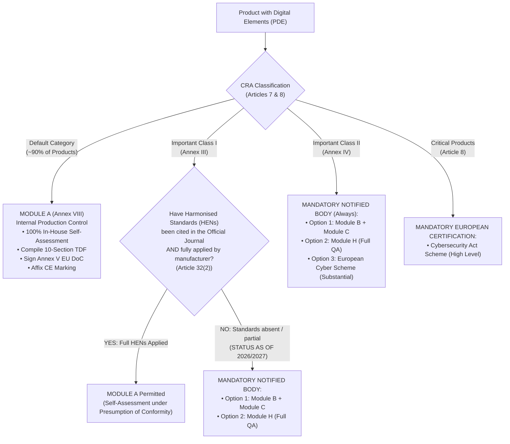
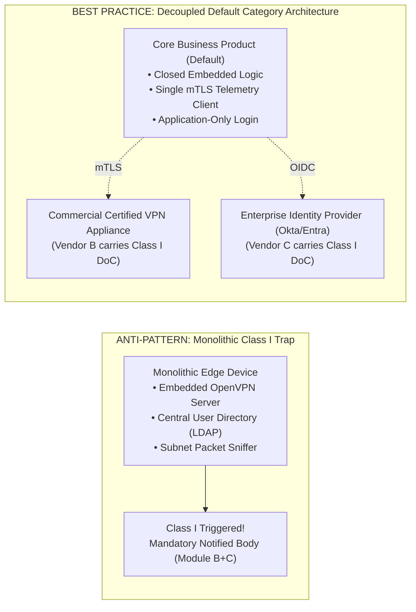

# EU Cyber Resilience Act (CRA) — Regulation (EU) 2024/2847
# Class I & Class II Product Boundary Assessment & Conformity Routing Guide

**Document Reference:** `CRA-CLASS-ASSESS-01`  
**Classification:** Strategic Regulatory Analysis & Architectural Gating Standard  
**Statutory Baseline:** Regulation (EU) 2024/2847, Articles 7, 8, 24, 32; Annex III (Class I), Annex IV (Class II), Annex VIII–XI  
**Guidance References:** Commission Notice C(2026) 5252 final, Commission Implementing Regulation (EU) 2025/2392, EU Blue Guide 2022  
**Target Audience:** Chief Technology Officers, Product Security Architects, Presales Leads, Regulatory Compliance Officers

---

## 1. Executive Summary & Strategic Business Imperative

Under **Regulation (EU) 2024/2847 (Cyber Resilience Act — CRA)**, the risk classification of a Product with Digital Elements (PDE) is the single most critical commercial and technical determination in the product lifecycle.

The regulation creates a **four-tier risk taxonomy**:
1. **Default Category (Standard Products):** ~90% of commercial software, embedded firmware, web platforms, and connected devices.
2. **Important Class I (Annex III):** 18 product categories presenting higher cybersecurity risks (e.g., identity systems, password managers, VPNs, network managers).
3. **Important Class II (Annex IV):** 9 product categories presenting critical cybersecurity risks (e.g., general-purpose OS, enterprise firewalls/IDS, hypervisors, secure elements, industrial controllers for critical entities).
4. **Critical Products with Digital Elements (Article 8):** Designated high-assurance hardware/software requiring mandatory European Cybersecurity Certification.

```
┌────────────────────────────────────────────────────────────────────────────────────────┐
│                        CRA CONFORMITY ASSESSMENT ROUTING MATRIX                        │
├─────────────────────┬─────────────────────────────────┬────────────────────────────────┤
│   DEFAULT CATEGORY  │     IMPORTANT CLASS I           │      IMPORTANT CLASS II        │
│   (Annex I Baseline)│     (Annex III - 18 Types)      │      (Annex IV - 9 Types)      │
├─────────────────────┼─────────────────────────────────┼────────────────────────────────┤
│      MODULE A       │       MODULE A (Conditional)    │     MANDATORY THIRD-PARTY      │
│  Internal Production│  *Requires Harmonised Standards*│         NOTIFIED BODY          │
│       Control       │               OR                │    • Module B+C (Type Exam)    │
│  (100% In-House)    │    MODULE B+C / MODULE H        │    • Module H (Full QA)        │
│  Cost: €10k - €30k  │   (Mandatory if no standards)   │    Cost: €100k - €250k+        │
│  Lead Time: 0 days  │   Cost: €50k - €150k            │    Lead Time: 6 - 12 Months    │
└─────────────────────┴─────────────────────────────────┴────────────────────────────────┘
```

> [!CAUTION]
> **The Conformity Assessment "Cliff Edge":**  
> An erroneous architectural decision or unvetted feature claim that nudges a product across the boundary from **Default** into **Class I or Class II** instantly triggers:
> 1. **Statutory Disqualification from In-House Module A:** The manufacturer can no longer self-certify compliance.
> 2. **Mandatory Notified Body Engagement:** Direct certification expenses increase by **$500\%\text{--}1000\%$** (€50,000 to €250,000+ per product family).
> 3. **Severe Time-to-Market Delays:** European Notified Bodies face severe capacity shortages; audit queues are projected at **6 to 12 months** ahead of the December 2027 enforcement deadline.
> 4. **Presales Contractual Exposure:** Bidding a Default Category product as Class I, or committing to delivery timelines without Notified Body availability, creates massive breach-of-contract liability.

---

## 2. Statutory Scope & Inventory of Annex III and Annex IV

### 2.1 Annex III — Important Products with Digital Elements (Class I)
Under **Article 7(1)** and **Annex III**, products belonging to the following 18 categories are classified as **Class I**:

1. **Identity management systems** and privileged access management (PAM) software and hardware.
2. **Standalone and embedded browsers**.
3. **Password managers**.
4. **Software that searches for, removes, or quarantines malicious software** (Antivirus, EDR, malware scanners).
5. **Products with digital elements with the function of Virtual Private Network (VPN)**.
6. **Network management systems** (NMS, central network orchestrators).
7. **Network monitoring tools** (network packet sniffers, flow analyzers, enterprise observability platforms).
8. **Security information and event management (SIEM) systems**.
9. **Boot managers** (UEFI bootloaders, standalone boot configuration software).
10. **Public key infrastructure (PKI)** and digital certificate issuance software.
11. **Physical and virtual network interfaces** (NIC drivers, virtual switches, network tunneling adapters).
12. **Operating systems** not covered by Class II (specialized embedded real-time operating systems - RTOS).
13. **Routers, modems** intended for internet connectivity, and switches not covered by Class II.
14. **Microprocessors and microcontrollers** intended for integration into programmable logic controllers and industrial devices not covered by Class II.
15. **Industrial automation and control systems (IACS)** not covered by Class II (e.g., general SCADA, HMIs).
16. **Smart home products with digital elements involving security functionalities** (e.g., smart door locks, security cameras, baby monitors, home alarm systems).
17. **Smart toys** with digital elements featuring social interactive, video/audio recording, or geolocation tracking capabilities.
18. **Personal wearable health devices** (e.g., smart health watches, biometric monitors not classified as medical devices under Regulation (EU) 2017/745).

---

### 2.2 Annex IV — Important Products with Digital Elements (Class II)
Under **Article 7(2)** and **Annex IV**, products belonging to the following 9 categories are classified as **Class II**:

1. **Operating systems for servers, desktops, and mobile devices** (general-purpose operating systems).
2. **Hypervisors and container runtime systems** (Type-1/Type-2 hypervisors, Docker daemon, containerd, Kubernetes nodes).
3. **Public key infrastructure (PKI)** and digital certificate issuance software intended for **qualified trust services** under eIDAS (Regulation (EU) 910/2014).
4. **Firewalls, intrusion detection and prevention systems (IDS/IPS)** intended for industrial or enterprise use.
5. **General-purpose microprocessors** with security functions (e.g., x86/ARM CPUs featuring hardware secure enclaves, TrustZone, or memory encryption).
6. **Microcontrollers with security functions** (e.g., hardware security modules - HSMs, secure elements - SEs, smart cards, TPM chips).
7. **Industrial Automation and Control Systems (IACS) intended for critical entities** under the NIS 2 Directive (Directive (EU) 2022/2555, e.g., energy grids, nuclear, water, healthcare).
8. **Smart meter gateways** and components within smart electricity/gas grids.
9. **Secure elements, smart card chips, and hardware security tokens**.

---

## 3. The 7 High-Risk Boundary Battlegrounds

In commercial product engineering, the majority of classification disputes arise not from dedicated, single-purpose security appliances (which clearly fall into Class I or II), but from **multifunctional enterprise solutions, IoT devices, and edge gateways** that incorporate security features.

```
┌────────────────────────────────────────────────────────────────────────────────────────┐
│                        THE 7 BOUNDARY BATTLEGROUNDS                                    │
├─────────────────────┬─────────────────────────────────┬────────────────────────────────┤
│ 1. IAM vs. Auth     │   2. VPN vs. TLS Tunnel         │   3. NMS vs. Local Management  │
│ 4. OS vs. Firmware  │   5. Smart Home vs. Security    │   6. MCU vs. Secure Element    │
│                     │   7. IACS vs. General Edge IoT  │                                │
└─────────────────────┴─────────────────────────────────┴────────────────────────────────┘
```

---

### Battleground 1: Identity Management (IAM/PAM) vs. Application Authentication
* **Statutory Class I Rule (Annex III Point 1):** "Identity management systems and privileged access management software and hardware."
* **The Boundary Dilemma:** Does an application that provides user login, password hashing, OAuth 2.0 client authentication, or local role-based access control (RBAC) constitute an "Identity Management System"?
* **The Legal Test (Commission Guidance C(2026) 5252, Recital 35):**
  * **Class I (IAM/PAM):** The product's *primary or intended purpose* is to act as an authoritative identity provider (IdP), centralized identity directory (LDAP, Active Directory, Okta-style broker), single sign-on (SSO) gateway, or enterprise privileged credential vault.
  * **Default Category:** An application that simply *authenticates its own users* to grant access to its own discrete application functions (e.g., an ERP login, a CMS admin portal, an edge device web GUI) is **NOT** an IAM/PAM system. Application-level authentication is a mandatory baseline requirement under **Annex I Part I(3)(a)**, not a Class I trigger.

---

### Battleground 2: Virtual Private Network (VPN) vs. Encrypted TLS/SSH Tunnels
* **Statutory Class I Rule (Annex III Point 5):** "Products with digital elements with the function of Virtual Private Network (VPN)."
* **The Boundary Dilemma:** Modern edge devices, microservices, and client software frequently utilize encrypted tunnels (OpenVPN, WireGuard, IPsec, SSH tunneling, mTLS). Does embedding an encrypted tunnel make the product a "VPN"?
* **The Legal Test:**
  * **Class I (VPN):** Products whose intended function is to provide **network-layer extension or routing between remote networks/hosts**, creating a virtualized private subnetwork across public networks (e.g., dedicated VPN client software, enterprise VPN concentrators, IPsec gateways).
  * **Default Category:** Products that establish an encrypted end-to-end transport session (e.g., mTLS to cloud backend, HTTPS client, secure telemetry socket) strictly to transmit their **own operational data** are **NOT** VPNs. The function is secure data transmission in transit (Annex I Part I(3)(b)), not network virtualization.
  * *Architectural Trap:* Providing end-users with generic routing or split-tunneling capabilities to tunnel third-party traffic pushes the product directly into **Class I**.

---

### Battleground 3: Network Management / Monitoring vs. Local Device Management
* **Statutory Class I Rule (Annex III Points 6 & 7):** "Network management systems" and "Network monitoring tools."
* **The Boundary Dilemma:** An IoT gateway or edge controller monitors its own Ethernet interface, reports network telemetry (packet loss, latency) to a cloud dashboard, and allows an admin to configure its static IP address. Does this constitute an NMS or Network Monitoring Tool?
* **The Legal Test:**
  * **Class I (NMS / Monitoring):** Systems designed to **manage, configure, orchestrate, or monitor third-party network devices, external network topology, or network-wide traffic flows** (e.g., Cisco DNA Center, SolarWinds, Wireshark, Zeek, SNMP managers).
  * **Default Category:** A device that provides local network configuration for its **own interfaces** (e.g., setting device IP, DNS, Wi-Fi SSID via a web page) or monitors its own link status is **NOT** a Network Management System.

---

### Battleground 4: Operating System vs. Embedded Firmware / Application Runtime
* **Statutory Rules:**
  * **Class II (Annex IV Point 1):** General-purpose operating systems for servers, desktops, mobile devices.
  * **Class I (Annex III Point 12):** Operating systems not covered by Class II (e.g., standalone embedded RTOS distributed for third-party programming).
* **The Boundary Dilemma:** A manufacturer builds an embedded edge device running a customized Linux kernel (Yocto / Buildroot) and a proprietary application. Is the manufacturer subject to Class I or Class II as an "Operating System vendor"?
* **The Legal Test:**
  * **Class II:** Commercial distributions of general-purpose OS marketed as platforms for end-users to install arbitrary third-party software (e.g., Ubuntu, RHEL, Windows, Android).
  * **Class I:** Standalone RTOS or embedded OS licensed as a commercial software product to third-party developers (e.g., VxWorks, QNX, FreeRTOS commercial distribution).
  * **Default Category:** An embedded Linux system or firmware image that is **tightly integrated, closed, and compiled solely to execute the manufacturer's dedicated application software** is legally assessed as a single integrated **Product with Digital Elements (Default Category)**, provided third-party arbitrary application execution is locked out.

---

### Battleground 5: Smart Home Connected Devices vs. "Smart Home Security Functionality"
* **Statutory Class I Rule (Annex III Point 16):** "Smart home products with digital elements involving security functionalities, such as smart door locks, security cameras, baby monitors, and home alarm systems."
* **The Boundary Dilemma:** A smart home energy monitor, connected light bulb, or smart thermostat has cloud connectivity and remote control. Is it Class I?
* **The Legal Test:**
  * **Class I:** Devices whose intended purpose involves **physical security, access control, surveillance, or intrusion detection of the home environment** (door locks, surveillance cameras, motion alarms, window sensors, baby monitors).
  * **Default Category:** Connected domestic devices whose function relates to energy, comfort, entertainment, or cleaning (smart plugs, thermostats, lighting, robot vacuums, coffee machines) remain in the **Default Category**, even though they possess digital connectivity.

---

### Battleground 6: Microcontrollers (MCUs) vs. Microcontrollers with Security Functions (HSMs/SEs)
* **Statutory Rules:**
  * **Class I (Annex III Point 14):** Microprocessors and microcontrollers intended for integration into PLCs and industrial devices.
  * **Class II (Annex IV Point 6):** Microcontrollers with security functions (e.g., Secure Elements, HSMs).
* **The Boundary Dilemma:** An OEM selects an STM32 or ESP32 microcontroller with hardware AES acceleration or secure boot. Does this MCU classify as Class II?
* **The Legal Test:**
  * **Class II (Annex IV Point 6):** Silicon chips whose primary commercial function is **hardware cryptographic isolation, secure key storage, or cryptographic identity tokening** (e.g., NXP SE050, Microchip ATECC608, smart card chips, dedicated TPMs).
  * **Class I (Annex III Point 14):** MCUs marketed specifically for integration into industrial automation / PLCs.
  * **Default Category:** General-purpose MCUs with standard hardware crypto accelerators integrated into non-industrial commercial products.

---

### Battleground 7: Industrial Automation Control Systems (IACS) vs. General Edge IoT
* **Statutory Rules:**
  * **Class II (Annex IV Point 7):** IACS intended for critical entities under the NIS 2 Directive.
  * **Class I (Annex III Point 15):** IACS not covered by Class II.
* **The Boundary Dilemma:** An IoT gateway collects sensor data from a factory floor and pushes it to an Azure IoT cloud. Does it constitute an IACS?
* **The Legal Test:**
  * **Class I / II (IACS):** Systems that participate directly in the **closed-loop control, actuation, safety interlocking, or operational monitoring of physical industrial processes** (PLCs, RTUs, DCS, SCADA servers).
  * **Default Category:** Read-only IoT telemetry gateways, predictive maintenance edge devices, and environmental sensors that do not actuate or control industrial automation processes.

---

## 4. The Conformity Assessment Routing Engine (Article 32)

Once a product's classification is determined, the manufacturer must navigate the statutory conformity assessment routes:



---

### 4.1 Detailed Conformity Procedure Comparison

| Conformity Assessment Module | Legal Basis | Applicable Product Tiers | Role of Notified Body | Manufacturer Responsibilities | Financial & Schedule Impact |
|---|---|---|:---:|---|---|
| **Module A (Internal Production Control)** | Annex VIII | **Default Category**<br/>*(and Class I only if full HENs applied)* | **NONE** (0%) | 1. Carry out Art 13(2) risk assessment.<br/>2. Compile 10-section Annex VII TDF.<br/>3. Maintain internal production control.<br/>4. Issue Annex V EU DoC & CE Mark. | **Low Cost:** €10,000 – €30,000 (Internal)<br/>**Lead Time:** Immediate / Continuous CI/CD |
| **Module B + Module C (EU-Type Examination + Conformity to Type)** | Annex IX & Annex X | **Class I** *(mandatory if no HENs)*<br/>**Class II** *(standard route)* | **MANDATORY**<br/>(Issues EU-Type Certificate) | 1. Submit TDF and sample unit to Notified Body.<br/>2. Undergo laboratory vulnerability testing.<br/>3. Maintain internal manufacturing control.<br/>4. Affix CE Mark with Notified Body ID. | **High Cost:** €60,000 – €180,000 per product<br/>**Lead Time:** 6 – 9 Months testing backlog |
| **Module H (Full Quality Assurance)** | Annex XI | **Class I**<br/>**Class II**<br/>*(recommended for multi-product lines)* | **MANDATORY**<br/>(Audits corporate QMS & SDLC) | 1. Implement audited secure SDLC (ISO 27001 + IEC 62443-4-1).<br/>2. Notified Body audits engineering organization.<br/>3. Continuous surveillance audits every 12–24m. | **Very High Initial Cost:** €120,000 – €250,000<br/>**Lead Time:** 9 – 12 Months initial certification<br/>*Advantage: Faster subsequent product releases* |
| **European Cybersecurity Certification Scheme** | Reg (EU) 2019/881, Art 32(3)(b) | **Class II**<br/>**Critical Products** | **MANDATORY**<br/>(Accredited Certification Body) | Full evaluation under EUCC scheme at assurance level 'substantial' or 'high'. | **Extreme Cost:** €200,000 – €500,000+<br/>**Lead Time:** 12 – 18 Months |

---

## 5. The "Harmonised Standards Cliff" & 2026/2027 Reality

> [!IMPORTANT]
> **The Statutory Trap in Article 32(2):**  
> Under Article 32(2)(a), a manufacturer of a **Class I** product may only utilize **Module A** if it has applied:
> * Harmonised standards whose references have been published in the Official Journal of the European Union (OJEU) covering **all essential requirements of Annex I**, OR
> * Common specifications adopted by the Commission covering all essential requirements.
>
> **The Real-World Reality as of October 2026:**  
> European Standardisation Request **M/60x** is in progress across CEN, CENELEC, and ETSI. **No harmonised European standard has yet been cited in the OJEU for the CRA.**  
> **Consequence:** Until harmonised standards are officially cited in the OJEU, **EVERY Class I product placed on the market must undergo third-party conformity assessment by a Notified Body (Module B+C or Module H)!**

---

## 6. Architectural De-Scoping Strategies (Staying in Default Category)

To avoid Notified Body bottlenecks, solution architects should employ **architectural de-scoping** to keep products safely within the **Default Category**:



### 6.1 Architectural Rules for De-Scoping:
1. **Rule 1: Eliminate Inbound Network Routing & Generic VPNs:**
   * *Anti-Pattern:* Embedding a configurable WireGuard/OpenVPN server that routes traffic for other devices on the customer LAN.
   * *Compliant Alternative:* Replace with an outbound-only, hardened mTLS connection connecting strictly to the product's own backend. If VPN is required, instruct the customer to deploy an external, certified VPN appliance.
2. **Rule 2: Outsource Central Identity to Standard Protocols (OIDC/SAML):**
   * *Anti-Pattern:* Building a user management database that issues credentials for third-party systems or acts as an LDAP server.
   * *Compliant Alternative:* Support OpenID Connect (OIDC) / SAML 2.0 to delegate identity to external IdPs. Only retain local application-level authorization.
3. **Rule 3: Enclose and Lock Down Embedded Firmware:**
   * *Anti-Pattern:* Providing a Linux terminal / SSH shell where customers can compile or execute arbitrary software.
   * *Compliant Alternative:* Remove build tools, disable SSH in production, enforce secure boot with cryptographic signature checks, and expose only a constrained REST/gRPC API.
4. **Rule 4: Demarcate Telemetry from Network Monitoring:**
   * *Anti-Pattern:* Offering network packet capture (pcap) or promiscuous LAN inspection in the product GUI.
   * *Compliant Alternative:* Restrict diagnostic logging to the product's own application sockets and internal event logs.

---

## 7. Presales & Bidding Decision Matrix

Presales and Solution Consulting teams must execute the following screening before submitting commercial proposals:

| Bidding Scenario | Customer Requirement / Proposal Scope | Risk Classification | Statutory Conformity Route | Commercial Action Required |
|---|---|:---:|:---:|---|
| **Scenario A** | Pure application software (CRM, ERP, CMS) with cloud SaaS backend. | **Default** | **Module A** (In-house) | Standard bid pricing. No Notified Body timeline required. |
| **Scenario B** | Edge IoT controller with local web UI for motor control and telemetry. | **Default** | **Module A** (In-house) | Ensure firmware is closed; no third-party network routing features enabled. |
| **Scenario C** | Edge gateway bidding client-requested embedded OpenVPN server for LAN access. | **Class I** *(Annex III(5))* | **Module B+C / H** *(Notified Body)* | **RED FLAG:** Add €80,000 certification buffer and 9-month schedule margin OR descope VPN feature. |
| **Scenario D** | Network switch with web console for small business office. | **Class I** *(Annex III(13))* | **Module B+C / H** *(Notified Body)* | Third-party Notified Body mandatory unless full HENs published and applied. |
| **Scenario E** | Industrial edge device with embedded enterprise firewall / DPI engine. | **Class II** *(Annex IV(4))* | **Module B+C / H** *(Always Notified Body)* | **CRITICAL RISK:** Mandate executive approval; verify Notified Body contract before bid submission. |
| **Scenario F** | Cloud-managed camera for home nursery / baby monitoring. | **Class I** *(Annex III(16))* | **Module B+C / H** *(Notified Body)* | Smart home security classification triggered. Notified Body mandatory. |

---

## 8. Enterprise Classification Governance RACI

| Role | Key Responsibility in Product Classification |
|---|---|
| **Lead Solution Architect** | Maps functional requirements against Annex III/IV categories; implements architectural de-scoping patterns. |
| **Product Security Architect** | Validates threat models and confirms that application security controls do not cross into Class I/II boundaries. |
| **Presales / Bid Director** | Executes presales classification screening gate; ensures Notified Body fees and timelines are priced into contracts. |
| **Compliance Officer / Legal** | Reviews intended purpose statements and marketing datasheets to ensure no inadvertent Class I/II claims are made. |
| **Chief Technology Officer** | Formal sign-off on product risk tier and approval of Notified Body conformity contracts. |
