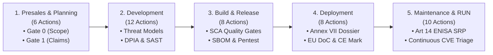

# EU Cyber Resilience Act (CRA) — Regulation (EU) 2024/2847
## Compliance Requirements & Security Tool Coverage Matrix

A comprehensive, audit-ready Excel workbook has been engineered and delivered to the workspace:
📁 **[CRA_Compliance_Requirements_and_Security_Tool_Coverage_Matrix.xlsx](file:///root/CRA-Compliance/CRA_Compliance_Requirements_and_Security_Tool_Coverage_Matrix.xlsx)** *(84.8 KB)*

---

### Executive Overview & Regulatory Baseline

The workbook provides an exhaustive, traceable compliance baseline for a **standard commercial product with digital elements (PDE)** placed on the European Union single market under **Regulation (EU) 2024/2847 (Cyber Resilience Act — CRA)**, published in the Official Journal on 20 November 2024 ([OJ L, 2024/2847](https://eur-lex.europa.eu/eli/reg/2024/2847/oj)).

```
┌────────────────────────────────────────────────────────────────────────────────────────┐
│                        CRA STATUTORY ENFORCEMENT TIMELINE                              │
├─────────────────────┬─────────────────────────────────┬────────────────────────────────┤
│   10 December 2024  │       11 September 2026         │        11 December 2027        │
│   Entry into Force  │    ARTICLE 14 REPORTING LIVE    │       GENERAL APPLICATION      │
│  (20 days post-OJ)  │   ENISA SRP & National CSIRTs   │    Annex I Essential Reqs,     │
│                     │   (Mandatory & Active Right Now)│   CE Marking & Conformity (DoC)│
└─────────────────────┴─────────────────────────────────┴────────────────────────────────┘
```

> [!IMPORTANT]
> **Article 14 Reporting is Live Today:** As of our current review date (**October 2026**), the statutory obligations under **Article 14 (reporting of actively exploited vulnerabilities and severe incidents to the designated CSIRT coordinator and ENISA)** have been **fully active and legally enforceable since 11 September 2026**. This duty applies retroactively to all products currently made available on the EU market, irrespective of declared support periods.

---

### Workbook Architecture & Sheet Guide

The workbook is structured into **six integrated worksheets**, featuring structured Excel tables, auto-filters, frozen panes, custom typography (`Segoe UI`), status color coding, data validation dropdowns, and dynamic Excel formulas (`COUNTIF`, `COUNTA`, `AVERAGE`).

```
CRA_Compliance_Requirements_and_Security_Tool_Coverage_Matrix.xlsx
├── [0] Executive Dashboard            ── Summary KPIs, Tool Scorecard, Lifecycle Rollup & Recommendations
├── [1] CRA Requirements Matrix        ── 43 Traceable Legal Obligations across 31 Standardized Columns
├── [2] Tool Coverage Summary          ── Table A (10 Tool Profiles) & Table B (Quantitative Coverage Formulas)
├── [3] Lifecycle Control Mapping      ── 44 Operational Actions & Gates across 5 Lifecycle Phases
├── [4] Compliance Gaps & Roadmap      ── 20 Residual Non-Tool Governance, Legal & Policy Gaps
└── [5] Sources and Assumptions        ── Legal Registers, Standards Status, Assumptions & Uncertainties
```

---

### Sheet 1 — CRA Requirements Matrix (31 Columns)

The matrix identifies **43 independently assessable regulatory obligations** across Annex I (Parts I & II), Chapter II (Manufacturer & Economic Operator Obligations), and Chapters III–IV (Conformity Assessment & CE Marking).

#### Structure & Data Fields:
* **Identification & Legal Intent:** Requirement ID (`CRA-REQ-GEN-01` to `CRA-REQ-SUP-01`), exact CRA legal citation, title, legal intent, and requirement type (*Product cybersecurity, Vulnerability handling, Documentation, Conformity assessment, Reporting, Governance*).
* **Scope & Governance:** Applicability classification (*Mandatory, Conditional, Not Applicable* with statutory justification), responsible organizational stakeholder, and binary applicability across the 5 lifecycle phases.
* **Engineering Guidance:** Technical implementation guidance, recommended technical & organisational controls, required compliance deliverables, and formal verification / acceptance criteria.
* **Security Tool & Activity Coverage (Columns 17–26):** Granular assessment of all 10 requested tools/activities using standardized ratings:
  * **Full:** Direct principal technical evidence within scope (subject to validation and configuration).
  * **Partial:** Supporting evidence; requires complementary controls, manual processes, or documentation.
  * **None:** No direct material technical contribution to satisfying the obligation.
* **Residual Analysis & Traceability:** Tool coverage limitations and assumptions, additional controls required, remediation priority (*Critical, High, Medium, Low*), official EUR-Lex hyperlink, and product-specific applicability considerations.

---

### Sheet 2 — Tool Coverage Summary & Quantitative Metrics

Evaluates the actual capabilities of the **10 required security tools and activities** against the 43 CRA requirements without vendor marketing inflation:

#### Quantitative Toolchain Coverage Scorecard (Calculated via Excel Formulas):

| Tool / Activity | Tool Category / Operating Model | Total Reqs | Full Coverage | Full % | Partial Coverage | Partial % | Direct Tech Contribution % | None % (Residual Gap) | Primary Lifecycle Focus |
|:---|:---|:---:|:---:|:---:|:---:|:---:|:---:|:---:|:---|
| **Threat Analysis & Risk Analysis (TARA)** | Security Architecture & Threat Modeling Process | 43 | **4** | **9.3%** | **16** | **37.2%** | **46.5%** | 53.5% | Planning, Design, RUN |
| **Penetration Testing** | Offensive Security Assessment / Ethical Hacking | 43 | **4** | **9.3%** | **14** | **32.6%** | **41.9%** | 58.1% | Dev, Build, RUN |
| **Nessus / Cyberwatch** | Infrastructure, Network & Host Vuln Scanner | 43 | **3** | **7.0%** | **9** | **20.9%** | **27.9%** | 72.1% | Build, Deploy, RUN |
| **Coverity** | Deep Static Application Security Testing (SAST) | 43 | **1** | **2.3%** | **9** | **20.9%** | **23.3%** | 76.7% | Development, Build |
| **SonarQube** | SAST & Clean Code Quality Platform | 43 | **0** | **0.0%** | **10** | **23.3%** | **23.3%** | 76.7% | Development, Build |
| **OWASP ZAP / Burp Suite** | Dynamic Application Security Testing (DAST) | 43 | **1** | **2.3%** | **9** | **20.9%** | **23.3%** | 76.7% | Dev, Build, Deploy |
| **Black Duck** | Enterprise SCA & Binary Analysis Platform | 43 | **3** | **7.0%** | **6** | **14.0%** | **20.9%** | 79.1% | Dev, Build, RUN |
| **Data Protection Impact Assessment (DPIA)** | GDPR Art 35 Privacy Governance Process | 43 | **2** | **4.7%** | **7** | **16.3%** | **20.9%** | 79.1% | Planning, Development |
| **Dependency-Track** | Continuous SBOM Ingestion & Post-Market Vuln Tracking | 43 | **2** | **4.7%** | **6** | **14.0%** | **18.6%** | 81.4% | Build, Deploy, RUN |
| **Nexus IQ Lifecycle / CLM** | Software Composition Analysis (SCA) & Policy Engine | 43 | **2** | **4.7%** | **6** | **14.0%** | **18.6%** | 81.4% | Development, Build, RUN |
| **Toolchain Portfolio Average** | *Integrated Multi-Layered Defense-in-Depth* | **43** | **2.2** | **5.1%** | **9.9** | **23.0%** | **28.1%** | **71.9%** | *Full Product Lifecycle* |

> [!NOTE]
> **Methodology & Counting Rule:** The denominator ($N=43$) represents all applicable obligations under the CRA baseline. Non-applicable requirements are excluded. Direct Technical Contribution is calculated as $\frac{\text{Full} + \text{Partial}}{\text{Total}}$.

#### Key Analytical Conclusions on Tool Coverage:
1. **No Tool Exceeds 10% Full Coverage:** Individual software products only directly satisfy 2 to 4 requirements in isolation (e.g., Black Duck / Dependency-Track for SBOMs, Coverity for memory safety, Nessus for CIS hardening).
2. **Processes Outperform Automated Scanners:** Threat Modeling / TARA (46.5%) and Penetration Testing (41.9%) deliver the highest coverage because they evaluate architectural design intent, attack chains, and business logic that scanners cannot inspect.
3. **The 72% Governance Gap:** On average, 71.9% of CRA requirements evaluate to **None** across individual technical tools. Over half of the regulation governs corporate policies, statutory incident reporting, support-period commitments, technical documentation dossiers, and CE marking.

---

### Sheet 3 — Lifecycle Control Mapping (5 Phases)

Maps CRA requirements to **44 discrete operational security actions and control gates** across the product lifecycle:



* **Presales & Planning:** Scope and economic operator determination, tier classification (Default vs Important Class I/II), guaranteed support period modeling (min. 5 years), marketing claims gating, supplier screening, and concept risk assessments.
* **Development:** Detailed STRIDE/PASTA threat models, IAM/RBAC enforcement, cryptographic protection (TLS 1.3, KMS), DPIA data minimisation, secure defaults, interface pruning, compiler exploit mitigations (`checksec`), logging, and CVD setup.
* **Build & Release:** Machine-readable SBOM generation (CycloneDX/SPDX), SCA quality gates, SAST deep analysis, HSM code signing (SLSA provenance), container scanning, DAST API scans, pre-release pentesting, and Change Advisory Board (CAB) substantial modification screening.
* **Deployment & Delivery:** Annex VII technical documentation dossier assembly, conformity assessment procedure (Module A vs B+C/H), EU Declaration of Conformity (DoC) signing, CE marking affixation, Annex II user instructions delivery, authenticated distribution channels, and 10-year compliance vault deposit.
* **Maintenance & RUN:** Continuous post-market CVE correlation across all fielded versions (Dependency-Track), live Article 14 ENISA SRP notifications (24h/72h/14d/1mo), customer emergency advisories, free security patches, CSAF 2.0 advisories, and 10-year patch archiving.

---

### Sheet 4 — Compliance Gaps & Remediation Roadmap

Identifies **20 critical compliance gaps** that cannot be solved by the security toolchain alone, establishing an operational remediation roadmap:

```
┌────────────────────────────────────────────────────────────────────────────────────────┐
│                        TOP COMPLIANCE GAPS REQUIRING ACTION                            │
├──────────────┬──────────────────┬──────────────────────────────────────────┬───────────┤
│ Gap ID       │ CRA Obligation   │ Nature of Gap & Required Action          │ Priority  │
├──────────────┼──────────────────┼──────────────────────────────────────────┼───────────┤
│ CRA-GAP-REP-01│ Art 14(1)–(3)    │ 24h / 72h / 14d ENISA SRP Exploit Filing │ CRITICAL  │
│ CRA-GAP-REP-02│ Art 14(3)–(5)    │ 24h / 72h / 1mo Severe Incident Reporting│ CRITICAL  │
│ CRA-GAP-REP-03│ Art 14(8)        │ Customer Emergency Advisory Broadcast    │ CRITICAL  │
│ CRA-GAP-GOV-01│ Art 13(8)        │ 5-Year Guaranteed Support Period Policy  │ CRITICAL  │
│ CRA-GAP-DOC-01│ Art 13(11), 31   │ Annex VII Technical Documentation Dossier│ CRITICAL  │
│ CRA-GAP-CONF-01│ Art 7, 8, 32    │ Important Class I/II Notified Body Route │ CRITICAL  │
│ CRA-GAP-CONF-02│ Art 13(13), 28   │ Executive EU Declaration of Conformity   │ CRITICAL  │
│ CRA-GAP-TECH-01│ Annex I Part II(7)│ HSM-Backed Cryptographic Code Signing    │ CRITICAL  │
│ CRA-GAP-GOV-02│ Annex I Part II(5)│ ISO/IEC 29147 CVD Policy & Safe Harbor   │ HIGH      │
│ CRA-GAP-GOV-03│ Annex I Part II(6)│ RFC 9116 security.txt & Intake Inbox     │ HIGH      │
│ CRA-GAP-GOV-04│ Art 13(9)        │ 10-Year Immutable Patch Archive (WORM)   │ HIGH      │
│ CRA-GAP-GOV-05│ Annex I Part II(8)│ Free Patches Decoupled from Paid Features│ HIGH      │
│ CRA-GAP-DOC-02│ Annex II         │ Customer Security & Hardening Guide      │ HIGH      │
│ CRA-GAP-CONF-03│ Art 13(15)–(17)  │ CE Mark & Traceability Labeling (>=5mm)  │ HIGH      │
│ CRA-GAP-CONF-04│ Art 3(30), 21    │ CAB Substantial Modification Gating      │ HIGH      │
└──────────────┴──────────────────┴──────────────────────────────────────────┴───────────┘
```

---

### Sheet 5 — Sources and Assumptions

Documents the legal and technical foundation of the analysis:

1. **Official Legal Instruments:**
   * **Regulation (EU) 2024/2847 (CRA):** [OJ L, 2024/2847, 20.11.2024](https://eur-lex.europa.eu/legal-content/EN/TXT/?uri=OJ:L_202402847).
   * **Corrigendum to CRA:** [OJ L, 2024/90782, 05.12.2024](https://eur-lex.europa.eu/legal-content/EN/TXT/?uri=OJ:L_202490782) (correcting Art 64 fine cross-references).
   * **Implementing Regulation (EU) 2025/2392:** [OJ L, 2025/2392, 01.12.2025](https://eur-lex.europa.eu/legal-content/EN/TXT/?uri=OJ:L_202502392) (technical descriptions for Important/Critical PDEs).
   * **Delegated Regulation (EU) 2026/881:** [OJ L, 2026/881, 20.04.2026](https://eur-lex.europa.eu/legal-content/EN/TXT/?uri=OJ:L_202600881) (procedural conditions for delayed dissemination).
2. **Authoritative Interpretative Guidance:**
   * **Commission Guidance C(2026) 5252 final (Annex):** Primary notice on standalone software, substantial modifications, support periods, and component integration.
   * **Commission CRA Implementation FAQs (v13):** Guidance on open-source stewardship, tailor-made software, and cloud boundaries.
   * **EU Blue Guide 2022 (Notice 2022/C 247/01):** Horizontal rules on placing vs making available on the market.
3. **Harmonised Standards Verification:**
   * **Standardisation Request M/60x:** Issued to CEN, CENELEC, and ETSI.
   * **Status Verified:** **NO standard is currently harmonised under the CRA as of October 2026.** No standard confers statutory *Presumption of Conformity* (Article 24) until cited in the Official Journal.
   * **State-of-the-Art Benchmarks:** EN 50742 / ETSI EN 303 645 (IoT), IEC 62443-4-1/-4-2 (Industrial/Embedded), ISO/IEC 29147 & 30111 (CVD/Vulnerability Handling), ISO/IEC 27001 (ISMS), and OWASP ASVS/SAMM.
4. **Baseline Product Assumptions:**
   * Standard commercial PDE placed on the EU market under manufacturer brand.
   * Remote Data Processing Solutions (RDPS) developed by the manufacturer without which the product cannot function are strictly in scope (Article 3(2)).
   * Bespoke / tailor-made software is fully in scope; only two narrow contractual deviations are permitted under Recital 64 (secure defaults and free updates).

---

### Recommended Next Steps for Compliance Leadership

1. **Download & Distribute the Matrix:** Provide [CRA_Compliance_Requirements_and_Security_Tool_Coverage_Matrix.xlsx](file:///root/CRA-Compliance/CRA_Compliance_Requirements_and_Security_Tool_Coverage_Matrix.xlsx) to Product Security Architects, Engineering Leads, and Compliance Officers.
2. **Operationalize Article 14 Today:** If not already active, immediately provision organizational accounts on the **ENISA Single Reporting Platform** (`portal.cra-srp.enisa.europa.eu`) with hardware FIDO2 credentials and train the PSIRT on 24-hour notification triggers.
3. **Formalize the 5-Year Support Commitment:** Coordinate with Product Management and Finance to publish the guaranteed calendar end-of-support date on customer datasheets and allocate sustaining engineering reserves.
4. **Audit CI/CD for Machine-Readable SBOMs:** Ensure that every build generates a cryptographically signed CycloneDX v1.5+ or SPDX v2.3+ SBOM ingested directly into Dependency-Track or Black Duck for continuous post-market monitoring.