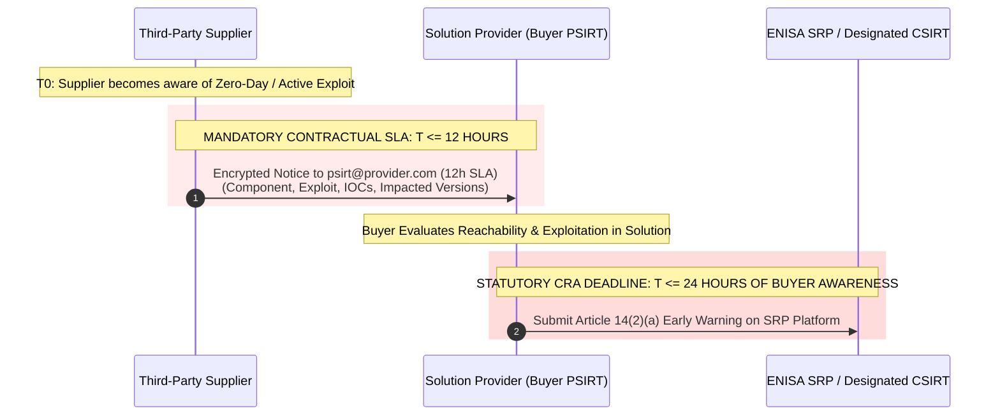

# EU Cyber Resilience Act (Regulation (EU) 2024/2847)
# Phase 2: Master Contractual Templates & Supply-Chain Addenda

**Document Classification:** Legal & Commercial Standard Contract Documentation  
**Governing Regulation:** Regulation (EU) 2024/2847 (Cyber Resilience Act - CRA)  
**Target Instruments:** B2B Master Services Agreements (MSAs), Statements of Work (SOWs), Software Licensing Agreements, and Upstream Procurement Contracts  
**Effective Date:** Harmonized for immediate Phase 1 reporting duties (Article 14 live since 11 September 2026) and Phase 2 contractual gating ahead of general application (11 December 2027)  
**Version:** 1.0 (Audit-Ready)

---

## Table of Contents
1. [Regulatory Purpose & Contractual Strategy](#1-regulatory-purpose--contractual-strategy)
2. [Schedule A: B2B Customer Cybersecurity & CRA Compliance Addendum](#2-schedule-a-b2b-customer-cybersecurity--cra-compliance-addendum)
   - Article 1: Definitions & Regulatory Hierarchy
   - Article 2: Demarcation of Statutory Roles & Intended Purpose
   - Article 3: Support Period & Vulnerability-Handling Commitments
   - Article 4: Delivery and Pricing of Security Updates (Annex I Part II Point (8))
   - Article 5: Customer Operational Responsibilities & Patching Covenants
   - Article 6: Incident & Exploited Vulnerability Communications (Article 14(8))
   - Article 7: Customer Modifications & Substantial Modification Allocation (Article 22)
   - Article 8: Warranties, Limitation of Liability & Regulatory Carve-Outs
   - Article 9: End of Support (EOS), Decommissioning & Data Retention
3. [Schedule B: Upstream Supplier & Subcontractor Cybersecurity Flow-Down Addendum](#3-schedule-b-upstream-supplier--subcontractor-cybersecurity-flow-down-addendum)
   - Section 1: Component Due Diligence & Vulnerability-Free Delivery (Article 13(5))
   - Section 2: Mandatory Machine-Readable SBOM Delivery (CycloneDX / SPDX)
   - Section 3: The 12-Hour Critical Vulnerability & Incident Notification SLA
   - Section 4: Component Support Period Alignment & Patch Remediation SLAs
   - Section 5: Upstream Vulnerability Reporting (Article 13(6))
   - Section 6: Audit Rights, Testing Verification & Market Surveillance Cooperation (Article 53)
   - Section 7: Indemnification for Regulatory Fines & Non-Compliance
4. [Schedule C: Tailor-Made & Bespoke B2B Software Maintenance Terms](#4-schedule-c-tailor-made--bespoke-b2b-software-maintenance-terms)
5. [Standard Exhibits & Operational Annexes](#5-standard-exhibits--operational-annexes)
   - Exhibit 1: Product Support Period Declaration Statement (Annex II Point 7)
   - Exhibit 2: Supplier SBOM Delivery & Acceptance Specification
   - Exhibit 3: Article 14 24/7 Security Contact & PGP Directory

---

## 1. Regulatory Purpose & Contractual Strategy

### 1.1 The Legal Imperative
Under Regulation (EU) 2024/2847 (Cyber Resilience Act), cybersecurity obligations can no longer be disclaimed through boilerplate "AS IS" or "WITHOUT WARRANTY OF ANY KIND" clauses. The CRA establishes non-waivable statutory duties on manufacturers, importers, distributors, and integrators.

For a **Solution Provider**, contract architecture serves two vital commercial functions:
1. **Downstream (Customer-Facing)**: Defending revenue and bounding liability. It prevents the provider from being treated as an open-ended insurer of customer operational environments, establishes legal boundaries for the declared support period, obligates customers to install security updates without delay, and protects against statutory manufacturer reclassification under Article 22 when customers modify solutions.
2. **Upstream (Supplier-Facing)**: Flowing down statutory exposure. Because Article 14 imposes strict **24-hour Early Warning** and **72-hour Notification** deadlines on our organization, third-party component vendors must be bound by a strict **12-hour notification SLA** to preserve the Solution Provider's compliance buffer.

---

## 2. Schedule A: B2B Customer Cybersecurity & CRA Compliance Addendum

*(To be incorporated as a mandatory Schedule to Master Services Agreements, Software Licenses, and Managed Solutions SOWs)*

### PREAMBLE & RECITALS
This Cyber Resilience Act Compliance Addendum (the **"CRA Addendum"**) is entered into by and between **[Solution Provider Entity Name]** (**"Provider"**) and **[Customer Entity Name]** (**"Customer"**) and supplements the Master Services Agreement dated **[Date]** (the **"Agreement"**).

**WHEREAS**, Provider supplies products with digital elements, software packages, firmware, hardware appliances, and integrated technical solutions (the **"Deliverables"**); and  
**WHEREAS**, Regulation (EU) 2024/2847 of the European Parliament and of the Council (the **"Cyber Resilience Act"** or **"CRA"**) establishes statutory essential cybersecurity requirements and vulnerability-handling obligations throughout the lifecycle of products with digital elements made available on the European Union market;  
**NOW, THEREFORE**, the parties agree as follows:

---

### ARTICLE 1: DEFINITIONS & REGULATORY HIERARCHY

1.1 **"Cyber Resilience Act" or "CRA"** means Regulation (EU) 2024/2847 of the European Parliament and of the Council of 23 October 2024 on horizontal cybersecurity requirements for products with digital elements.  
1.2 **"Product with Digital Elements" ("PDE")** has the meaning assigned in Article 3(1) of the CRA, encompassing any software or hardware product and its remote data processing solutions, including software or hardware components being placed on the market separately.  
1.3 **"Remote Data Processing Solution" ("RDPS")** has the meaning assigned in Article 3(2) of the CRA, covering cloud-based data processing developed or controlled by Provider and whose processing is indispensable for the PDE to perform its core functions.  
1.4 **"Support Period"** means the definite period declared by Provider pursuant to Article 13(8) and Annex II of the CRA, during which Provider ensures that vulnerabilities of the PDE are handled effectively in accordance with Annex I Part II of the CRA.  
1.5 **"Security Update"** means an update, patch, hotfix, or new minor release intended to address, mitigate, or eliminate cybersecurity vulnerabilities in the Deliverables.  
1.6 **"Substantial Modification"** has the meaning set forth in Article 3(30) of the CRA, meaning a change to the PDE following its placing on the market which affects the compliance of the PDE with the essential requirements or results in a modification to the intended purpose for which the PDE has been assessed.  
1.7 **"Actively Exploited Vulnerability"** has the meaning set forth in Article 3(42) of the CRA.  
1.8 **"Severe Incident"** has the meaning set forth in Article 14(5) of the CRA.

---

### ARTICLE 2: DEMARCATION OF STATUTORY ROLES & INTENDED PURPOSE

2.1 **Intended Purpose Specification**: Provider supplies the Deliverables solely for the intended purpose, operational parameters, and deployment environment specified in the applicable Statement of Work or User Documentation (**"Intended Purpose"**). Customer covenants that it shall deploy, configure, and operate Deliverables strictly within said Intended Purpose.  
2.2 **Demarcation of Operator Responsibilities**: The parties acknowledge that while Provider bears responsibility under the CRA for the design, development, and vulnerability management of the Deliverable, Customer retains sole operational responsibility for:
- (a) Securing its corporate IT infrastructure, networks, firewalls, and segmentation;
- (b) Managing user access controls, authentication credentials, and privileged accounts;
- (c) Timely deployment and testing of Security Updates made available by Provider; and
- (d) Implementing defense-in-depth controls recommended in Provider's User Documentation.

---

### ARTICLE 3: SUPPORT PERIOD & VULNERABILITY-HANDLING COMMITMENTS

3.1 **Guaranteed Support Period**: Pursuant to CRA Article 13(8) and Annex II Point 7, Provider formally declares the guaranteed Support Period for each Deliverable as specified in **Exhibit 1** attached hereto. In no event shall the Support Period for standard commercial Deliverables be less than **five (5) years** from the initial date of commercial release, unless a shorter period is explicitly justified in Exhibit 1 in compliance with CRA Recital 60 and documented in Provider's technical dossier.  
3.2 **Vulnerability-Handling Standard**: Throughout the declared Support Period, Provider shall maintain an active vulnerability-handling process conforming to CRA Annex I Part II, including:
- (a) Operating a designated point of contact and public Coordinated Vulnerability Disclosure (CVD) process;
- (b) Regularly investigating, remediating, and testing reported vulnerabilities without undue delay;
- (c) Distributing Security Updates separately from functionality updates wherever technically feasible;
- (d) Publishing structured machine-readable security advisories (CSAF 2.0 / CycloneDX VEX).  
3.3 **Archive Retention (Article 13(9))**: Provider covenants that all Security Updates issued during the Support Period shall remain accessible for download by Customer for **at least ten (10) years** after their issuance date or for the remainder of the Support Period, whichever is longer.

---

### ARTICLE 4: DELIVERY AND PRICING OF SECURITY UPDATES (ANNEX I PART II POINT (8))

4.1 **Standard Products — Free of Charge**: In strict compliance with CRA Annex I Part II Point (8), for all standard, off-the-shelf, or multi-tenant commercial Deliverables, Provider shall deliver all Security Updates addressing vulnerabilities **free of charge** to Customer during the Support Period.  
4.2 **No Bundled Feature Requirement**: Provider shall not condition the provision of Security Updates on Customer purchasing new feature licenses, upgrading to higher commercial tiers, or subscribing to premium support tiers.  
4.3 **Bespoke / Custom Software Terms**: Where Deliverables constitute tailor-made, custom software developed exclusively for Customer pursuant to a bespoke SOW, the commercial terms governing ongoing software maintenance, engineering time, and custom patch generation shall be governed by **Schedule C** (Custom Software Maintenance Schedule) attached hereto, in accordance with the permissible B2B exceptions under CRA Article 13(8) and Recital 58.

---

### ARTICLE 5: CUSTOMER OPERATIONAL RESPONSIBILITIES & PATCHING COVENANTS

5.1 **Duty to Apply Security Updates**: Customer acknowledges that unpatched software constitutes an active cybersecurity risk. Customer expressly covenants that upon receiving notice from Provider that a Security Update is available, Customer shall:
- (a) Test and deploy the Security Update within its production environment without undue delay, and in any event within thirty (30) calendar days for Critical/High severity updates;
- (b) Immediately deploy temporary mitigating measures or workarounds published by Provider if immediate patch deployment is delayed due to Customer internal change control; and
- (c) Maintain automated update mechanisms enabled where provided by Provider and technically supported.  
5.2 **Upgrade to Substantially Modified Versions (Article 13(10))**: Pursuant to CRA Article 13(10), Provider reserves the right to deliver vulnerability remediations solely in the form of a Security Update for the latest substantially modified version of the Deliverable, provided that Provider makes such upgraded version available to Customer **free of charge and without additional infrastructure costs**. Customer agrees to upgrade to said version to maintain vulnerability remediation coverage.  
5.3 **Release of Provider Liability**: If Customer fails or refuses to install a Security Update or temporary mitigation made available by Provider, Provider shall be fully relieved of any liability, indemnity, or statutory warranty claim resulting from any cybersecurity breach, exploit, or data loss that would have been prevented by the timely application of said Security Update.

---

### ARTICLE 6: INCIDENT & EXPLOITED VULNERABILITY COMMUNICATIONS (ARTICLE 14(8))

6.1 **Customer Notification Duty**: Pursuant to CRA Article 14(8), in the event that Provider becomes aware of an Actively Exploited Vulnerability or a Severe Incident having an impact on the security of the Deliverable deployed by Customer, Provider shall inform Customer **without undue delay**.  
6.2 **Form of Notification**: Provider shall deliver such notices via:
- (a) Direct secure communication to Customer's designated CISO/Security Contact listed in **Exhibit 3**; and
- (b) Publication of machine-readable advisories in CSAF 2.0 format on Provider's authenticated customer portal.  
6.3 **Confidentiality of Pre-Patch Advisories**: If Provider discloses an actively exploited vulnerability accompanied by compensating workarounds prior to the availability of an official patch, Customer shall treat such technical advisory as **STRICTLY CONFIDENTIAL (TLP:AMBER+STRICT)** and shall not publish or share details with unauthorized third parties until official public disclosure by Provider.  
6.4 **Customer Incident Reporting Assistance**: If Customer experiences an active exploitation or severe incident impacting the Deliverables within Customer's operational network, Customer shall notify Provider's PSIRT within **twenty-four (24) hours** to allow Provider to fulfill its statutory reporting obligations to ENISA and the designated CSIRT coordinator under CRA Article 14.

---

### ARTICLE 7: CUSTOMER MODIFICATIONS & SUBSTANTIAL MODIFICATION ALLOCATION (ARTICLE 22)

7.1 **Prohibition of Unauthorized Code Alteration**: Customer shall not decompile, reverse engineer, modify, patch, or alter the binary code, operating system scripts, or core configuration files of the Deliverables without prior written authorization from Provider.  
7.2 **Statutory Transfer of Manufacturer Role (Article 22)**: Customer expressly acknowledges that under **Article 22 of the CRA**, any person or entity that carries out a **Substantial Modification** to a product with digital elements, or modifies its intended purpose, **shall be considered the statutory Manufacturer** under the CRA for the modified scope.  
7.3 **Indemnification for Customer Modifications**: In the event Customer executes any unauthorized modification, custom integration, or architectural alteration to the Deliverables that:
- (a) Causes the Deliverable to be reclassified under CRA Article 22; or
- (b) Introduces new vulnerabilities or compromises essential CRA requirements;  
Customer shall assume all statutory obligations of a Manufacturer under CRA Articles 13 and 14 for said modifications, and shall indemnify, defend, and hold harmless Provider from any third-party claims, customer disputes, or administrative fines imposed by Market Surveillance Authorities resulting therefrom.

---

### ARTICLE 8: WARRANTIES, LIMITATION OF LIABILITY & REGULATORY CARVE-OUTS

8.1 **Conformity Warranty**: Provider warrants that during the Support Period, Deliverables developed by Provider comply in all material respects with the essential requirements set forth in CRA Annex I, and that Deliverables have been subjected to the applicable conformity assessment procedure required by CRA Article 32.  
8.2 **Disclaimer of Inherent Software Infallibility**: Customer acknowledges that the CRA does not require software to be 100% bug-free. Provider does not warrant that Deliverables will operate entirely uninterrupted or that every vulnerability will be discovered prior to commercial deployment. Provider's sole warranty obligation under the CRA is the rigorous, diligent execution of the vulnerability-handling and reporting processes mandated by Annex I Part II and Article 14.  
8.3 **Cap on Liability**: To the maximum extent permitted by applicable law, Provider's aggregate liability for direct damages arising out of regulatory non-compliance under this Addendum shall not exceed **two times (2x) the total fees paid by Customer under the applicable SOW in the twelve (12) months preceding the claim**.  
8.4 **Regulatory Fines Exclusion**: Neither party shall be liable to the other for any administrative fines imposed by EU Market Surveillance Authorities under CRA Article 64, which shall remain the sole non-delegable responsibility of the party upon whom such fines are lawfully assessed.

---

### ARTICLE 9: END OF SUPPORT (EOS), DECOMMISSIONING & DATA RETENTION

9.1 **End of Support Notice (Article 13(19))**: Provider shall provide Customer with written notice of the approaching End of Support date at least **six (6) months** prior to the expiration of the Support Period specified in Exhibit 1.  
9.2 **Termination of Vulnerability Handling**: Upon the expiration of the declared Support Period:
- (a) Provider's obligation to develop and distribute new Security Updates under Annex I Part II shall terminate;
- (b) Customer may continue running the Deliverables at Customer's sole operational risk; and
- (c) Provider shall maintain published Security Updates in its public or authenticated archives for the 10-year period mandated by CRA Article 13(9).  
9.3 **Statutory Retention of Technical Files**: Customer acknowledges that Provider is statutorily required under CRA Article 13(13) to retain all Annex VII technical documentation, conformity assessments, and incident records for **at least ten (10) years** following commercial placing on the market, notwithstanding any customer contract termination or data deletion requests to the contrary.

---

## 3. Schedule B: Upstream Supplier & Subcontractor Flow-Down Addendum

*(Mandatory Flow-Down Schedule to all Hardware, Software, COTS, and Open-Source Support Agreements)*

### PREAMBLE & STATUTORY PURPOSE
This CRA Supplier Cybersecurity Addendum (the **"Supplier Addendum"**) is entered into by and between **[Solution Provider Entity Name]** (**"Buyer"**) and **[Supplier / Vendor Entity Name]** (**"Supplier"**).

**WHEREAS**, Buyer integrates Supplier’s software libraries, firmware, APIs, software components, or hardware appliances (the **"Components"**) into Buyer’s products with digital elements and customer solutions; and  
**WHEREAS**, Buyer is subject to strict statutory requirements under **Regulation (EU) 2024/2847 (Cyber Resilience Act)**, including Article 13(5) (Component Due Diligence), Article 13(6) (Upstream Vulnerability Sharing), and Article 14 (Mandatory Incident Reporting within 24 hours);  
**NOW, THEREFORE**, the parties agree to the following binding covenants:

---

### SECTION 1: COMPONENT DUE DILIGENCE & VULNERABILITY-FREE DELIVERY (ARTICLE 13(5))

1.1 **Statutory Due Diligence Covenant**: Pursuant to CRA Article 13(5), Supplier warrants and represents that:
- (a) All Components delivered to Buyer have been developed in accordance with state-of-the-art secure software development lifecycles (SSDLC);
- (b) Supplier has performed thorough automated and manual vulnerability testing (SAST, DAST, SCA) prior to delivery; and
- (c) Components are delivered **free from all known exploitable vulnerabilities** listed in public vulnerability databases (NVD, GitHub Advisories, OSV.dev) with a CVSS v3.1/v4.0 base score of 7.0 or higher (High / Critical).  
1.2 **Known Vulnerability Disclosure**: If a Component is delivered containing any known unresolved vulnerability, Supplier must disclose such vulnerability to Buyer in writing prior to delivery, accompanied by:
- (a) Documented technical justification demonstrating why the vulnerable code path cannot be exploited in the intended operational context (VEX justification); and
- (b) Compensating controls and the firm target delivery date for the permanent remediation patch.

---

### SECTION 2: MANDATORY MACHINE-READABLE SBOM DELIVERY (CYCLONEDX / SPDX)

2.1 **SBOM Provision Mandate**: With every Component delivery, build, major release, minor update, or patch, Supplier shall deliver to Buyer a complete, machine-readable **Software Bill of Materials (SBOM)** conforming strictly to the specifications set forth in **Exhibit 2**.  
2.2 **SBOM Technical Standard**: The SBOM must be provided in **CycloneDX (v1.5 or later, JSON format)** or **SPDX (v2.3 or later, JSON format)** and must include:
- (a) Complete hierarchical dependency tree down to all direct and transitive sub-components;
- (b) Standard Package URL (purl) and Common Platform Enumeration (CPE) identifiers for every component;
- (c) Cryptographic hash (SHA-256) of each build artifact and sub-component binary;
- (d) Accurate SPDX license expressions; and
- (e) Supplier’s internal component authorship and provenance metadata.  
2.3 **Rejection of Non-Conforming Deliverables**: Buyer shall have the legal right to reject any Component delivery and withhold acceptance milestone payments if Supplier fails to provide an automated, machine-readable, schema-valid SBOM.

---

### SECTION 3: THE 12-HOUR CRITICAL VULNERABILITY & INCIDENT NOTIFICATION SLA



3.1 **The 12-Hour Emergency Notification SLA**: Because Buyer is legally obligated under CRA Article 14 to notify ENISA and national CSIRT authorities within **twenty-four (24) hours of becoming aware** of an Actively Exploited Vulnerability or Severe Incident:
- **SUPPLIER EXPRESSLY COVENANTS AND AGREES THAT IT SHALL NOTIFY BUYER’S PSIRT IN WRITING WITHIN TWELVE (12) HOURS** of Supplier becoming aware of:
  - (a) Any actively exploited vulnerability in the wild affecting the Components;
  - (b) Any zero-day vulnerability reported to Supplier affecting the Components; or
  - (c) Any security incident compromising Supplier’s source code repositories, CI/CD build pipelines, code-signing certificates, or distribution infrastructure.  
3.2 **Notification Protocol**: Supplier shall deliver said emergency notice to Buyer’s 24/7 designated emergency contact listed in **Exhibit 3** (`psirt@solution-provider.example.com`), encrypted using Buyer’s published PGP key, containing:
- (a) Component name, exact versions, and commit IDs affected;
- (b) Detailed technical nature of the vulnerability/exploit and known Indicators of Compromise (IOCs);
- (c) Recommended immediate compensating workarounds Buyer can deploy; and
- (d) Estimated timeline for patch availability.

---

### SECTION 4: COMPONENT SUPPORT PERIOD ALIGNMENT & PATCH REMEDIATION SLAS

4.1 **Support Period Alignment**: Supplier warrants that it shall maintain active vulnerability handling and patch availability for the Components for a period **no shorter than the Support Period declared by Buyer to its end customers (minimum five (5) years)** from the date of Component acceptance. Supplier shall not terminate support or end-of-life any Component without at least **twenty-four (24) months prior written notice** to Buyer.  
4.2 **Patch Remediation Timelines**: Supplier shall adhere to the following binding remediation SLAs upon disclosure or discovery of a vulnerability in a Component:

| Severity Level (CVSS v3.1/v4.0) | Temporary Workaround SLA | Tested Security Patch / Release SLA |
|---|---|---|
| **Critical (9.0 – 10.0) / Actively Exploited** | **Within 24 Hours** | **Within 72 Hours** |
| **High (7.0 – 8.9)** | **Within 48 Hours** | **Within 7 Calendar Days** |
| **Medium (4.0 – 6.9)** | **Within 5 Business Days** | **Within 21 Calendar Days** |
| **Low (0.1 – 3.9)** | Next scheduled sprint | Next scheduled maintenance release |

4.3 **Zero-Fee Patch Covenant**: All patches, workarounds, and Security Updates delivered by Supplier under this Section shall be provided **free of charge**.

---

### SECTION 5: UPSTREAM VULNERABILITY REPORTING (ARTICLE 13(6))

5.1 **Obligation to Accept Disclosures**: Pursuant to CRA Article 13(6), if Buyer discovers or receives a report of a vulnerability in Supplier’s Component, Buyer shall notify Supplier. Supplier agrees to:
- (a) Formally acknowledge receipt within **twenty-four (24) hours**;
- (b) Collaborate with Buyer in assessing technical impact and verifying remediations;
- (c) Propagate the vulnerability remediation upstream to the original maintainers or open-source community where applicable; and
- (d) Deliver the resulting patch to Buyer without delay.

---

### SECTION 6: AUDIT RIGHTS, TESTING VERIFICATION & MARKET SURVEILLANCE COOPERATION (ARTICLE 53)

6.1 **Audit Rights**: Buyer (or an independent accredited third-party auditor appointed by Buyer) shall have the right, upon reasonable notice, to review Supplier’s SSDLC policies, secure build pipelines, code review logs, and penetration test reports to verify compliance with CRA Annex I essential requirements.  
6.2 **Cooperation with Authorities (Article 53)**: In the event an EU Market Surveillance Authority initiates an inquiry, investigation, or audit under CRA Article 53 regarding a product containing Supplier’s Component:
- (a) Supplier shall promptly provide Buyer and the requesting Authority with all necessary technical documentation, architecture schematics, test evidence, and source verification files within **ten (10) calendar days** of Buyer’s request; and
- (b) Supplier shall participate in technical briefing sessions with the Authority at Supplier’s sole expense.

---

### SECTION 7: INDEMNIFICATION FOR REGULATORY FINES & NON-COMPLIANCE

7.1 **Supplier Indemnity**: Supplier shall defend, indemnify, and hold harmless Buyer, its affiliates, directors, officers, and employees against any and all losses, liabilities, damages, costs, and expenses (including reasonable legal fees and costs of mandatory customer remediation) arising out of or resulting from:
- (a) Supplier’s failure to deliver the 12-hour emergency notice mandated in Section 3.1;
- (b) Supplier’s delivery of Components with known, undisclosed Critical/High vulnerabilities;
- (c) Administrative fines lawfully imposed upon Buyer by EU Market Surveillance Authorities under CRA Article 64 to the extent directly caused by Supplier’s component non-conformity or breach of this Addendum.  
7.2 **Uncapped Liability for Breach of SLA**: The limitation of liability caps in the underlying Master Agreement **shall not apply** to Supplier’s indemnification obligations under this Section 7.

---

## 4. Schedule C: Tailor-Made & Bespoke B2B Software Maintenance Terms

*(Applicable solely to custom solutions developed under dedicated Statements of Work)*

### 1. Statutory Rationale (Article 13(8) & Recital 58)
Under CRA Recital 58 and Article 13(8), tailor-made products with digital elements developed exclusively for a single business customer are subject to essential cybersecurity requirements, but the commercial terms governing the allocation of ongoing maintenance costs may be agreed between the parties.

### 2. Commercial Terms for Bespoke Solutions
2.1 **Baseline Warranty**: Provider warrants that the bespoke software meets CRA Annex I requirements upon initial acceptance and deployment. Provider shall provide all necessary Security Updates during the initial **twelve (12) month warranty period** without additional cost.  
2.2 **Subsequent Maintenance Allocation**: Following the expiration of the initial warranty, Customer agrees to enter into an annual **Custom Cybersecurity Maintenance Schedule (CCMS)**. The annual CCMS fee shall cover:
- Continuous vulnerability scanning of custom source code;
- Triaging of third-party dependency vulnerabilities; and
- Engineering hours dedicated to developing custom patches for bespoke code.  
2.3 **Statutory Safeguard**: If Customer elects not to renew the CCMS:
- Provider shall fulfill its statutory obligation under Annex I Part II by publishing notification of known vulnerabilities affecting the bespoke software; but
- Engineering hours required to modify custom architecture, rebuild bespoke modules, or re-test custom code shall be billed to Customer at Provider’s prevailing Time & Materials rates.

---

## 5. Standard Exhibits & Operational Annexes

```markdown
<!-- slide -->
### EXHIBIT 1: PRODUCT SUPPORT PERIOD DECLARATION STATEMENT (ANNEX II POINT 7)
<!-- slide -->
### EXHIBIT 2: SUPPLIER SBOM DELIVERY & ACCEPTANCE SPECIFICATION
<!-- slide -->
### EXHIBIT 3: ARTICLE 14 24/7 SECURITY CONTACT & PGP DIRECTORY
```

### Exhibit 1: Product Support Period Declaration Statement
*(To be included in Presales proposals, B2B Contracts, and Annex II Customer Documentation)*

```markdown
PRODUCT CYBERSECURITY SUPPORT PERIOD DECLARATION
Issued pursuant to Regulation (EU) 2024/2847 (Cyber Resilience Act) - Article 13(8), 13(19) & Annex II

1. PRODUCT IDENTIFICATION
   - Product Commercial Name: _____________________________________________
   - Product Model / Type:    _____________________________________________
   - Commercial Launch Date:  202__-___-___ (Placing on EU Market)

2. DECLARED SUPPORT PERIOD
   - Minimum Duration:        [ ] 5 Years   [ ] ___ Years (Custom Enterprise Tier)
   - Guaranteed END DATE:     [Month] ________ / [Year] 203__ (Mandatory Specification)

3. DETERMINATION RATIONALE (Article 13(8) Factors)
   - Reasonably expected lifetime of hardware/environment: _____ Years
   - Comparable product lifecycle benchmarks:              _____ Years
   - Third-party core OS / component support horizons:     _____ Years

4. VULNERABILITY HANDLING & UPDATE COMMITMENTS
   - Security Updates addressing vulnerabilities will be provided FREE OF CHARGE during the Support Period.
   - Issued updates will remain archived and accessible for download for at least 10 years following issuance (Article 13(9)).
   - CVD Point of Contact: https://solution-provider.example.com/.well-known/security.txt
   - Machine-Readable Advisory Feed: https://solution-provider.example.com/advisories/csaf.json

Authorized Signature (Provider): _________________________ Date: 202__-___-___
```

---

### Exhibit 2: Supplier SBOM Delivery & Acceptance Specification

```markdown
SUPPLIER SBOM ACCEPTANCE CRITERIA
Mandatory technical requirements for Software Bill of Materials delivered under Schedule B

1. FORMAT & SCHEMA VALIDATION
   - CycloneDX v1.5 or later (JSON) [PREFERRED], OR SPDX v2.3 or later (JSON).
   - Must validate successfully against official schema definitions without syntax errors.

2. DEPTH & SCOPE
   - 100% of direct dependencies and transitive sub-dependencies must be enumerated.
   - Dynamic and static libraries, runtime containers, build plugins, and firmware blobs.

3. MANDATORY COMPONENT ATTRIBUTES
   For every component entry:
   [x] Standard Package URL (purl) (e.g., pkg:maven/org.apache.logging.log4j/log4j-core@2.17.1)
   [x] Common Platform Enumeration (CPE 2.3) where assigned
   [x] Cryptographic Hash: SHA-256 (mandatory)
   [x] Declared & Concluded License (SPDX License Expression)
   [x] Supplier / Author Name and Official Repository URL

4. VEX (VULNERABILITY EXPLOITABILITY EXCHANGE)
   - For all components with known CVEs, an embedded CycloneDX VEX or CSAF VEX block must be provided specifying status: `not_affected`, `affected`, `fixed`, or `under_investigation`.
   - Any `not_affected` claim must state the exact technical justification:
     * `code_not_reachable`
     * `code_not_present`
     * `requires_configuration`
     * `inline_mitigation_already_present`
```

---

### Exhibit 3: Article 14 24/7 Security Contact & PGP Directory

```markdown
EMERGENCY ARTICLE 14 CONTACT & ESCALATION DIRECTORY
For formal statutory notifications and 12-Hour Supplier Emergency Escalations

1. SOLUTION PROVIDER PSIRT CONTACT (BUYER)
   - Primary 24/7 Hotline:        +353 1 000 0000 / +49 89 0000 0000
   - Emergency Intake Email:      psirt@solution-provider.example.com
   - Encrypted Submission Portal: https://portal.solution-provider.example.com/psirt
   - PGP Public Key ID:           0xDEADBEEFCAFE1234
   - PGP Key Fingerprint:         XXXX XXXX XXXX XXXX XXXX  XXXX XXXX XXXX XXXX XXXX

2. SUPPLIER 24/7 INCIDENT CONTACT (SELLER)
   - Supplier Company Name:       _____________________________________________
   - Supplier 24/7 PSIRT Phone:   _____________________________________________
   - Supplier Emergency Email:    _____________________________________________
   - Supplier PGP Fingerprint:    _____________________________________________

3. ESCALATION PROTOCOL
   - Any message bearing subject line: "URGENT: CRA ARTICLE 14 - 12H NOTICE" triggers automatic paging of the on-call Incident Commander and Legal Counsel.
```
