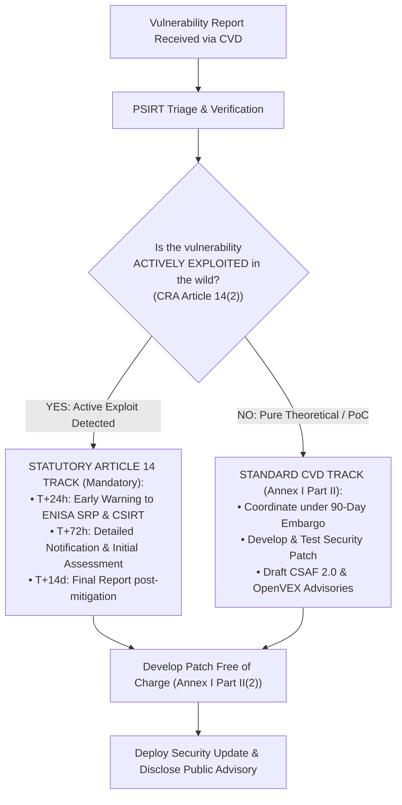

# EU Cyber Resilience Act (CRA) — Regulation (EU) 2024/2847
# Coordinated Vulnerability Disclosure (CVD), CSIRT & Security Advisory Operational Policy

**Document Reference:** `CRA-CVD-POL-01`  
**Classification:** Enterprise Security Policy & Operational SOP / Annex I Part II Compliance  
**Statutory Baseline:** Regulation (EU) 2024/2847, Articles 13, 14; Annex I Part II (Points 1–8); Annex II Point 2  
**Standards Alignment:** ISO/IEC 29147:2018 (Disclosure), ISO/IEC 30111:2019 (Handling), RFC 9116 (`security.txt`), OASIS CSAF 2.0, OpenVEX v0.2.0  
**Effective Date:** Mandatory across entire product lifecycle and active post-market support period

---

## 1. Executive Summary & Statutory Mandate

Under **Annex I, Part II of Regulation (EU) 2024/2847 (Cyber Resilience Act — CRA)**, manufacturers of products with digital elements are legally required to establish, maintain, and execute an effective **Coordinated Vulnerability Disclosure (CVD)** policy.

```
┌────────────────────────────────────────────────────────────────────────────────────────┐
│                        CRA CVD OPERATIONAL LIFECYCLE                                   │
├─────────────────────┬─────────────────────────────────┬────────────────────────────────┤
│ 1. INTAKE & TRIAGE  │    2. REMEDIATION & MITIGATION  │   3. DISCLOSURE & ADVISORIES   │
│   • RFC 9116 Intake │     • Root-Cause Analysis       │     • CVE Allocation (CNA)     │
│   • PGP Encryption  │     • Patch Engineering         │     • CSAF 2.0 JSON Advisory   │
│   • 48h Response SLA│     • Regression Testing        │     • OpenVEX Exploitability   │
│   • Safe Harbor Law │     • Art 14 Trigger Screening  │     • 90-Day Embargo Lift      │
└─────────────────────┴─────────────────────────────────┴────────────────────────────────┘
```

The regulation establishes four non-negotiable statutory pillars for vulnerability handling:
1. **Public Contact Point (Annex I Part II(4)):** The manufacturer must provide a publicly accessible contact address for reporting vulnerabilities.
2. **Coordinated Disclosure Policy (Annex I Part II(3)):** The manufacturer must apply an effective coordinated vulnerability disclosure policy facilitating reporting by third parties.
3. **Security Updates Free of Charge (Annex I Part II(2)):** Vulnerabilities must be promptly addressed through security updates delivered free of charge, with security updates separated from functional enhancements.
4. **Transparent Advisories (Annex I Part II(6) & (7)):** Once a security update is available, the manufacturer must publicly disclose the vulnerability in a structured advisory (including CVE, affected versions, severity, and remediation guidance).

> [!WARNING]
> **Active Exploitation Triggers Article 14 Override:**  
> If during the CVD process the Product Security Incident Response Team (PSIRT) discovers that a reported vulnerability is being **actively exploited in the wild**, statutory reporting under **Article 14(2)** takes immediate legal precedence over standard CVD timelines. An **Early Warning must be submitted to ENISA and the designated national CSIRT within 24 hours of awareness**.

---

## 2. Ethical Security Researcher Legal Safe Harbor Agreement

To encourage responsible security research and protect researchers under European legal frameworks (including Directive 2013/40/EU on attacks against information systems and national cybercrime statutes), the manufacturer adopts this binding **Legal Safe Harbor**:

### 2.1 Scope of Safe Harbor
If an independent security researcher adheres to the terms of this policy in good faith:
* **Authorization:** The manufacturer considers their research and testing activities to be authorized under applicable anti-hacking laws (including European national cybercrime laws and the US Computer Fraud and Abuse Act - CFAA).
* **No Civil or Criminal Litigation:** The manufacturer covenants not to initiate legal action, pursue civil damages, or report the researcher to law enforcement agencies.
* **DMCA / DRM Exemption:** The manufacturer will not pursue copyright infringement or anti-circumvention claims against the researcher for bypassing technical protection measures during legitimate security analysis.

### 2.2 Researcher Conduct Requirements
To remain protected under this Safe Harbor, researchers must:
1. **Avoid Service Disruption:** Avoid causing Denial of Service (DoS), data destruction, or degradation of production environments.
2. **Respect Data Privacy:** Do not access, download, modify, or disclose customer personal data (GDPR Article 4(1)) or proprietary commercial data. If sensitive data is inadvertently encountered, cease access immediately and notify the PSIRT.
3. **Report Promptly & Privately:** Submit reports directly to the manufacturer via authorized intake channels without disclosing details to third parties prior to the mutually agreed coordination deadline.
4. **No Extortion:** Do not demand ransom, payment, or commercial contracts as a condition for withholding vulnerability information (commercial bug bounty rewards, if offered, follow predefined program rules).

---

## 3. Vulnerability Intake Protocols & Public Contact Architecture

### 3.1 Public Contact Endpoints (Annex II Point 2)
The manufacturer maintains three redundant, high-availability intake channels:
* **Primary Encrypted Email:** `security@company.com` (Monitored 24/7/365 by PSIRT on-call engineers).
* **Secure Web Intake Portal:** `https://www.company.com/security/report-vulnerability` (TLS 1.3 with client-side PGP encryption form).
* **RFC 9116 Standard Endpoint:** `https://www.company.com/.well-known/security.txt` and `https://product-domain.com/.well-known/security.txt`.

### 3.2 RFC 9116 `security.txt` Specification
Every web application, customer-facing portal, and network-connected product with an HTTP administrative interface must host a valid, signed `security.txt` file at `/.well-known/security.txt`.

```text
# RFC 9116 Coordinated Vulnerability Disclosure Specification
# EU Cyber Resilience Act (Regulation (EU) 2024/2847) Compliance

Contact: mailto:security@company.com
Contact: https://www.company.com/security/report-vulnerability
Expires: 2027-10-12T00:00:00.000Z
Encryption: https://www.company.com/security/pgp-key.asc
Preferred-Languages: en, fr, de
Canonical: https://www.company.com/.well-known/security.txt
Policy: https://www.company.com/security/coordinated-vulnerability-disclosure
Hiring: https://www.company.com/careers/security
CSAF: https://www.company.com/.well-known/csaf/provider-metadata.json
Acknowledgments: https://www.company.com/security/hall-of-fame
```

> [!TIP]
> **Digital Signature (`security.txt.sig`):**  
> To guarantee integrity against tampering, an OpenPGP detached signature must be hosted alongside the text file at `/.well-known/security.txt.sig`. The file expiry (`Expires:`) must never exceed 12 calendar months and must be refreshed during automated CI/CD releases.

---

## 4. Vulnerability Triage, Severity Scoring & Operational SLAs

Once a vulnerability report is submitted, the PSIRT executes triage according to the following strict timeline:

```
┌────────────────────────────────────────────────────────────────────────────────────────┐
│                        PSIRT TRIAGE & RESOLUTION SLA CLOCK                             │
├─────────────────────┬─────────────────────────────────┬────────────────────────────────┤
│      0 to 48 Hours  │          3 to 10 Days           │         10 to 90 Days          │
│   Initial Intake    │    Technical Validation & CVSS  │    Remediation & Advisory      │
│  • Automated Ticket │    • Reproduce Bug              │    • Engineering Patch         │
│  • PGP Verification │    • Assign CVSS v3.1 / v4.0    │    • Regression Testing        │
│  • Legal Safe Harbor│    • Check KEV / Active Exploit │    • Reserve CVE ID            │
│  • Human Acknowledge│    • Initial Status to Finder   │    • CSAF / OpenVEX Emission   │
└─────────────────────┴─────────────────────────────────┴────────────────────────────────┘
```

### 4.1 Binding PSIRT Operational SLAs
| Milestone Stage | Target SLA | Mandatory Deliverable | Statutory Compliance Reference |
|---|:---:|---|---|
| **Intake Acknowledgment** | $\le \mathbf{48\text{ Hours}}$ | Automated ticket creation & human confirmation to researcher. | ISO/IEC 29147, Sec 5.3 |
| **Initial Assessment & Triage** | $\le \mathbf{5\text{ Business Days}}$ | Confirmation of reproducibility; initial CVSS score assigned. | ISO/IEC 30111, Sec 7.2 |
| **Article 14 KEV Screening** | $\le \mathbf{24\text{ Hours}}$ | Verification if vulnerability is actively exploited in the wild. | CRA Article 14(2) |
| **Remediation Plan & Timeline** | $\le \mathbf{10\text{ Business Days}}$ | Engineering work order created; target release date provided to researcher. | ISO/IEC 29147, Sec 5.4 |
| **Critical Patch Delivery** | $\le \mathbf{14\text{ Calendar Days}}$ | CVSS 9.0–10.0 (or actively exploited): emergency out-of-band hotfix. | Annex I Part II(2) |
| **Standard Remediation Window** | $\le \mathbf{90\text{ Calendar Days}}$ | Routine security patch bundled in scheduled release. | Industry Standard CVD Window |
| **Public Advisory Publication** | **At Patch Release** | CSAF 2.0 JSON + OpenVEX + Human Security Bulletin published. | Annex I Part II(6) & (7) |

### 4.2 Severity Scoring Standard
* **Primary Scoring:** Common Vulnerability Scoring System **CVSS v3.1** and **CVSS v4.0**.
* **Exploitability Filter:** Stakeholder Specific Vulnerability Categorization (**SSVC**) decision tree:
  * `Track`: No known exploit; low impact $\rightarrow$ standard maintenance release.
  * `Attend`: Public PoC exists or high impact $\rightarrow$ prioritized sprint release.
  * `Act`: Actively exploited in wild or catastrophic impact $\rightarrow$ emergency hotfix + Article 14 ENISA notification.

---

## 5. CRA Article 14 Dual-Track Incident Reporting Integration

When the PSIRT triages a vulnerability, it must evaluate whether statutory reporting to the **ENISA Single Reporting Platform (SRP)** is required:



---

## 6. Machine-Readable Advisory Architecture: CSAF 2.0 & OpenVEX

Under Annex I Part II(6) and Part II(7), security updates must be accompanied by comprehensive, machine-readable security advisories.

### 6.1 OASIS Common Security Advisory Framework (CSAF) v2.0
The PSIRT publishes advisories using CSAF v2.0 JSON, allowing automated consumption by enterprise vulnerability scanners, SIEMs, and orchestrators.

#### Turnkey CSAF 2.0 JSON Template (`csaf-advisory-sample.json`)
```json
{
  "document": {
    "category": "csaf_security_advisory",
    "csaf_version": "2.0",
    "title": "Security Update for Remote Buffer Overflow in SEG-5000 Network Daemon",
    "tracking": {
      "id": "COMPANY-SA-2026-0042",
      "current_release_date": "2026-10-12T14:00:00.000Z",
      "initial_release_date": "2026-10-12T14:00:00.000Z",
      "status": "final",
      "version": "1.0.0",
      "generator": {
        "engine": {
          "name": "CRA Advisory Engine",
          "version": "1.2.0"
        }
      }
    },
    "publisher": {
      "category": "vendor",
      "name": "SecureEdge Technologies Ltd",
      "namespace": "https://www.company.com",
      "contact_details": "security@company.com"
    },
    "notes": [
      {
        "category": "summary",
        "title": "Advisory Summary",
        "text": "A remote heap buffer overflow vulnerability exists in the network framing parser of SEG-5000 firmware prior to v3.4.1. Successful exploitation could allow an unauthenticated attacker on the local network to execute arbitrary code with elevated privileges."
      },
      {
        "category": "legal_disclaimer",
        "title": "CRA Regulatory Notice",
        "text": "This security advisory is issued pursuant to Regulation (EU) 2024/2847 (Cyber Resilience Act), Annex I, Part II, Point 6."
      }
    ],
    "references": [
      {
        "category": "self",
        "summary": "Canonical Security Advisory URL",
        "url": "https://www.company.com/security/advisories/COMPANY-SA-2026-0042"
      }
    ]
  },
  "product_tree": {
    "branches": [
      {
        "category": "vendor",
        "name": "SecureEdge Technologies",
        "branches": [
          {
            "category": "product_family",
            "name": "SecureEdge Gateway",
            "branches": [
              {
                "category": "product_name",
                "name": "SEG-5000 Firmware",
                "product": {
                  "name": "SEG-5000 Firmware",
                  "product_id": "CSAFPID-SEG5000-ALL",
                  "product_identification_helper": {
                    "cpe": "cpe:2.3:o:secureedge:seg-5000_firmware:*:*:*:*:*:*:*:*"
                  }
                }
              }
            ]
          }
        ]
      }
    ]
  },
  "vulnerabilities": [
    {
      "cve": "CVE-2026-49120",
      "title": "Heap Buffer Overflow in NetFrame Parser",
      "cwe": {
        "id": "CWE-122",
        "name": "Heap-based Buffer Overflow"
      },
      "scores": [
        {
          "cvss_v3": {
            "version": "3.1",
            "vectorString": "CVSS:3.1/AV:A/AC:L/PR:N/UI:N/S:C/C:H/I:H/A:H",
            "baseScore": 9.6,
            "baseSeverity": "CRITICAL"
          }
        }
      ],
      "product_status": {
        "known_affected": [
          "CSAFPID-SEG5000-ALL"
        ]
      },
      "remediations": [
        {
          "category": "vendor_fix",
          "details": "Upgrade SEG-5000 firmware to version 3.4.1 or later. The patch is distributed free of charge pursuant to CRA Annex I Part II(2).",
          "url": "https://download.company.com/updates/SEG-5000-v3.4.1.bin"
        }
      ]
    }
  ]
}
```

---

### 6.2 OpenVEX Exploitability Statement Template (`openvex-statement-sample.json`)
OpenVEX provides lightweight, machine-readable exploitability metadata paired directly with CycloneDX SBOMs:

```json
{
  "@context": "https://openvex.dev/ns/v0.2.0",
  "@id": "https://www.company.com/security/vex/2026/COMPANY-VEX-2026-0042",
  "author": "SecureEdge PSIRT",
  "role": "Product Security Incident Response Team",
  "timestamp": "2026-10-12T14:00:00.000Z",
  "version": 1,
  "statements": [
    {
      "vulnerability": {
        "name": "CVE-2026-49120"
      },
      "products": [
        {
          "@id": "pkg:generic/secureedge/seg-5000@3.4.1"
        }
      ],
      "status": "fixed"
    },
    {
      "vulnerability": {
        "name": "CVE-2025-38102"
      },
      "products": [
        {
          "@id": "pkg:golang/github.com/gin-gonic/gin@v1.9.1"
        }
      ],
      "status": "not_affected",
      "justification": "vulnerable_code_not_in_execute_path",
      "impact_statement": "The vulnerable multipart form parser is disabled in SEG-5000 production configurations via compile-time build tags."
    }
  ]
}
```

---

## 7. Embargo Management & Multi-Party Coordination Protocols

When vulnerabilities involve third-party open-source components (e.g., Linux kernel, OpenSSL, Apache) or multi-vendor hardware chips:

### 7.1 Upstream Component Disclosure (Article 13(6))
* **Mandatory Upstream Sharing:** Under **Article 13(6)**, where a manufacturer develops a security patch for a vulnerability in a third-party open-source component integrated into its product, it **must share the code of the patch or mitigation with the upstream maintainer or project**.
* **Embargo Alignment:** The PSIRT coordinates disclosure with the upstream maintainer and designated national CSIRT before public release to prevent premature exploitation.

### 7.2 Standard 90-Day Embargo Timeline
1. **Day 0:** Vulnerability validated; embargo clock starts.
2. **Day 15:** CVE ID reserved from CNA (MITRE or national CSIRT).
3. **Day 45:** Patch developed and submitted to QA staging.
4. **Day 75:** Pre-notification sent to critical customers / CERT-EU under Non-Disclosure Agreement (NDA) or TLP:AMBER.
5. **Day 90:** Coordinated public disclosure:
   * Public patch binary released on download portal.
   * CSAF 2.0 advisory and OpenVEX document published to `/.well-known/csaf/`.
   * Researcher credited on public Security Hall of Fame.

### 7.3 Early Disclosure Exception (Annex I Part II(7))
If evidence arises that the vulnerability is actively exploited in the wild, or if details are leaked publicly by a third party:
* The 90-day embargo is terminated immediately.
* An emergency security advisory and temporary workaround are published within **24 hours**.
* The Article 14 ENISA SRP reporting workflow is triggered in parallel.

---

## 8. Customer Security Advisory Notification Channels

Under **Article 13(1)** and **Annex I Part II(6)**, manufacturers must ensure customers receive timely notification of security updates:

### 8.1 Distribution Channels
1. **Direct Security RSS / Atom Feed:** `https://www.company.com/security/advisories.rss`
2. **Cryptographic Email Broadcast:** To registered compliance officers and security contacts listed in customer contracts.
3. **Automated In-Product Banner:** Administrative console UI alerts administrators when an active, signed security update is available.
4. **Machine-Readable CSAF Aggregator Portal:** CSAF provider metadata directory conforming to RFC 9116 / CSAF v2.0 standards at:
   `https://www.company.com/.well-known/csaf/provider-metadata.json`

---

## 9. Enterprise CVD Operational RACI Matrix

| Activity | PSIRT Lead | Security Architect | Lead Dev | Compliance / Legal | Executive / CTO |
|---|:---:|:---:|:---:|:---:|:---:|
| **Maintain `security.txt` & PGP Key** | **Accountable** | Responsible | Consulted | Informed | Informed |
| **Intake Triage within 48 Hours** | **Accountable** | Responsible | Consulted | Informed | Informed |
| **Article 14 KEV Assessment** | **Accountable** | Consulted | Informed | **Accountable** | Informed |
| **Patch Engineering & Code Fix** | Consulted | Consulted | **Accountable** | Informed | Informed |
| **Pre-Release Patch Validation** | Responsible | Consulted | **Accountable** | Informed | Informed |
| **CSAF 2.0 & OpenVEX Generation** | **Accountable** | Responsible | Consulted | Informed | Informed |
| **Article 13(6) Upstream Sharing** | Responsible | Consulted | **Accountable** | Informed | Informed |
| **Public Advisory Publication** | **Accountable** | Consulted | Informed | Responsible | **Accountable** |
| **Researcher Hall of Fame** | **Accountable** | Informed | Informed | Consulted | Informed |

---

## 10. Verification & Audit Readiness Checklist

- [ ] **RFC 9116 `security.txt`** active and validated at `https://[domain]/.well-known/security.txt`.
- [ ] **OpenPGP Key** published with $\ge 3072$-bit RSA or Curve25519; fingerprint verified.
- [ ] **Public CVD Policy** accessible with explicit Legal Safe Harbor clause.
- [ ] **CSAF 2.0 Provider Metadata** published at `/.well-known/csaf/provider-metadata.json`.
- [ ] **Article 14 Escalation Bridge** tested: PSIRT on-call engineers trained on 24-hour ENISA SRP reporting triggers.
- [ ] **Upstream Patch Sharing Workflow** established for open-source components under Article 13(6).
- [ ] **Free Update Distribution Pipeline** active and verified without commercial licensing paywalls.
