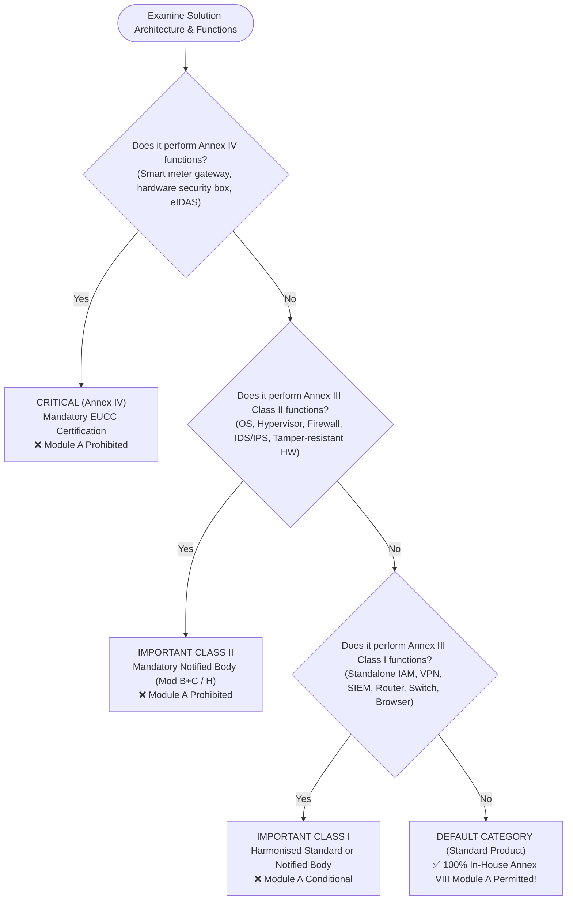
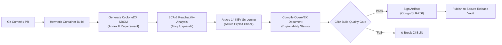
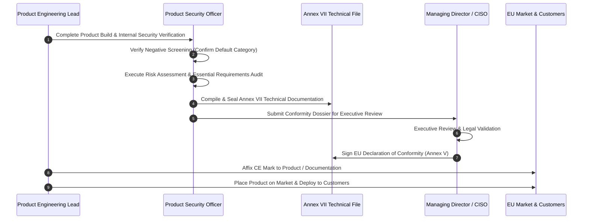

# EU Cyber Resilience Act (Regulation (EU) 2024/2847)
# Default Category Vendor Lifecycle Guide
## Complete Operational Handbook for In-House Development, Build, Deployment, and RUN Support of Standard Products (Module A Route)

**Document Classification:** Internal Operational Standard & Compliance Architecture  
**Target Profile:** End-to-End Solution Vendor (Sell, Develop, Build, Deploy, Support on RUN)  
**Product Scope:** Exclusively **Default Category (Standard Products with Digital Elements)**  
**Conformity Route:** **Annex VIII Module A (Internal Production Control / 100% In-House)**  
**Version:** 1.0 (Audit-Ready)  
**Effective Date:** Immediate application for Article 14 (live since 11 September 2026); Full general application by 11 December 2027  

---

## Table of Contents
1. [Executive Summary & Strategic Advantage of Default Category](#1-executive-summary--strategic-advantage-of-default-category)
2. [Negative Screening: Proving Default Category Classification](#2-negative-screening-proving-default-category-classification)
3. [The End-to-End Lifecycle Blueprint](#3-the-end-to-end-lifecycle-blueprint)
   - [Phase 1: SELL (Presales, Commercial Structuring & Customer Demarcation)](#phase-1-sell-presales-commercial-structuring--customer-demarcation)
   - [Phase 2: DEVELOP (Secure Architecture, SSDLC & Risk Assessment)](#phase-2-develop-secure-architecture-ssdlc--risk-assessment)
   - [Phase 3: BUILD (CI/CD Pipeline, Automated SBOM & Release Gates)](#phase-3-build-cicd-pipeline-automated-sbom--release-gates)
   - [Phase 4: DEPLOY (Installation, Hardening, Commissioning & Handover)](#phase-4-deploy-installation-hardening-commissioning--handover)
   - [Phase 5: SUPPORT on RUN (Vulnerability Handling, Article 14 & Patch Archiving)](#phase-5-support-on-run-vulnerability-handling-article-14--patch-archiving)
4. [Annex VIII Module A: Step-by-Step Internal Conformity Assessment](#4-annex-viii-module-a-step-by-step-internal-conformity-assessment)
5. [Annex VII Technical Documentation Assembly Blueprint](#5-annex-vii-technical-documentation-assembly-blueprint)
6. [EU Declaration of Conformity (Annex V) & CE Marking Rules](#6-eu-declaration-of-conformity-annex-v--ce-marking-rules)
7. [Standard Operating Procedures (SOPs) & Checklists](#7-standard-operating-procedures-sops--checklists)
   - [SOP-DEF-01: Annual Negative Screening & Classification Review](#sop-def-01-annual-negative-screening--classification-review)
   - [SOP-DEF-02: Presales Gating & Support Period Commitment](#sop-def-02-presales-gating--support-period-commitment)
   - [SOP-DEF-03: Secure Deployment & Customer Boundary Handover](#sop-def-03-secure-deployment--customer-boundary-handover)
   - [SOP-DEF-04: 10-Year Security Update Download Archive](#sop-def-04-10-year-security-update-download-archive)
8. [Cross-Functional Enterprise RACI Matrix](#8-cross-functional-enterprise-raci-matrix)

---

## 1. Executive Summary & Strategic Advantage of Default Category

### 1.1 The Vendor Operating Model
As a full-lifecycle vendor, our organization executes every phase of the solution value chain:
```text
[ SELL ] ──▶ [ DEVELOP ] ──▶ [ BUILD ] ──▶ [ DEPLOY ] ──▶ [ SUPPORT on RUN ]
Presales      Secure SDLC    CI/CD Pipeline   Installation    Vulnerability Handling
B2B Addenda   Threat Model   CycloneDX SBOM   Hardening       Article 14 Reporting
5yr Support   Risk Assess    Release Gates    Commissioning   10yr Patch Archive
```

### 1.2 The "Default Category" Strategic Advantage
Under the CRA, products with digital elements (PDEs) are segmented into three regulatory tiers:
1. **Critical Products** (Annex IV): Mandatory European Cybersecurity Certificate.
2. **Important Products (Class I & Class II)** (Annex III): Mandatory third-party Notified Body assessment or harmonised standards certification.
3. **Default Category (Standard Products)**: **Subject to Annex VIII Module A (Internal Production Control)**.

#### What Default Category Means for Our Business:
* **ZERO Notified Body Dependency**: We are **NOT** legally required to hire external accredited Notified Bodies (saving €30k–€100k per product release and eliminating 4–8 month audit scheduling bottlenecks).
* **100% In-House Conformity Assessment**: Our internal engineering, security, and legal teams perform the conformity evaluation, sign the EU Declaration of Conformity, and affix the CE marking.
* **Full Regulatory Rigor Remains Mandatory**: Belonging to the Default category does **NOT** relax the essential technical cybersecurity requirements (Annex I), vulnerability handling standards, SBOM obligations, the 5-year support period baseline, or Article 14 mandatory incident reporting. It solely simplifies the *conformity verification mechanism*.

---

## 2. Negative Screening: Proving Default Category Classification

To lawfully utilize the internal Module A self-assessment route, our technical documentation must prove through **negative screening** that the solution does not perform functions listed in Annex III or Annex IV.



### 2.1 The Negative Screening Audit Checklist
For every standard product developed and sold, the Lead Architect must sign off on the following negative verification:

| Category Tested | Excluded Core Functions | Verification Status in Our Product | Audit Evidence |
|---|---|---|---|
| **Annex IV (Critical)** | Smart meter gateways, hardware security boxes, eIDAS hardware | ❌ **NOT PRESENT** (Product is standard software/hardware application) | Solution Functional Specification Section 2 |
| **Annex III Class II** | Operating Systems, hypervisors, network firewalls, IDS/IPS | ❌ **NOT PRESENT** (Runs as an application atop standard commercial OS; does not act as general firewall) | Architecture Diagram & Process Tree |
| **Annex III Class I** | Standalone IAM/PAM systems, VPN gateways, SIEM platforms, core routers/switches, web browsers | ❌ **NOT PRESENT** (Features standard RBAC authentication for its own UI, but is not sold as an enterprise IAM/VPN infrastructure product) | Scope & Features Register |

> **CRITICAL LEGAL DISTINCTION (Embedded vs. Standalone Security Functions):**  
> Under European Commission CRA Guidance, incorporating internal authentication (e.g., standard login credentials or OAuth client) to protect the solution’s own administrative interface does **NOT** transform an application into an "Identity and Access Management (IAM)" product under Annex III. The classification applies only to products whose *primary intended purpose* is providing IAM, VPN, or Firewall services.

---

## 3. The End-to-End Lifecycle Blueprint

---

### Phase 1: SELL (Presales, Commercial Structuring & Customer Demarcation)

When selling standard products, presales teams must avoid commercial traps that create regulatory liability.

#### 1. Support Period Specification in Proposals (Article 13(8) & Annex II)
- Every commercial proposal, quotation, and contract must explicitly state the **Guaranteed Support Period End Date (Month/Year)**.
- **The 5-Year Floor**: Standard products must carry at least a **5-year support commitment** from commercial release date, unless a shorter operational lifetime is formally justified in the technical dossier (e.g., disposable devices or subscription-bound software).
- **Prohibited Practice**: Never state "Support provided for the duration of the active contract" without defining a fixed minimum calendar date.

#### 2. Pricing Security Updates (Annex I Part II Point (8))
- Security updates must be provided **free of charge**.
- Presales cannot bundle security patches into premium "Gold/Platinum Maintenance" packages.
- **Compliant Revenue Model**: Charge for customer operational support (24/7 helpdesk SLAs, installation services, routine database tuning), while guaranteeing patch download availability to all licensed users at zero additional software cost.

#### 3. B2B Customer Contract Addenda (Schedule A)
Every sales contract must incorporate the [CRA Customer Addendum](./CRA_Contractual_Templates_and_Addenda.md#2-schedule-a-b2b-customer-cybersecurity--cra-compliance-addendum):
- **Demarcation of Operator Duties**: Customer is responsible for applying patches within 30 days and securing its operational environment.
- **Article 22 Substantial Modification Shield**: Customer is prohibited from modifying solution binaries or exposing unassessed network interfaces; unauthorized modifications transfer statutory manufacturer status to the customer.

---

### Phase 2: DEVELOP (Secure Architecture, SSDLC & Risk Assessment)

Engineering teams must embed Annex I Part I essential requirements into standard product development.

#### 1. Living Cybersecurity Risk Assessment (Article 13(7))
The risk assessment is not a static document; it must be updated whenever architecture changes or new threat intelligence emerges:
- **Identify Assets**: Sensitive data handled, local storage, control interfaces, APIs.
- **Determine Operational Environment**: Target network segment, user privilege model.
- **Threat Modeling (STRIDE / ATT&CK)**: Map potential spoofing, tampering, information disclosure, and denial of service.
- **Document Residual Risk**: Prove that all known risks are reduced to an acceptable level through technical controls.

#### 2. Secure by Default Technical Standards (Annex I Part I)
- **Zero Default Passwords**: Generate random unique credentials on installation, or enforce immediate password change on first boot/login.
- **Minimal Attack Surface**: Disable all unused network ports, services, and debug APIs by default.
- **Encrypted Communications**: TLS 1.3 enforced for all network interfaces; legacy SSL/TLS 1.0/1.1 disabled.
- **Data Protection**: Sensitive credentials and encryption keys vaulted in secure keystores/HSMs, never hardcoded in source.

#### 3. Component Due Diligence (Article 13(5))
- Before introducing any third-party or open-source library, developers must verify its vulnerability history via OSV.dev / NVD.
- Dependencies with unpatched Critical/High vulnerabilities are prohibited from merging into `main`.

---

### Phase 3: BUILD (CI/CD Pipeline, Automated SBOM & Release Gates)

Build pipelines must guarantee artifact integrity and automated transparency.



#### 1. Automated CycloneDX SBOM Generation
Every build must automatically generate an Annex II-compliant Software Bill of Materials using the toolkit’s [`cra_ci_pipeline_gate.py`](./cra_ci_pipeline_gate.py).
- Enumerates 100% of direct and transitive dependencies.
- Embeds Package URLs (purls), SHA-256 hashes, and license expressions.

#### 2. Blocking Quality Gates
Release candidate builds must pass three automated gates:
- **Gate 1**: Valid CycloneDX SBOM generated and archived.
- **Gate 2 (Article 14 Screen)**: Zero reachable vulnerabilities listed in active exploitation catalogs (CISA KEV / EUVD).
- **Gate 3**: Zero unmitigated Critical vulnerabilities without an accredited OpenVEX justification.

#### 3. Cryptographic Artifact Signing
- All release binaries, container images, and update packages must be signed using corporate PKI / Cosign.
- SHA-256 checksums must be recorded in the Annex VII technical dossier.

---

### Phase 4: DEPLOY (Installation, Hardening, Commissioning & Handover)

Because our organization deploys the solution for customers, deployment practices directly affect CRA compliance.

#### 1. Secure Installation & Hardening Runbooks
Professional services teams must execute deployment according to the published Annex II User Information:
- Automated provisioning via hardened Infrastructure-as-Code (Ansible playbooks / Helm charts).
- Strict firewall ingress rules configured (e.g., exposing only necessary application ports).
- System services executed under non-root service accounts with least privilege.

#### 2. Mandatory Commissioning Handover Protocol
Upon completing deployment at a customer site or cloud tenant:
- Deliver the **Annex II Security Instructions Dossier** to the customer's operations team.
- Provide the **Simplified EU Declaration of Conformity URL**.
- Conduct initial credential rotation in the presence of the customer administrator.
- Execute the **CRA Deployment Handover Certificate** signed by both parties, establishing the operational demarcation boundary.

---

### Phase 5: SUPPORT on RUN (Vulnerability Handling, Article 14 & Patch Archiving)

During the multi-year RUN phase, the organization fulfills post-market monitoring duties.

#### 1. 24/7 Coordinated Vulnerability Disclosure (CVD) Intake
- Maintain `https://vendor.example.com/.well-known/security.txt` pointing to our PSIRT intake.
- Acknowledge incoming vulnerability reports within **24 hours**.

#### 2. Article 14 Live Reporting Execution (ENISA SRP)
If an active exploit or severe incident is detected in our product:
- **Within 24 Hours of Awareness**: Submit Early Warning on ENISA SRP (`portal.cra-srp.enisa.europa.eu`).
- **Within 72 Hours of Awareness**: Submit Detailed Notification.
- **Within 14 Days of Patch Release**: Submit Final Remediation Report.
- Use [`cra_article14_deadlines.py`](./cra_article14_deadlines.py) to manage the countdown.

#### 3. Separate Security Updates (Annex I Part II Point (7))
- When releasing patches, distribute security updates **separately from feature/functionality upgrades** wherever technically feasible.
- Ensure customers can patch vulnerabilities without being forced to adopt breaking feature changes.

#### 4. The 10-Year Patch Archive Mandate (Article 13(9))
- Every issued security update package, patch binary, and release advisory must remain downloadable for **at least 10 years** following issuance or for the remainder of the support period, whichever is longer.

---

## 4. Annex VIII Module A: Step-by-Step Internal Conformity Assessment

Module A (Internal Production Control) is the statutory procedure whereby the vendor fulfills obligations internally and declares on its sole responsibility that products meet the CRA.



### Module A Execution Checklist
1. **Internal Verification of Essential Requirements**: Engineering performs automated test suites, static analysis, dynamic scanning, and penetration testing against Annex I requirements.
2. **Technical Dossier Compilation**: Assemble all 10 mandatory sections of the Annex VII Technical Documentation.
3. **Execution of EU Declaration of Conformity**: Executive management executes the signed Annex V document.
4. **CE Marking Affixing**: The CE mark is affixed in accordance with Articles 29 & 30.
5. **Continuous Internal Production Control**: Implement quality assurance in the build pipeline ensuring that subsequent production runs and patches remain conformant.

---

## 5. Annex VII Technical Documentation Assembly Blueprint

The vendor must maintain a technical dossier for every standard product, retained for **at least 10 years** from placing on the market (Article 13(13)).

### The 10 Mandatory Technical Dossier Sections:
1. **General Product Description**: Commercial name, versions, hardware/software specifications, intended purpose, and negative screening classification evidence.
2. **Cybersecurity Risk Assessment (Article 13(7))**: Detailed threat model, risk evaluation matrix, and mitigation mapping against Annex I essential requirements.
3. **Design, Architecture & Implementation Schematics**: System topology, data flow diagrams, network boundaries, authentication mechanisms, and external APIs.
4. **Declared Support Period Determination (Article 13(8))**: Documented analysis establishing why the declared support period (e.g., 5 years) meets reasonable user expectations and hardware longevity.
5. **Software Bill of Materials (SBOM) & Component Inventory**: CycloneDX machine-readable SBOM, third-party dependency registers, and open-source licenses.
6. **Vulnerability Handling Policy & Architecture**: Internal PSIRT procedures, CVD policy URL, patch distribution architecture, and ENISA SRP Primary Assigned Representative details.
7. **Standards Applied & Conformity Solutions**: List of applied harmonised European standards (CEN/CENELEC/ETSI), international standards (ISO/IEC 27001, IEC 62443), or internal technical specifications.
8. **Test Reports & Verification Evidence**: Automated SAST/DAST/SCA test logs, penetration test executive summaries, and regression test results.
9. **Annex II User Security Information**: Copy of user manuals, secure installation instructions, hardening guidelines, and administrative security documentation.
10. **Executed EU Declaration of Conformity (Annex V)**: Signed copy of the declaration.

---

## 6. EU Declaration of Conformity (Annex V) & CE Marking Rules

### 6.1 Standard Product EU Declaration of Conformity Template

```markdown
EU DECLARATION OF CONFORMITY (No. DoC-2027-DEF-001)
Issued in accordance with Regulation (EU) 2024/2847 (Cyber Resilience Act) - Annex V

1. PRODUCT IDENTIFICATION:
   - Commercial Name:     [Standard Product Name]
   - Model / Type:        Version 2.0.x (Software Package / Appliance)
   - Unique Identifier:   PURL / Serial / Model No. _______________________

2. MANUFACTURER:
   - Company Name:        [Solution Vendor Legal Name]
   - Registered Address:  [Full Corporate Address, EU Member State]
   - Single Contact:      compliance@solution-vendor.example.com

3. STATEMENT OF SOLE RESPONSIBILITY:
   This declaration of conformity is issued under the sole responsibility of the manufacturer.

4. OBJECT OF THE DECLARATION:
   Standard Commercial Solution for [Intended Purpose Description].

5. CONFORMITY ASSESSMENT ROUTE & CLASSIFICATION:
   - Product Classification: Default Category (Standard Product with Digital Elements)
   - Conformity Route:       Annex VIII Module A (Internal Production Control)

6. COMPLIANCE STATEMENT & HARMONISED STANDARDS:
   The object of the declaration described above is in conformity with Regulation (EU) 2024/2847 
   (Cyber Resilience Act) and satisfies the essential requirements laid down in Annex I.
   References to relevant harmonised standards or technical specifications applied:
   - EN 18031-1 / EN 18031-2 (General cybersecurity requirements)
   - ISO/IEC 29147 & ISO/IEC 30111 (Vulnerability handling and disclosure)
   - ETSI EN 303 645 (where applicable for connected devices)

7. SIGNED FOR AND ON BEHALF OF:
   Place and Date of Issue:  [City, Member State], [Date]
   Name and Function:        [Executive Director / CISO Legal Representative]
   Signature:                ________________________________________________
```

### 6.2 CE Marking Affixing Protocol (Articles 29 & 30)
* **Form & Dimensions**: Must bear the official CE graphic symbol, maintaining proportions with a minimum height of 5 mm.
* **Location**: Affixed visibly, legibly, and indelibly to the product or its data plate. For pure software products, it must be affixed to the electronic packaging, accompanying documentation, or accessible via the software interface (e.g., `About` or `License` screen).
* **No Notified Body Number**: Because this product follows **Module A**, **NO Notified Body identification number** accompanies the CE mark.

---

## 7. Standard Operating Procedures (SOPs) & Checklists

### SOP-DEF-01: Annual Negative Screening & Classification Review
- **Trigger**: Every major software release (X.0) or annual product roadmap review.
- **Action**: Product Architect and Security Lead re-verify that no newly added features (e.g., introducing VPN tunneling or centralized credential brokering) trigger Annex III Important Class I or II criteria.
- **Evidence**: Signed classification review appended to Section 1 of the Technical Dossier.

### SOP-DEF-02: Presales Gating & Support Period Commitment
- **Trigger**: Customer bid or contract negotiation.
- **Action**: Presales Lead executes [`cra_presales_gate.py`](./cra_presales_gate.py), confirms Default tier, inserts Exhibit 1 Support Period Declaration with guaranteed Month/Year end date ($\ge 5$ years), and attaches Schedule A CRA Addendum.
- **Evidence**: Presales Gate Dossier signed by CISO and Sales Director.

### SOP-DEF-03: Secure Deployment & Customer Boundary Handover
- **Trigger**: Customer solution installation and commissioning.
- **Action**: Deployment Engineer applies hardening benchmarks, disables unneeded services, executes first-login credential rotation, and presents customer with Annex II security instructions.
- **Evidence**: Signed Customer Handover Certificate.

### SOP-DEF-04: 10-Year Patch Archive Maintenance SOP
- **Trigger**: Publication of any security update.
- **Action**: Release Engineer publishes patch binary, cryptographic hash, and advisory to the write-once, tamper-evident long-term patch repository.
- **Evidence**: Automated checksum verification log and archive index entry.

---

## 8. Cross-Functional Enterprise RACI Matrix

| CRA Mandatory Obligation | Presales | Engineering | DevOps / Build | Professional Services | Support / PSIRT | Legal & CISO |
|---|:---:|:---:|:---:|:---:|:---:|:---:|
| **Negative Screening (Default Category Proof)** | I | **A / R** | I | I | C | **C** |
| **5-Year Support Period Pricing & Declaration** | **R** | C | I | I | I | **A** |
| **B2B Contract Addendum (Schedule A)** | **R** | I | I | I | I | **A** |
| **Cybersecurity Risk Assessment (Art. 13(7))** | I | **R** | I | I | C | **A** |
| **Secure by Default Configuration** | I | **R** | **R** | C | I | **A** |
| **Automated CycloneDX SBOM in CI/CD** | I | C | **R** | I | I | **A** |
| **Release Gate Verification (Zero KEV)** | I | C | **R** | I | I | **A** |
| **Secure On-Site / Cloud Deployment** | I | I | I | **A / R** | I | C |
| **Commissioning Handover & Demarcation** | C | I | I | **A / R** | I | C |
| **24/7 CVD Intake & security.txt** | I | I | I | I | **A / R** | C |
| **Article 14 ENISA SRP Incident Reporting** | I | C | I | I | **R** | **A** |
| **Separate Security Updates Distribution** | I | **R** | **R** | I | C | **A** |
| **10-Year Patch Archive Retention** | I | I | **R** | I | **R** | **A** |
| **Annex VII Technical Dossier Assembly** | I | **R** | C | I | C | **A** |
| **EU Declaration of Conformity Execution** | I | C | I | I | I | **A / R** |

*(R = Responsible for execution, A = Accountable / Sign-off authority, C = Consulted, I = Informed)*
