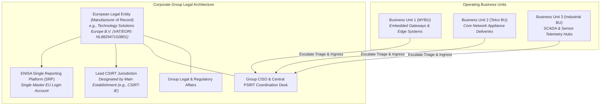
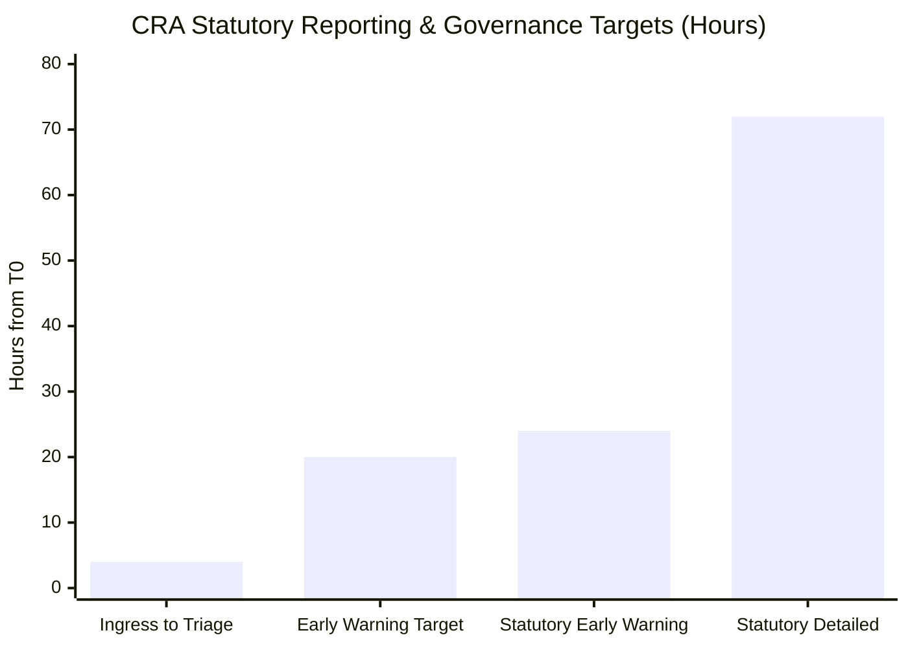
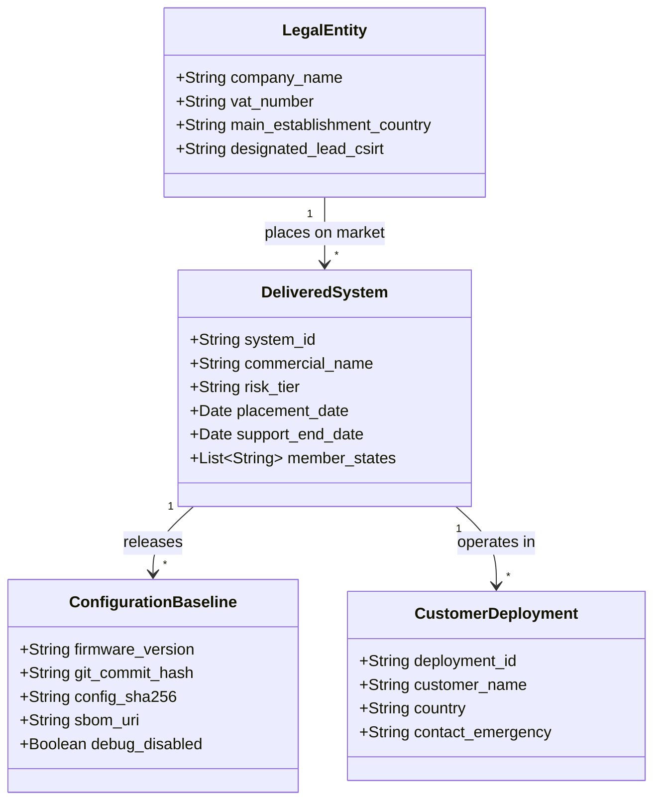
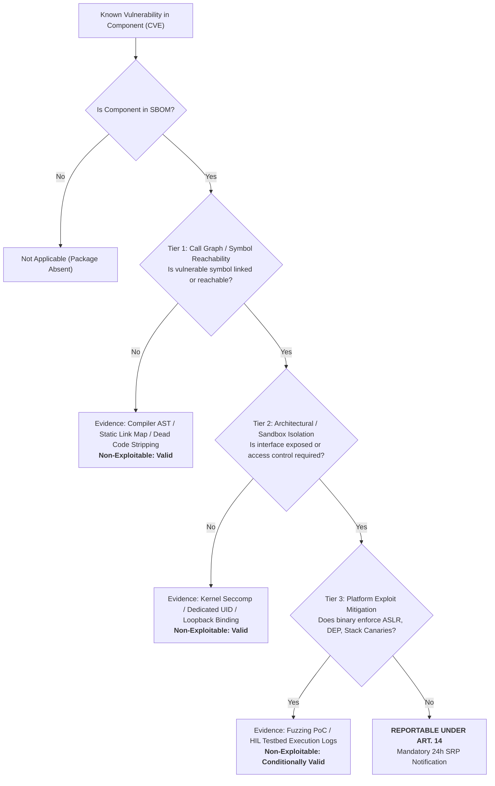
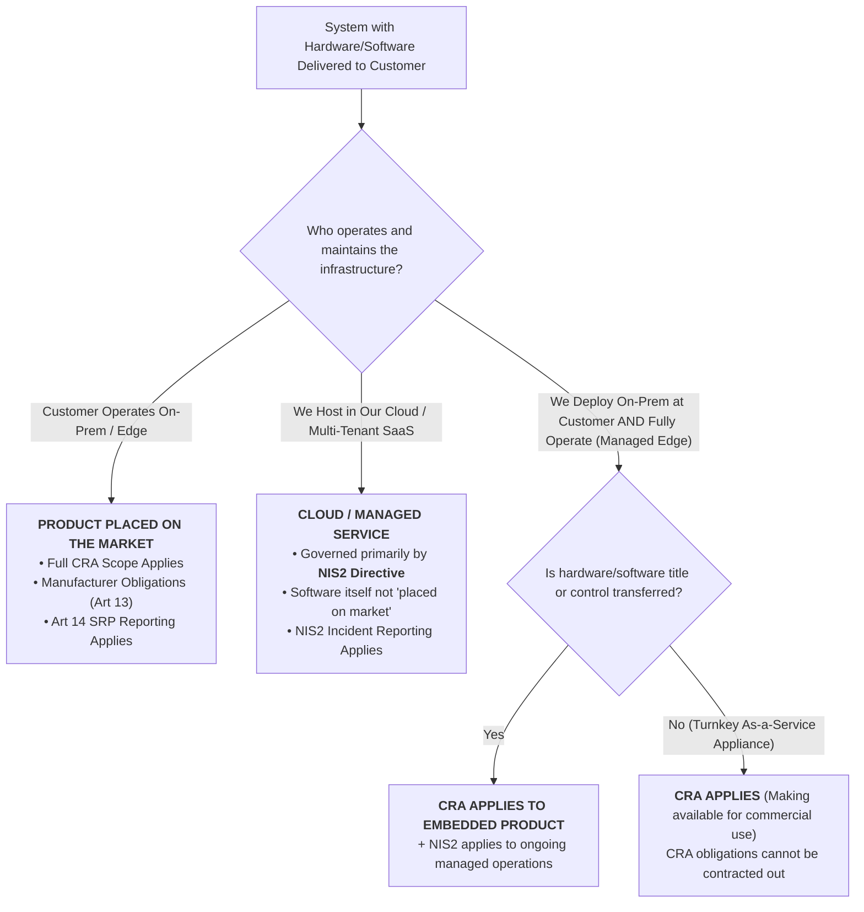

# EU Cyber Resilience Act (CRA) Group Master Procedure: Enterprise Vulnerability & Incident Governance (SEC-PRO-CRA-001)

**Document Reference:** `SEC-PRO-CRA-001`  
**Security Classification:** Group Confidential / Operational Mandatory  
**Effective Date:** 11 September 2026 (Article 14 Live Law) · Full Lifecycle Effective: 11 December 2027  
**Approved By:** Group Chief Information Security Officer (CISO), Group General Counsel, Head of Enterprise Product Assurance  
**Target Audience:** All Business Units (including MYBU), Central PSIRT, Legal, Systems Engineering, Product Management, Quality Assurance  
**Subordinate Documents:** BU-Specific Simplified Procedures (including `CRA_Reporting_Procedure.md` / MYBU-SOP-001)

---

## Executive Summary & Regulatory Authority

This Group Master Procedure establishes the enterprise-wide governance framework for compliance with **Regulation (EU) 2024/2847 (Cyber Resilience Act - CRA)**. 

While individual business units (such as MYBU) operate simplified field procedures for immediate intake and fast-path escalation, this Master Procedure governs **group-level legal liability, multi-BU coordination, formal RACI, immutable audit baselines, substantial modification assessments, and Market Surveillance Authority (MSA) defense**.

Where any business unit procedure conflicts with or is silent on requirements in `SEC-PRO-CRA-001`, **this Master Procedure strictly supersedes**.

---

## 1. Enterprise Governance & Multi-BU Architecture

### 1.1 The Legal Entity Principle (Single Point of Regulatory Accountability)
Under the CRA, regulatory obligations, statutory penalties, and single reporting platform credentials attach strictly to the **European Corporate Legal Entity** placing the product on the market (Articles 3(21) and 13), **never to an individual internal business unit**.

### 1.2 Centralized ENISA SRP Account Management & Anti-Collision Protocol
1. **Single Central Credentials**: No individual business unit may register independent manufacturer credentials on the ENISA Single Reporting Platform (SRP). Central PSIRT holds the master credentials tied to the Legal Entity's corporate EU Login.
2. **Designated Authorized Filers**: BU Compliance Officers (BLCOs) are provisioned delegated operator seats within the group tenant.
3. **Cross-BU Collision Deduplication**:
   - If an open-source library vulnerability (e.g., in `busybox` or `openssl`) affects products in multiple BUs, **Central PSIRT files a single coordinated notification** to ENISA SRP.
   - Separate filings from different BUs for the same vulnerability under the same legal entity are prohibited to prevent inconsistent legal statements or duplicative administrative dockets.

---

## 2. Enterprise RACI Matrix & Governance Controls

To satisfy Market Surveillance Authority scrutiny and European Commission standardisation mandates, accountability across all 11 lifecycle phases is mapped as follows:

* **R (Responsible):** The role that executes the action.
* **A (Accountable):** The single individual with final veto/approval authority.
* **C (Consulted):** Subject matter experts providing input.
* **I (Informed):** Roles notified of outcomes.

| Lifecycle Phase / Statutory Control | BU Engineer | BU Lead Architect | Central PSIRT | BU BLCO | Group Legal | Group CISO | Customer SDM |
|---|:---:|:---:|:---:|:---:|:---:|:---:|:---:|
| **1. Ingress & T0 Timestamping** | R | I | **A** | I | I | I | I |
| **2. Technical Reachability / Exploitability (Q4)** | C | **R** | C | A | I | I | I |
| **3. Non-Exploitability Attestation (NEDR)** | I | R | C | **A** | C | I | I |
| **4. 20-Hour Internal Target Formulation** | I | C | R | **A** | I | I | I |
| **5. 24-Hour Early Warning SRP Filing** | I | I | R | **A** | C | I | I |
| **6. 24-Hour Customer Security Alert (Art 14(8))** | I | C | C | A | C | I | **R** |
| **7. 72-Hour Detailed SRP Notification** | I | C | R | **A** | C | I | I |
| **8. Upstream Maintainer Disclosure (Art 13(5))** | I | I | **R** | A | I | I | I |
| **9. Workaround & Hotfix Deployment** | R | R | C | A | I | I | **R** |
| **10. 14-Day / 1-Month Final SRP Report** | I | C | R | **A** | C | I | I |
| **11. 10-Year WORM Evidence Archival** | I | I | R | **A** | I | I | I |

### 2.1 Compliance Service Level Indicators (SLIs) & KPIs
The Group CISO monitors four mandatory compliance metrics across all BUs:

1. **SLI-1 (Ingress-to-Triage Latency):** Maximum **4 hours** from `T0` to the completion of the 5-Question decision gate.
2. **SLI-2 (Internal Safety Buffer Compliance):** **100%** of Early Warnings formulated and ready for transmission within **20 hours** of `T0` (preserving a 4-hour emergency buffer).
3. **SLI-3 (Statutory Deadline Zero-Breach):** **0** missed 24h, 72h, or 14d statutory deadlines across all operating units.
4. **SLI-4 (Audit Trail Completeness):** **100%** compliance in 10-year WORM archival packages for all security events.

---

## 3. Structured CRA Object & System Register Specification

To resolve the limitation in §11 item 2 of the simplified procedure, all business units must register every delivered solution in the centralized **Group CRA Object Register**.

### 3.1 Object Hierarchy & Data Model
A CRA "Object" is defined as any product with digital elements, distinct subsystem, or firmware release placed on the market.

### 3.2 Automated Reachability & Inventory Queries
The Central PSIRT maintains a programmatic CLI query engine interfacing with the register:
* *Given CVE-2026-NNNNN in component X:* Immediately identifies which BUs, systems, firmware versions, and customer deployments contain component X within 15 minutes of advisory publication.

---

## 4. Non-Exploitability Verification & Immutable Baseline Governance

To resolve the limitation in §11 item 3, any decision to answer "No" to Question 4 (*"Is it exploitable in our build and configuration?"*) must strictly follow the **Group Evidentiary Standard for Non-Exploitability**.

### 4.1 Evidentiary Hierarchy
A finding of non-exploitability is legally defensible before an MSA only if substantiated by at least one of three technical tiers:

### 4.2 Configuration Baseline Invalidation Rule
Every Technical Non-Exploitability Determination Record (NEDR) is bound to an immutable configuration hash.
* **Automatic Invalidation:** If a customer modifies `/etc/configuration`, enables telemetry debug flags, alters firewall policies, or updates OS kernels, the NEDR **instantly invalidates**.
* **Re-Triage Obligation:** Upon notification of configuration change, PSIRT must re-execute the 5-Question triage within 24 hours.

---

## 5. Substantial Modification & Lifecycle Transition Rules

To resolve the limitation in §11 item 4, this section defines the boundary between normal software maintenance and **Substantial Modification (Article 13(8) and Article 22)**.

### 5.1 Substantial vs. Non-Substantial Modification Matrix

| Modification Type | Examples | CRA Classification | Regulatory Consequence |
|---|---|---|---|
| **Security Bug Fix / Hotfix** | Patching CVE heap overflow, updating openssl minor version | **Non-Substantial Modification** | Permitted under ongoing support; requires SBOM update and OpenVEX issuance; no new CE mark required. |
| **Defect Remediation** | Correcting memory leak, performance tuning, stability patch | **Non-Substantial Modification** | Module A internal record update; no Notified Body involvement. |
| **New Network Interface / Port Exposure** | Adding public REST API, opening new listening port on WAN | **SUBSTANTIAL MODIFICATION** | **Triggers Article 22:** Entity is deemed the manufacturer of a new product; requires new Annex VII TDF and updated EU DoC. |
| **New Cloud / Third-Party Integration** | Adding telemetry push to AWS/Azure, remote management daemon | **SUBSTANTIAL MODIFICATION** | Fundamental alteration of cybersecurity risk profile; full conformity assessment re-run. |
| **Addition of Cryptographic / Identity Functions** | Adding user authentication module, VPN tunneling, PKI daemon | **SUBSTANTIAL MODIFICATION + TIER UPGRADE** | May promote product from Default Category to Annex III Class I; mandates harmonised standard compliance. |

### 5.2 Transition to 11 December 2027 Obligations
1. **Essential Cybersecurity Requirements (Annex I Part I):** By December 2027, all products must be designed secure-by-default (no default passwords, encrypted communication, automatic integrity verification).
2. **CE Marking & EU Declaration of Conformity (Annex V):** CE mark must be affixed to hardware packaging, firmware splash screens, and documentation.
3. **10-Year WORM Technical Documentation Archive (Annex VII):** All 10 sections of the Technical Documentation File must be archived in tamper-proof storage.

---

## 6. The "Delivered and Operated" Legal Demarcation

To resolve the legal ambiguity noted in §11 item 5 (*"whether a system we deliver and then operate counts as a product on the market"*):

### 6.1 Regulatory Classification Rule
Under European Commission Blue Guide interpretations and CRA Article 3(21):

* **Core Legal Conclusion:** Where physical edge gateways, appliances, or on-premise software containers are installed in a customer environment—even if operated by our personnel under an MSA or managed service agreement—they constitute **products with digital elements made available on the Union market** (Article 3(22)). CRA Article 14 incident and vulnerability reporting applies unconditionally.

---

## 7. Multi-Entity Incident Escalation & Market Surveillance Defense

### 7.1 Cross-BU Escalation Workflow
When a local BLCO in MYBU (or any other BU) identifies an actively exploited vulnerability or severe incident:

1. **Step 1 (Immediate Ingress Alert - T+0h):** BU BLCO alerts `central-psirt@<COMPANY>` with raw email headers and initial T0 timestamp.
2. **Step 2 (Deduplication Check - T+2h):** Central PSIRT checks the Group CRA Object Register. If other BUs deploy the same component, PSIRT assumes central coordination.
3. **Step 3 (Legal Review - T+10h):** Group Legal confirms Lead CSIRT jurisdiction and approves any request for **Delayed Dissemination** under Delegated Regulation (EU) 2026/881.
4. **Step 4 (Filing Execution - T+18h to T+20h):** Authorized filer submits the Early Warning via the single corporate ENISA SRP account.
5. **Step 5 (Customer Broadcast - T+20h to T+24h):** SDMs dispatch Article 14(8) Proportional Customer Security Advisories to affected customer designated emergency contacts.
6. **Step 6 (10-Year WORM Archival - Post-Resolution):** All artifacts, screenshots, and logs are ingested into the group immutable compliance vault.

---

## 8. Document Governance & Revision History

| Version | Effective Date | Author / Owner | Approval Authority | Summary of Major Changes |
|---|---|---|---|---|
| **1.0** | 11 Sept 2026 | Group Head of Product Security | Group CISO, General Counsel | Initial baseline enterprise procedure governing Article 14 live law, multi-BU coordination, and resolving all Section 11 field procedure gaps. |
| **1.1** | Target: Q3 2027 | Head of Compliance Assurance | Group CISO | Incorporation of harmonised European standards (CEN/CENELEC) and Notified Body conformity workflows. |
| **2.0** | 11 Dec 2027 | Group CISO | Board of Management | Full enforcement of Annex I Essential Requirements, CE Marking, and Module A / B+C conformity controls. |
