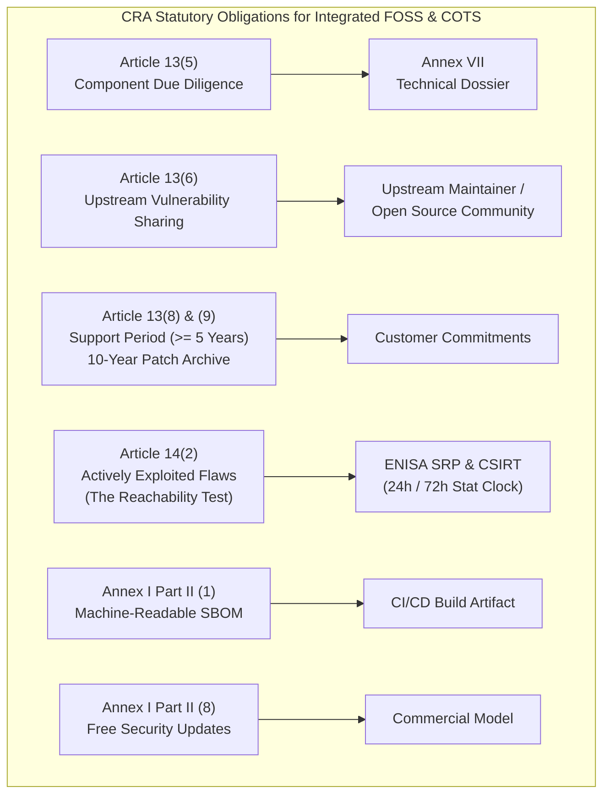
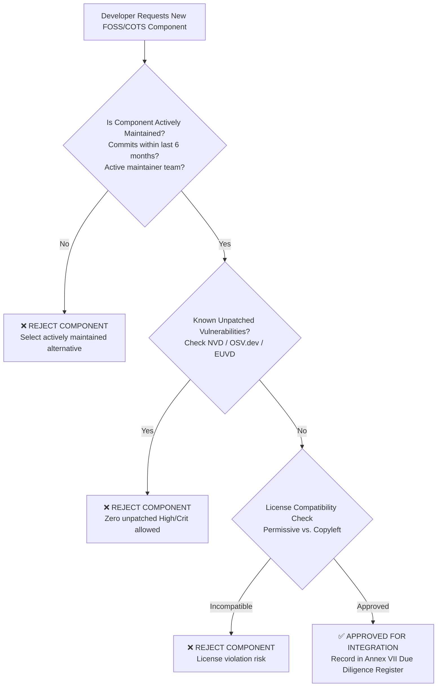
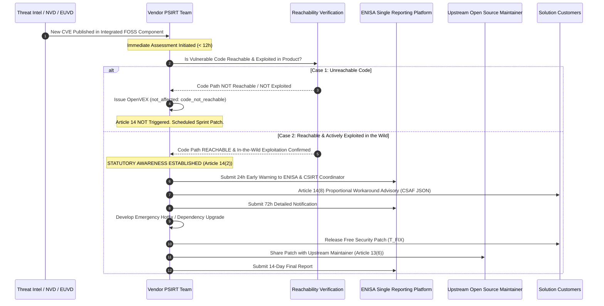

# EU Cyber Resilience Act (Regulation (EU) 2024/2847)
# Open Source (FOSS) & COTS Integration Compliance Guide
## Comprehensive Vendor Obligations Across Sell, Develop, Build, Deploy, and RUN Maintenance for Default Category Solutions

**Document Classification:** Internal Regulatory Standard & Engineering Policy  
**Target Organization:** Complete Solution Vendor (Sell, Develop, Build, Deploy, Support on RUN)  
**Regulatory Scope:** Exclusively **Default Category (Standard Products with Digital Elements)**  
**Conformity Assessment Route:** **Annex VIII Module A (Internal Production Control / 100% In-House)**  
**Governing Regulation:** Regulation (EU) 2024/2847 (Cyber Resilience Act - CRA)  
**Enforcement Horizon:** Article 14 live since 11 September 2026; General application 11 December 2027  
**Version:** 1.0 (Audit-Ready)

---

## Table of Contents
1. [Executive Summary & The Fundamental Legal Principle](#1-executive-summary--the-fundamental-legal-principle)
2. [Regulatory Foundations & Core CRA Obligations](#2-regulatory-foundations--core-cra-obligations)
   - Article 13(5): Component Due Diligence
   - Article 13(6): Upstream Vulnerability Reporting
   - Article 13(8): Support Period & The "Abandonware" Trap
   - Article 14(2): Actively Exploited Vulnerabilities & The Reachability Filter
   - Annex I Part II Point (1): Machine-Readable Software Bill of Materials (SBOM)
   - Annex I Part II Point (8): Free-of-Charge Security Updates
   - Article 13(9): 10-Year Security Update Download Archive
3. [Lifecycle Phase 1: SELLING (Presales, Pricing & Contractual Structuring)](#3-lifecycle-phase-1-selling-presales-pricing--contractual-structuring)
4. [Lifecycle Phase 2: DEVELOPING (Component Selection, Due Diligence & Threat Modeling)](#4-lifecycle-phase-2-developing-component-selection-due-diligence--threat-modeling)
5. [Lifecycle Phase 3: BUILDING (Supply Chain Integrity, CI/CD SBOM & Release Gates)](#5-lifecycle-phase-3-building-supply-chain-integrity-cicd-sbom--release-gates)
6. [Lifecycle Phase 4: DEPLOYING (Hardening, Configuration & Handover Documentation)](#6-lifecycle-phase-4-deploying-hardening-configuration--handover-documentation)
7. [Lifecycle Phase 5: SUPPORT on RUN Maintenance (Vulnerability Lifecycle, Upstream Sharing & Archiving)](#7-lifecycle-phase-5-support-on-run-maintenance-vulnerability-lifecycle-upstream-sharing--archiving)
8. [The Open-Source "Abandonware" Contingency Playbook](#8-the-open-source-abandonware-contingency-playbook)
9. [Standard Operating Procedures (SOPs) & Checklists](#9-standard-operating-procedures-sops--checklists)
   - SOP-OSS-01: Third-Party & Open Source Component Intake Review
   - SOP-OSS-02: Upstream Vulnerability Reporting Protocol (Article 13(6))
   - SOP-OSS-03: Component EOL & Emergency Forking Procedure
10. [Cross-Functional Enterprise RACI Matrix](#10-cross-functional-enterprise-raci-matrix)

---

## 1. Executive Summary & The Fundamental Legal Principle

### 1.1 The Golden Rule of CRA Component Integration
When a vendor integrates third-party components—whether **Free and Open Source Software (FOSS)** libraries or **Commercial Off-The-Shelf (COTS)** proprietary software—into a commercial solution:

> **THE VENDOR INHERITS 100% STATUTORY RESPONSIBILITY FOR THE ENTIRE INTEGRATED PRODUCT.**  
> Under Regulation (EU) 2024/2847, integrating a third-party component does **not** transfer or dilute the vendor’s statutory obligations. The vendor cannot shift liability to open-source maintainers, community foundations, or external software publishers. If an integrated component contains a flaw, goes unmaintained, or is actively exploited, **our organization is solely accountable to EU Market Surveillance Authorities and customers.**

```text
┌────────────────────────────────────────────────────────────────────────┐
│                      OUR COMMERCIAL SOLUTION                           │
│  ┌─────────────────────────┐        ┌───────────────────────────────┐  │
│  │   Proprietary Code      │        │  Integrated Open Source /     │  │
│  │   (Developed In-House)  │        │  COTS Software Components     │  │
│  └───────────┬─────────────┘        └───────────────┬───────────────┘  │
│              │                                      │                  │
│              ▼                                      ▼                  │
│  ┌──────────────────────────────────────────────────────────────────┐  │
│  │    100% STATUTORY LIABILITY ASSUMED BY OUR ORGANIZATION          │  │
│  │    • Annex I Essential Cybersecurity Requirements                 │  │
│  │    • Article 13 Manufacturer Obligations & 5-Year Support Floor  │  │
│  │    • Article 14 Mandatory 24h/72h ENISA SRP Reporting            │  │
│  │    • Annex VII Technical File, Annex V EU DoC & CE Marking       │  │
│  └──────────────────────────────────────────────────────────────────┘  │
└────────────────────────────────────────────────────────────────────────┘
```

### 1.2 The "Maintainer Immunity" Reality (Recitals 18 & 34)
The CRA specifically protects independent open-source developers:
- **No Commercial Activity**: FOSS developed or provided outside the course of a commercial activity is **excluded from CRA manufacturer obligations** (Recital 18, Article 3(48)).
- **Zero Recourse**: Open-source maintainers owe **no compliance obligations, no warranties, and no support periods** to commercial vendors who integrate their work.
- **The Vendor’s Duty**: If an integrated open-source component is abandoned, our organization is legally required to either **backport patches internally, fork the library, or replace it entirely**.

### 1.3 The Default Category (Module A) Operational Context
Because our solutions belong exclusively to the **Default Category (Standard Products)**:
- We verify all FOSS/COTS components **100% in-house** via **Annex VIII Module A (Internal Production Control)**.
- We do **not** need an external Notified Body to audit our open-source dependencies.
- However, our **Annex VII Technical Documentation** must contain full verifiable proof of due diligence, machine-readable Software Bills of Materials (SBOMs), and vulnerability handling for every single integrated component.

---

## 2. Regulatory Foundations & Core CRA Obligations



### 2.1 Article 13(5): Mandatory Component Due Diligence
Manufacturers must exercise **due diligence** when integrating third-party components. Due diligence is not a passive checkbox; it requires verifiable pre-integration testing and ongoing health checks:
1. **Verification of Security Posture**: Check whether the component has demonstrated conformity (CE mark for COTS) or follows secure development lifecycles (SSDLC).
2. **Vulnerability History Review**: Search public vulnerability databases (NVD, OSV.dev, GitHub Advisory Database, and the forthcoming EU Vulnerability Database - EUVD) for open, unpatched, or recurring vulnerabilities.
3. **Independent Security Testing**: Execute automated static analysis (SAST), software composition analysis (SCA), and dynamic testing on the component prior to incorporation.
4. **Active Maintenance Screening**: Verify that the component is actively maintained, has regular commit activity, and responds promptly to security disclosures.

### 2.2 Article 13(6): Upstream Vulnerability Reporting
If our engineering, security, or testing teams discover a vulnerability in an integrated third-party component:
- **Mandatory Notification**: We must report the vulnerability to the component maintainer / developer without undue delay.
- **Remediation Sharing**: Where our engineers develop a patch, hotfix, or workaround for the flaw, we must share the fix with the upstream maintainer in a licence-compatible format.
- **Exceptions to Reporting**: Reporting upstream is **not** required if:
  - The maintainer is already aware of the vulnerability;
  - The component is abandoned with no identifiable maintainer; or
  - The vulnerability arises solely from our specific proprietary integration, rather than the component itself.

### 2.3 Article 13(8): Support Period & The "Abandonware" Trap
- **Statutory 5-Year Floor**: Our solution must carry a declared support period of at least **five (5) years** (unless a shorter operational lifetime is formally justified).
- **The Upstream Disconnect**: If our solution integrates an open-source library whose maintainers declare End-Of-Life (EOL) after 18 months, **our 5-year customer commitment does NOT end**. We are statutorily required to maintain security patches for that component for the full remaining 3.5 years.

### 2.4 Article 14(2): Actively Exploited Vulnerabilities & The Reachability Filter
Article 14 reporting (live since 11 September 2026) mandates submitting a **24-hour Early Warning** and **72-hour Notification** to ENISA and the national CSIRT coordinator for actively exploited vulnerabilities:
- **The Reachability Test (Commission Guidance Point 218)**:
  - If a CVE in an integrated open-source component is actively exploited in the wild, but our application architecture renders that code path **unreachable and unexploitable**, it is **NOT reportable under Article 14(2)**.
  - If the vulnerable code path **is reachable and actively exploited**, our organization must report it within **24 hours of awareness**, even though we did not write the vulnerable library code!

### 2.5 Annex I Part II Point (1): Machine-Readable SBOM
The product must include an automated, machine-readable **Software Bill of Materials (SBOM)** identifying all top-level and transitive dependencies, their versions, package URLs, and cryptographic hashes.

### 2.6 Annex I Part II Point (8): Free-of-Charge Security Updates
All security updates addressing vulnerabilities in integrated FOSS/COTS components must be delivered to customers **free of charge** during the declared support period.

### 2.7 Article 13(9): 10-Year Security Update Download Archive
Security patches issued to fix open-source vulnerabilities must remain preserved and downloadable by customers for **at least 10 years** following release or for the remainder of the support period, whichever is longer.

---

## 3. Lifecycle Phase 1: SELLING (Presales, Pricing & Contractual Structuring)

```text
[ Presales Scoping ] ──▶ [ Support Period Commitment ] ──▶ [ Pricing & Margin Structuring ] ──▶ [ B2B Contract Demarcation ]
Audit FOSS Stack         Align to 5-Year Floor             Factor Internal Patch Backporting    Schedule A Addendum
```

### 3.1 Presales Scoping & FOSS Dependency Auditing
Before finalizing a commercial proposal:
- **Dependency Inventory Check**: Presales architects must review the preliminary High-Level Design (HLD) to identify core open-source frameworks (e.g., Spring Boot, Django, Node.js runtimes, OpenSSL).
- **Longevity Validation**: Check upstream release roadmaps. If an upstream framework reaches EOL within 24 months, presales must budget for a major version upgrade within the project delivery plan.

### 3.2 Pricing the "Open Source Maintenance Surcharge"
Because Annex I Part II Point (8) prohibits charging for security patches, product pricing must account for internal maintenance of open-source components:
- **The Cost of Free Software**: Integrating open-source eliminates initial license fees, but transfers ongoing security maintenance, backporting, and testing costs to the vendor.
- **Financial Rule**: Factor an **annual maintenance reserve (typically 12–18% of engineering development cost)** into the solution’s multi-year commercial pricing model to fund internal dependency updates and patch backports.

### 3.3 Contractual Structuring with Enterprise Customers
Every customer contract must incorporate [Schedule A (CRA Customer Addendum)](./CRA_Contractual_Templates_and_Addenda.md#2-schedule-a-b2b-customer-cybersecurity--cra-compliance-addendum):
- **Single Point of Warranty**: The contract must state that our organization warrants the integrated solution as a unified system, relieving the customer from inspecting third-party open-source components.
- **Demarcation of Operational Patching**: The vendor is obligated to deliver patches for FOSS/COTS components; the customer is contractually covenanted to apply them within **30 calendar days** of release.
- **Article 13(10) Version Upgrade Covenant**: The contract must stipulate that when an upstream open-source dependency requires a major architectural upgrade to resolve a vulnerability, the customer agrees to adopt the upgraded version provided it is delivered free of charge without extra infrastructure costs.

### 3.4 COTS vs. FOSS Supplier Contracts
- **For COTS Suppliers**: Execute [Schedule B (Supplier Flow-Down Addendum)](./CRA_Contractual_Templates_and_Addenda.md#3-schedule-b-upstream-supplier--subcontractor-flow-down-addendum) enforcing a **12-hour Article 14 notification SLA**, automated SBOM delivery, and 5-year patch availability.
- **For FOSS Dependencies**: Because open-source maintainers cannot be bound by commercial contracts, establish an internal **FOSS Engineering Contingency Fund** to handle backports and emergency forking.

---

## 4. Lifecycle Phase 2: DEVELOPING (Component Selection, Due Diligence & Threat Modeling)



### 4.1 Component Due Diligence Protocol (Article 13(5))
Engineering teams must follow a strict intake procedure before running `npm install`, `pip install`, `go get`, or adding Maven/Cargo dependencies:

#### 1. Due Diligence Scoring Criteria (Minimum Acceptance Thresholds)
| Evaluation Metric | Minimum Acceptable Threshold | Rationale & Regulatory Basis |
|---|---|---|
| **Upstream Activity** | Last commit $< 6$ months ago; release $< 12$ months ago | Avoids incorporating unmaintained code at design time. |
| **Maintainer Vitality** | $\ge 2$ active maintainers or sponsored foundation | Mitigates single-maintainer burnout / sudden abandonment. |
| **Known Vulnerabilities** | **Zero (0)** unpatched Critical or High CVEs | Article 13(5) mandate to deliver without known flaws. |
| **Security Track Record** | Published security policy or security.txt present | Verifies upstream willingness to handle security reports. |
| **OpenSSF Scorecard** | Score $\ge 6.0$ out of 10.0 (where available) | Independent objective verification of repository posture. |

#### 2. Rejection Rules
- ❌ **Abandoned Repositories**: Any repository marked "Archived", "Read-Only", or lacking commits for over 12 months is strictly barred from integration.
- ❌ **Typosquatting & Unverified Packages**: Dependencies must originate from verified publishers or official namespace scopes (e.g., `@angular/`, `org.springframework`).

### 4.2 Architecture & Reachability by Design
To insulate the solution from upstream component vulnerabilities:
1. **Attack Surface Minimization (Annex I Part I Point (2))**:
   - Import only necessary sub-modules (e.g., import `lodash/get` rather than the entire `lodash` utility suite).
   - Never import development dependencies (`devDependencies`, test runners, mocking libraries) into production runtimes.
2. **Defensive Wrappers & API Facades**:
   - Wrap third-party components behind internal adapter interfaces. If a component suffers a critical zero-day or is abandoned, the adapter allows swapping the underlying library with minimal refactoring.
3. **Privilege & Process Isolation**:
   - Run components requiring native system execution in isolated child processes with sandboxing, restricted file permissions, and no root capabilities.

---

## 5. Lifecycle Phase 3: BUILDING (Supply Chain Integrity, CI/CD SBOM & Release Gates)

```text
[ Hermetic Build ] ──▶ [ Automated CycloneDX SBOM ] ──▶ [ SCA & Reachability Scan ] ──▶ [ CRA Quality Release Gate ]
Pinned Lockfiles       Annex II Transparency            Trivy / Semgrep Supply Chain     Zero Active Exploits (KEV)
```

### 5.1 Hermetic Builds & Dependency Pinning
To protect against supply chain tampering (e.g., compromised upstream PyPI or npm accounts):
- **Mandatory Strict Lockfiles**: Every project must commit cryptographic lockfiles (`package-lock.json`, `poetry.lock`, `Cargo.lock`, `go.sum`). Build pipelines must execute with strict validation (`npm ci`, `poetry install --no-root`, `go mod verify`).
- **Internal Artifact Mirroring**: Never pull dependencies directly from the public internet during production builds. Route all dependency resolution through an internal cached proxy (e.g., Nexus, Artifactory, or OpenBao-secured registry) that performs pre-caching vulnerability scanning.

### 5.2 Automated CycloneDX SBOM Compilation
Build pipelines must execute [`cra_ci_pipeline_gate.py`](./cra_ci_pipeline_gate.py) on every release build:
- **Format**: CycloneDX v1.5 JSON or SPDX v2.3 JSON.
- **Coverage**: 100% of direct and transitive dependencies cataloged.
- **Attributes Captured**: Package URL (`purl`), Common Platform Enumeration (`cpe`), SHA-256 build checksum, component authorship, and SPDX license expression.

### 5.3 Automated SCA, Reachability & Gating Policy
The build pipeline enforces three non-negotiable release gates:

| Quality Gate | Regulatory Standard | Gate Action |
|---|---|---|
| **Gate 1: SBOM Generation** | Annex I Part II Point (1) & Annex VII Point 5 | **BLOCK BUILD** if SBOM generation fails or contains 0 components. |
| **Gate 2: Active Exploitation Screen (KEV)** | CRA Article 14(2) & Article 3(42) | **BLOCK BUILD** if any reachable component contains a CVE listed in CISA KEV or EUVD active exploitation feeds. Triggers immediate Article 14 escalation. |
| **Gate 3: Severity Policy** | Annex I Part I Point (1) | **BLOCK BUILD** on any unmitigated CRITICAL vulnerability unless an accredited OpenVEX justification (`code_not_reachable`) is compiled. |

### 5.4 OpenVEX Generation for Non-Reachable Vulnerabilities
When an integrated open-source library contains a theoretical CVE, but our application does not invoke the vulnerable code path:
- The build pipeline compiles an **OpenVEX (v0.2.0)** statement marking status as `not_affected`.
- Justification: `code_not_reachable`.
- The OpenVEX file is preserved alongside the SBOM in the release package, satisfying Annex VII documentation requirements.

---

## 6. Lifecycle Phase 4: DEPLOYING (Hardening, Configuration & Handover Documentation)

```text
[ Binary Stripping ] ──▶ [ Secure Default Config ] ──▶ [ Annex II User Manual ] ──▶ [ Deployment Handover ]
Remove Dev Artifacts     Disable Unneeded COTS Ports   Component Inventory Link     Signed Demarcation Form
```

### 6.1 Deployment Bundle Hygiene
When building deployment packages (Docker images, VM appliances, or bare-metal installers):
- **Strip Development Artifacts**: Purge compilers, debuggers, git directories, and test suites from production container images (multi-stage Docker builds mandatory).
- **Embedded COTS/FOSS Hardening**:
  - Disable default administrative interfaces, sample databases, and demo endpoints embedded in COTS software (e.g., embedded web servers, Swagger UI in production).
  - Enforce TLS encryption for all inter-component communication (e.g., between app server and embedded database).

### 6.2 Annex II Security Information for Customers
Under CRA Annex II, customer-facing documentation must include:
1. **Component Transparency Summary**: Inform customers of core third-party runtimes and open-source foundations included in the solution.
2. **Operational Security Instructions**: Provide step-by-step hardening instructions for any customer-managed dependencies (e.g., recommended OS kernel parameters, network firewall rules).
3. **Contact for Vulnerability Disclosure**: Clearly display the link to our Coordinated Vulnerability Disclosure (CVD) intake and `security.txt`.

### 6.3 Commissioning & Demarcation Sign-Off
During solution commissioning at customer premises or managed cloud environments:
- Execute the **CRA Deployment Handover Certificate**.
- Customer explicitly signs off that:
  - Solution has been installed with secure defaults;
  - Customer acknowledges responsibility for applying vendor-provided security updates within 30 days; and
  - Customer will not alter underlying open-source configurations in ways that trigger **Article 22 Substantial Modification**.

---

## 7. Lifecycle Phase 5: SUPPORT on RUN Maintenance (Vulnerability Lifecycle, Upstream Sharing & Archiving)



### 7.1 Continuous Post-Market Vulnerability Monitoring
Post-market monitoring is a statutory legal obligation under CRA Article 13(4) and Annex I Part II:
- **Automated Daily Matching**: Our internal vulnerability scanner ([`cra-agent`](file:///root/cra-agent)) performs daily automated cross-checks of our published CycloneDX SBOMs against:
  - CISA Known Exploited Vulnerabilities (KEV)
  - Open Source Vulnerabilities (OSV.dev)
  - National Vulnerability Database (NVD)
  - European Vulnerability Database (EUVD)
- **Triage SLA**: Any new CVE affecting an integrated component must be triaged by PSIRT within **24 hours of publication**.

### 7.2 The Reachability Triage Protocol
When a CVE is reported in an integrated FOSS library:
1. **Step 1: Check Component Inclusion**: Does our active release package bundle this library version?
2. **Step 2: Check Static Reachability**: Does our source code call the specific vulnerable method, class, or API?
3. **Step 3: Check Dynamic Exploitability**: Can an external network packet, authenticated user, or malicious input reach that function in production?
4. **Step 4: Classification**:
   - *Not Reachable*: Compile OpenVEX statement; schedule standard upgrade in next maintenance cycle.
   - *Reachable but Not Exploited*: Develop patch under standard SLA (Critical: 7 days, High: 21 days).
   - *Reachable and Actively Exploited*: **Immediate statutory escalation under Article 14!**

### 7.3 Article 14 Live Reporting for FOSS Flaws
If an open-source dependency vulnerability is **actively exploited in the wild and reachable in our product**:
- **T + 24 Hours of Awareness**: File the Early Warning on the ENISA Single Reporting Platform (`portal.cra-srp.enisa.europa.eu`).
- **T + 72 Hours of Awareness**: File the Detailed Notification.
- **T + 14 Calendar Days of Patch Release**: File the Final Remediation Report.
- Use [`cra_article14_deadlines.py`](./cra_article14_deadlines.py) to manage the countdown.

### 7.4 Article 13(6) Upstream Vulnerability Reporting Workflow
When our engineers discover a new zero-day or develop a proprietary patch for an open-source dependency:
1. **Coordinated Disclosure**: Contact the upstream maintainer via their documented security intake (e.g., `security.txt`, GitHub Private Vulnerability Reporting).
2. **Fix Contribution**: Submit the patch or pull request in a licence-compatible manner (e.g., Apache 2.0, MIT).
3. **Embargo Coordination**: Agree on a synchronized disclosure date (standard: 30 to 90 days), ensuring our commercial customers receive mitigating updates in tandem.
4. **Evidence Archival**: Store email correspondence and PR links in Section 6 of the Annex VII Technical File.

### 7.5 10-Year Patch Archive Maintenance (Article 13(9))
- Every security patch addressing an open-source flaw must be uploaded to our tamper-evident, write-once download repository.
- Must remain accessible to licensed customers for **at least 10 years** following release date.

---

## 8. The Open-Source "Abandonware" Contingency Playbook

A major regulatory risk under the CRA is the **Upstream Abandonment Scenario**: An open-source project embedded in our solution is abandoned by its community, but our product’s declared support period still has several years remaining.

```text
┌────────────────────────────────────────────────────────────────────────┐
│               UPSTREAM FOSS PROJECT ABANDONED (EOL)                    │
│      Maintainer steps down • No releases • Unpatched CVE emerges       │
└───────────────────────────────────┬────────────────────────────────────┘
                                    │
                                    ▼
       ┌─────────────────────────────────────────────────────────┐
       │   DOES OUR DECLARED 5-YEAR SUPPORT PERIOD STILL RUN?    │
       │               YES: STATUTORY DUTY REMAINS               │
       └────────────────────────────┬────────────────────────────┘
                                    │
         ┌──────────────────────────┼──────────────────────────┐
         │                          │                          │
         ▼                          ▼                          ▼
   [ STRATEGY 1 ]             [ STRATEGY 2 ]             [ STRATEGY 3 ]
  INTERNAL FORK &            DROP-IN REPLACEMENT        INLINE WRAPPER /
  BACKPORT PATCH              (SWAP COMPONENT)          COMPENSATING CONTROL
```

### Strategy 1: Internal Fork & Security Backporting
- **When to Use**: When the library is deeply coupled with core application logic and cannot be swapped without breaking architecture.
- **Protocol**:
  1. Fork the upstream repository into our organization’s secure enterprise GitHub/GitLab space.
  2. Maintain a dedicated branch for security backports only.
  3. Apply the security patch internally, rebuild, run regression suites, and release to customers.
  4. Offer the patch publicly to the community (fulfilling Article 13(6)).

### Strategy 2: Drop-In Replacement Migration
- **When to Use**: When an active, compliant alternative library exists with compatible APIs.
- **Protocol**:
  1. Migrate the dependency in our codebase to the actively maintained alternative.
  2. Release the updated version to customers under CRA Article 13(10) (free of charge and without additional infrastructure costs).
  3. Notify customers that support for the earlier version will terminate pursuant to Article 13(19).

### Strategy 3: Inline Defensive Mitigation / Wrapper Control
- **When to Use**: Temporary stopgap while engineering develops a permanent replacement.
- **Protocol**:
  1. Implement input sanitation, WAF rules, or disable the specific vulnerable sub-feature.
  2. Publish an interim customer advisory (CSAF JSON) and update the OpenVEX document to status `not_affected` with justification `inline_mitigation_already_present`.

---

## 9. Standard Operating Procedures (SOPs) & Checklists

### SOP-OSS-01: Third-Party & Open Source Component Intake Review
- **Owner**: Product Security Officer & Lead Architect
- **Trigger**: Developer submits PR adding new dependency to `package.json`, `requirements.txt`, `pom.xml`, or `go.mod`.
- **Steps**:
  1. Verify repository is active (commits within last 6 months).
  2. Run SCA scan verifying zero unpatched Critical/High CVEs.
  3. Validate license compatibility (Permissive / Apache / MIT approved; AGPL/GPL requires legal review).
  4. Sign off on intake ticket; record in the **Annex VII Component Due Diligence Register**.

### SOP-OSS-02: Upstream Vulnerability Reporting Protocol (Article 13(6))
- **Owner**: Vendor PSIRT Lead
- **Trigger**: Discovery of previously uncataloged flaw in third-party FOSS/COTS component.
- **Steps**:
  1. Document technical reproduction and proof-of-concept.
  2. Submit report confidentially via GitHub Security Advisories or maintainer security email.
  3. Attach developed patch/workaround under the component's open-source license.
  4. Log disclosure timestamp and confirmation receipt in Section 6 of the Technical File.

### SOP-OSS-03: Component EOL & Emergency Forking Procedure
- **Owner**: Engineering Lead & CISO
- **Trigger**: Third-party component maintainer announces End-Of-Life while solution is in active RUN phase.
- **Steps**:
  1. Log an **Upstream EOL Risk Ticket** in internal issue tracker.
  2. Assess remaining duration of product’s declared support period.
  3. Execute technical assessment: determine whether to fork and backport or schedule drop-in migration.
  4. If forking: clone repository, restrict commit access to senior engineers, and run automated SAST on fork.

---

## 10. Cross-Functional Enterprise RACI Matrix

| Open Source & COTS Obligation | Presales | Engineering | DevOps / Build | Professional Services | PSIRT / Support | Legal & CISO |
|---|:---:|:---:|:---:|:---:|:---:|:---:|
| **FOSS Due Diligence Review (Art. 13(5))** | I | **R** | I | I | C | **A** |
| **5-Year FOSS Maintenance Cost Pricing** | **R** | C | I | I | I | **A** |
| **Strict Lockfile & Artifact Pinning** | I | C | **A / R** | I | I | C |
| **Automated CycloneDX SBOM in CI/CD** | I | C | **A / R** | I | I | C |
| **SCA Reachability & Release Gating** | I | C | **A / R** | I | I | **A** |
| **Deployment Bundle Binary Stripping** | I | C | **A / R** | C | I | I |
| **Annex II Security Information Manual** | I | **R** | I | C | C | **A** |
| **Continuous Daily Vulnerability Monitoring** | I | I | I | I | **A / R** | C |
| **Article 14 Live SRP Reporting for FOSS** | I | C | I | I | **R** | **A** |
| **Article 13(6) Upstream Patch Sharing** | I | **R** | I | I | **R** | **A** |
| **Emergency Forking of Abandoned FOSS** | I | **A / R** | C | I | C | C |
| **10-Year Patch Archive Retention (Art. 13(9))**| I | I | **R** | I | **R** | **A** |
| **Annex VII Component Technical Dossier** | I | **R** | C | I | C | **A** |

*(R = Responsible for execution, A = Accountable / Sign-off authority, C = Consulted, I = Informed)*
