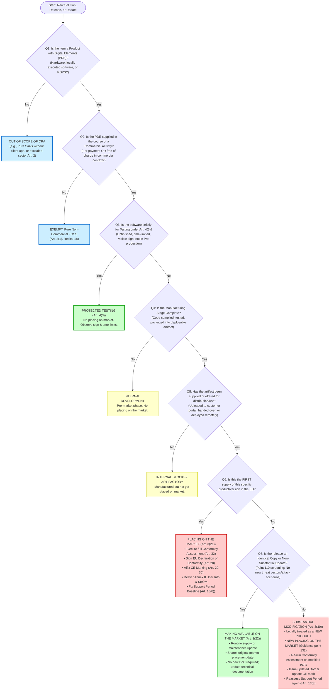

# CRA Legal Analysis: “Placing on the Market” vs. “Making Available on the Market” Throughout a Solution Lifecycle

**Authoritative Legal and Technical Reference Guide for Software and Integrated Solution Providers**  
**Governing Regulation:** Regulation (EU) 2024/2847 (Cyber Resilience Act — CRA)  
**Publication Reference:** OJ L, 2024/2847, 20.11.2024; Corrigendum OJ L, 2024/90782, 05.12.2024  
**Date of Assessment:** October 2026  

---

## 1. Executive Summary

### 1.1 Core Regulatory Problem
In modern software engineering and enterprise digital delivery, software is rarely delivered as a static, shrink-wrapped commodity. Solution providers routinely execute commercial agreements for solutions not yet coded, deliver bespoke systems into client-managed cloud or on-premises environments, integrate third-party components, continuously push updates, and manage multi-year release pipelines across contractual milestones.

Under European Union product harmonisation law, and specifically under **Regulation (EU) 2024/2847 (Cyber Resilience Act — CRA)**, the entire regulatory architecture hinges on two foundational legal concepts rooted in the New Legislative Framework (NLF):
1. **“Making available on the market”** (Article 3(22)): Any supply of a product with digital elements for distribution or use on the Union market in the course of a commercial activity, whether in return for payment or free of charge.
2. **“Placing on the market”** (Article 3(21)): The *first* making available of a product with digital elements on the Union market.

A pervasive, high-risk misconception in IT and engineering organizations is the conflation of **contractual milestones** (contract signature, statement of work execution, factory acceptance testing, delivery handover, customer sign-off) with **statutory product compliance events** (placing on the market). A contractual agreement to develop software does not place a product on the market. Conversely, uploading an installable release artifact to an EU customer repository or pushing a remote deployment into production often constitutes a legal market placement, regardless of whether formal acceptance testing has concluded.

### 1.2 Key Legal Conclusions for Solution Providers

1. **Contract Signature is Not Market Placement:** Signing a contract for a custom or future solution before software development is completed does not constitute placing on the market or making available on the market. Under Section 2.2 of the EU Blue Guide (Commission Notice 2022/C 247/01), market placement presupposes that the manufacturing stage is complete. A non-existent product cannot legally be placed on the market.
2. **The Build Artifact vs. Legal Supply:** The internal completion of a compilation, container image, or firmware build inside a continuous integration/continuous delivery (CI/CD) pipeline does not constitute placing on the market as long as the artifact remains within the manufacturer’s internal control and development environment.
3. **The Software Placement Moment (Guidance C(2026) 5252, Point 14):** For standalone software, the legal event of "placing on the market" occurs when the manufacturing phase is complete and the software version is **first supplied for distribution or use** (e.g., published for download or transferred to a customer). At that precise instant, all copies of that software version are legally deemed placed on the market simultaneously. Subsequent downloads or installations of that *same identical version* constitute instances of **making available on the market**, not new placings on the market.
4. **Maintenance, Patches, and Non-Substantial Releases (Points 15 & 108):** Routine bug fixes, security patches, minor feature updates, and dependency maintenance that do *not* qualify as a "substantial modification" under Article 3(30) do **not** trigger a new placing on the market. Crucially, they share the original version’s market-placement date (Commission Guidance C(2026) 5252, Example 2). They do not require a new conformity assessment procedure or reset the product's statutory support period.
5. **Substantial Modification Triggers a New Placing on the Market (Recital 41, Point 132):** Where a subsequent release—even if planned in the original multi-year contract—introduces changes that alter the cybersecurity risk profile beyond what was originally evaluated and mitigated in the initial cybersecurity risk assessment, or alters the intended purpose, it constitutes a **substantial modification** (Article 3(30)). Under Article 21, Article 22, and Guidance point 132, the substantially modified release is legally treated as a **new product**, and its supply constitutes a **new placing on the market**, requiring a new or updated conformity assessment, technical documentation, EU Declaration of Conformity, and support period reassessment.
6. **Tailor-Made / Bespoke Software is in Scope:** Custom software engineered for a single customer is **not** exempt from the CRA. Unless developed strictly for the organization's own internal use (Blue Guide Section 2.3), bespoke software supplied to a third-party commercial user is placed on the market. The CRA only permits two narrow, contractually negotiated deviations for tailor-made software: the secure-by-default configuration requirement (Annex I, Part I, point 2(b)) and the free-of-charge security update requirement (Annex I, Part II, point 8) may be waived by explicit contractual agreement (Recital 64; CRA FAQ 4.2.5). All other requirements (risk assessment, vulnerability handling, technical documentation, CE marking, and Article 14 incident reporting) remain fully mandatory.
7. **SaaS vs. Remote Data Processing Solutions (RDPS):** Pure cloud/SaaS software executing exclusively on remote servers and merely accessed via a standard browser or client is not a product with digital elements (PDE) (Recitals 11 & 12; Guidance point 21). However, if cloud processing is developed by or under the responsibility of the manufacturer and its absence prevents an on-premises or client-side PDE from performing one of its functions, that cloud backend constitutes a **Remote Data Processing Solution (RDPS)** under Article 3(2) and is fully integrated into the PDE's regulatory perimeter.
8. **Article 14 Reporting is Live Today (Since 11 September 2026):** While the general application of essential requirements and CE marking takes effect on **11 December 2027** (Article 71(2)), the **Article 14 reporting obligations** for actively exploited vulnerabilities and severe incidents became legally binding on **11 September 2026**. Under Article 69(3), this reporting duty applies retroactively to **all in-scope products**, including those placed on the market before 11 December 2027, and persists even after a product's declared support period expires (Guidance point 210).

---

## 2. Scope, Assumptions, and Terminology

### 2.1 Solution Provider Operating Model
This legal analysis examines an organization acting as a **solution provider** in the software and systems engineering sector. The provider operates across diverse commercial arrangements:
- Selling integrated IT, OT, or IoT solutions prior to completion of engineering.
- Developing bespoke applications or adapting commercial off-the-shelf (COTS) software under master services agreements (MSAs) and statements of work (SOWs).
- Building, packaging, and hosting software release artifacts.
- Deploying releases remotely into customer clouds, on-premises data centers, or edge devices.
- Maintaining production environments through Level 2/Level 3 application support, continuous patching, and security maintenance.
- Developing contractually scheduled major functional updates (e.g., Year 2 and Year 3 releases).
- Sourcing and integrating third-party software libraries, open-source software (FOSS), hardware appliances, and cloud services.
- Providing managed software services (operating the software on behalf of the client).

### 2.2 Rebutting False Assumptions
To ensure strict regulatory compliance, the following assumptions must be formally dismissed:
- *Assumption 1 (Rejected): "The solution provider is automatically the CRA manufacturer for everything it delivers."*  
  **Correction:** Manufacturer status (Article 3(13)) depends on who develops the PDE and markets it under their own name or trademark. If the solution provider integrates third-party branded products without altering them or branding them, it acts as a distributor (Article 3(17)) or integrator. If it modifies an existing product substantially, it may be deemed a manufacturer under Article 21 or 22.
- *Assumption 2 (Rejected): "An entire integrated multi-vendor enterprise solution constitutes a single product with digital elements."*  
  **Correction:** Complex systems may consist of multiple distinct products with digital elements placed on the market separately by different economic operators (Article 3(1), Guidance point 29). The system boundary must be legally dissected into separate PDEs versus unified integrated products.
- *Assumption 3 (Rejected): "Every software build, sprint release, or semantic version bump constitutes a new product with a new market placement."*  
  **Correction:** Under Commission Guidance C(2026) 5252 (points 14–15), iterative updates that do not constitute substantial modifications share the original release's placement date and do not represent new products.
- *Assumption 4 (Rejected): "Bespoke software developed for a single client under a professional services agreement is exempt from product safety regulations."*  
  **Correction:** EU product harmonisation rules apply to individual products supplied in commercial activity. The CRA contains no general exemption for bespoke, custom, or tailor-made software.

### 2.3 Terminology Baseline
- **Product with Digital Elements (PDE) (Art. 3(1)):** Any software or hardware product and its remote data processing solutions, including software or hardware components being placed on the market separately.
- **Remote Data Processing Solution (RDPS) (Art. 3(2)):** Any data processing at a distance for which the software is designed and developed by the manufacturer, or under its responsibility, and the absence of which would prevent the PDE from performing one of its functions.
- **Economic Operator (Art. 3(12)):** The manufacturer, the authorised representative, the importer, the distributor, the open-source software steward, or any other natural or legal person subject to CRA obligations.
- **Manufacturer (Art. 3(13)):** Any natural or legal person who develops or manufactures PDEs or has PDEs designed, developed, or manufactured, and markets them under its name or trademark, whether for payment, monetisation, or free of charge.
- **Placing on the Market (Art. 3(21)):** The first making available of a PDE on the Union market.
- **Making Available on the Market (Art. 3(22)):** Any supply of a PDE for distribution or use on the Union market in the course of a commercial activity, whether in return for payment or free of charge.
- **Putting into Service (Art. 3(23)):** The first use of a PDE in the Union by its user for its intended purpose.
- **Substantial Modification (Art. 3(30)):** A change to the PDE following its placing on the market which affects its compliance with Annex I, Part I essential requirements, or which results in a modification to the intended purpose for which it was assessed.
- **Support Period (Art. 13(8)):** The period during which the manufacturer ensures that vulnerabilities of the PDE are handled effectively in accordance with Annex I, Part II.

---

## 3. Applicable CRA Legal Framework

### 3.1 Primary Legal Authorities
1. **Regulation (EU) 2024/2847** of the European Parliament and of the Council of 23 October 2024 on horizontal cybersecurity requirements for products with digital elements and amending Regulations (EU) No 168/2013 and (EU) 2019/1020 and Directive (EU) 2020/1828 (Cyber Resilience Act) ([OJ L, 2024/2847, 20.11.2024](https://eur-lex.europa.eu/legal-content/EN/TXT/?uri=OJ:L_202402847)).
2. **Corrigendum to Regulation (EU) 2024/2847** of 5 December 2024, correcting administrative fine references in Article 64(10) ([OJ L, 2024/90782, 05.12.2024](https://eur-lex.europa.eu/legal-content/EN/TXT/?uri=OJ:L_202490782)).

### 3.2 Binding Implementing and Delegated Acts
1. **Commission Implementing Regulation (EU) 2025/2392** of 28 November 2025 laying down technical descriptions and specifications for categories of important and critical products with digital elements listed in Annexes III and IV to Regulation (EU) 2024/2847 ([OJ L, 2025/2392, 01.12.2025](https://eur-lex.europa.eu/legal-content/EN/TXT/?uri=OJ:L_202502392)).
2. **Commission Delegated Regulation (EU) 2026/881** of 11 December 2025 supplementing Regulation (EU) 2024/2847 by specifying grounds and procedural conditions for delayed dissemination of notifications of actively exploited vulnerabilities ([OJ L, 2026/881, 20.04.2026](https://eur-lex.europa.eu/legal-content/EN/TXT/?uri=OJ:L_202600881)).

### 3.3 Authoritative Interpretative Documents (Non-Binding Guidance)
1. **Commission Notice — The ‘Blue Guide’ on the implementation of EU product rules 2022** (Commission Notice 2022/C 247/01, [OJ C 247, 29.6.2022, pp. 1–151](https://eur-lex.europa.eu/legal-content/EN/TXT/?uri=CELEX:52022XC0629(01))). The horizontal reference guide governing NLF concepts across Union harmonisation legislation.
2. **Commission Guidance on the Application of the Cyber Resilience Act, C(2026) 5252 final (Annex)**, adopted 27 July 2026. The primary European Commission interpretive notice addressing CRA scope, standalone software, substantial modifications, support periods, and component integration.
3. **European Commission CRA Implementation FAQs (v13)**, published 3 December 2025, regularly updated.

### 3.4 Statutory Implementation Timetable (Articles 69 and 71)

| Calendar Date | Legal Provision | Operational Impact on Solution Providers |
|---|---|---|
| **10 December 2024** | Article 71(1) | CRA enters into formal force (20 days post-OJ publication). |
| **11 June 2026** | Article 71(2), Ch. IV | Notification of Conformity Assessment Bodies (CABs) and designating national authorities takes effect. |
| **11 September 2026** | **Article 71(2), Article 14, Article 69(3)** | **LIVE NOW:** Mandatory incident and actively exploited vulnerability reporting via ENISA Single Reporting Platform (SRP). Applies to **all products** currently in use or on the market, including legacy products placed on the market before 11 December 2027. |
| **11 December 2027** | **Article 71(2)** | **Full Application:** General application of Annex I essential requirements, Module A/B/C/H conformity assessments, CE marking, Technical Documentation (Annex VII), user information, distributor/importer obligations, and administrative fines (Article 64). |
| **11 June 2028** | Article 69(1) | Transitional validity of cybersecurity certificates issued under legacy Union legislation (e.g., Radio Equipment Directive RED Delegated Regulation (EU) 2022/30) expires. |

> [!IMPORTANT]
> **Reporting is Live Today:** Because the present date is October 2026, Article 14 reporting is **fully live and legally enforceable**. Any actively exploited vulnerability or severe incident affecting an in-scope software solution currently deployed on the EU market must be reported to the CSIRT designated as coordinator and to ENISA within strict statutory deadlines (24-hour early warning, 72-hour notification, 14-day / 1-month final report).

---

## 4. Legal Definitions and Statutory Interpretation

### 4.1 "Making Available on the Market" (Article 3(22))
Article 3(22) defines "making available on the market" as:
> *“any supply of a product with digital elements for distribution or use on the Union market in the course of a commercial activity, whether in return for payment or free of charge”*

Deconstructing the constituent legal criteria based on the Blue Guide (Section 2.1):
1. **Supply:** Refers to the transfer of the product or the creation of an entitlement to receive/use it (transfer of ownership, possession, licensing, leasing, loan, or electronic transmission). Crucially, supply occurs *only after the stage of manufacture has been completed*.
2. **For Distribution or Use:** Software made available may be supplied downstream for further distribution (e.g., to an OEM, VAR, or system integrator) or for end-use by an enterprise or consumer.
3. **On the Union Market:** The product must be targeted at, or made accessible to, persons established or located within the EU customs territory.
4. **Course of a Commercial Activity:** The transaction occurs within a business context, offering goods or services on a market. Purely personal, non-commercial open-source contributions without monetisation are excluded (Article 2(1), Recital 18).
5. **Payment or Free of Charge:** Consideration is irrelevant. Beta trials, freemium tiers, and no-cost evaluation licenses provided by commercial entities satisfy this criterion.

### 4.2 "Placing on the Market" (Article 3(21))
Article 3(21) defines "placing on the market" as:
> *“the first making available of a product with digital elements on the Union market”*

Key legal principles governing placing on the market (Blue Guide Section 2.2; CRA Guidance C(2026) 5252, Section 2.1):
1. **First Instance in the EU:** Placing on the market occurs only once for a specific product. Subsequent transfers, downloads, or resales within the distribution chain are instances of *making available*, but not *placing on the market*.
2. **Exclusive Operators:** An operation strictly reserved for either the **manufacturer** (who is established in the EU or exports directly into the EU) or the **importer** (established in the EU, who brings a non-EU manufacturer's product onto the EU market). A distributor cannot place a product on the market; it only makes products available.
3. **Individual Product vs. Product Type (The Software Paradox):**
   - Under classical NLF doctrine (Blue Guide Section 2.2), placing on the market applies to **each individual product unit**, not to a generic model or product type. For physical hardware (e.g., servers, routers), 10,000 units manufactured in a batch are each placed on the market when individually transferred or shipped.
   - **Standalone Software Interpretation (Guidance C(2026) 5252, points 13–14):** Because intangible software is duplicated on demand without physical inventory limits, the European Commission established a specific doctrine:
     > *“Once the software’s manufacturing phase is complete and the product with digital elements is offered to prospective users in the EU market, its manufacturer can be regarded as having manufactured multiple copies of the same software product with digital elements and having supplied them for distribution or use... As long as this version of the software is not modified in a way that affects compliance with the CRA, the placing on the EU market is to be considered to have occurred at the moment of the first offering for distribution or use. The possibility of subsequent download or distribution of this version of the software product with digital elements is therefore to be regarded as an instance where this software product with digital elements is made available.”* (Guidance point 13).
   - Consequently, for a specific version (e.g., Release 1.0.0), **all identical copies are deemed legally placed on the market simultaneously at the moment of first general offering or supply**. Every subsequent customer download of that identical Release 1.0.0 is an act of *making available*.

### 4.3 "Putting into Service" (Article 3(23))
Article 3(23) defines "putting into service" as:
> *“the first use of a product with digital elements in the Union by its user for its intended purpose”*

In classical machinery and medical device directives, putting into service can trigger regulatory obligations where an entity manufactures equipment for its own use without placing it on the market. In the CRA, primary manufacturer obligations attach at the point of **placing on the market** (Article 13(1)). However, putting into service is an essential concept for:
- Assessing products developed for in-house use in critical infrastructure.
- Determining when a product has entered operational life for vulnerability remediation.

### 4.4 "Substantial Modification" (Article 3(30))
Article 3(30) defines a "substantial modification" as:
> *“a change to the product with digital elements following its placing on the market, which affects the compliance of the product with digital elements with the essential cybersecurity requirements set out in Part I of Annex I or which results in a modification to the intended purpose for which the product with digital elements has been assessed”*

Under Recital 41 and Guidance point 132, a substantially modified product is legally treated as a **new product**, and making it available constitutes a **new placing on the market**.

---

## 5. Comprehensive Solution Lifecycle Analysis

```
  PHASE 1           PHASE 2          PHASE 3          PHASE 4          PHASE 5          PHASE 6/7        PHASE 8/9
 Presales &        Development      Build & Package   Delivery &       Maintenance     Subsequent       Long-Term &
 Contracting       (Testing)        (Artifacts)      Deployment       (Patches)       Releases         End of Life
┌───────────┐    ┌───────────┐    ┌───────────┐    ┌───────────┐    ┌───────────┐    ┌───────────┐    ┌───────────┐
│ Commercial│    │ Pre-market│    │ Internal  │    │ 1st Supply│    │ Ongoing   │    │ Delta /   │    │ Decommis- │
│Negotiation│───>│Development│───>│ Repository│───>│ to Client │───>│ Support   │───>│Substantial│───>│  sioning  │
│(No Market │    │(Art. 4(3) │    │(No Market │    │(PLACING ON│    │(Shared 1st│    │Modific'n  │    │(Art. 14   │
│Placement) │    │ Exception)│    │Placement) │    │THE MARKET)│    │Placement) │    │Screening) │    │ Persists) │
└───────────┘    └───────────┘    └───────────┘    └───────────┘    └───────────┘    └───────────┘    └───────────┘
```

### Phase 1 — Presales and Contract Signature

#### Activities Examined
- Commercial marketing, RFPs, bids, solution architecture pitches.
- Signing a master services agreement (MSA) or statement of work (SOW) for software to be developed over 12–36 months.
- Agreeing to fixed-price milestones, multi-year support periods, SLA terms, and roadmaps.

#### Legal Analysis
1. **Contractual Commitment vs. Supply:** Under Blue Guide Section 2.2, placing on the market requires that the product *exists* and its *manufacturing stage is complete*. A contract of sale or development agreement for future goods is merely an executory commercial agreement. It does not transfer or supply a product with digital elements.
2. **Offers for Sale / Commercial Negotiations:** The Blue Guide notes that an "offer for sale" or commercial advertising can constitute placing on the market *only* if the offer relates to an already manufactured, compliant product available for order/shipping. Where an offer concerns custom software yet to be engineered, no product exists to be made available.
3. **Legal Conclusion:** Contract signature constitutes **neither** "placing on the market" nor "making available on the market".
4. **Statutory Reference:** Blue Guide Section 2.2; CRA Article 3(21), (22).

---

### Phase 2 — Development of the First Release

#### Activities Examined
- Internal coding, continuous integration, unit testing, automated security scanning.
- Developer alpha builds, sprint demos, staging environments.
- Customer access to pre-release software for evaluation, proof of concept (POC), user acceptance testing (UAT), or pilot deployments.

#### Legal Analysis
1. **Internal Builds:** Code executing strictly within the solution provider’s internal engineering infrastructure (or private developer sandboxes) has not been supplied to any third party. Under Blue Guide Section 2.3 and CRA FAQ 1.5, internal activities do not constitute making available on the market.
2. **Pre-Release Customer Access & The Article 4(3) Testing Exemption:**
   - Providing pre-release software (alpha, beta, release candidate) to a prospective customer involves transferring software code for use in commercial activity. Prima facie, this would trigger full CRA obligations unless an exemption applies.
   - **The Article 4(3) Derogation:** Article 4(3) explicitly protects testing:
     > *“Member States shall not prevent the making available on the market of unfinished software which does not comply with this Regulation, provided that the software is made available only for a limited period required for testing purposes with a visible sign clearly indicating that it does not comply with this Regulation and that it will not be available on the market for purposes other than testing.”*
   - **Mandatory Conditions for Article 4(3) Immunity:**
     1. Software must be genuinely *unfinished*.
     2. Supplied *strictly for a limited period* necessary for testing/feedback.
     3. Accompanied by a *visible, unambiguous sign* (in UI, splash screen, CLI output, license notice) stating non-compliance with the CRA and restriction to testing.
     4. Supported by an internal risk assessment ensuring it complies *to the extent possible* with Annex I properties and vulnerability handling (Recital 37).
     5. The provider *must not force* users to upgrade to test versions or run them in live production (Recital 37).
3. **Failure of Conditions:** If pre-release software is deployed into a customer’s live operational production environment without Article 4(3) signs and time limits, it is legally deemed supplied for use, triggering full placing-on-the-market compliance duties.
4. **Statutory Reference:** CRA Article 4(3); Recital 37; CRA FAQ 1.6; Guidance point 23.

---

### Phase 3 — Building and Packaging the First Release

#### Activities Examined
- Final release compilation, Docker container packaging, Helm chart generation, binary signing.
- Generation of the Software Bill of Materials (SBOM) and compilation of technical documentation.
- Publishing build artifacts to an internal Artifactory or uploading artifacts to a private customer distribution portal before customer download.

#### Legal Analysis
1. **Completion of Manufacturing:** When code is frozen, compiled, signed, and packaged into a deployable distribution artifact, the "manufacturing stage" is legally complete.
2. **Technical Availability vs. Legal Supply:** The mere physical or digital existence of a compiled artifact within the provider's private repository does not constitute placing on the market. Under Blue Guide Section 2.2:
   > *“Placing on the market is considered not to take place where a product is in the stocks of the manufacturer... and not yet made available.”*
3. **Customer Portal Upload:** The critical transition occurs when the artifact is uploaded to a customer-facing portal or shared repository where the customer is granted credentials or download rights. Under Guidance point 14, when the finished software is first offered or made accessible to the customer for distribution or use, **placing on the market occurs at that moment**, even if the customer has not yet clicked "Download".
4. **Statutory Reference:** Blue Guide Section 2.2; Guidance point 13–14; CRA Article 3(21).

---

### Phase 4 — Delivery and Deployment of the First Release

#### Activities Examined
- Customer downloads installation binaries, or solution provider engineers execute remote deployment scripts (Terraform, Ansible, CI/CD runners) into the customer’s cloud tenancy or on-premises servers.
- System integration with existing client databases, active directory, and network firewalls.
- User Acceptance Testing (UAT), formal acceptance certificate signing, and first live production use.

#### Legal Analysis: Dissecting Competing Milestones
Engineers and commercial managers frequently confuse four distinct events. Their legal significance is evaluated below:

| Project Milestone | Legal Characterisation under CRA & Blue Guide | Market Placement Trigger? |
|---|---|---|
| **Digital Transfer / Remote Installation** | The software is supplied to the customer's information system for use in commercial activity. | **YES — Placing on the Market occurs here.** Under Guidance point 14 and Blue Guide 2.2, transfer of possession or granting operational control completes the first supply. |
| **Contractual Acceptance Testing (UAT)** | A contractual verification mechanism governed by private contract law (BGB, Code Civil, Common Law) determining payment milestones. | **NO.** Contractual sign-off does not delay market placement. If non-compliant software is handed over for commercial operation, it is already on the market. |
| **First Live Production Use** | Defined in Article 3(23) as **"Putting into service"**. | **NO (Secondary).** For products supplied to third parties, "placing on the market" precedes or coincides with putting into service. Putting into service is the trigger for in-house manufactured tools. |
| **Passing of Legal Title / IP Ownership** | Transfer of intellectual property rights or software ownership. | **NO.** Blue Guide Section 2.1 explicitly states supply occurs via lease, license, or physical transfer; transfer of legal property/title is not required. |

#### Integrated Solutions Incorporating Third-Party Components
Where the solution provider bundles its proprietary software with third-party operating systems, open-source libraries, and commercial hardware appliances:
- If marketed under the provider’s name or brand as a unified solution, the provider is the **sole manufacturer** of the complete PDE (Article 3(13)).
- The provider must conduct **component due diligence** under Article 13(5) and ensure the entire system satisfies Annex I essential requirements before placing it on the market.
- **Statutory Reference:** CRA Article 3(13), (21), (23); Article 13(1), (5); Blue Guide Section 2.1, 2.2.

---

### Phase 5 — Maintenance of the First Release

#### Activities Examined
- Publishing security patches resolving Common Vulnerabilities and Exposures (CVEs).
- Releasing bug fixes, minor performance tuning, configuration hardening.
- Updating minor third-party dependencies (e.g., updating a logging library from v2.1.1 to v2.1.2).
- Pushing automatic updates to deployed systems under an active maintenance SLA.

#### Legal Analysis
1. **Regulatory Character of Maintenance:** Under Article 13(8) and Annex I, Part II, point 2, the manufacturer is under a **mandatory statutory obligation** to address and remediate vulnerabilities without delay throughout the declared support period, including by providing security updates.
2. **Does Maintenance Constitute a New Product or Placement?**
   - **The General Rule (Guidance point 15, 108):** Routine maintenance, security updates, and bug fixes do **NOT** constitute a new placing on the market, nor do they constitute new products.
   - **Date Preservation (Guidance point 15, Example 2):** Under Commission Guidance C(2026) 5252:
     > *“Iterations that do not qualify as substantial modifications do not require the manufacturer to perform a new conformity assessment procedure and therefore do not modify that software’s date of placement on the market.”*
   - In Example 2 of the Guidance: Company A places Release 1.0.0 on the market on 1 January 2028. It issues non-substantial update Release 1.0.1 on 15 January 2028. Customer 2 acquires Release 1.0.1 on 30 January 2028. **Both Release 1.0.0 and Release 1.0.1 are legally deemed placed on the market on 1 January 2028.**
3. **Making Available vs. Placing on the Market:** The delivery or automated download of patch 1.0.1 is an instance of **making available on the market**, executing the ongoing vulnerability handling duties of the original product placement.
4. **Statutory Reference:** CRA Article 13(8); Annex I, Part II; Recital 39; Guidance points 15, 108, Example 2.

---

### Phase 6 — Development of Subsequent Contractual Releases

#### Activities Examined
- Development of a "Release 2.0" or "Major Upgrade" that was specified in the original master agreement signed three years prior.
- Architectural refactoring, microservice migrations, replacement of database engines.
- Adding major functional modules under a new Statement of Work (SOW) or contract amendment.

#### Legal Analysis
1. **Contractual Continuity Does Not Equal Regulatory Continuity:**
   - Engineering leaders frequently argue: *"Release 2 was priced and committed in the original contract from 2025; therefore, it is part of the original product placement."*
   - **Legal Reality:** Union harmonisation law overrides private contracts. The fact that a release was planned, funded, or contractually committed before initial market placement has **zero legal relevance** to whether that release constitutes a new placing on the market under the CRA.
2. **The Anticipation Doctrine (Guidance point 106):**
   - Guidance point 106 establishes a narrow exception: If a manufacturer progressively introduces new functionality that was **already fully included, described, and assessed in the original cybersecurity risk assessment**, with all associated threats identified and safeguards implemented, the progressive activation of that functionality is *not* a substantial modification (see Guidance Example 42 on group messaging, and Example 43 on dormant control loops).
   - **Condition:** If Release 2 introduces architectures, protocols, external APIs, or operational scopes that were *not* comprehensively evaluated and mitigated in the baseline Article 13(2) risk assessment drawn up at Release 1.0, Release 2 cannot claim contractual continuity.
3. **Statutory Reference:** CRA Article 3(30); Article 13(2); Recitals 39, 41; Guidance points 104–106.

---

### Phase 7 — Building and Delivering Subsequent Releases

#### Activities Examined
- Packaging Release 2.0 or Release 1.5.
- Pushing the release to existing customers via automated CI/CD deployment pipelines, or uploading to portals for customer-managed installation.
- Supplying the release to new customers alongside existing customers.

#### Legal Analysis: The Substantial Modification Screening
When subsequent releases are packaged and delivered, the provider must classify the release into one of three statutory buckets:

```
                          SUBSEQUENT RELEASE SCREENING
                                        │
             ┌──────────────────────────┴──────────────────────────┐
             ▼                                                     ▼
   Does the change alter intended                     Does it introduce new threat vectors,
   purpose OR alter cybersecurity                     new attack scenarios, or alter risk
   risk profile beyond baseline?                      likelihood/impact? (Point 110)
             │                                                     │
     ┌───────┴───────┐                                     ┌───────┴───────┐
     ▼               ▼                                     ▼               ▼
    YES              NO                                   YES              NO
     │               │                                     │               │
     └───────┬───────┘                                     └───────┬───────┘
             │                                                     │
             ▼                                                     ▼
     ANY "YES" ANSWER? ───────────────────> YES ───> SUBSTANTIAL MODIFICATION
             │                                       • New Product (Art. 3(30))
             ▼ NO                                    • NEW PLACING ON THE MARKET
    NON-SUBSTANTIAL ITERATION                        • Reassess Support Period
    • Part of original product                       • Update DoC & Tech Doc
    • Shares original placement date
    • Making available only
```

1. **Bucket A: Non-Substantial Update (Continued Making Available):**
   - Applies to bug fixes, security patches, and minor enhancements whose risks were covered in the existing risk assessment.
   - **Consequence:** Shares original placement date. No new Declaration of Conformity. Technical documentation updated internally (Article 31(2)).
2. **Bucket B: Substantial Modification (New Placing on the Market):**
   - Applies where the update meets the Article 3(30) definition by modifying intended purpose or affecting Annex I compliance via new/increased risks.
   - **Consequence:** Treated as a **brand-new product**. Making it available to the customer constitutes a **new placing on the market** (Guidance point 132).
   - **Mandatory Obligations Triggered:**
     1. New or updated Cybersecurity Risk Assessment (Article 13(2)).
     2. New Conformity Assessment procedure (Article 32) (focused on modified components, per Guidance point 123).
     3. Updated Technical Documentation (Annex VII).
     4. New EU Declaration of Conformity (Article 28).
     5. Reassessment of the declared support period under Article 13(8) (Guidance points 133–134).
3. **Bucket C: Third-Party Modification (Assumption of Manufacturer Role):**
   - If an entity other than the original manufacturer (e.g., a customer, system integrator, or third-party maintenance contractor) substantially modifies the deployed software, that entity **becomes the legal manufacturer** under Article 21 (for distributors/importers) or Article 22 (for any other person), assuming all Article 13 and 14 obligations for the modified portion or the entire product.
4. **Statutory Reference:** CRA Articles 21, 22; Article 3(30); Guidance points 110, 114–124, 132.

---

### Phase 8 — Ongoing Releases and Long-Term Operation

#### Activities Examined
- Multi-tenant or multi-version environments where Customer A runs Release 1.0, Customer B runs Release 1.5, and Customer C runs Release 2.0.
- Providing SaaS-delivered companions alongside on-premises software.
- Supplying an established software release to a new customer five years after initial launch.

#### Legal Analysis
1. **Supplying Established Versions to New Customers:**
   - When Customer D purchases Release 1.0 in 2030 (which was first placed on the market in 2028), the transaction is an act of **making available on the market**.
   - The product’s statutory market-placement date remains 2028. However, the manufacturer must ensure that the unit supplied conforms to CRA requirements and that the support period has not expired.
2. **The Multi-Version Support Dilemma & Article 13(10) Flexibility:**
   - Under classical product rules, a manufacturer would be forced to maintain parallel security patching pipelines for every release ever distributed.
   - **Article 13(10) Statutory Relief:**
     > *“Manufacturers may ensure compliance with the vulnerability handling requirement set out in point (2) of Part II of Annex I only for the version of the product with digital elements last placed on the market, provided that users of previously placed versions have access to the version last placed on the market free of charge and do not incur additional costs to adjust the hardware and software environment...”*
   - **Conditions to Discontinue Patching Legacy Releases (Guidance points 129–131):**
     1. The latest version must be provided to legacy users **free of charge**.
     2. Upgrading must **not impose "additional costs"** on the customer (i.e., does not force hardware replacement or major infrastructure overhaul; reasonable testing effort and dependency upgrades are permitted, per point 130).
     3. The manufacturer must still fulfill all *other* vulnerability handling obligations for legacy releases (e.g., maintaining coordinated vulnerability disclosure, receiving vulnerability reports, and issuing security advisories).
     4. The manufacturer must, where technically feasible, notify users that their version has reached end-of-support (Article 13(19); Guidance point 131, footnote 18).
3. **Statutory Reference:** CRA Article 13(8), (10), (19); Guidance points 129–131.

---

### Phase 9 — End of Life and Decommissioning

#### Activities Examined
- Reaching the end of the declared support period (Article 13(8)).
- Commercial withdrawal from sales ("End of Sale" / "End of Life").
- Decommissioning deployed software in customer environments.
- Archiving historical software builds in public or customer portals.

#### Legal Analysis
1. **End of Support vs. End of Market Placement:**
   - Ending commercial sales stops new instances of *placing on the market*.
   - However, products previously placed on the market remain legally in circulation. The manufacturer’s obligation to handle vulnerabilities under Annex I, Part II continues until the formal **end of the declared support period**.
2. **Article 14 Incident Reporting Survives End-of-Life:**
   - Under Commission Guidance C(2026) 5252, point 210, the **Article 14 reporting obligation** for actively exploited vulnerabilities and severe incidents **does not expire when the support period ends**.
   - As long as the product with digital elements remains in operational use within the Union, the manufacturer must report actively exploited vulnerabilities that come to its awareness via the ENISA SRP.
3. **Public Software Archives (Article 13(11)):**
   - Solution providers may maintain historical software repositories or customer download archives after the support period expires.
   - **Mandatory Duty:** Under Article 13(11), users accessing historical versions must be **clearly and conspicuously informed in an easily accessible manner about the cybersecurity risks** associated with deploying unsupported software.
4. **Statutory Reference:** CRA Article 13(8), (11), (19); Article 14; Guidance point 210.

---

## 6. Mandatory Legal Distinctions

```
┌─────────────────────────────────────────────────────────────────────────────────────────────────┐
│                                    THE 14 MANDATORY DISTINCTIONS                                │
├───────────────────────────────┬─────────────────────────────────┬───────────────────────────────┤
│ 1. Product Identity           │ 6. B2B vs. B2C Realities        │ 11. Milestone vs. Legal Event │
│ 2. Making Available on Market │ 7. Software Supply vs. Service  │ 12. Continuous Delivery & SaaS│
│ 3. Placing on the Market      │ 8. Minor Updates vs. New Version│ 13. Third-Party Integrations  │
│ 4. First vs. Subsequent Supply│ 9. Substantial Modification     │ 14. Transitional Grandfather- │
│ 5. Paid vs. Free of Charge    │ 10. Bespoke / Tailor-Made Rules │     ing & Unit-by-Unit Rules  │
└───────────────────────────────┴─────────────────────────────────┴───────────────────────────────┘
```

### Distinction 1: Product with Digital Elements and its Legal Identity
- **Legal Rule:** A PDE is defined by Article 3(1) as hardware, software, and its remote data processing solutions (RDPS). Software identity is determined by its functional code, dependencies, execution environment, and intended purpose.
- **Practical Implications:** Under Guidance point 14, software variants that differ in compiled components, underlying OS targets, or enabled functional bundles (e.g., Linux vs. Windows builds; Community vs. Enterprise editions) are **legally distinct products**, each requiring separate conformity assessment and market-placement tracking.
- **Limitations:** Minor packaging differences (e.g., distributing the identical container image via Docker Hub vs. Quay) do not create distinct product identities.

### Distinction 2: Making Available on the Market
- **Legal Rule (Art. 3(22)):** Any commercial supply of a completed PDE for distribution or use on the Union market.
- **Practical Implications:** Broad operational net. Encompasses distribution through resellers, secondary transfers, customer downloads from portals, and deployments by professional service contractors.
- **Limitations:** Pure internal transfers within the same corporate entity (e.g., headquarters transferring code to a branch office for development) do not constitute making available (Blue Guide Section 2.1).

### Distinction 3: Placing on the Market
- **Legal Rule (Art. 3(21)):** The *first* making available on the EU market. Reserved strictly for EU manufacturers or EU importers.
- **Practical Implications:** Fixes the statutory baseline date for the product unit, triggers the formal applicability of CE marking and Declaration of Conformity requirements, and marks the commencement of the product's regulatory lifecycle.
- **Limitations:** Can occur only once in the lifecycle of a specific product version.

### Distinction 4: First Supply versus Subsequent Supplies
- **Legal Rule (Guidance points 13–14):** For physical products, each unit is placed on the market upon its first supply. For standalone software, all copies of a specific version are deemed placed on the market at the moment the version is first offered or supplied.
- **Practical Implications:** Subsequent deliveries of identical Release 1.0.0 binaries to new customers are subsequent supplies (making available). They do not reset the original market-placement date or alter the conformity baseline.
- **Limitations:** If the code is modified prior to supply to a new customer, the analysis resets to evaluate whether a new variant or substantial modification has been generated.

### Distinction 5: Free-of-Charge Supply versus Supply for Payment
- **Legal Rule (Art. 3(22), Recital 18):** Making available applies "whether in return for payment or free of charge" as long as it occurs in the course of a commercial activity.
- **Practical Implications:** Commercial providers cannot escape CRA compliance by labeling beta trials, evaluations, or companion desktop utilities as "free". Monetisation via indirect services, customer retention, advertising, or enterprise support contracts establishes a commercial activity (Guidance Section 3.2.2).
- **Limitations:** Pure free and open-source software (FOSS) developed and distributed entirely outside commercial activity (e.g., by individual hobbyists or non-profit foundations not monetising software) is excluded under Article 2(1) and Recital 18.

### Distinction 6: Business-to-Business (B2B) versus Business-to-Consumer (B2C)
- **Legal Rule:** CRA essential requirements and market-placement rules apply horizontally across both B2B and B2C markets.
- **Practical Implications:** Crucial divergence exists in the **tailor-made derogation** (Recital 64; FAQ 4.2.5). Contractual opt-outs from secure-by-default configurations and free patches are permitted **strictly for business users** under bilateral contractual agreement. Consumer products can never deviate from secure-by-default or free security updates.
- **Limitations:** B2B providers often mistakenly assume they are exempt from CE marking. B2B software requires CE marking and Declarations of Conformity identical to B2C software.

### Distinction 7: Supply of Software versus Provision of a Service
- **Legal Rule (Recitals 11 & 12; Guidance points 20–21):** Software supplied to and executing on an electronic information system on the **user's side** is a PDE in scope. Pure cloud services / SaaS executing remotely and merely accessed via a browser or standard interface are **not** PDEs.
- **Practical Implications:** Solution providers hosting a multi-tenant cloud application are not subject to the CRA for that cloud software (it may fall under NIS 2, Directive (EU) 2022/2555). However, any locally installed thick client, mobile app, or agent supplied to the user is a PDE.
- **The RDPS Exception (Art. 3(2)):** If the cloud backend was developed by the provider and is essential for the locally installed client/hardware to perform its functions, that cloud backend is regulated as an integrated **Remote Data Processing Solution**.

### Distinction 8: Software Updates versus New Product Versions
- **Legal Rule (Guidance points 15, 108):** Semantic versioning does not govern regulatory status. A version labeled "v2.0.0" is not legally a new product if it merely fixes security vulnerabilities and refactors code without altering risk or intended purpose.
- **Practical Implications:** Engineering teams must avoid treating every sprint or release tag as a regulatory event. The sole determinative test is whether the update constitutes a substantial modification under Article 3(30).
- **Limitations:** A patch labeled "v1.0.1" that introduces an unencrypted local credential caching mechanism is legally a substantial modification and a new product placement, despite the minor version label (Guidance Example 44).

### Distinction 9: Substantial Modification and Assumption of Manufacturer Obligations
- **Legal Rule (Arts. 21 & 22; Guidance points 114–124):** A change affecting Annex I compliance or intended purpose post-market creates a new product.
- **Practical Implications:** If carried out by the original manufacturer, it triggers a new market placement for that version. If carried out by a systems integrator, value-added reseller, or customer, **that third party becomes the legal manufacturer**, stripping the original vendor of liability for the modified portions and subjecting the third party to full CRA penalties.
- **Limitations:** Repairs restoring original state and updates pre-evaluated in the risk assessment do not trigger manufacturer reassignment.

### Distinction 10: Products Developed for a Specific Customer (Tailor-Made Software)
- **Legal Rule (Recital 64; FAQ 4.2.5; Blue Guide Section 2.2):** Bespoke software supplied to a client is placed on the market. There is no general "bespoke software exclusion".
- **Practical Implications:** Turnkey and custom enterprise applications must undergo conformity assessment, maintain technical documentation (Annex VII), compile an SBOM, affix CE markings, and comply with Article 14 reporting.
- **Permissible Contractual Derogations:** The parties may explicitly agree in contract to deviate from:
  1. Secure-by-default configuration (Annex I, Part I, point 2(b)).
  2. Free security updates (Annex I, Part II, point 8).
  All other Annex I requirements remain mandatory.

### Distinction 11: Contractual Milestones versus Legal Market-Placement Events
- **Legal Rule:** Private contractual milestones (SOW sign-off, billing events, UAT sign-off) are governed by national contract law and have no binding force over EU market surveillance authorities.
- **Practical Implications:** A provider cannot defer CRA obligations by inserting contract clauses stating "software shall not be deemed delivered until final customer sign-off". The moment software is transferred or deployed for operational use, market placement has occurred under EU public law.
- **Limitations:** Development staging access under controlled Article 4(3) testing agreements remains protected prior to commercial deployment.

### Distinction 12: Continuous Deployment and Software-as-a-Service Models
- **Legal Rule:** In continuous deployment (CI/CD) pipelines pushing daily/weekly updates to on-premises or client-managed environments, applying traditional NLF paper documentation to every commit is impossible.
- **Practical Implications:** Compliance must be architected at the **system lifecycle level**. Automated CI/CD gates must execute substantial-modification screening scripts. Minor commits share the baseline Declaration of Conformity; pipeline triggers halt deployments when an architectural change flags a substantial modification.
- **Limitations:** Pure SaaS continuous deployment falls outside the CRA unless qualifying as an RDPS.

### Distinction 13: Third-Party Components and Integrated Solutions
- **Legal Rule (Art. 13(5), (6); Recital 35; Guidance Section 7.3):** Manufacturers integrating third-party proprietary or open-source components must exercise **due diligence**.
- **Practical Implications:** The integrator is strictly responsible for ensuring third-party libraries do not compromise system cybersecurity. Integrators must maintain an SBOM, monitor upstream vulnerabilities, report upstream vulnerabilities to component developers (Article 13(6)), and ingest/deploy third-party patches.
- **Limitations:** Integrators are not required to force third-party open-source developers to sign EU Declarations of Conformity, but must verify security posture through independent scanning and testing.

### Distinction 14: Transitional Rules and Grandfathering (Unit-by-Unit Doctrine)
- **Legal Rule (Art. 69(2), (3); Art. 71; FAQ 1.4, 7.2):**
  - Products placed on the market **before 11 December 2027** are exempt from Annex I essential requirements, CE marking, and conformity assessments, **unless substantially modified after that date**.
  - **The Unit-by-Unit Rule:** Grandfathering applies strictly to **individual units** placed on the market prior to 11 December 2027. If a provider continues to license or deliver *new instances or copies* of an old, non-compliant software version after 11 December 2027, those new instances violate the CRA (FAQ 7.2).
  - **Article 14 Carve-Out (Art. 69(3)):** Incident and vulnerability reporting applies to **all products**, including pre-2027 grandfathered units, starting **11 September 2026**.

---

## 7. Scenario-Based Decision Matrix

The following decision matrix evaluates 15 concrete operational scenarios encountered by solution providers.

| # | Scenario Description | Relevant Legal Event | Placing on Market? | Making Available? | Potentially New / Updated Product? | CRA Statutory Implications | Primary Legal Authority | Confidence & Interpretative Uncertainty |
|---|---|---|---|---|---|---|---|---|
| **1** | Multi-year enterprise contract signed for bespoke solution before development begins | Execution of commercial contract for future goods | **NO** | **NO** | Neither (product does not yet exist) | No CRA obligations triggered at signature. Manufacturing not complete. Contractual delivery dates do not define market placement. | Blue Guide Sec. 2.2; CRA Art. 3(21), (22) | **High Confidence.** Established NLF doctrine. |
| **2** | Internal engineering compilation and automated CI/CD container build | Internal completion of software build artifact | **NO** | **NO** | Neither (remains in internal control) | Build is in manufacturer's internal stocks. No supply to third parties. Technical documentation and SBOM generation should begin. | Blue Guide Sec. 2.2, 2.3; CRA FAQ 1.5 | **High Confidence.** Internal tools/builds not placed on market. |
| **3** | Beta software release supplied to enterprise customer for limited pre-production testing | Supply of unfinished software for testing | **NO** (conditional on Art. 4(3)) | **YES** (protected by Art. 4(3) derogation) | Pre-market test version | Exempt from non-compliance sanctions if: (1) limited test period, (2) visible non-compliance sign, (3) risk assessment performed, (4) not forced on live production. | CRA Art. 4(3); Recital 37; CRA FAQ 1.6 | **High Confidence.** Strict adherence to Art. 4(3) conditions required. |
| **4** | Final release candidate container uploaded to customer-facing private download portal | Making software accessible for commercial supply | **YES** (at first download availability) | **YES** | First production product (Release 1.0) | Placing on the market occurs when finished software is first offered/accessible for customer distribution or use. CE marking, DoC, and tech docs must be finalized. | Guidance C(2026) 5252, points 13–14; Blue Guide Sec. 2.2 | **Medium-High Confidence.** Minor ambiguity on whether upload or access grant constitutes supply. |
| **5** | First production release delivered and handed over to customer IT team | First supply of finished software for use | **YES** | **YES** | First production product | Definite placing on the market. Full Annex I, DoC, CE marking, and Annex II user instructions must be fully executed prior to this event. | CRA Art. 3(21), (22); Art. 13(1); Blue Guide Sec. 2.2 | **High Confidence.** Core statutory trigger. |
| **6** | Solution provider remotely installs software into customer-controlled cloud infrastructure | Direct deployment and handover into customer environment | **YES** | **YES** | First production product | Remote installation constitutes supply for use. Placing on the market occurs upon completion of deployment, prior to contractual UAT sign-off. | CRA Art. 3(21), (22); Guidance point 14, 20 | **High Confidence.** Handover of operational control constitutes supply. |
| **7** | Security patch (v1.0.1) supplied to existing customer resolving a CVE | Supply of security update during support period | **NO** (shares Release 1.0 placement date) | **YES** | Updated product (non-substantial iteration) | Mandatory obligation under Annex I, Part II. Does not constitute a new placing on the market. Shares v1.0.0 placement date. No new DoC required; update tech docs. | CRA Art. 13(8); Annex I Part II; Guidance points 15, 108 | **High Confidence.** Explicitly affirmed in Guidance Example 2. |
| **8** | Major upgrade (Release 2.0) delivered under terms of original 2025 multi-year contract | Supply of major functional upgrade | **YES** (if changes alter risk profile/purpose) | **YES** | New Product (Substantial Modification) | Contractual anticipation does not prevent new placement. If update introduces new attack vectors or alters intended purpose, it is a new placing on the market. New DoC & CE mark required. | CRA Art. 3(30); Recital 41; Guidance points 105, 132 | **High Confidence.** NLF rules override private multi-year agreements. |
| **9** | New functional release developed and delivered under separate SOW 2 | Supply of subsequent release under separate contract | **Fact-dependent** (Substantial mod. test applies) | **YES** | Potential new product | Assessed under 4 questions of Guidance point 110. If not substantial, shares v1.0 placement. If substantial, constitutes new placing on the market. | CRA Art. 3(30); Guidance points 110, 114–124 | **High Confidence.** Technical risk changes determine status, not SOW structure. |
| **10** | Existing release (v1.0.0) supplied to a new customer 18 months post-launch | Subsequent commercial supply of existing product | **NO** (placement occurred at initial v1.0 launch) | **YES** | Existing product (Release 1.0.0) | Placing on the market occurred at first EU supply. This transaction is making available. Must ensure product still complies and support period is active. | CRA Art. 3(21), (22); Guidance points 13–14, Example 1 | **High Confidence.** Explicitly affirmed in Guidance Example 1. |
| **11** | Automated hotfix pushed to running customer instances via provider agent | Automated remote execution of update | **NO** (provided update is non-substantial) | **YES** | Updated product (non-substantial) | Permissible under vulnerability handling duties. Must ensure update does not disrupt security configurations or introduce unassessed risks. | CRA Annex I Part II, point 2; Guidance point 108 | **High Confidence.** Routine security operations. |
| **12** | Deployed software modified by adding unencrypted logging export (Guidance Ex. 45) | Introduction of functionality altering cybersecurity risk | **YES** (new placing on market of modified version) | **YES** | New Product (Substantial Modification) | Substantial modification under Guidance point 107. Even though feature is minor, it introduces unassessed risks. Requires new risk assessment, DoC, and tech docs. | CRA Art. 3(30); Guidance point 107, Example 45 | **High Confidence.** Direct European Commission example. |
| **13** | Solution provider integrates 3rd-party commercial firewall & open-source OS into turnkey system | Assembly and supply of integrated solution | **YES** (for the integrated system as a whole) | **YES** | New integrated product | Provider is manufacturer of the complete PDE. Must conduct due diligence (Art. 13(5)), compile unified SBOM, and execute conformity assessment for total assembly. | CRA Art. 3(13); Art. 13(1), (5); Guidance Section 7.3 | **High Confidence.** Core integrator doctrine. |
| **14** | Pure multi-tenant SaaS application accessed strictly via standard web browser | Provision of remote cloud data processing service | **NO** (outside CRA scope unless RDPS) | **NO** (service, not product supply) | Neither (cloud service) | Excluded from CRA under Recitals 11 & 12. Regulated under NIS 2 Directive. Note: If provider also supplies a local client app, client app is a PDE. | CRA Recitals 11, 12; Guidance points 20–21; NIS 2 Directive | **High Confidence.** Clear demarcation between software goods and services. |
| **15** | Bespoke software developed exclusively for a single enterprise customer | Commercial supply of custom-engineered software | **YES** | **YES** | First production product (tailor-made) | Fully in scope of CRA. Must undergo conformity assessment, compile tech docs, and affix CE mark. Contract may waive secure-by-default and free patches only. | CRA Recital 64; CRA FAQ 4.2.5; Blue Guide Sec. 2.2 | **High Confidence.** Custom software is not exempt from NLF harmonisation. |

---

## 8. Worked Lifecycle Timelines and Examples

### Example A: Fixed-Price Enterprise Project with Multiple Contractual Releases

#### Case Facts
In January 2028, Solution Provider Alpha signs a 3-year fixed-price contract with Client Beta to deliver an automated logistics platform. 
- **Milestone 1:** Release 1.0 (Core Tracking) developed Feb–May 2028, deployed to Beta’s cloud in June 2028.
- **Milestone 2:** Release 2.0 (Automated Warehouse Dispatch & IoT Integration), planned in the January 2028 SOW, developed Aug–Nov 2028, deployed in December 2028.
- **Milestone 3:** Ongoing security patching throughout 2029–2031.

```
JAN 2028         JUN 2028                    DEC 2028                    2029 - 2031
Contract Signed  Release 1.0 Deployed        Release 2.0 Deployed        Ongoing Maintenance
┌──────────────┐ ┌─────────────────────────┐ ┌─────────────────────────┐ ┌────────────────────────┐
│ No Market    │ │ PLACING ON THE MARKET   │ │ NEW PLACING ON MARKET   │ │ Making Available Only  │
│ Placement    │ │ • Full Annex I Baseline │ │ • Substantial Modific'n │ │ • Patches share R2.0   │
│ • Executory  │ │ • Module A Tech Docs    │ │ • New DoC & CE Mark     │ │   placement date       │
│   Contract   │ │ • 5-Yr Support Declared │ │ • Support Period Re-ass.│ │ • Art. 13(10) Applied  │
└──────────────┘ └─────────────────────────┘ └─────────────────────────┘ └────────────────────────┘
```

#### Chronological Legal Assessment Table

| Date | Lifecycle Event | Product Technical State | Relevant Legal Question | Statutory Interpretation & Conclusion | Mandatory Conditions & Impact | Legal Authority |
|---|---|---|---|---|---|---|
| **Jan 2028** | Execution of Master Contract & SOW | Non-existent; specification document only | Does signing a multi-year development contract place Release 1.0 or 2.0 on the market? | **No.** Placing on the market requires that manufacturing is complete and a product is supplied. The contract is an agreement to deliver future goods. | Commercial milestones do not trigger regulatory deadlines. | Blue Guide Sec. 2.2; CRA Art. 3(21) |
| **Mar 2028** | UAT Beta build handed over to Beta for testing | Unfinished software container | Can Alpha supply pre-release software to Beta without full CE marking and conformity assessment? | **Yes, under Article 4(3).** Alpha may supply unfinished software strictly for testing. | Alpha must display visible non-compliance sign, limit duration, perform risk assessment, and prevent production use. | CRA Art. 4(3); Recital 37; FAQ 1.6 |
| **Jun 2028** | Release 1.0 deployed to Beta's cloud tenancy | Completed software package; core tracking enabled | Does deployment to client cloud constitute placing on the market, even if formal UAT sign-off is pending? | **Yes — Placing on the Market.** Deployment into client operational environment constitutes first supply for use in commercial activity. | Alpha must complete Module A conformity assessment, draw up EU DoC, compile Annex VII tech docs, and declare support period (min. 5 years). | CRA Art. 3(21), (22); Art. 13(1), (8); Guidance point 14 |
| **Dec 2028** | Release 2.0 deployed, adding autonomous dispatch & IoT protocols | Software updated with IoT protocols (MQTT, CoAP) and automated control | Does Release 2.0 constitute part of the original placement because it was agreed in the Jan 2028 contract? | **No — Substantial Modification / New Placing on the Market.** Contractual planning is irrelevant. Adding IoT protocols introduces new threat vectors (Guidance point 110(a)). | Treated as a new product. Alpha must execute a new conformity assessment (Module A), issue updated EU DoC, update tech docs, and reassess support period. | CRA Art. 3(30); Recital 41; Guidance points 105, 110, 132 |
| **Apr 2029** | Security Patch 2.0.1 deployed to fix memory leak in MQTT parser | Code updated to fix buffer vulnerability | Does patch 2.0.1 trigger a new placing on the market or require a new CE marking? | **No.** Routine security patch intending solely to reduce risk. Shares Release 2.0 market-placement date (Dec 2028). | Alpha updates internal technical documentation (Art. 31(2)); no new DoC required. Ongoing making available. | CRA Annex I Part II; Guidance points 15, 108 |

---

### Example B: Continuously Maintained Enterprise Software Product (COTS / Multi-Customer)

#### Case Facts
Software Vendor Gamma develops and licenses "DataShield", an enterprise on-premises database encryption software package.
- **1 February 2028:** DataShield v1.0.0 is released and made downloadable from Gamma's customer portal. Customer 1 downloads and installs it.
- **15 March 2028:** Customer 2 purchases and downloads DataShield v1.0.0.
- **1 June 2028:** Gamma releases v1.1.0, adding an optional OAuth2 connector that was fully documented, threat-modeled, and mitigated in the original v1.0.0 risk assessment.
- **1 November 2028:** Gamma releases v2.0.0, introducing a cloud-backed AI anomaly detection engine requiring data export to an external LLM provider.

#### Chronological Legal Assessment Table

| Date | Lifecycle Event | Product Technical State | Relevant Legal Question | Statutory Interpretation & Conclusion | Mandatory Conditions & Impact | Legal Authority |
|---|---|---|---|---|---|---|
| **01 Feb 2028** | DataShield v1.0.0 published on portal; Customer 1 downloads | Finished standalone software binary | When is DataShield v1.0.0 legally placed on the market, and for which copies? | **Placing on the Market.** All copies of Release 1.0.0 are deemed placed on the market on 1 Feb 2028 upon first offering for download. | Gamma must have signed EU DoC, affixed CE mark to packaging/portal, compiled SBOM, and published support period. | Guidance C(2026) 5252, points 13–14, Example 1 |
| **15 Mar 2028** | Customer 2 purchases and downloads DataShield v1.0.0 | Identical binary copy of v1.0.0 | Does Customer 2's purchase constitute a new placing on the market? | **No — Making Available on the Market.** The product was placed on the market on 1 Feb 2028. This is a subsequent supply of the same product. | Does not reset statutory deadlines or support period calculation. | Guidance C(2026) 5252, point 14, Example 1 |
| **01 Jun 2028** | DataShield v1.1.0 released with OAuth2 connector | New functional connector added | Does v1.1.0 constitute a new product or substantial modification? | **No — Non-Substantial Update (Continued Placement).** Because OAuth2 integration was fully assessed and mitigated in the original risk assessment, Guidance point 106 applies. | Shares 1 Feb 2028 placement date. Both v1.0.0 and v1.1.0 share the original market-placement date. Technical docs updated. | Guidance C(2026) 5252, points 15, 106, Example 42 |
| **01 Nov 2028** | DataShield v2.0.0 released with cloud AI data export | Architecture altered; remote dependencies added | Does v2.0.0 constitute a substantial modification triggering a new market placement? | **Yes — Substantial Modification / New Placing on the Market.** Introducing cloud AI data export creates new threat vectors and attack scenarios (Guidance point 110(a), (b)). | Legally a new product. New placing on the market on 1 Nov 2028. Requires new DoC, tech doc revision, and support period reassessment. | CRA Art. 3(30); Guidance points 109, 110, 132 |
| **2029–2033** | Gamma maintains v2.0.0; offers v2.0.0 free to v1.x users | Successive versions maintained in parallel | Can Gamma cease patching v1.0.0 vulnerabilities if v2.0.0 is available? | **Yes, under Article 13(10).** Gamma can discontinue remediating v1.x if v2.x is offered free of charge without additional infrastructure costs. | Gamma must still accept vulnerability reports (CVD) and inform v1.x users of support termination (Art. 13(19)). | CRA Art. 13(10), (19); Guidance points 129–131 |

---

### Example C: Integrated Turnkey Solution with Third-Party Components

#### Case Facts
Provider Delta contracts with Municipal Water Authority Epsilon to deliver an Industrial Supervisory Control and Data Acquisition (SCADA) Gateway Solution.
- Delta provides: (1) Its proprietary SCADA telemetry software; (2) Third-party industrial PC hardware (Vendor H); (3) Open-source Linux distribution (Debian); (4) Third-party proprietary database (Vendor D).
- Delta installs the integrated cabinet at Epsilon’s plant in October 2028 under Delta’s brand name.
- In 2029, Vendor D discontinues its database. Delta replaces it with an open-source database (PostgreSQL) and rewrites the database abstraction layer.

#### Chronological Legal Assessment Table

| Date | Lifecycle Event | Product Technical State | Relevant Legal Question | Statutory Interpretation & Conclusion | Mandatory Conditions & Impact | Legal Authority |
|---|---|---|---|---|---|---|
| **Oct 2028** | Turnkey SCADA gateway installed at municipal water facility | Fully assembled hardware + OS + software suite branded by Delta | Who is the CRA manufacturer, and when is the product placed on the market? | **Delta is the Manufacturer; Placing on Market occurs upon installation.** Branded under Delta's trademark, Delta is sole manufacturer of the integrated PDE. | Delta must perform due diligence on Vendor H hardware, Debian, and Vendor D database (Art. 13(5)), compile composite SBOM, affix CE mark, and issue DoC. | CRA Art. 3(1), (13), (21); Art. 13(1), (5); Guidance point 25 |
| **Nov 2028** | Actively exploited vulnerability discovered in Debian kernel component | Vulnerability CVE-2028-XXXX identified in integrated OS | Must Delta report the vulnerability under Article 14, even though Delta did not write the Debian kernel? | **Yes.** Manufacturers must report actively exploited vulnerabilities in their products, including integrated third-party components (FAQ 5.4). | Delta must submit 24-hr early warning and 72-hr notification via ENISA Single Reporting Platform (SRP). Delta must notify Debian upstream (Art. 13(6)). | CRA Art. 14(1), (7); Art. 13(6); FAQ 5.4 |
| **May 2029** | Database component replaced: Vendor D replaced with PostgreSQL | Core storage engine swapped; abstraction layer rewritten | Does replacing a 3rd-party component post-market constitute a substantial modification? | **Fact-dependent Screening.** Does PostgreSQL alter cryptographic storage, access controls, or expose new network ports? | Delta screens change against Guidance point 110. If access controls or threat vectors change, it is a substantial modification requiring new DoC. | CRA Art. 3(30); Guidance points 110, 122–124 |
| **Jun 2029** | Customer Epsilon hires third-party firm Zeta to add a custom cellular modem | Physical hardware modified; cellular modem integrated | Who is the manufacturer of the modified gateway? | **Zeta becomes deemed Manufacturer under Article 22.** Any person who substantially modifies a product post-market assumes manufacturer duties. | Delta is relieved of liability for the modification. Zeta must carry out conformity assessment and issue a new DoC for the modified system. | CRA Art. 22; Guidance Section 4.4.1 |

---

## 9. Decision Tree for Evaluating Market-Placement Events

The following decision tree must be executed by solution architects, product managers, and compliance counsel for every software deliverable and release artifact.



---

## 10. Operational Procedure and Release-Gate Checklist

### 10.1 Governance Framework and Organizational RACI Matrix
To prevent accidental non-compliance or unlawful market placements, solution providers must embed CRA regulatory controls into their corporate governance.

| Lifecycle Stage | Product Management | Engineering / DevOps | Regulatory Compliance & Legal | Customer Delivery / Support |
|---|---|---|---|---|
| **Contracting / Presales** | **Accountable (A)**: Solution scope | **Consulted (C)**: Feasibility | **Responsible (R)**: CRA contract terms, tailor-made derogations | **Informed (I)** |
| **Architecture & Threat Model** | **Consulted (C)** | **Responsible (R)**: Secure-by-design | **Accountable (A)**: Risk assessment validation (Art. 13(2)) | **Informed (I)** |
| **Pre-Release / Beta Testing** | **Consulted (C)** | **Responsible (R)**: Artifact build | **Accountable (A)**: Article 4(3) testing compliance & signage | **Responsible (R)**: Enforce test limits |
| **Release Candidate Build** | **Informed (I)** | **Responsible (R)**: SBOM generation, crypto checks | **Accountable (A)**: Annex VII Technical Documentation verification | **Informed (I)** |
| **Market Placement Gate** | **Accountable (A)**: Release sign-off | **Consulted (C)** | **Responsible (R)**: Authorize EU DoC & CE mark affixation | **Informed (I)** |
| **Substantial Mod. Screening** | **Consulted (C)** | **Responsible (R)**: Execute 4-question technical screening | **Accountable (A)**: Final legal classification (New vs. Existing) | **Informed (I)** |
| **Vulnerability Reporting** | **Informed (I)** | **Responsible (R)**: PSIRT technical investigation | **Accountable (A)**: ENISA SRP reporting (24h/72h deadlines) | **Consulted (C)**: Client advisory |

---

### 10.2 Mandatory Release-Gate Verification Checklist

Every software release passing through the deployment pipeline must clear the following six statutory gates prior to distribution or deployment into customer environments.

```
┌────────────────────────────────────────────────────────────────────────────────────────┐
│                                SIX-GATE RELEASE VERIFICATION                           │
├───────────────┬───────────────┬───────────────┬───────────────┬───────────────┬────────┤
│ GATE 1        │ GATE 2        │ GATE 3        │ GATE 4        │ GATE 5        │ GATE 6 │
│ Pre-Contract  │ Pre-Release   │ Technical     │ Market        │ Substantial   │ EOL &  │
│ Review        │ Testing       │ Documentation │ Placement     │ Modification  │ Sunset │
└───────────────┴───────────────┴───────────────┴───────────────┴───────────────┴────────┘
```

#### Gate 1: Pre-Contract & Scope Gate (Presales Phase)
- [ ] Determine whether deliverables contain PDEs, standalone software, or pure SaaS (Recitals 11 & 12).
- [ ] If bespoke software is developed for a single client, determine if contractual derogations under Recital 64 and FAQ 4.2.5 (waiving secure-by-default or free updates) are explicitly negotiated in the MSA.
- [ ] Confirm contract language does not misrepresent contractual acceptance as the legal market-placement event.

#### Gate 2: Pre-Release & Beta Gate (Development Phase)
- [ ] If pre-release software is supplied to customers for evaluation, verify compliance with Article 4(3).
- [ ] Ensure visible non-compliance warning is displayed in UI, login screen, CLI banner, and release documentation.
- [ ] Verify written agreement restricts use strictly to testing for a defined, limited duration and prohibits live production use.
- [ ] Verify that a preliminary cybersecurity risk assessment was executed covering the testing scope (Recital 37).

#### Gate 3: Technical Documentation & Build Gate (Pre-Placement Phase)
- [ ] Compilation and signing completed in secure, tamper-proof CI/CD pipeline (Annex I, Part I, point 2(e)).
- [ ] Comprehensive Software Bill of Materials (SBOM) generated in machine-readable CycloneDX or SPDX format covering all direct and transitive dependencies (Article 13(24)).
- [ ] Vulnerability scanner reports clear of unmitigated known exploitable vulnerabilities.
- [ ] Technical Documentation compiled in accordance with Article 31 and Annex VII, including cybersecurity risk assessment, architecture diagrams, and test reports.

#### Gate 4: Market Placement Authorization Gate (First Supply Phase)
- [ ] Conformity assessment procedure completed (Module A Internal Control for default software; Module B+C or H for Annex III/IV Important/Critical products) (Article 32).
- [ ] EU Declaration of Conformity drafted, completed, and signed by authorized executive (Article 28).
- [ ] CE marking properly affixed to software digital interface, packaging, or accompanying documentation (Articles 29, 30).
- [ ] Annex II User Information and Instructions prepared, stating declared support period end date (Article 13(8), (16)).
- [ ] Single Point of Contact for vulnerability reporting established and published (Article 13(17)).

#### Gate 5: Delta / Substantial Modification Gate (Maintenance & Subsequent Releases)
- [ ] Execute the European Commission Four-Question Screening (Guidance point 110):
  1. *Does the update introduce new threat vectors (new interfaces, external dependencies, protocols)?* [Yes / No]
  2. *Does the update enable new attack scenarios (unauthorized access, privilege escalation)?* [Yes / No]
  3. *Does the update change the likelihood of identified attack scenarios (weakened safeguards)?* [Yes / No]
  4. *Does the update change the potential impact (expanded data access, operational disruption)?* [Yes / No]
- [ ] **If ALL answers are "NO" and intended purpose is unchanged:**  
  Classify as **Non-Substantial Update**. Release shares original placement date. Update internal technical documentation. Proceed with distribution.
- [ ] **If ANY answer is "YES" or intended purpose has changed:**  
  Classify as **Substantial Modification**. Halt standard release. Route to Gate 4 for new conformity assessment, updated Declaration of Conformity, technical documentation revision, and support period reassessment.

#### Gate 6: Decommissioning & End-of-Life Gate (Retirement Phase)
- [ ] If support period has expired, verify that active security remediation is formally terminated in accordance with user notices.
- [ ] If historical software is retained in public download archives, ensure conspicuous warning notices are displayed detailing risks of unsupported software (Article 13(11)).
- [ ] Confirm PSIRT monitoring remains active to handle Article 14 incident reporting duties for deployed legacy instances (Guidance point 210).

---

## 11. Open Legal Questions and Interpretative Uncertainties

While Regulation (EU) 2024/2847 and Commission Guidance C(2026) 5252 provide substantial clarity, several critical legal ambiguities remain unresolved pending future CJEU case law and administrative guidelines:

### 11.1 The Exact Moment of Software Market Placement in Closed Enterprise Portals
- **The Issue:** Guidance point 14 states standalone software is placed on the market when manufacturing is complete and it is *first supplied for distribution or use*. In a closed enterprise portal where software is uploaded on Day 1, but client access credentials are not issued until Day 30, does placement occur on Day 1 (upload) or Day 30 (credential issuance)?
- **Current Legal Interpretation:** Under Blue Guide Section 2.2, placing on the market requires an offer or agreement making the product accessible to another legal person. Uploading to a completely inaccessible private bucket does not constitute market placement. The conservative operational view treats the **provision of download credentials/access to the customer** as the definitive legal event.

### 11.2 The Fuzzy Boundary of Remote Data Processing Solutions (RDPS) in Hybrid Clouds
- **The Issue:** Article 3(2) defines an RDPS as remote processing designed/developed by the manufacturer, the absence of which *would prevent the PDE from performing one of its functions*. In modern cloud-native software where a local client functions with degraded capabilities offline but relies on proprietary cloud microservices for advanced telemetry, analytics, or optimization, where does the PDE boundary end?
- **Interpretative Uncertainty:** Does "one of its functions" encompass *any* secondary/ancillary feature, or only the *core intended purpose*? If interpreted broadly, almost every enterprise SaaS companion backend becomes an RDPS, pulling massive cloud environments under CRA product conformity rules. Sectoral guidance from the Commission's CRA ADCO is pending.

### 11.3 Interpretation of "Additional Costs" under Article 13(10)
- **The Issue:** Article 13(10) allows manufacturers to patch only the latest software version if customers can upgrade free of charge without "additional costs". Guidance point 130 notes that routine staff time and testing do not constitute additional costs, but "mandatory purchases of new hardware, infrastructure replacement or fundamental changes" do.
- **Uncertainty:** In enterprise environments where upgrading from Release 1 to Release 2 requires migrating from Python 3.8 to 3.12, upgrading an underlying commercial database license, or upgrading container orchestrator clusters, at what dollar or operational threshold does a dependency upgrade constitute an "additional cost" that strips the vendor of Article 13(10) relief?

### 11.4 Legal Status of High-Velocity Continuous Delivery (CI/CD)
- **The Issue:** Traditional NLF product regulations assume discrete "batches" or "versions". High-performing DevOps teams push micro-releases daily or weekly. Does the Commission Guidance treat every micro-commit that modifies binaries as an instance of making available that requires continuous updating of technical files?
- **Pragmatic Consensus:** Market surveillance authorities cannot inspect daily Git commits. The prevailing view is that technical files and risk assessments must be maintained as "living documents" within automated CI/CD tooling, with formal DoC re-issuance triggered only when a commit trips the Guidance point 110 substantial-modification threshold.

---

## 12. Official Sources and Legal-Reference Register

### 12.1 Primary EU Legislation (Authentic OJ Publications)
1. **Regulation (EU) 2024/2847 (Cyber Resilience Act)**  
   *Official Citation:* Regulation (EU) 2024/2847 of the European Parliament and of the Council of 23 October 2024 on horizontal cybersecurity requirements for products with digital elements and amending Regulations (EU) No 168/2013 and (EU) 2019/1020 and Directive (EU) 2020/1828.  
   *Publication:* OJ L, 2024/2847, 20.11.2024.  
   *EUR-Lex Access:* [https://eur-lex.europa.eu/legal-content/EN/TXT/?uri=OJ:L_202402847](https://eur-lex.europa.eu/legal-content/EN/TXT/?uri=OJ:L_202402847)
2. **Corrigendum to Regulation (EU) 2024/2847**  
   *Publication:* OJ L, 2024/90782, 05.12.2024.  
   *EUR-Lex Access:* [https://eur-lex.europa.eu/legal-content/EN/TXT/?uri=OJ:L_202490782](https://eur-lex.europa.eu/legal-content/EN/TXT/?uri=OJ:L_202490782)
3. **Commission Implementing Regulation (EU) 2025/2392 (Technical Descriptions for Annexes III & IV)**  
   *Publication:* OJ L, 2025/2392, 01.12.2025.  
   *EUR-Lex Access:* [https://eur-lex.europa.eu/legal-content/EN/TXT/?uri=OJ:L_202502392](https://eur-lex.europa.eu/legal-content/EN/TXT/?uri=OJ:L_202502392)
4. **Commission Delegated Regulation (EU) 2026/881 (Delayed Dissemination of Vulnerabilities)**  
   *Publication:* OJ L, 2026/881, 20.04.2026.  
   *EUR-Lex Access:* [https://eur-lex.europa.eu/legal-content/EN/TXT/?uri=OJ:L_202600881](https://eur-lex.europa.eu/legal-content/EN/TXT/?uri=OJ:L_202600881)

### 12.2 Authoritative European Commission Guidance
1. **The ‘Blue Guide’ on the implementation of EU product rules 2022**  
   *Official Citation:* Commission Notice 2022/C 247/01.  
   *Publication:* OJ C 247, 29.6.2022, pp. 1–151.  
   *EUR-Lex Access:* [https://eur-lex.europa.eu/legal-content/EN/TXT/?uri=CELEX:52022XC0629(01)](https://eur-lex.europa.eu/legal-content/EN/TXT/?uri=CELEX:52022XC0629(01))
2. **Commission Guidance on the Application of the Cyber Resilience Act**  
   *Official Citation:* Commission Guidance C(2026) 5252 final (Annex), adopted 27 July 2026.  
   *Status:* Non-binding authoritative guidance. European Commission Directorate-General for Communications Networks, Content and Technology (DG CONNECT).
3. **European Commission CRA Implementation FAQs**  
   *Official Citation:* FAQs on the Cyber Resilience Act (v13), European Commission, Directorate-General for Communications Networks, Content and Technology, 2025/2026.

### 12.3 Interplay Directives and Regulations
1. **Directive (EU) 2022/2555 (NIS 2 Directive)**  
   *Official Citation:* Directive (EU) 2022/2555 on measures for a high common level of cybersecurity across the Union.  
   *Publication:* OJ L 333, 27.12.2022, pp. 80–152.  
   *EUR-Lex Access:* [https://eur-lex.europa.eu/legal-content/EN/TXT/?uri=CELEX:32022L2555](https://eur-lex.europa.eu/legal-content/EN/TXT/?uri=CELEX:32022L2555)
2. **Regulation (EU) 2019/881 (EU Cybersecurity Act)**  
   *EUR-Lex Access:* [https://eur-lex.europa.eu/legal-content/EN/TXT/?uri=CELEX:32019R0881](https://eur-lex.europa.eu/legal-content/EN/TXT/?uri=CELEX:32019R0881)

---

## 13. Practical Rules of Thumb for Solution Providers

To conclude this analysis, engineering, product, and delivery teams can apply the following concise rules to determine when a formal CRA market-placement assessment is triggered:

> ### Rule 1: No Placement Before Build
> You cannot legally place on the market a product that does not yet exist. SOWs, MSAs, and contract signatures never trigger market placement.
> 
> ### Rule 2: Upload or Handover Triggers Placement
> Once a finished release is uploaded to a customer-accessible portal or installed into a client environment, placing on the market has legally occurred. Do not wait for billing milestones or acceptance certificates.
> 
> ### Rule 3: Patches Inherit, Upgrades Diverge
> Bug fixes and security patches inherit the original release's placement date and support period. Upgrades that introduce new attack vectors, protocols, or alter intended purpose are substantial modifications—treated legally as brand-new products with new market-placement dates.
> 
> ### Rule 4: Bespoke is Not Exempt
> Custom software engineered for a single enterprise client is fully subject to the CRA. Only internal tools built strictly for your own company's in-house use are exempt.
> 
> ### Rule 5: Pure SaaS is Out, Companions are In
> Software executing 100% on cloud servers and accessed only via a standard browser is outside the CRA. Any downloadable client, mobile app, local container, or essential remote processing solution (RDPS) brings the solution firmly into scope.
> 
> ### Rule 6: Article 14 Never Sleeps
> Active vulnerability and incident reporting via the ENISA Single Reporting Platform is legally binding today (since 11 September 2026) across all products, including grandfathered and legacy releases.
