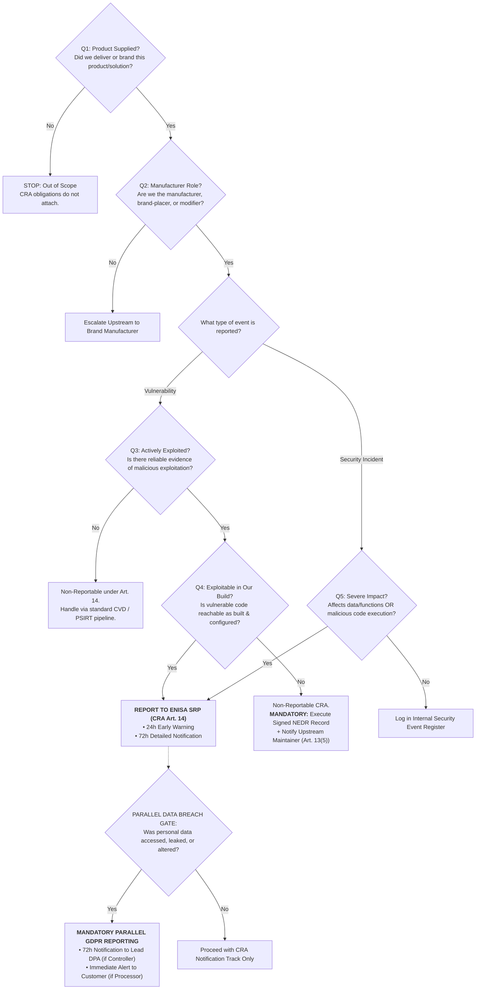

# CRA Reporting — Solution Operational Procedure

**Document Reference:** `CRA-SOP-MYBU-001` · **Version:** 1.2 (Operational Directive)  
**Applies From:** 11 September 2026 (Article 14 Live Statutory Law) · **Scope:** All Solution Deliveries & Systems  
**Primary Authorities:** Regulation (EU) 2024/2847 (Cyber Resilience Act - CRA), Delegated Regulation (EU) 2026/881, Regulation (EU) 2016/679 (GDPR), Commission Guidance C(2026) 5252 final  
**Governing Standard:** Subordinate to Group Master Governance Standard `SEC-PRO-CRA-001`  
**Approved By:** Business Unit Head, Group CISO, Group Data Protection Officer (DPO), Group Legal Counsel  

---

## 🚨 Emergency Protocol: Immediate Ingress Action

If an actively exploited vulnerability, zero-day threat, severe incident, or data breach is detected or reported:

1. **Record the Exact Arrival Timestamp (`T0` in UTC):**
   - Record the exact minute the information first entered the company's perimeter (server delivery header, external advisory timestamp, customer ticket creation). **Do NOT use the time you read it.** That timestamp is `T0`.
2. **Alert the 24/7 Response Chain Immediately:**
   - Email: `psirt-cra@<COMPANY>` · Hotline: `<PHONE>` (Alerts Central PSIRT and BU Compliance Officer).
   - **If Personal Data (Customer PII, user credentials, device telemetry with customer identifiers) may be affected:** CC `dpo@<COMPANY>` immediately.
3. **Preserve Forensic & Ingress Evidence:**
   - Do NOT modify configurations or purge logs. Save raw email with full RFC 5322 headers, firewall/packet captures, and SIEM alerts.
4. **Enforce Statutory Countdowns (Measured Strictly from `T0`):**
   - **20 Hours (Internal Buffer):** Complete triage and draft the Early Warning payload.
   - **24 Hours ⚖️ (CRA Legal Hard Cliff):** File Early Warning to European Authorities via **ENISA Single Reporting Platform (SRP)**.
   - **24 Hours ⚖️ (CRA Customer Duty):** Disseminate actionable security mitigations to affected customers (Art. 14(8)).
   - **24–48 Hours ⚖️ (GDPR Processor SLA):** Send formal breach alert to Customer Data Controllers if our Solution processed compromised personal data.
   - **72 Hours ⚖️ (CRA Legal Cliff):** File Detailed Notification on the ENISA SRP.
   - **72 Hours ⚖️ (GDPR Legal Cliff):** File Personal Data Breach Notification to the competent Data Protection Authority (DPA).

---

## 📖 Regulatory Foundation & Essential Principles

This procedure governs mandatory reporting to European authorities under **Article 14 of Regulation (EU) 2024/2847 (Cyber Resilience Act - CRA)**, **Commission Delegated Regulation (EU) 2026/881**, and **Articles 33 & 34 of Regulation (EU) 2016/679 (GDPR)**.

### Non-Negotiable Legal Rules:

> [!CRITICAL]
> **RULE 1 — SEPARATION OF EUROPEAN REPORTING CHANNELS (CRA ≠ GDPR):**
> Submitting a notification to the **ENISA Single Reporting Platform (SRP)** satisfies your CRA duty to European cybersecurity authorities and national CSIRTs. **It does NOT notify Data Protection Authorities (DPAs).** 
> The ENISA SRP has no legal mandate or technical connection to forward reports to national DPAs (e.g., CNIL, DPC, BfDI, AP). If an incident on our Solution involves a personal data breach, **parallel filings** must be executed:
> - **Cybersecurity Channel:** ENISA SRP & Lead CSIRT (CRA Art. 14).
> - **Data Privacy Channel:** Competent National DPA & Customer Data Controller (GDPR Art. 33 / Art. 28).

> [!WARNING]
> **RULE 2 — ARTICLE 14 IS LIVE LAW ACROSS ALL DELIVERIES:**
> Article 14 has been **live, binding statutory law since 11 September 2026**. 
> Pursuant to CRA Article 69(3) and Commission Guidance C(2026) 5252 (Point 210), this obligation applies **retroactively to all products with digital elements placed on the market before 11 December 2027**, and **continues even after a product's declared support period has expired**.

> [!IMPORTANT]
> **RULE 3 — THE SINGLE CORPORATE LEGAL ENTITY PRINCIPLE:**
> CRA obligations and ENISA SRP credentials attach to the **European Corporate Legal Entity** placing the Solution on the market (Art. 3(21)), not to individual engineering projects or business units. Filings must route via Central PSIRT to ensure cross-BU deduplication.

---

## 1. When This Applies: The Three Reportable Events

Our Solution comprises hardware appliances, embedded firmware, edge agents, application containers, and remote data processing solutions delivered to customer environments. Three distinct regulatory reporting events can occur:

| Event Category | Governing Regulation | Statutory Definition & Threshold | Recipient Authority |
|---|---|---|---|
| **1. Actively Exploited Vulnerability** | **CRA Art. 3(42), Art. 14(1)–(2)** | A vulnerability in our Solution for which there is **reliable evidence that a malicious actor has exploited it in a system without permission of the system owner**. (Includes integrated third-party/FOSS components if exploited in our Solution; zero-days without malicious exploit proof are excluded from mandatory reporting). | **ENISA Single Reporting Platform (SRP)** & designated **Lead CSIRT** |
| **2. Severe Security Incident** | **CRA Art. 3(44), Art. 14(3)–(4)** | An incident that negatively affects, or is capable of negatively affecting, our Solution's ability to protect the **availability, authenticity, integrity, or confidentiality of sensitive or important data or functions**; OR that has led or could lead to the execution of **malicious code** in the product or customer systems. | **ENISA Single Reporting Platform (SRP)** & designated **Lead CSIRT** |
| **3. Personal Data Breach** | **GDPR Art. 4(12), Art. 33–34** | A breach of security leading to the accidental or unlawful destruction, loss, alteration, unauthorized disclosure of, or access to **personal data** transmitted, stored, or otherwise processed in or by our Solution (e.g., customer credentials, telemetry linked to individuals, user audit logs). | **Competent National DPA** (Lead Supervisory Authority) AND/OR **Customer Data Controller** |

---

## 2. Legal Awareness Doctrine: How the Regulatory Clock Starts

Pursuant to Commission Guidance C(2026) 5252 (Points 211–217) and European Data Protection Board (EDPB) doctrine:

1. **Awareness Definition:**
   - Legal awareness is established when, following a prompt initial assessment, the company has a **reasonable degree of certainty** that:
     * An actively exploited vulnerability exists in our product; OR
     * A severe incident has compromised the product's security; OR
     * Personal data has been compromised.
2. **Initial Assessment Mandate:**
   - The initial assessment must be executed promptly without delay.
   - Its start time, technical triage steps, and formal awareness determination timestamp must be recorded in the **Article 14 Triage Ledger**.
3. **No Artificial Delay or Backdating:**
   - An advisory received on Friday cannot be "discovered" on Monday. `T0` is the arrival timestamp at the corporate perimeter.
   - Artificially extending triage to defer the 24-hour statutory clock is an intentional non-compliance violation triggering Article 64 fines.

---

## 3. Decision Framework: Five CRA Questions + Data Breach Gate

Incident responders and the BLCO must execute this decision sequence in order. **If uncertain within the available triage window, the default decision is YES (file).**



### The 5-Question Evaluation Criteria:
1. **Q1 (Supplied Product):** Is a product with digital elements delivered by us involved? *(If customer-owned hardware without our software, stop).*
2. **Q2 (Manufacturer Status):** Are we the manufacturer, trademark placer, or substantial modifier (Articles 3(21), 21, 22)?
3. **Q3 (Active Exploitation):** Is there reliable evidence of malicious in-the-wild exploitation (CISA KEV, CERT-EU alerts, telemetry reverse shells)? *(CVSS base score alone never triggers Article 14).*
4. **Q4 (Build & Configuration Exploitability):** Is the flaw exploitable in our specific delivery?
   * If **NO (Unreachable / Disabled):** Must document precise call graph isolation or configuration baselines in a signed **Technical Non-Exploitability Determination Record (NEDR)**. An unevidenced "no" is an audit finding.
5. **Q5 (Severe Incident Impact):** Does the incident degrade the availability, integrity, or confidentiality of data or functions, or execute malicious code?

### The Data Breach Gate (Question 6):
* **Did the event compromise personal data?**
  * If **YES:** Hand off immediately to the **Group DPO**. The 72-hour GDPR Article 33 countdown runs **concurrently and independently** from the CRA countdown.

---

## 4. Master Reconciled Deadlines Matrix: CRA & Data Breach Tracks

All deadlines run in calendar hours from `T0` (UTC). Weekends and holidays do NOT toll regulatory deadlines.

| Elapsed Time from T0 | Regime & Citation | Obligation & Content | Receiving European Authority / Recipient | Responsible Role |
|---|---|---|---|---|
| **T+04:00** | Internal Standard | Complete 5-question triage, determine exploitability (Q4), evaluate data breach | Internal Incident Team | PSIRT Lead / Security Architect |
| **T+20:00** | **Internal Safety Target** | Formulate, validate, and approve Early Warning payload (reserves 4h emergency buffer) | Central PSIRT & BLCO | BLCO |
| **T+24:00** ⚖️ | **CRA Art. 14(2)(a) / 14(4)(a)** | **CRA Early Warning:** Product identity, general nature of event, affected EU Member States, and **Delayed Dissemination Request** if applicable | **ENISA Single Reporting Platform (SRP)** & designated Lead CSIRT | BLCO / Central PSIRT |
| **T+24:00** ⚖️ | **CRA Art. 14(8)** | **Customer Security Alert:** Proportional, actionable technical workarounds and mitigations (no weaponized PoCs) | Affected Customer Contacts | SDM / Project Manager |
| **T+24:00 – T+48:00** ⚖️ | **GDPR Art. 28 / B2B Contract** | **Processor Breach Notice:** Notify Customer Data Controllers of personal data impact so they can meet their DPA obligations | Customer DPO & CISO | Group DPO / SDM |
| **T+72:00** ⚖️ | **CRA Art. 14(2)(b) / 14(4)(b)** | **CRA Detailed Notification:** Comprehensive vulnerability/exploit analysis, root cause (CWE), TLP sensitivity grading, mitigation status | **ENISA Single Reporting Platform (SRP)** & designated Lead CSIRT | BLCO / Central PSIRT |
| **T+72:00** ⚖️ | **GDPR Art. 33** | **Personal Data Breach Filing:** Nature of breach, categories/volume of data subjects and records, likely consequences, remediation measures | **Competent National DPA** (e.g., CNIL, DPC, BfDI, AP) | Group DPO |
| **T+14 Days** ⚖️ *(Post-Mitigation)* | **CRA Art. 14(2)(c)** | **CRA Final Report (Vulnerabilities):** Root cause analysis, CVE/CVSS, patch details, evidence of upstream sharing (Art. 13(6)) | **ENISA Single Reporting Platform (SRP)** & Lead CSIRT | BLCO / Central PSIRT |
| **T+1 Month** ⚖️ *(Post-72h Notice)* | **CRA Art. 14(4)(c)** | **CRA Final Report (Incidents):** Threat actor attribution (if known), systemic impact evaluation, long-term corrective measures | **ENISA Single Reporting Platform (SRP)** & Lead CSIRT | BLCO / Central PSIRT |

> [!CAUTION]
> **THE TWO CRITICAL TIME TRAPS:**
> 1. **The 72-Hour CRA Notification Clock:** Runs from `T0` (awareness), NOT from the Early Warning filing. Filing the Early Warning at hour 23 leaves exactly 49 hours to submit the Detailed Notification.
> 2. **The 14-Day Final Report Clock:** Begins as soon as a **workaround or mitigating measure** is made available to users (e.g., an iptables rule or firewall guidance), NOT when the final firmware patch binary is released!

---

## 5. Organizational RACI & Statutory Accountability

| Action / Statutory Deliverable | Solution Engineer | Lead Architect | Central PSIRT | BU BLCO | Group DPO | Group Legal | Customer SDM | Group CISO |
|---|:---:|:---:|:---:|:---:|:---:|:---:|:---:|:---:|
| Ingress Ingestion & `T0` Logging | R | I | **A** | I | I | I | I | I |
| Technical Reachability Assessment (Q4) | C | **R** | C | A | I | I | I | I |
| Signed NEDR Record Execution | I | R | C | **A** | I | C | I | I |
| 20h Early Warning Formulation | I | C | R | **A** | I | I | I | I |
| **24h CRA Early Warning SRP Submission** | I | I | R | **A** | I | C | I | I |
| **24h Customer Security Alert (Art 14(8))** | I | C | C | A | C | C | **R** | I |
| **72h CRA Detailed SRP Submission** | I | C | R | **A** | I | C | I | I |
| **72h GDPR DPA Breach Submission** | I | I | C | I | **A** | R | I | I |
| Upstream FOSS / Vendor Disclosure (Art 13(5)) | I | I | **R** | A | I | I | I | I |
| Workaround & Hotfix Deployment | R | R | C | A | I | I | **R** | I |
| **CRA Final Report SRP Submission** | I | C | R | **A** | I | C | I | I |
| 10-Year Immutable WORM Archival | I | I | R | **A** | R | I | I | I |

* **Commercial Veto Prohibited:** Commercial objections, client sensitivities, sales opportunities, and non-disclosure agreements cannot pause, defer, or veto statutory filings.
* **Emergency Default Filer:** If the designated BLCO is unreachable by `T0 + 18:00`, Central PSIRT executes the filing independently.

---

## 6. Filing with European Authorities: Platform Architecture & Mechanics

### 6.1 The CRA Channel: ENISA Single Reporting Platform (SRP)
- **Official Portal:** `https://portal.cra-srp.enisa.europa.eu` (Operational since 11 September 2026).
- **Authentication:** Corporate EU Login with multi-factor authentication (MFA). Accounts must be pre-provisioned for Primary Assigned Representatives (PAR) and Secondary Assigned Representatives (SAR).
- **Simultaneous Dissemination Workflow:**
  * When submitted to the SRP, the notification is routed simultaneously to:
    1. **Designated Lead CSIRT:** Determined by the Member State of Main Establishment (where cybersecurity decisions are predominantly taken; e.g., CSIRT-IE for Ireland, NCSC-NL for Netherlands, BSI for Germany). For non-EU entities: CSIRT of Authorised Representative under Article 25.
    2. **ENISA Incident Response Unit**.
    3. Other affected Member State CSIRTs and Market Surveillance Authorities (MSAs).
- **Delayed Dissemination Request (Delegated Regulation (EU) 2026/881):**
  * When reporting an actively exploited zero-day where a patch is actively being engineered, the filer must check the **Delayed Dissemination Request** box in the 24h Early Warning.
  * **Grounds (Art. 3 CDR 2026/881):** Immediate cross-border dissemination would undermine product security or enable widespread exploitation before customer mitigations are available.
  * Must indicate sensitivity grading using Traffic Light Protocol (**TLP:AMBER+STRICT** or **TLP:RED**).
- **SRP Outage Failover Protocol:**
  * If the SRP is inaccessible, retry every 15 minutes and take timestamped screenshots.
  * Submit the notification package via encrypted PGP email directly to the Lead CSIRT emergency intake desk. Document the outage in the audit log.

### 6.2 The Data Privacy Channel: National Data Protection Authorities (DPAs)
- **Official Portals:** Specific web portals of the competent national supervisory authorities (e.g., Data Protection Commission in Ireland, CNIL in France, BfDI in Germany, Dutch DPA).
- **Sole Filer:** Executed exclusively by the **Group Data Protection Officer (DPO)** or designated Privacy Counsel.
- **Mandatory Content (GDPR Art. 33(3)):** Description of breach nature, categories and estimated count of data subjects and records, name of DPO, anticipated consequences, measures adopted or proposed.

---

## 7. Customer Communications & Supply Chain Sharing

### 7.1 Customer Communication Protocols
1. **Article 14(8) Cybersecurity Notice (Within 24 Hours):**
   - Transmitted via authenticated support portal or encrypted advisory.
   - Must provide: impacted product model/firmware versions, nature of the vulnerability, and **actionable technical mitigations** (firewall rules, configuration hardening).
   - Format: Machine-readable (CSAF 2.0 / CycloneDX / OpenVEX) and human-readable.
   - **Proportionality Rule:** Never disclose weaponized exploit code, heap offsets, or attack blueprints.
2. **Data Breach Customer Notification (Processor Duty):**
   - Dispatched to Customer Data Controllers under GDPR Article 28 / contractual terms.
   - Details categories of personal data compromised to enable customer DPA filings.

### 7.2 Supply Chain & Upstream Sharing (Articles 13(5) & 13(6))
- If the flaw originated in third-party or open-source software (e.g., Linux kernel, OpenSSL, BusyBox):
  * We must notify the upstream maintainer and share corrective patch code.
  * **Mandatory Even When Not Exploitable in Our Product:** Upstream sharing applies even if Q4 was "No" (the component is flawed, even if unreachable in our specific delivery).

---

## 8. Enforcement & Cumulative Penalty Structure

Failure to comply with European reporting mandates triggers severe, non-overlapping cumulative administrative fines:

| Regulatory Instrument | Statutory Violation | Maximum Administrative Fine |
|---|---|---|
| **CRA Article 64(2)** | Failure to notify actively exploited vulnerability or severe incident within Article 14 deadlines | **Up to €15,000,000 or 2.5% of total worldwide annual turnover**, whichever is higher |
| **CRA Article 64(3)** | Failure to comply with documentation, CE marking, or economic operator duties | **Up to €10,000,000 or 2% of worldwide annual turnover** |
| **CRA Article 64(4)** | Supplying incorrect, incomplete, or misleading information to CSIRTs or Market Surveillance Authorities | **Up to €5,000,000 or 1% of worldwide annual turnover** |
| **GDPR Article 83(4)** | Failure to notify competent DPA of a Personal Data Breach within 72 hours (Art. 33) | **Up to €10,000,000 or 2% of total worldwide annual turnover** |
| **GDPR Article 83(5)** | Infringement of basic data protection principles or rights (Art. 5, 6, 9) | **Up to €20,000,000 or 4% of total worldwide annual turnover** |

* **Micro/Small Enterprise Relief (CRA Art. 64(10)):** Microenterprises and small enterprises are exempt from fines *only* for missing the 24-hour Early Warning deadline. All other deadlines (72h, Final Report, GDPR) remain fully punishable.

---

## 9. Evidentiary Package: Mandatory 10-Year Statutory WORM Archive

Pursuant to CRA Article 13(10) and Article 64, complete evidentiary dossiers for **every incident and vulnerability** (reportable and non-reportable) must be archived in write-once-read-many (WORM) storage for **at least 10 years**:

```
s3://cra-compliance-worm/YYYY/[Event_ID]/
├── 01_raw_ingress_proof.eml                ── RFC 5322 raw headers proving initial T0 entry
├── 02_triage_decision_record.json          ── 5-question evaluation log with digital signatures
├── 03_signed_nedr_record.pdf (if Q4=No)    ── Signed Technical Non-Exploitability Record & hash baseline
├── 04_enisa_early_warning_payload.json     ── Exact JSON submitted to ENISA SRP at T+20h
├── 05_enisa_early_warning_receipt.png      ── Time-stamped screenshot of SRP submission confirmation
├── 06_customer_advisory_broadcast.eml      ── Copy of Art. 14(8) customer advisory and delivery log
├── 07_gdpr_dpa_submission.pdf (if Breach)  ── DPA portal filing confirmation receipt
├── 08_enisa_72h_detailed_payload.json      ── Detailed notification submitted to ENISA SRP
├── 09_workaround_release_notice.pdf        ── Announcement establishing the 14-day final report clock
├── 10_enisa_14d_final_payload.json         ── Final report submitted to ENISA SRP
├── 11_upstream_maintainer_notice.eml       ── Proof of disclosure to third-party / FOSS maintainer
└── sha256sums.txt                          ── Cryptographic checksum manifest of the package
```

---

## 10. Pre-Flight Operational Checklist

| # | Operational Readiness Task | Owner | Verification Reference |
|---|---|---|---|
| 1 | Confirm European Legal Entity, Main Establishment, and designated Lead CSIRT with Legal | BLCO + Legal | `SEC-PRO-CRA-001` §1 |
| 2 | Verify EU Login accounts and MFA credentials for Primary (PAR) and Secondary (SAR) Representatives on ENISA SRP | BLCO | `https://portal.cra-srp.enisa.europa.eu` |
| 3 | Route all CVE feeds, threat alerts, and CVD intake to monitored mailbox (`psirt-cra@<COMPANY>`) auto-logging `T0` | Central PSIRT | Ticketing Automation |
| 4 | Register all delivered systems and firmware versions in the **CRA Delivered Systems Register** | BLCO + PMs | `CRA_Delivered_Systems_and_Object_Register_Template.md` |
| 5 | Maintain up-to-date CycloneDX 1.6 / SPDX 3.0 SBOMs for rapid reachability queries | Systems Engineering | SBOM Vault |
| 6 | Maintain 24/7 on-call escalation roster linking BLCO, PSIRT Lead, DPO, and Systems Architect | BLCO | On-Call Schedule |
| 7 | Conduct semi-annual tabletop incident simulation drills testing the 24h/72h pipeline | Central PSIRT | `cra_drill_simulator.py` |

---

## 11. Procedure Scope & Transition to Group Standard

This operational procedure provides rapid execution for field engineers and local business unit personnel. It is subordinate to **`SEC-PRO-CRA-001` (Group CRA Master Governance Standard)**.

**Mandatory Immediate Transition to `SEC-PRO-CRA-001` Occurs When:**
1. A real reportable filing is initiated on the ENISA Single Reporting Platform.
2. A confirmed Personal Data Breach requires DPA notification under GDPR Article 33.
3. An incident impacts products shared across multiple operating units or entities.
4. A formal inquiry or inspection is initiated by a European Market Surveillance Authority.
5. Preparation begins for the **11 December 2027** general application obligations (CE marking, Annex I essential requirements, conformity assessment modules).

---

*Contact Points: BU BLCO, `<PHONE>` · Central PSIRT, `psirt-cra@<COMPANY>` · Group DPO, `dpo@<COMPANY>`.  
Subordinate to Group Master Governance Standard `SEC-PRO-CRA-001`.*
