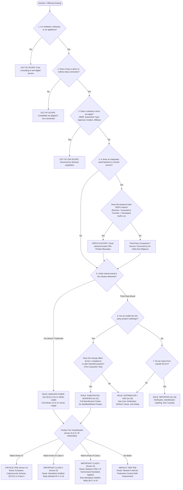
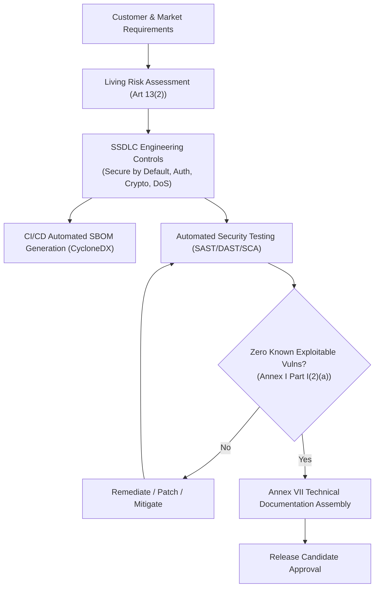
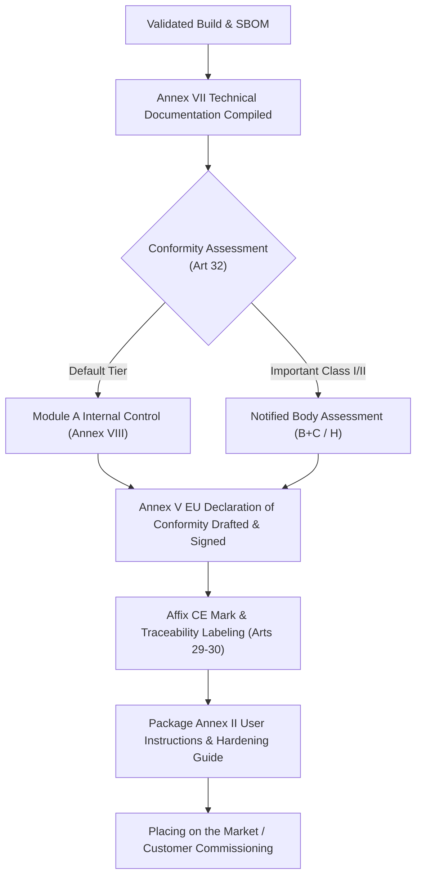
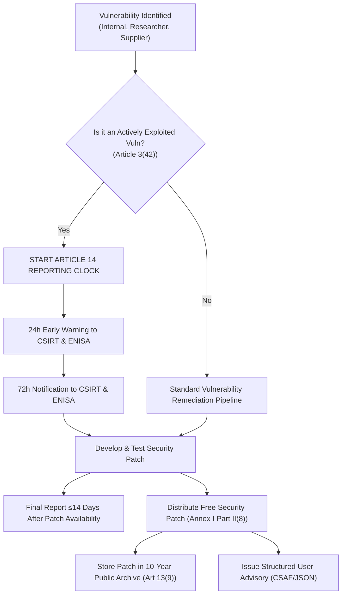
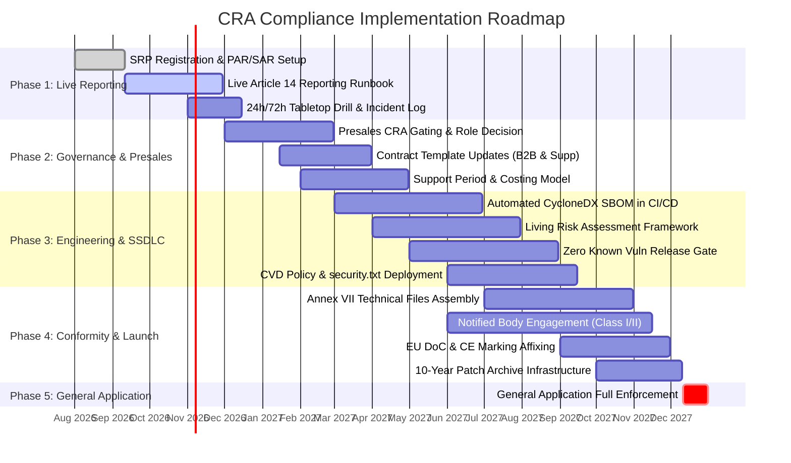

# EU Cyber Resilience Act (CRA) — Regulation (EU) 2024/2847
## Comprehensive Requirements and Business Process Impact Assessment for Solution Providers

**Document Title**: CRA Requirements and Business Process Impact Assessment  
**Target Organization Role**: Solution Provider (Developer, Systems Integrator, Value-Added Reseller, Managed Service Provider)  
**Regulatory Baseline**: Regulation (EU) 2024/2847 (OJ L, 20.11.2024) | Corrigendum of 5 Dec 2024 | Implementing Regulation (EU) 2025/2392 | Delegated Regulation (EU) 2026/881 | Commission Guidance C(2026) 5252 final | Commission FAQs v13  
**Status**: Formal Operational Assessment & Compliance Framework  
**Date of Assessment**: October 2026  
**Document Identifier**: CRA-SVR-BPIA-2026-V1.0  

---

## Table of Contents

1. [Executive Summary](#1-executive-summary)
2. [Regulatory Scope, Definitions, and Applicability Assumptions](#2-regulatory-scope-definitions-and-applicability-assumptions)
3. [CRA Roles and Responsibilities Applicable to a Solution Provider](#3-cra-roles-and-responsibilities-applicable-to-a-solution-provider)
4. [CRA Applicability Decision Tree](#4-cra-applicability-decision-tree)
5. [Lifecycle-Based Requirements Matrix](#5-lifecycle-based-requirements-matrix)
6. [Detailed Requirements by Business Process](#6-detailed-requirements-by-business-process)
   - 6.1 [Presales](#61-presales)
   - 6.2 [Solution Development](#62-solution-development)
   - 6.3 [Solution Integration / Build](#63-solution-integration--build)
   - 6.4 [Solution Deployment](#64-solution-deployment)
   - 6.5 [Solution Maintenance During RUN](#65-solution-maintenance-during-run)
   - 6.6 [Solution Decommissioning](#66-solution-decommissioning)
7. [Cross-Functional Requirements and RACI Matrix](#7-cross-functional-requirements-and-raci-matrix)
8. [Vulnerability Management and Incident Reporting Obligations](#8-vulnerability-management-and-incident-reporting-obligations)
9. [Conformity Assessment, Technical Documentation, CE Marking, and EU DoC](#9-conformity-assessment-technical-documentation-ce-marking-and-eu-doc)
10. [Third-Party Supplier, Subcontractor, and Open-Source Requirements](#10-third-party-supplier-subcontractor-and-open-source-requirements)
11. [Contractual and Customer-Facing Implications](#11-contractual-and-customer-facing-implications)
12. [Required Evidence, Records, and Audit-Readiness Requirements](#12-required-evidence-records-and-audit-readiness-requirements)
13. [Compliance Gaps and Implementation Roadmap](#13-compliance-gaps-and-implementation-roadmap)
14. [Regulatory References and Source Register](#14-regulatory-references-and-source-register)
15. [Assumptions, Exclusions, Unresolved Questions, and Limitations](#15-assumptions-exclusions-unresolved-questions-and-limitations)

---

## 1. Executive Summary

### 1.1 Context and Regulatory Mandate
On 20 November 2024, the European Union published **Regulation (EU) 2024/2847** on horizontal cybersecurity requirements for products with digital elements (the **Cyber Resilience Act** or **CRA**; OJ L, 2024/2847). The CRA entered into force on **10 December 2024**. It establishes a mandatory, horizontal Union regulatory regime for all hardware and software products placed or made available on the EU single market that have direct or indirect logical or physical data connections to an external device or network.

Unlike voluntary cybersecurity frameworks (e.g., ISO/IEC 27001, SOC 2, NIST CSF) or sector-specific critical infrastructure security directives (e.g., NIS2 Directive (EU) 2022/2555), the CRA establishes **direct, legally binding product-level essential requirements, post-market vulnerability-handling obligations, statutory reporting mandates, and strict supply-chain due-diligence rules backed by CE marking and substantial administrative penalties**.

### 1.2 Impact on the Solution Provider Business Model
A modern solution provider rarely acts in a single, static capacity. In daily commercial operations, our organization functions across a spectrum of delivery models:
1. **Proprietary Software & Appliance Engineering**: Developing custom software, microservices, companion applications, or turnkey appliances released under our organization's brand.
2. **Systems Integration & Value-Added Reselling (VAR)**: Procuring third-party commercial off-the-shelf (COTS) software, operating systems, hypervisors, network appliances, and industrial controllers, and integrating them into combined client architectures.
3. **White-Labeling & Rebranding**: Packaging third-party hardware or software solutions and delivering them to enterprise customers under our organization's name, brand, or trademark.
4. **Custom Scripting, Orchestration & Configuration**: Modifying third-party components, developing glue code, custom APIs, pipeline workflows, and custom automation scripts.
5. **Turnkey Deployment & Commissioning**: Installing, configuring, hardening, and interconnecting IT/OT solutions within customer on-premises or cloud environments.
6. **Managed Services (MSP) & RUN Operations**: Providing continuous infrastructure monitoring, patching, lifecycle maintenance, and incident management under Service Level Agreements (SLAs).

Under the CRA, **regulatory obligations attach to legal roles and commercial actions, not corporate job titles**. Crucially:
- Marketing a product with digital elements under our organization’s name or trademark immediately triggers **Manufacturer** status under **Article 21**, inheriting 100% of the manufacturer obligations under **Articles 13 and 14** and **Annex I**.
- Modifying a third-party product following its placing on the market in a manner that affects compliance with Annex I essential requirements or alters its assessed intended purpose constitutes a **Substantial Modification** under **Article 3(30)**, transforming our organization into a statutory **Manufacturer** under **Article 22**.
- Integrating third-party components into our proprietary solutions triggers non-negotiable **due diligence and upstream vulnerability-sharing duties** under **Article 13(5) and 13(6)**.
- Acting strictly as a distributor or value-added reseller mandates formal **verification of CE markings, declarations of conformity, user security instructions, and mandatory reporting of significant cybersecurity risks and vulnerabilities** under **Article 20**.

### 1.3 The Dual-Track Enforcement Timeline
A critical compliance misconception is that the CRA takes effect uniformly in late 2027. The CRA enforces a strict dual-track timeline:
- **IMMEDIATE LIVE OBLIGATION (11 September 2026)**: Article 14 reporting obligations are **already in effect**. Under **Article 69(3)**, any actively exploited vulnerability or severe incident affecting in-scope products with digital elements must be reported to the national CSIRT designated as coordinator and ENISA within **24 hours (early warning)** and **72 hours (full notification)** via the ENISA Single Reporting Platform (`portal.cra-srp.enisa.europa.eu`). This applies **regardless of whether the product was placed on the market before 11 December 2027** and continues beyond the declared support period.
- **GENERAL APPLICATION DATE (11 December 2027)**: All essential cybersecurity requirements (Annex I Part I), mandatory vulnerability-handling processes (Annex I Part II), conformity assessment routes (Article 32), technical documentation dossiers (Article 31 and Annex VII), EU declarations of conformity (Article 28 and Annex V), and CE marking enforcement (Articles 29–30) become fully applicable across the Union.

```
       10 Dec 2024                 11 Jun 2026             11 Sep 2026                    11 Dec 2027
───────────┼────────────────────────────┼───────────────────────┼──────────────────────────────┼───────────►
      Entry into               Chapter IV Notified        ARTICLE 14 LIVE             General Application
        Force                  Bodies Framework       Incident & Exploited Vuln       Full Annex I, DoC,
     (OJ L 2024/2847)          Notification Open         Reporting via ENISA          CE Mark, Fines Active
                                                              Platform
```

### 1.4 Enforcement, Sanctions, and Business Risk
Non-compliance carries existential operational and financial exposure under **Article 64**:
- **Tier 1 Infringements (Art 64(2))**: Non-compliance with Annex I essential cybersecurity requirements, Article 13 manufacturer obligations, or Article 14 reporting mandates is subject to administrative fines of up to **EUR 15 000 000 or 2.5% of total worldwide annual turnover**, whichever is higher.
- **Tier 2 Infringements (Art 64(3))**: Breaches of economic operator duties (Articles 18–23), technical documentation rules (Article 31), CE marking rules (Article 30), or conformity procedures (Article 32) incur fines up to **EUR 10 000 000 or 2% of worldwide annual turnover**.
- **Tier 3 Infringements (Art 64(4))**: Supplying false, incomplete, or misleading information to market surveillance authorities or notified bodies carries fines up to **EUR 5 000 000 or 1% of turnover**.
- **Market Surveillance Measures (Arts 52–58)**: National Market Surveillance Authorities (MSAs) possess statutory powers to mandate corrective actions, order the prohibition or restriction of product availability, compel product recalls or withdrawals from the EU market, and demand direct access to internal source code and technical records (Article 53).
- **Civil Liability Cascades**: Under the revised Product Liability Directive ((EU) 2024/2853) and national tort regimes, failure to fulfill statutory CRA duties establishes prima facie negligence in commercial defect disputes.

---

## 2. Regulatory Scope, Definitions, and Applicability Assumptions

### 2.1 The Core Scope Test (Article 2(1))
A product or solution falls within the scope of the CRA if it satisfies **all four cumulative criteria**:
1. **Product with Digital Elements (PDE)**: Defined in Article 3(1) as *"any software or hardware product and its remote data processing solutions, including software or hardware components being placed on the market separately"*.
2. **Commercial Activity**: Placed on the market or made available on the EU market in the course of a commercial activity, whether in return for payment or free of charge (Article 3(21), 3(22), Recital 18).
3. **Connectivity Criterion**: Its intended purpose or reasonably foreseeable use includes a direct or indirect logical or physical data connection to a device or network (Article 2(1)).
4. **Absence of a Sectoral Exclusion**: The product does not fall under an explicit statutory exclusion set out in Article 2(2)–(7).

### 2.2 Remote Data Processing Solutions (RDPS) (Article 3(2))
A critical expansion under the CRA is the inclusion of **Remote Data Processing Solutions (RDPS)** within the legal definition of the product itself (Article 3(1) and 3(2)). A cloud, backend, or companion service is classified as an RDPS—and therefore falls inside the product's CRA boundary—if it meets **all three cumulative tests** (Commission Guidance C(2026) 5252, Section 8.1):
1. **At a Distance**: The processing occurs outside the customer's local environment (e.g., hosted in multi-tenant cloud, public cloud, edge nodes, or provider-hosted data centers).
2. **Functional Dependency**: The software is designed and developed by or under the responsibility of the manufacturer, and its absence **would prevent the product with digital elements from performing one of its functions**. 
   *Note*: "Function" is not limited to core product utility. Supporting functions such as remote device management, user onboarding, telemetry-driven configuration, automated patch distribution, and central identity synchronization count. Pure general business websites, standard billing portals, and corporate IT do not qualify.
3. **Manufacturer Responsibility**: The software running at a distance was developed in-house by our organization or built by a contractor to our specific designs and requirements. Merely consuming a generic third-party SaaS API (e.g., standard Stripe payment gateway or Twilio SMS API) does not make that external service an RDPS; rather, that external service is a third-party dependency governed by Article 13(5) component due diligence.

```
┌────────────────────────────────────────────────────────────────────────────────────────┐
│                        CRA PRODUCT BOUNDARY (Article 3(1))                             │
│                                                                                        │
│  ┌───────────────────────────────────┐        ┌─────────────────────────────────────┐  │
│  │     Client / Edge PDE Element     │        │ Qualifying Remote Data Processing   │  │
│  │ (Software, Firmware, Appliance)   │◄──────►│             Solution                │  │
│  │                                   │        │  (In-house Cloud Backend / API)     │  │
│  └───────────────────────────────────┘        └─────────────────────────────────────┘  │
└───────────────────────────────────┬────────────────────────────────────────────────────┘
                                    │ Article 13(5) Due Diligence & Secure Interfaces
                                    ▼
┌────────────────────────────────────────────────────────────────────────────────────────┐
│                      OUTSIDE CRA BOUNDARY (Third-Party / General)                      │
│                                                                                        │
│  ┌───────────────────────────────────┐        ┌─────────────────────────────────────┐  │
│  │      Third-Party Public Cloud     │        │     External Third-Party SaaS       │  │
│  │    (Generic IaaS / PaaS Layer)    │        │      (e.g., Stripe, Sendgrid)       │  │
│  └───────────────────────────────────┘        └─────────────────────────────────────┘  │
└────────────────────────────────────────────────────────────────────────────────────────┘
```

### 2.3 Statutory Exclusions and Carve-Outs (Article 2)
The CRA explicitly excludes certain categories of products to avoid legislative overlap:
1. **Medical Devices (Art 2(2)(a)–(b))**: Medical devices governed by Regulation (EU) 2017/745 (MDR) and in vitro diagnostic devices governed by Regulation (EU) 2017/746 (IVDR) are fully excluded.
2. **Type-Approved Motor Vehicles (Art 2(2)(c))**: PDEs to which Regulation (EU) 2019/2144 applies are excluded. 
   *Important Distinction*: Under Commission FAQ 2.1.1 and the "component principle", this exclusion is strictly product-by-product. A software or hardware component intended for integration into an automotive system that is *not itself type-approved* remains **in scope** of the CRA. Delegated Regulation (EU) 2025/1535 extends this carve-out to Regulation (EU) No 168/2013 L-category vehicles (excluding L1e pedal-assist bikes).
3. **Civil Aviation (Art 2(2)(d))**: Equipment certified under Regulation (EU) 2018/1139.
4. **Marine Equipment (Art 2(3))**: Marine equipment within the scope of Directive 2014/90/EU.
5. **National Security and Defence (Art 2(7))**: Products developed or modified exclusively for national security or defence purposes.
6. **Spare Parts (Art 2(6))**: Components placed on the market as spare parts exclusively to replace identical components manufactured to original specifications.

### 2.4 Interplay with Other Union Legislation
- **NIS2 Directive ((EU) 2022/2555)**: NIS2 regulates *entities* (operators of essential and important services) and their operational risk-management and governance procedures. The CRA regulates *products* placed on the market. Solution providers serving NIS2 entities face indirect CRA flow-down: NIS2 entities are legally required to mandate supply-chain cybersecurity (NIS2 Article 21(2)(d)), driving them to demand CRA-compliant PDEs. Dual-hatted organizations hosting SaaS or managed cloud environments fall under NIS2 for their service operations and under the CRA for their distributed client applications and RDPS.
- **GDPR (Regulation (EU) 2016/679)**: CRA Annex I Part I point (2)(g) mandates data minimisation as a product cybersecurity property. Personal data breaches resulting from product exploits may trigger parallel notifications under GDPR Article 33/34 (72 hours to DPAs) and CRA Article 14 (24 hours / 72 hours to CSIRTs/ENISA).
- **Radio Equipment Directive (RED - Directive 2014/53/EU)**: Articles 3(3)(d), (e), and (f) of RED cover wireless cybersecurity. Under CRA Article 2(5) and transitional provisions, CRA replaces the delegated acts under RED for cybersecurity requirements once fully applicable.
- **Machinery Regulation ((EU) 2023/1230)**: Where machinery contains software, the CRA governs the cybersecurity of the digital elements, while the Machinery Regulation governs safety risks resulting from software failures.
- **AI Act (Regulation (EU) 2024/1689)**: Under CRA Article 12, high-risk AI systems that qualify as products with digital elements are deemed to meet AI Act cybersecurity requirements if they fulfill CRA Annex I, provided the CRA conformity assessment covers the AI Act aspects.

---

## 3. CRA Roles and Responsibilities Applicable to a Solution Provider

The CRA avoids generic corporate labeling. Obligations attach strictly to the **economic operator role** assumed in a specific project or commercial offering.

### 3.1 Solution Provider Role Archetypes

```
┌────────────────────────────────────────────────────────────────────────────────────────┐
│                        SOLUTION PROVIDER ROLE SPECTRUM                                 │
│                                                                                        │
│  [Archetype A]        [Archetype B]         [Archetype C]          [Archetype D]       │
│  Proprietary          White-Label           Substantial            Turnkey             │
│  Manufacturer         Integrator            Modifier               Distributor         │
│                                                                                        │
│  Develops in-house;   Procures COTS;        Modifies 3rd-party     Resells unmodified  │
│  markets under own    markets under own     PDE, altering risk/    3rd-party PDE;      │
│  brand/trademark.     brand/trademark.      intended purpose.      vendor brand kept.  │
│  (Art 3(13), 13, 14)  (Art 21, 13, 14)      (Art 22, 13, 14)       (Art 3(17), 20)     │
│                                                                                        │
│  ◄────────────────────────────────────────── ────────────────────────────────────────► │
│  FULL STATUTORY MANUFACTURER RESPONSIBILITY            DUE DILIGENCE & VERIFICATION    │
└────────────────────────────────────────────────────────────────────────────────────────┘
```

#### Archetype A: Proprietary Product Manufacturer (Article 3(13))
- **Trigger**: Our organization designs, develops, or commissions software/hardware and markets it under our own name or trademark.
- **Legal Mandate**: Full, direct responsibility for **Articles 13 and 14**, **Annex I Essential Requirements**, **Annex II User Documentation**, **Annex V EU DoC**, **Annex VII Technical Documentation**, and **Articles 28–32 Conformity Assessment & CE Marking**.
- **Scope of Liability**: The entire product, including all embedded third-party components, open-source libraries, and integrated RDPS backends.

#### Archetype B: Deemed Manufacturer via White-Labeling / Rebranding (Article 21)
- **Trigger**: Our organization takes a third-party PDE (hardware appliance, edge gateway, software platform) and markets, packages, or distributes it under our organization's name, brand, or trademark.
- **Legal Mandate**: **Complete role escalation**. Under Article 21, the importer or distributor is subject to **all obligations of the manufacturer set out in Articles 13 and 14**.
- **Crucial Trap**: The original OEM's CE mark and EU Declaration of Conformity **do not legally protect our organization**. We must draw up our own EU DoC, assemble our own technical documentation (Annex VII), establish our own vulnerability-handling and SBOM processes, and assume statutory reporting duties under Article 14.

#### Archetype C: Deemed Manufacturer via Substantial Modification (Article 22)
- **Trigger**: Our organization modifies a third-party PDE following its placing on the market, where that modification:
  1. Alters the level of cybersecurity risk in a manner not foreseen or mitigated in the original manufacturer’s risk assessment; or
  2. Introduces new threat vectors, interfaces, external network calls, or dependencies; or
  3. Modifies the intended purpose for which the product was assessed (Article 3(30); Commission Guidance C(2026) 5252, Section 4.3).
- **Legal Mandate**: Our organization is deemed the manufacturer for the part of the product that is modified or, if the modification affects the cybersecurity of the product as a whole, for the **entire product** (Article 22). We must execute a fresh conformity assessment, issue an updated EU DoC, and assume full post-market support and reporting liabilities for that product.

#### Archetype D: Value-Added Reseller / Turnkey Distributor (Article 3(17), Article 20)
- **Trigger**: Our organization makes an unmodified third-party PDE available on the market under the original manufacturer's brand and trademark.
- **Legal Mandate**: Due care verification under **Article 20**:
  - Verify that the product bears the CE marking.
  - Verify that the manufacturer and importer complied with identification, contact details, user information (Annex II), support period statement, and EU DoC availability.
  - Do not make a product available if it presents a significant cybersecurity risk.
  - If a vulnerability is discovered, inform the manufacturer without undue delay.
  - If the product presents a significant cybersecurity risk, immediately inform market surveillance authorities.
  - If the manufacturer ceases operations, inform MSAs and users.

#### Archetype E: Importer of Non-EU Products (Article 3(16), Article 19)
- **Trigger**: Our organization places a PDE originating from a third country (outside the EU) onto the EU market.
- **Legal Mandate**: Formal verification under **Article 19**:
  - Verify that the manufacturer conducted the conformity assessment, assembled Annex VII documentation, affixed the CE mark, and supplied Annex II instructions and EU DoC.
  - Affix our organization's name, registered trade name, and postal/electronic contact address to the product or packaging.
  - Refrain from placing non-conforming products on the market; escalate significant risks to MSAs.
  - Retain a copy of the EU DoC for 10 years or the support period, whichever is longer.

#### Archetype F: Pure IT Systems Integrator / Deployer (Professional Services)
- **Trigger**: Delivering custom on-site engineering, commissioning, integration, and managed RUN services directly within the customer's privately controlled network infrastructure, without placing a packaged, standardized PDE on the market.
- **Legal Status**: CRA applies to products placed or made available on the market. A pure bespoke professional service that integrates customer-owned products without distributing a new commercial product element is outside the direct scope of the CRA. However, **contractual flow-downs, customer procurement specifications under Article 5, and the risk of triggering Article 22 substantial modification create immediate indirect liability**.

### 3.2 Role Matrix Summary

| Economic Operator Role | Primary Articles | Essential Requirements (Annex I) | SBOM & Risk Assessment | CE Marking & EU DoC | Art 14 Reporting (24h/72h) | Post-Market Patching (≥5 Yrs) |
|---|---|---|---|---|---|---|
| **Proprietary Manufacturer (A)** | Arts 13, 14 | **Mandatory** (Sole responsibility) | **Mandatory** | **Mandatory** | **Mandatory** | **Mandatory** |
| **White-Label Integrator (B)** | Arts 21, 13, 14 | **Mandatory** (Full escalation) | **Mandatory** | **Mandatory** | **Mandatory** | **Mandatory** |
| **Substantial Modifier (C)** | Arts 22, 13, 14 | **Mandatory** (For modified scope / whole) | **Mandatory** | **Mandatory** | **Mandatory** | **Mandatory** |
| **Importer (E)** | Art 19 | Verification & Blocking | Verification | Verification & Custody | Inform Maker / MSAs | Verification |
| **Distributor / VAR (D)** | Art 20 | Due Care Verification | Verification | Verification | Relay to Maker / MSAs | Verification |
| **Pure Service Integrator (F)** | N/A (Contractual) | Contractual Compliance | Contractual / Best Practice | N/A | Contractual / Incident SLA | Governed by SLA |

---

## 4. CRA Applicability Decision Tree

To determine the exact legal status and applicable requirements for any proposed solution, project, or commercial offering, our organization must execute the following multi-tiered decision logic.



### 4.1 Product Tier Classification Criteria
Classification is determined strictly by the product's **core functionality** against the exhaustive lists in Annexes III and IV and the technical descriptions established in **Implementing Regulation (EU) 2025/2392**:
- **Critical Products (Annex IV)**: Hardware devices with security boxes, smart meter gateways, smartcards, secure elements. *Conformity Route*: European cybersecurity certification scheme (EUCC) where designated by delegated act under Article 8(1); otherwise Class II routes.
- **Important Class II (Annex III)**: Operating systems for general use, hypervisors and container runtime environments, firewalls, intrusion detection and prevention systems (IDS/IPS), tamper-resistant microprocessors/microcontrollers. *Conformity Route*: Article 32(3) mandates third-party assessment: **Module B + C** (EU-Type Examination + Conformity to Type) or **Module H** (Full Quality Assurance), or EUCC certification at assurance level 'substantial' or 'high'. **Internal self-assessment (Module A) is strictly prohibited**.
- **Important Class I (Annex III)**: Identity and access management (IAM) software and authentication agents, password managers, virtual private networks (VPNs), web browsers, network management systems, network interfaces, routers, switches, security information and event management (SIEM) systems, boot managers, smart home devices with security functionality, smart home locks, health wearables. *Conformity Route*: **Module A (Internal Control) is permissible ONLY IF qualifying harmonised standards published in the OJEU or common specifications have been fully applied** (Article 32(2)). If harmonised standards are absent, partial, or not applied, a **Notified Body is legally mandatory** (Module B+C or Module H).
- **Default Tier (All PDEs not in Annex III or IV)**: General business software, enterprise ERP/CRM components, custom IoT logic, standard automation scripts. *Conformity Route*: **Module A (Internal Production Control)** under Annex VIII.

---

## 5. Lifecycle-Based Requirements Matrix

The consolidated matrix below details every applicable CRA obligation across the entire solution lifecycle, specifying legal citations, operational conditions, and audit evidence requirements.

| Req ID | Lifecycle Phase | Business Process | CRA Obligation | Legal Reference | Applicability | Triggering Condition | Responsible Role | Required Action | Required Evidence | Dependencies | Timing / Deadline | Business Impact | Priority | Source |
|---|---|---|---|---|---|---|---|---|---|---|---|---|---|---|
| **CRA-REQ-PRE-01** | Presales | Product & Solution Qualification | Determine CRA scope, economic operator role, and delivery model boundaries | Art 2(1), Art 3(1), Art 3(12)–(17), Art 21, Art 22 | Mandatory | All bids, proposals, and new product initiatives | Presales Lead, Solution Architect, Legal / Compliance | Execute statutory scope test; identify whether delivery is Archetype A, B, C, D, E, or F | Signed Scope & Role Determination Record (`02-scope-decision.json`) | Product Management, Legal Counsel | Presales qualification gate (Prior to bid submission) | Drives solution pricing, delivery liability, and compliance overhead | **Critical** (Failure misassigns legal duties) | [EUR-Lex Art 2](https://eur-lex.europa.eu/eli/reg/2024/2847/oj) |
| **CRA-REQ-PRE-02** | Presales | Product Classification | Classify PDE into Default, Important Class I/II, or Critical category | Art 7, Art 8, Annex III, Annex IV; IR (EU) 2025/2392 | Mandatory | When solution is classified as Archetype A, B, or C | Lead Architect, Compliance Officer | Assess core functionality against IR 2025/2392; select conformity route (Module A, B+C, H) | Product Classification Decision Record | Engineering, Notified Bodies (if Class I/II) | Solution architecture freeze / proposal stage | Determines conformity costs and Notified Body engagement (6+ month lead time) | **Critical** (Wrong route invalidates CE mark) | [EUR-Lex Annex III](https://eur-lex.europa.eu/eli/reg/2024/2847/oj) |
| **CRA-REQ-PRE-03** | Presales | Supplier Due Diligence | Conduct presales cybersecurity screening of third-party COTS and OSS components | Art 13(5), Recitals 33–36 | Mandatory | When solution integrates third-party COTS hardware/software or OSS | Procurement Lead, Lead Architect | Verify vendor CRA readiness, CE marking, vulnerability handling, and support commitment | Vendor Cybersecurity Assessment, Pre-award Due Diligence Log | Third-Party Vendors, Open-Source Repositories | Vendor selection / proposal costing | Excludes non-compliant COTS; shapes partner selection | **High** (Inherited liability) | [EUR-Lex Art 13(5)](https://eur-lex.europa.eu/eli/reg/2024/2847/oj) |
| **CRA-REQ-PRE-04** | Presales | Customer Claims & Marketing Gating | Align marketing claims and technical datasheets with assessed intended purpose | Art 13(2), Annex II point 1; Guidance Pt 139 | Mandatory | All marketing collateral, datasheets, proposals, and tender responses | Product Manager, Marketing Lead, Legal | Gate all marketing text; prevent unintended claims (e.g. claiming "firewall" pushes to Class II) | Approved Datasheet, Contractual Scope of Intended Purpose | Presales, Product Marketing | Prior to publishing collateral or signing contracts | Prevents unintentional category reclassification into Class I/II | **High** (Overclaiming expands legal scope) | [EC Guidance C(2026) 5252](https://digital-strategy.ec.europa.eu/en/policies/cyber-resilience-act) |
| **CRA-REQ-PRE-05** | Presales | Support Period Commitment | Determine and contractually state the guaranteed security support period | Art 13(8), Annex II point 8; Guidance Pt 133 | Mandatory | All PDEs placed on market (Archetype A, B, C) | Business Unit Director, Finance, Support Head | Model multi-year patching costs; determine support period (minimum 5 years unless shorter use justified) | Formal Support Period Statement (`17-support-period.md`), Financial Model | Engineering, Vendor Support Contracts | Contract execution / placing on market | Long-term operational liability; must be priced into contracts | **Critical** (Statutory minimum ≥5 years) | [EUR-Lex Art 13(8)](https://eur-lex.europa.eu/eli/reg/2024/2847/oj) |
| **CRA-REQ-DEV-01** | Development | Risk Assessment | Conduct and maintain a comprehensive, living cybersecurity risk assessment | Art 13(2)–(4), Annex VII point 1(b); Guidance Pt 146 | Mandatory | All proprietary PDEs and substantially modified solutions | Security Architect, Engineering Lead | Assess intended purpose, reasonably foreseeable use/misuse, conditions of use; document Annex I applicability | Living Cybersecurity Risk Assessment Dossier (`06-risk-assessment.md`) | Product Team, Threat Intelligence | Initiated at design; updated throughout support period | Central spine of technical documentation; required for all tiers | **Critical** (Mandatory across all tiers) | [EUR-Lex Art 13(2)](https://eur-lex.europa.eu/eli/reg/2024/2847/oj) |
| **CRA-REQ-DEV-02** | Development | Secure by Design & Default | Ensure products are delivered with secure default configuration and reset capability | Annex I Part I point (2)(b) | Mandatory | Unless written N/A justification in Risk Assessment | Lead Developer, DevSecOps Lead | Disable insecure ports/services by default; mandate strong auth; implement factory-reset mechanism | Configuration Baseline Spec, Hardening Validation Test Report | Architecture, QA | Sprint delivery / Release gating | Re-architects out-of-the-box experience; eliminates default passwords | **High** (Essential requirement) | [EUR-Lex Annex I](https://eur-lex.europa.eu/eli/reg/2024/2847/oj) |
| **CRA-REQ-DEV-03** | Development | Vulnerability-Free Release | Ensure products are placed on the market without known exploitable vulnerabilities | Annex I Part I point (2)(a); Art 3(41) | Mandatory | All product releases and updates | Release Manager, Security Lead | Run SCA/SAST/DAST/pen-testing; resolve or mitigate all exploitable vulnerabilities prior to release | Final Pre-release Vulnerability Scan, Clean Penetration Test Sign-off | Engineering, Security Operations | Release gate (Prior to commercial shipment) | Blocks releases with unmitigated CVEs; demands strict patching cadence | **Critical** (Direct release blocker) | [EUR-Lex Annex I](https://eur-lex.europa.eu/eli/reg/2024/2847/oj) |
| **CRA-REQ-DEV-04** | Development | Access Control & Authentication | Protect against unauthorised access via robust authentication and IAM controls | Annex I Part I point (2)(d) | Conditional (Per Risk Assessment) | PDEs with user/admin interfaces or network management | Engineering Team, IAM Architect | Implement MFA, brute-force mitigation, session management, secure credential storage | IAM Architecture Design, Access Control Verification Test Results | Architecture, Security | Development phase | Standardizes enterprise-grade auth across all solutions | **High** (Core security property) | [EUR-Lex Annex I](https://eur-lex.europa.eu/eli/reg/2024/2847/oj) |
| **CRA-REQ-DEV-05** | Development | Cryptographic Protection | Protect confidentiality and integrity of stored and transmitted data via modern crypto | Annex I Part I point (2)(e), (2)(f) | Conditional (Per Risk Assessment) | PDEs processing or transmitting data | Security Architect, Crypto Engineer | Enforce state-of-the-art encryption (TLS 1.3, AES-256, secure key storage in HSM/TPM) | Cryptographic Architecture Spec, Cipher Suite Test Reports | Architecture, Infrastructure | Development phase | Deprecates legacy algorithms; enforces secure key management | **High** (Essential requirement) | [EUR-Lex Annex I](https://eur-lex.europa.eu/eli/reg/2024/2847/oj) |
| **CRA-REQ-DEV-06** | Development | Data Minimisation | Ensure PDE processes only data that is adequate, relevant, and strictly necessary | Annex I Part I point (2)(g) | Conditional (Per Risk Assessment) | PDEs processing application or telemetry data | Data Protection Officer, Software Architect | Prune unnecessary telemetry, debug logging of PII, and unused data collection routines | Data Flow Architecture, Data Minimisation Review Sign-off | Legal, Engineering | Architecture & Design | Aligns CRA product security with GDPR Article 5(1)(c) | **Medium** (Privacy & security overlap) | [EUR-Lex Annex I](https://eur-lex.europa.eu/eli/reg/2024/2847/oj) |
| **CRA-REQ-DEV-07** | Development | DoS Resilience & Availability | Design essential functions to be resilient against denial-of-service conditions | Annex I Part I point (2)(h), (2)(i) | Conditional (Per Risk Assessment) | PDEs providing critical operations or exposed to network traffic | Performance Engineer, Infrastructure Lead | Implement rate limiting, input validation, resource quotas, and fail-safe degraded states | Stress / DoS Test Reports, Resiliency Architecture Document | Architecture, QA | Pre-release validation | Prevents resource exhaustion; protects connected infrastructure | **Medium** (Essential requirement) | [EUR-Lex Annex I](https://eur-lex.europa.eu/eli/reg/2024/2847/oj) |
| **CRA-REQ-DEV-08** | Development | Attack Surface Reduction | Limit attack surfaces and prune external interfaces to the bare minimum required | Annex I Part I point (2)(j) | Mandatory | All proprietary PDEs | Software Architect, DevSecOps | Remove debug code, close unused ports, disable unnecessary daemons, enforce least privilege | Attack Surface Analysis Report, Port/Interface Manifest | Engineering, Security | Development & Build | Requires continuous hardening and automated interface auditing | **High** (Essential requirement) | [EUR-Lex Annex I](https://eur-lex.europa.eu/eli/reg/2024/2847/oj) |
| **CRA-REQ-DEV-09** | Development | Exploitation Mitigation | Employ state-of-the-art software exploitation mitigations in build and runtime | Annex I Part I point (2)(k) | Conditional (Per Risk Assessment) | Compiled and interpreted software components | Build Engineer, DevSecOps Lead | Enable ASLR, DEP/NX, stack canaries, CFI, compiler hardening flags, sandboxing | Compiler Flag Audit Log, Binary Hardening Verification Report | Build Pipeline, QA | Build automation | Modernizes build toolchains and binary security profiles | **Medium** (Technical mitigation) | [EUR-Lex Annex I](https://eur-lex.europa.eu/eli/reg/2024/2847/oj) |
| **CRA-REQ-DEV-10** | Development | Security Logging & Monitoring | Record internal security-relevant events with user opt-out and tamper protection | Annex I Part I point (2)(l) | Conditional (Per Risk Assessment) | PDEs with administrative or security functions | Software Architect, Security Ops | Log authentication events, access failures, config changes; provide user opt-out for telemetry | Logging Architecture Spec, Log Format Documentation | Security Ops, Privacy Lead | Architecture & Sprint Build | Enables forensic audit trails and SIEM integration | **High** (Essential requirement) | [EUR-Lex Annex I](https://eur-lex.europa.eu/eli/reg/2024/2847/oj) |
| **CRA-REQ-DEV-11** | Development | Machine-Readable SBOM | Generate and maintain a machine-readable Software Bill of Materials (SBOM) | Annex I Part II point (1); Art 13(24) | Mandatory | All PDEs placed on the market (Archetype A, B, C) | DevSecOps Lead, Tooling Architect | Automate generation of CycloneDX / SPDX SBOM per build covering ≥ top-level dependencies | Validated Machine-Readable SBOM File (`sbom.cyclonedx.json`) | Build Toolchain, SCA Scanners | Per-build CI/CD generation | Mandatory artifact; feeds continuous vulnerability monitoring | **Critical** (Statutory deliverable) | [EUR-Lex Annex I](https://eur-lex.europa.eu/eli/reg/2024/2847/oj) |
| **CRA-REQ-DEV-12** | Development | Coordinated Vulnerability Disclosure | Establish and publish a Coordinated Vulnerability Disclosure (CVD) policy | Annex I Part II point (5), (6); Art 13(19) | Mandatory | All PDEs placed on the market | Product Security Lead (PSIRT), Legal, Web Ops | Publish public vulnerability contact point (`security.txt`, email), triage SLA, researcher guidelines | Public CVD Policy URL, `security.txt` Deployment, PSIRT Runbook | Communications, PSIRT | Prior to commercial launch | Formalizes researcher intake; mandatory public disclosure channel | **High** (Mandatory post-market gate) | [EUR-Lex Annex I](https://eur-lex.europa.eu/eli/reg/2024/2847/oj) |
| **CRA-REQ-INT-01** | Integration / Build | Component Due Diligence | Verify cybersecurity integrity of integrated third-party COTS and open-source software | Art 13(5), Recital 33 | Mandatory | Integrating external code or hardware components into solution | Solution Architect, Lead Developer | Vet components; verify active maintenance, absence of known vulns; record due diligence | Component Due Diligence Register (`06-due-diligence.md`) | Procurement, Open-Source Repositories | Component selection / build | Integrator is strictly liable for integrated component security | **Critical** (Direct manufacturer liability) | [EUR-Lex Art 13(5)](https://eur-lex.europa.eu/eli/reg/2024/2847/oj) |
| **CRA-REQ-INT-02** | Integration / Build | Upstream Vulnerability Reporting | Report vulnerabilities found in components to upstream maintainers and share fixes | Art 13(6) | Mandatory | Discovery of a vulnerability in an integrated component | PSIRT Lead, Engineering Lead | Inform upstream maintainer; provide technical analysis; share patch code where feasible | Upstream Vulnerability Transmission Record, Disclosure Ticket | External Maintainers, CERTs | Without undue delay upon discovery | Statutory obligation to contribute security fixes upstream | **High** (Mandatory collaboration duty) | [EUR-Lex Art 13(6)](https://eur-lex.europa.eu/eli/reg/2024/2847/oj) |
| **CRA-REQ-INT-03** | Integration / Build | Build Pipeline Security | Protect CI/CD pipelines, build environments, and software artifact integrity | Annex I Part I point (2)(f); Annex VII point 1(b) | Mandatory | All software build, integration, and release workflows | DevSecOps Lead, Infrastructure Security | Implement signed commits, isolated runners, SLSA provenance, cryptographic artifact signing | Signed Build Provenance Attestation, CI/CD Pipeline Audit Log | IT Operations, Security | Continuous integration setup | Defends against SolarWinds-style supply chain build compromises | **High** (Integrity requirement) | [EUR-Lex Annex I](https://eur-lex.europa.eu/eli/reg/2024/2847/oj) |
| **CRA-REQ-INT-04** | Integration / Build | Substantial Modification Gating | Screen solution changes to prevent unintended substantial modification escalation | Art 3(30), Art 21, Art 22; Guidance Pt 110 | Mandatory | When modifying third-party software or configuring integrated solutions | Lead Architect, Compliance Lead | Execute the 4-question screening test prior to deploying modifications | Substantial Modification Screening Record (`delta-decision.json`) | Engineering, Presales | Prior to deploying code changes to customer | Determines whether modification triggers full manufacturer duties | **Critical** (Role escalation trigger) | [EC Guidance C(2026) 5252](https://digital-strategy.ec.europa.eu/en/policies/cyber-resilience-act) |
| **CRA-REQ-INT-05** | Integration / Build | Integration Testing | Conduct automated security regression testing and end-to-end vulnerability scans | Annex I Part II point (3) | Mandatory | All integrated solution builds | QA Lead, Security Test Engineer | Run regular security testing, dynamic analysis, interface fuzzing, integration test suites | Automated Security Test Suite Results, Integration Test Sign-off | QA, Engineering | Pre-release build phase | Ensures integrated components do not create emergent vulnerabilities | **High** (Mandatory testing duty) | [EUR-Lex Annex I](https://eur-lex.europa.eu/eli/reg/2024/2847/oj) |
| **CRA-REQ-INT-06** | Integration / Build | RDPS Boundary Verification | Document and validate remote cloud services that qualify as an RDPS | Art 3(1), Art 3(2); Guidance Section 8 | Mandatory | When solution includes companion cloud APIs or backend services | Cloud Architect, Security Officer | Apply the 3 cumulative tests; document RDPS within product boundary; apply Annex I | RDPS Boundary Determination Record, Architecture Trust Boundaries | Cloud Engineering, Operations | System architecture review | Pulls cloud backend under CRA scope, technical docs, and reporting | **Critical** (Scope expansion) | [EC Guidance C(2026) 5252](https://digital-strategy.ec.europa.eu/en/policies/cyber-resilience-act) |
| **CRA-REQ-DEP-01** | Deployment | User Security Documentation | Author and deliver comprehensive information and instructions to the user | Art 13(18), Annex II | Mandatory | All PDEs made available to customers | Technical Writer, Solution Architect | Provide clear, understandable instructions on secure installation, configuration, support period | User Security Manual (Annex II compliant), Hardening Guide | Product Team, Customer Success | Product delivery / commissioning | Customers must be given explicit instructions to operate securely | **Critical** (Statutory condition for market) | [EUR-Lex Annex II](https://eur-lex.europa.eu/eli/reg/2024/2847/oj) |
| **CRA-REQ-DEP-02** | Deployment | Conformity Assessment Execution | Execute statutory conformity assessment procedure (Module A, B+C, H, or EUCC) | Art 32, Annexes VIII–XI | Mandatory | Prior to placing any PDE on EU market (Archetype A, B, C) | Quality / Compliance Lead, Technical Director | Execute Module A self-assessment or obtain Notified Body EU-Type Examination Certificate | Conformity Assessment Report, Notified Body Certificate (if Class I/II) | Engineering, Notified Body | Prior to placing on market | Legal prerequisite for CE marking and commercial distribution | **Critical** (Cannot sell without it) | [EUR-Lex Art 32](https://eur-lex.europa.eu/eli/reg/2024/2847/oj) |
| **CRA-REQ-DEP-03** | Deployment | Technical Documentation Dossier | Compile and finalize complete technical documentation dossier under Annex VII | Art 13(11), Art 31, Annex VII | Mandatory | All PDEs placed on the market | Compliance Officer, Lead Architect | Assemble risk assessment, design drawings, SBOM, test reports, standards applied | Annex VII Technical Documentation Dossier (`13-technical-docs.md`) | Engineering, QA, Legal | At the moment of placing on market | Must be producible to MSAs on demand for 10 years | **Critical** (Direct audit target) | [EUR-Lex Annex VII](https://eur-lex.europa.eu/eli/reg/2024/2847/oj) |
| **CRA-REQ-DEP-04** | Deployment | EU Declaration of Conformity | Draw up and sign the formal EU Declaration of Conformity (DoC) | Art 13(13), Art 28, Annex V | Mandatory | All PDEs placed on the market | Managing Director / Authorized Legal Signatory | Draft Annex V DoC stating sole responsibility, standards applied, Notified Body info; sign | Signed EU Declaration of Conformity (`14-eu-declaration-of-conformity.pdf`) | Legal, Technical Compliance | Before commercial shipment / CE affixing | Legal document assuming strict civil/regulatory responsibility | **Critical** (Prerequisite for CE mark) | [EUR-Lex Annex V](https://eur-lex.europa.eu/eli/reg/2024/2847/oj) |
| **CRA-REQ-DEP-05** | Deployment | CE Marking & Traceability | Affix the CE marking and statutory manufacturer identification details | Art 13(15)–(17), Arts 29–30 | Mandatory | All PDEs placed on the market | Production / Release Ops, Logistics | Affix CE mark, type/batch/serial number, company postal and website/email address | Physical / Digital Labeling Spec, Packaging Artwork Approval | Manufacturing, Web Ops | At placing on market / distribution | Visual indicator of compliance; illegal to affix without DoC | **Critical** (Customs & MSA barrier) | [EUR-Lex Art 29](https://eur-lex.europa.eu/eli/reg/2024/2847/oj) |
| **CRA-REQ-DEP-06** | Deployment | Secure Delivery & Distribution | Ensure cryptographically protected distribution of software and firmware | Annex I Part II point (7) | Mandatory | All electronic software/firmware distribution mechanisms | DevSecOps Lead, Infrastructure Ops | Implement cryptographically signed binaries, TLS transport, and hash verification | Code Signing Infrastructure Spec, Key Management Audit Log | Infrastructure, IT Security | Software distribution setup | Prevents man-in-the-middle tampering during customer downloads | **High** (Essential requirement) | [EUR-Lex Annex I](https://eur-lex.europa.eu/eli/reg/2024/2847/oj) |
| **CRA-REQ-DEP-07** | Deployment | Handover of Responsibility | Execute formal handover of security configuration and operational parameters | Art 13(18), Annex II; Customer Contracts | Mandatory | Turnkey deployment and on-premise commissioning projects | Deployment Lead, Project Manager | Deliver customer handover pack; sign off initial secure configuration; demarcate boundaries | Signed Customer Handover Protocol, Configuration Acceptance Sign-off | Customer IT Team, Presales | Deployment sign-off | Contractually establishes boundary between product and customer ops | **High** (Operational boundary protection) | [EUR-Lex Annex II](https://eur-lex.europa.eu/eli/reg/2024/2847/oj) |
| **CRA-REQ-RUN-01** | RUN (Maintenance) | Vulnerability Monitoring & Triage | Continuously monitor, investigate, and triage vulnerabilities throughout support period | Art 13(7), Annex I Part II point (1)–(3) | Mandatory | Throughout entire declared support period (≥5 years) | PSIRT Lead, Security Operations | Ingest CVEs, correlate with SBOM, assess exploitability, determine root cause | Vulnerability Triage Register, Vulnerability Resolution Tickets | Threat Intel, Engineering | Continuous (Within 48h of vulnerability emergence) | Demands standing PSIRT capability for 5+ years per release | **Critical** (Continuous legal duty) | [EUR-Lex Art 13(7)](https://eur-lex.europa.eu/eli/reg/2024/2847/oj) |
| **CRA-REQ-RUN-02** | RUN (Maintenance) | Vulnerability Remediation | Address and remediate vulnerabilities without delay via security updates | Annex I Part II point (2); Art 13(10) | Mandatory | Upon confirming an exploitable vulnerability | Engineering Lead, Release Manager | Develop, test, and release security patch; separate security updates from feature changes | Released Security Advisory, Signed Patch Release Binaries | Engineering, QA | Without undue delay (Target <14 days for critical) | Requires isolated patching pipelines separate from feature roadmaps | **Critical** (Core post-market duty) | [EUR-Lex Annex I](https://eur-lex.europa.eu/eli/reg/2024/2847/oj) |
| **CRA-REQ-RUN-03** | RUN (Maintenance) | Free Security Updates | Provide security updates free of charge to customers | Annex I Part II point (8) | Mandatory | Standard PDEs (Exception: tailor-made B2B bespoke agreements) | Commercial Director, Support Head | Distribute security patches without charging additional licensing or support fees | Customer Support Policy, Update Distribution Portal Access Terms | Finance, Legal | Throughout support period | Prohibits charging for bug fixes on standard commercial products | **High** (Commercial impact) | [EUR-Lex Annex I](https://eur-lex.europa.eu/eli/reg/2024/2847/oj) |
| **CRA-REQ-RUN-04** | RUN (Maintenance) | Automatic Update Delivery | Deliver automatic updates by default where technically feasible, with easy opt-out | Annex I Part I point (2)(c); Annex I Part II point (7) | Conditional (Per Risk Assessment) | PDEs with automated update capabilities (standard in consumer/SaaS) | Software Architect, Product Lead | Implement auto-update default-on; provide clear opt-out, notification, and postponement | Update Client Configuration, Auto-Update Verification Test Reports | Engineering, UX | Software release | Shifts user fleets to automatically patched baseline | **Medium** (Product design impact) | [EUR-Lex Annex I](https://eur-lex.europa.eu/eli/reg/2024/2847/oj) |
| **CRA-REQ-RUN-05** | RUN (Maintenance) | 10-Year Update Archive | Retain all distributed security updates in a publicly accessible archive for ≥10 years | Art 13(9) | Mandatory | All security patches released for any PDE | Infrastructure Lead, Release Ops | Archive all released patches, firmware, and release notes in durable immutable storage | 10-Year Patch Archive Repository, Immutable Object Storage Logs | IT Ops, Release Engineering | Minimum 10 years from patch release or remainder of support | Significant long-term storage and legacy toolchain archiving cost | **High** (Long-term retention) | [EUR-Lex Art 13(9)](https://eur-lex.europa.eu/eli/reg/2024/2847/oj) |
| **CRA-REQ-RUN-06** | RUN (Maintenance) | Article 14 Exploited Vuln Reporting | Report actively exploited vulnerabilities within 24h / 72h / 14 days to CSIRT and ENISA | Art 14(1)–(3), Art 16; Delegated Reg (EU) 2026/881 | Mandatory | Awareness of reliable evidence of malicious exploitation of product vulnerability | PSIRT Lead, Compliance Officer, CISO | Submit 24h Early Warning, 72h Notification, and 14-day Final Report via ENISA SRP | Submitted ENISA SRP Receipts (`SRP-NOTIF-XXXX`), Incident Logs | National CSIRT Coordinator, ENISA | **24h Early Warning / 72h Notification / 14d Final** (Live from 11 Sep 2026!) | High legal liability; strictly timed execution; live 24/7 on-call | **Critical** (Fines up to €15M / 2.5%) | [EUR-Lex Art 14](https://eur-lex.europa.eu/eli/reg/2024/2847/oj) |
| **CRA-REQ-RUN-07** | RUN (Maintenance) | Article 14 Severe Incident Reporting | Report severe incidents impacting product security within 24h / 72h / 1 month | Art 14(3)–(5), Art 16 | Mandatory | Awareness of severe incident impacting security of product or its RDPS | CISO, Incident Commander, Legal | Submit 24h Early Warning, 72h Notification, and 1-month Final Report via ENISA SRP | Submitted ENISA SRP Receipts, Incident Investigation Report | National CSIRT Coordinator, ENISA | **24h Early Warning / 72h Notification / 1mo Final** (Live from 11 Sep 2026!) | High visibility to regulators; parallel to NIS2 / GDPR reporting | **Critical** (Fines up to €15M / 2.5%) | [EUR-Lex Art 14](https://eur-lex.europa.eu/eli/reg/2024/2847/oj) |
| **CRA-REQ-RUN-08** | RUN (Maintenance) | Customer Security Advisory | Disseminate advisory notices and mitigation instructions to affected users | Art 14(8), Annex I Part II point (4), (8) | Mandatory | Upon releasing security update or learning of active exploitation | Communications Lead, PSIRT, Support | Issue structured, machine-readable advisories (CSAF/JSON) explaining impact and fix | Published Security Advisory (`CSAF-2026-XXXX.json`), Customer Bulletins | Customer Success, Web Ops | Immediately upon patch availability | Establishes public transparency and customer mitigation capability | **High** (Customer communication) | [EUR-Lex Art 14(8)](https://eur-lex.europa.eu/eli/reg/2024/2847/oj) |
| **CRA-REQ-RUN-09** | RUN (Maintenance) | Post-Market Risk Updates | Continuously update risk assessment and technical documentation during RUN | Art 13(7), Art 31(2); Guidance Pt 147 | Mandatory | Emergence of new threat vectors or architectural changes during support | Security Officer, Lead Architect | Review risk assessment annually or on major vulnerability; update technical file | Versioned Risk Assessment Update Log, Revised Technical Documentation | Engineering, PSIRT | Throughout support period | Technical file must remain live; static dossiers fail audits | **High** (Audit requirement) | [EUR-Lex Art 13(7)](https://eur-lex.europa.eu/eli/reg/2024/2847/oj) |
| **CRA-REQ-RUN-10** | RUN (Maintenance) | Versioning Relief Monitoring | Maintain free upgrade paths if applying vulnerability fixes only to latest version | Art 13(10) | Conditional | When organization chooses not to backport patches to older minor versions | Product Manager, Release Lead | Ensure older product users can upgrade to latest version free of charge without hardware penalty | Product Upgrade Compatibility Matrix, Zero-Cost Upgrade Policy | Engineering, QA | Throughout support period | Saves backporting costs, but forces zero-cost forward compatibility | **Medium** (Release strategy) | [EUR-Lex Art 13(10)](https://eur-lex.europa.eu/eli/reg/2024/2847/oj) |
| **CRA-REQ-DEC-01** | Decommissioning | End-of-Support Notification | Provide advance public and contractual notice of impending End-of-Support (EOS) | Art 13(8), Annex II point 8; Customer Contracts | Mandatory | Approaching end of declared support period | Product Manager, Customer Success Lead | Issue formal EOS notifications to customers ≥12 months prior to support expiration | Customer EOS Notification Bulletins, Support Expiration Log | Sales, Legal | ≥12 months prior to EOS date | Manages customer expectations and residual liability exposure | **High** (Customer lifecycle) | [EUR-Lex Art 13(8)](https://eur-lex.europa.eu/eli/reg/2024/2847/oj) |
| **CRA-REQ-DEC-02** | Decommissioning | Secure Data Erasure | Enable users to permanently and securely erase all data, configurations, and secrets | Annex I Part I point (2)(m) | Mandatory | All PDEs decommissioned, returned, or repurposed | Software Architect, QA Lead | Implement validated cryptographic wipe / factory reset that purges all keys and user data | Data Sanitization Verification Test Report, Factory Reset Spec | Engineering, QA | Product retirement / decommissioning | Prevents data leakage upon device disposal or transfer | **High** (Essential requirement) | [EUR-Lex Annex I](https://eur-lex.europa.eu/eli/reg/2024/2847/oj) |
| **CRA-REQ-DEC-03** | Decommissioning | 10-Year Record Retention | Retain technical documentation and EU Declarations of Conformity for ≥10 years | Art 13(12), Art 13(14), Art 31(3) | Mandatory | Following placing of last unit on market | Compliance Officer, Legal Archiving Lead | Store Annex VII technical docs and Annex V DoC in immutable, tamper-proof digital archive | Long-term Compliance Archive Manifest (`compliance-archive-index.json`) | IT Operations, Legal | 10 years after last unit placed or support period, whichever longer | Essential defense during retrospective market surveillance audits | **Critical** (Statutory retention duty) | [EUR-Lex Art 13(12)](https://eur-lex.europa.eu/eli/reg/2024/2847/oj) |
| **CRA-REQ-DEC-04** | Decommissioning | Business Cessation Notice | Inform authorities and customers if organization ceases operations or product line | Art 13(22) | Conditional | In the event of corporate dissolution, bankruptcy, or product cessation | Executive Management, Legal Counsel | Formally notify relevant national MSAs and impacted users; transfer records if required | Official MSA Cessation Notification Letters, Customer Bulletins | Legal, Executive Leadership | Prior to operational shutdown | Avoids abrupt abandonment of supported fleets without authority notice | **Medium** (Contingency governance) | [EUR-Lex Art 13(22)](https://eur-lex.europa.eu/eli/reg/2024/2847/oj) |
| **CRA-REQ-DEC-05** | Decommissioning | Cloud Service Deprovisioning | Securely deprovision and terminate associated RDPS cloud endpoints and credentials | Annex I Part I point (2)(e), (2)(m); Guidance Pt 182 | Mandatory | When retiring a cloud-connected PDE or companion RDPS backend | Cloud Ops Lead, Security Architect | Revoke API keys, terminate cloud endpoints, purge tenant databases, redirect update channels | RDPS Decommissioning Sign-off, Cloud Resource Termination Records | Infrastructure, Security Ops | At formal service shutdown | Eliminates orphaned cloud backends vulnerable to subdomain takeover | **High** (Operational hygiene) | [EC Guidance C(2026) 5252](https://digital-strategy.ec.europa.eu/en/policies/cyber-resilience-act) |

---

## 6. Detailed Requirements by Business Process

### 6.1 Presales
The presales phase establishes the legal foundation of every engagement. Uncontrolled presales activities expose our organization to severe regulatory liabilities, such as unintentionally triggering manufacturer status or committing to unsustainable patching windows.


#### Operational Mandates:
1. **Presales Gate 1 — Role & Scope Determination (`CRA-REQ-PRE-01`)**:
   - Before submitting any binding proposal, the Lead Architect and Legal Counsel must complete the *CRA Role Determination Worksheet*.
   - Identify whether the solution constitutes a PDE placed on the EU market under our brand (Archetype A/B), a substantial modification of a client PDE (Archetype C), or pure system integration services (Archetype F).
   - If our organization's logo or trademark appears on the hardware casing, software installer, web UI banner, or user manual, the bid must be costed and managed as a **Full Manufacturer** project under Article 21.
2. **Presales Gate 2 — Product Categorization & Route Budgeting (`CRA-REQ-PRE-02`)**:
   - Screen core product capabilities against Implementing Regulation (EU) 2025/2392.
   - If the solution contains authentication management, VPN, or SIEM features, classify as **Important Class I**. Budget EUR 25,000–60,000 and 4–6 months for Notified Body engagement (Module B+C or H) unless fully covered by published harmonised standards.
   - If the solution acts as a general operating system, hypervisor, or firewall, classify as **Important Class II** (mandatory Notified Body).
3. **Presales Gate 3 — Component Pre-Screening (`CRA-REQ-PRE-03`)**:
   - Mandate that all third-party COTS vendors submit proof of CRA readiness, including machine-readable SBOM availability, declared support periods, and CE marking roadmaps.
   - Reject third-party software components that lack ongoing maintenance, have unmitigated critical CVEs, or fail vendor due-diligence screening.
4. **Presales Gate 4 — Intended Purpose & Marketing Text Gating (`CRA-REQ-PRE-04`)**:
   - Marketing datasheets and proposal executive summaries define "intended purpose" under Article 13(2).
   - Ensure proposals explicitly define the boundary of intended use and disclaim unsupported environments. Do not market general software using security appliance buzzwords (e.g. do not call an API gateway a "firewall" unless prepared for Class II obligations).
5. **Presales Gate 5 — Support Period Cost Modeling (`CRA-REQ-PRE-05`)**:
   - The CRA establishes a default expectation of **at least 5 years of free security updates** (Article 13(8)).
   - Finance and Operations must calculate the amortized 5-year engineering cost of vulnerability monitoring, regression testing, and patch release, incorporating it into the base solution pricing or ongoing managed service contract.

---

### 6.2 Solution Development
Solution Development operationalizes the essential cybersecurity requirements set out in **Annex I Part I** and establishes the vulnerability-handling architecture mandated by **Annex I Part II**.



#### Operational Mandates:
1. **The Living Cybersecurity Risk Assessment (`CRA-REQ-DEV-01`)**:
   - Development cannot commence without a documented cybersecurity risk assessment covering intended purpose, operational context, network exposure, asset criticality, and reasonably foreseeable misuse (Article 13(2)–(4)).
   - For every requirement in Annex I Part I point (2)(a) through (m), the risk assessment must explicitly state how the requirement is implemented or document a written, audit-grade justification for why it is not applicable.
2. **Secure by Default Configuration Baseline (`CRA-REQ-DEV-02`)**:
   - All solutions must be delivered in a hardened state out-of-the-box: all unnecessary network daemons disabled, administrative debug ports closed, telemetry opt-in or easily disabled, and default passwords prohibited.
   - Implement a verifiable reset-to-factory-defaults mechanism that clears customer data and returns the system to its original secure configuration.
3. **The Zero Known Exploitable Vulnerability Release Gate (`CRA-REQ-DEV-03`)**:
   - Enforce an absolute pipeline release gate: no software build may be released to staging, production, or customer delivery containing a known exploitable vulnerability (Article 3(41) and Annex I Part I point (2)(a)).
   - Vulnerability scanners must be integrated into CI/CD, cross-referencing findings against the CISA Known Exploited Vulnerabilities (KEV) catalog and European Vulnerability Database.
4. **State-of-the-Art Cryptography & Authentication (`CRA-REQ-DEV-04`, `DEV-05`)**:
   - Enforce modern cryptographic standards: TLS 1.3 for network transit, AES-256-GCM or ChaCha20-Poly1305 for data at rest. Deprecate TLS 1.0/1.1, SHA-1, MD5, and static RSA key exchanges.
   - Cryptographic keys, API secrets, and private certificates must never be hardcoded in repositories; enforce secrets scanning and mandate hardware-backed storage (TPM 2.0 / HSM / cloud KMS).
5. **Continuous Machine-Readable SBOM Generation (`CRA-REQ-DEV-11`)**:
   - Every build must automatically generate an SBOM in CycloneDX (JSON) or SPDX format covering all direct and transitive dependencies (Annex I Part II point (1)).
   - Each SBOM must include component hashes, purls, license identifiers, and supplier metadata, stored immutably alongside build artifacts.
6. **Public Coordinated Vulnerability Disclosure (CVD) Infrastructure (`CRA-REQ-DEV-12`)**:
   - Engineering and Web Ops must implement and publish a public `security.txt` file (RFC 9116) at `/.well-known/security.txt` on all public domains.
   - Establish a dedicated public email address (`security@organization.com`), PGP encryption key, and documented response timeline for external security researchers.

---

### 6.3 Solution Integration / Build
The integration phase represents the highest operational risk for a solution provider. Assembling components into a coherent architecture triggers strict due diligence duties under **Article 13(5)** and the risk of **substantial modification** under **Article 22**.

#### Operational Mandates:
1. **Third-Party Component Due Diligence (`CRA-REQ-INT-01`)**:
   - Our organization must document due diligence on all integrated software and hardware components (Article 13(5)).
   - Verify that third-party vendors actively maintain their software, patch vulnerabilities within reasonable windows, and provide machine-readable component descriptions. Maintain a formal *Component Due Diligence Register*.
2. **Upstream Vulnerability Disclosure Loop (`CRA-REQ-INT-02`)**:
   - If our integration engineers discover a vulnerability in an integrated open-source library or COTS component, Article 13(6) legally requires our organization to report the vulnerability to the upstream maintainer and share fix documentation without undue delay.
3. **Build Pipeline Hardening & Provenance (`CRA-REQ-INT-03`)**:
   - Defend the build environment against supply-chain attacks: enforce signed Git commits, multi-factor authentication for repository merges, ephemeral build containers, and cryptographic artifact signing (e.g. Cosign / Sigstore).
   - Generate SLSA-compliant build provenance attestations verifying that the released binary matches the reviewed source code.
4. **Substantial Modification Screening (`CRA-REQ-INT-04`)**:
   - Prior to deploying customizations, custom scripts, or modified configurations to a third-party PDE, the integration team must execute the **Four-Question Screening Test** (Commission Guidance C(2026) 5252, Section 4.3):
     - *Question 1*: Does the change introduce new threat vectors (new network ports, external APIs, execution privileges)?
     - *Question 2*: Does the change enable new attack scenarios not previously possible?
     - *Question 3*: Does the change increase the likelihood of previously identified attack scenarios?
     - *Question 4*: Does the change increase the potential impact of an attack (e.g., exposing sensitive customer databases)?
   - If **ANY** question is answered "Yes", the change constitutes a **Substantial Modification**. Our organization is legally classified as the **Manufacturer** under Article 22 and must execute a full conformity assessment, assemble technical documentation, and issue an updated EU DoC.
5. **RDPS Product Boundary Verification (`CRA-REQ-INT-06`)**:
   - If the integrated solution communicates with an in-house developed cloud backend (e.g. management portal, telemetry collector, provisioning API), evaluate whether its absence prevents a function.
   - If affirmative, formally document the backend as an **RDPS within the product boundary**. The backend code, its cloud infrastructure, and its CI/CD pipeline become subject to all Annex I essential requirements and Article 14 incident reporting.

---

### 6.4 Solution Deployment
Deployment governs the formal legal act of **placing on the market** or **making available on the market**, requiring complete technical documentation, conformity assessment, and CE marking.



#### Operational Mandates:
1. **Annex II User Information & Instructions Package (`CRA-REQ-DEP-01`)**:
   - Deliver clear, legible, and understandable user instructions with every deployed solution (Article 13(18) and Annex II).
   - Instructions must specify:
     - Identification of the product, manufacturer, and contact details.
     - The intended purpose and secure operational environment specifications.
     - Step-by-step instructions for secure installation, initial commissioning, and hardening.
     - The exact declared **support period end-date** (e.g., "Security updates provided until at least 31 December 2032").
     - Clear instructions on how security updates are distributed, verified, and installed, and how to opt out of automatic updates.
     - Clear instructions on how to decommission the product and securely erase all customer data.
2. **Conformity Assessment Execution (`CRA-REQ-DEP-02`)**:
   - For Default Tier solutions, complete the internal production control assessment under **Module A** (Annex VIII).
   - For Important Class I solutions without full harmonised standards coverage, or Important Class II solutions, submit the technical file to an accredited Notified Body and secure an **EU-Type Examination Certificate** prior to release.
3. **Annex VII Technical Documentation Assembly (`CRA-REQ-DEP-03`)**:
   - Compile the formal *Technical Documentation Dossier* before placing the product on the market (Article 31 and Annex VII).
   - The dossier must contain:
     - General product description, architecture schematics, and hardware/software specifications.
     - The cybersecurity risk assessment and justifications for any non-applicable Annex I requirements.
     - The machine-readable SBOM.
     - Design, development, and build pipeline descriptions.
     - List of applied harmonised standards, common specifications, or international cybersecurity standards.
     - Complete test reports, static/dynamic scan outputs, and penetration test certifications.
     - Copies of the EU Declaration of Conformity and Annex II user instructions.
4. **EU Declaration of Conformity (DoC) (`CRA-REQ-DEP-04`)**:
   - Authorized executive management must sign the formal EU Declaration of Conformity under Annex V.
   - The DoC states the sole responsibility of our organization, identifies the product with digital elements, lists applicable Union harmonisation legislation (CRA, RED, EMC, RoHS), references applied standards, and details Notified Body certifications where applicable.
5. **CE Marking & Traceability Labeling (`CRA-REQ-DEP-05`)**:
   - Affix the CE mark visibly, legibly, and indelibly to the product casing, packaging, or digital UI/installer (Articles 29–30).
   - Affix statutory manufacturer identification: registered business name, commercial trademark, physical postal address, and single electronic contact point (website/email).
   - Where a Notified Body participated under Module B+C or Module H, append the Notified Body's 4-digit identification number adjacent to the CE mark.
6. **Customer Handover Protocol (`CRA-REQ-DEP-07`)**:
   - In turnkey deployment projects, execute a formal *Security Handover Protocol*.
   - Obtain written customer sign-off confirming that default credentials have been rotated, administrative access transferred, and the operational boundaries between product support and customer infrastructure formally accepted.

---

### 6.5 Solution Maintenance During RUN
The RUN phase represents the longest operational phase of the product lifecycle, enforcing continuous vulnerability management, update distribution, and statutory reporting under Article 14.



#### Operational Mandates:
1. **Continuous Vulnerability Intake & PSIRT Operations (`CRA-REQ-RUN-01`)**:
   - Maintain a dedicated Product Security Incident Response Team (PSIRT) capability operating throughout the declared support period (≥5 years).
   - Ingest daily vulnerability feeds from CISA, NVD, OSV, and vendor feeds, automatically correlating new CVEs against active product SBOMs.
2. **Remediation Without Delay & Free Updates (`CRA-REQ-RUN-02`, `RUN-03`)**:
   - Address and remediate discovered vulnerabilities without undue delay through dedicated security patches (Annex I Part II point (2)).
   - Provide security updates **free of charge** to customers (Annex I Part II point (8)).
   - Strictly separate security updates from feature/functional updates where technically feasible, allowing customers to patch critical vulnerabilities without being forced to accept breaking functional changes.
3. **10-Year Security Patch Retention Archive (`CRA-REQ-RUN-05`)**:
   - Under Article 13(9), every released security patch, firmware update, and accompanying release note must remain publicly accessible and downloadable for **at least 10 years** from the date of release or the remainder of the support period, whichever is longer.
   - Establish immutable, tamper-resistant cloud storage to archive all historical update binaries and signatures.
4. **Article 14 Mandatory Reporting Machinery (`CRA-REQ-RUN-06`, `RUN-07`)**:
   - Operationalize the 24h / 72h / 14-day reporting pipeline (detailed in Section 8).
5. **Living Post-Market Risk Updates (`CRA-REQ-RUN-09`)**:
   - Update the cybersecurity risk assessment whenever major architectural changes occur or significant new attack vectors emerge in the wild.
   - Ensure the Annex VII technical documentation is updated to reflect all post-market changes and firmware versions (Article 13(7)).

---

### 6.6 Solution Decommissioning
Decommissioning governs the secure retirement of software, appliances, and cloud services, ensuring that end-of-life products do not become persistent security threats.

#### Operational Mandates:
1. **End-of-Support (EOS) Advance Notification (`CRA-REQ-DEC-01`)**:
   - Provide formal, written notice to customers and the public at least 12 months prior to the expiration of the declared support period.
   - Inform users that security updates will cease, articulate the associated cybersecurity risks, and provide migration paths to supported versions.
2. **Secure Data Sanitization & Cryptographic Erasure (`CRA-REQ-DEC-02`)**:
   - Verify that the product's reset/decommissioning mechanism permanently sanitizes all stored customer data, cryptographic keys, network credentials, and personal data (Annex I Part I point (2)(m)).
   - Comply with NIST SP 800-88 Rev. 1 or DIN 66399 standards for digital media sanitization.
3. **10-Year Technical Documentation Retention (`CRA-REQ-DEC-03`)**:
   - Under Article 13(12) and 13(14), our organization must retain the complete Annex VII technical documentation dossier and the Annex V EU Declaration of Conformity for **at least 10 years** after the last unit of the product was placed on the market, or for the duration of the support period, whichever is longer.
   - Ensure compliance records are preserved in immutable corporate archives accessible to market surveillance authorities upon reasoned request (Article 53).
4. **Cloud RDPS Deprovisioning & Key Revocation (`CRA-REQ-DEC-05`)**:
   - When retiring a cloud-connected product line, systematically deprovision associated backend APIs, revoke TLS certificates, purge cloud databases, and disable DNS endpoints.
   - Prevent orphaned cloud domains that could be hijacked by malicious actors to compromise legacy, unpatched client installations.

---

## 7. Cross-Functional Requirements and RACI Matrix

CRA compliance cannot be delegated solely to the engineering department. It requires an enterprise-wide operating model spanning executive leadership, legal, procurement, operations, and support.

### 7.1 Cross-Functional Accountabilities
- **Executive Leadership & Board**: Overall governance; allocating compliance budget; appointing statutory representatives for the ENISA Single Reporting Platform; accepting residual product risk.
- **Legal & Compliance**: Statutory role determination; reviewing customer and supplier contracts; authoring EU Declarations of Conformity; managing formal communications with Market Surveillance Authorities; fine mitigation.
- **Product Management & Presales**: Defining intended purpose; gating marketing datasheets; pricing support period liabilities; screening incoming bids against CRA feasibility.
- **Procurement & Vendor Management**: Supplier CRA due diligence; negotiating supplier vulnerability SLAs; securing vendor SBOM deliverables and support period commitments.
- **Software Engineering & Architecture**: Implementing Annex I essential requirements; threat modeling; living risk assessments; maintaining secure build pipelines; patch engineering.
- **DevSecOps & Tooling**: Automating machine-readable SBOM generation (CycloneDX); integrating SAST/DAST/SCA scanners; managing code-signing infrastructure; binary provenance.
- **Product Security Incident Response Team (PSIRT)**: Continuous vulnerability triage; managing CVD channels (`security.txt`); executing Article 14 24h/72h reporting; authoring security advisories.
- **IT Operations & Customer Support**: Distributing free security updates; operating the 10-year patch archive; managing customer decommissioning protocols; customer escalation.

### 7.2 Enterprise RACI Matrix

| Business Activity / Artifact | Executive Leadership | Legal / Compliance | Product Management | Procurement | Software Engineering | DevSecOps / QA | PSIRT / Security Ops | Customer Support |
|---|---|---|---|---|---|---|---|---|
| **CRA Scope & Role Assessment (`CRA-REQ-PRE-01`)** | I | **A** | R | C | R | C | C | I |
| **Product Classification & Route Selection (`PRE-02`)** | I | C | **A** | I | R | C | R | I |
| **Vendor Due Diligence & SBOM Flow-down (`PRE-03`)** | I | C | I | **A** | C | R | R | I |
| **Support Period & Cost Modeling (`PRE-05`)** | **A** | C | R | C | C | I | C | R |
| **Living Risk Assessment Dossier (`DEV-01`)** | I | C | C | I | **A** | R | R | I |
| **Essential Requirements Engineering (`DEV-02–10`)** | I | I | C | I | **A** | R | C | I |
| **Machine-Readable SBOM Generation (`DEV-11`)** | I | I | I | C | R | **A** | R | I |
| **Coordinated Vulnerability Disclosure Policy (`DEV-12`)**| I | C | C | I | C | I | **A** | R |
| **Substantial Modification Screening (`INT-04`)** | I | C | C | I | **A** | R | R | I |
| **Annex VII Technical Documentation Dossier (`DEP-03`)** | I | R | C | I | R | R | **A** | I |
| **EU Declaration of Conformity Sign-off (`DEP-04`)** | **A** | R | C | I | C | I | C | I |
| **CE Marking & Labeling Affixing (`DEP-05`)** | I | C | **A** | I | R | R | I | I |
| **Continuous Vulnerability Monitoring & Triage (`RUN-01`)**| I | I | I | I | R | C | **A** | C |
| **Free Security Update Distribution (`RUN-02, RUN-03`)** | I | C | C | I | R | **A** | R | R |
| **10-Year Security Patch Retention Archive (`RUN-05`)** | I | I | I | I | I | **A** | C | R |
| **Article 14 Exploited Vuln / Incident Reporting (`RUN-06`)**| **A** | R | I | I | C | I | R | I |
| **Public Customer Security Advisories (`RUN-08`)** | I | C | C | I | R | I | **A** | R |
| **End-of-Support Notification & Decommissioning (`DEC-01`)**| I | C | **A** | I | C | I | C | R |
| **10-Year Compliance Record Retention (`DEC-03`)** | I | **A** | I | I | I | I | C | I |

*Legend*: **A** = Accountable (Final decision maker); **R** = Responsible (Completes the work); **C** = Consulted (Provides input); **I** = Informed (Kept updated).

---

## 8. Vulnerability Management and Incident Reporting Obligations

Article 14 establishes strict, non-negotiable statutory notification deadlines that operate on an aggressive, legally enforceable timeline.

### 8.1 Reporting Trigger Conditions
Reporting is legally mandated under Article 14 upon the occurrence of either of two distinct legal triggers:

#### Trigger A: Actively Exploited Vulnerability (Article 3(42), Article 14(1)–(2))
- **Definition**: *"A vulnerability for which there is reliable evidence that a malicious actor has exploited it in a system without permission of the system owner."*
- **Application**:
  - Requires **reliable evidence** of active malicious exploitation in the wild.
  - Zero-days discovered by security researchers, bug bounties, or internal penetration tests **without evidence of exploitation are NOT reportable under Article 14** (voluntary reporting remains available under Article 15).
  - If a vulnerability exists in an integrated third-party component, our organization must report it if there is reliable evidence that it is being exploited in **our product**. If the vulnerable component code is unreachable or not exploited in our product, mandatory reporting is not triggered (Commission Guidance C(2026) 5252, Point 218).

#### Trigger B: Severe Incident Having an Impact on Product Security (Article 14(3)–(5))
- **Definition**: An incident that:
  1. Negatively affects, or is capable of negatively affecting, the product's ability to protect the availability, authenticity, integrity, or confidentiality of sensitive or important data or functions; or
  2. Has led or could lead to the introduction or execution of malicious code in the product or in a user's network and information systems.
- **Application**: Covers severe compromises of the product's runtime environment, firmware integrity, or companion **Remote Data Processing Solutions (RDPS)**. A ransomware attack or credential compromise of the in-house cloud management portal qualifies as a severe incident.

### 8.2 The Statutory Clock: "Becoming Aware"
Under Commission Guidance C(2026) 5252 (Points 211–217), the statutory reporting clock starts at the moment of **awareness**:
- **Awareness Threshold**: The clock starts when, following an initial assessment, our organization has a **reasonable degree of certainty** that a vulnerability in our product is being actively exploited or that a severe incident has occurred.
- **Logging the Assessment**: The initial assessment must be executed promptly without artificial delay. The exact start timestamp, assessment steps, technical logs, and final conclusion must be formally recorded in the *PSIRT Incident Log*, as market surveillance authorities will scrutinize the awareness timestamp during post-incident investigations.

### 8.3 The Multi-Stage Notification Timeline

```
 Awareness Timestamp (T0)
         │
         ├─── Within 24 Hours: EARLY WARNING
         │    • Submit via ENISA Single Reporting Platform
         │    • State whether unlawful/malicious acts suspected
         │    • Identify Member States where product is known to be available
         │
         ├─── Within 72 Hours: FORMAL NOTIFICATION
         │    • General nature of exploit and vulnerability
         │    • Initial impact assessment and severity rating
         │    • Corrective or mitigating measures already taken or available to users
         │    • Sensitivity indication (request delayed dissemination if patch in progress)
         │
         └─── FINAL REPORT
              ├─ For Exploited Vulnerabilities (Art 14(2)(c)):
              │  • Due no later than 14 DAYS after a corrective measure/patch is available
              │  • Detailed description, severity, impact, threat actor info, update details
              │
              └─ For Severe Incidents (Art 14(4)(c)):
                 • Due no later than ONE MONTH after the 72-hour notification
                 • Detailed description, root cause, applied mitigations, long-term remedies
```

### 8.4 Reporting Architecture & The ENISA Single Reporting Platform
- **Reporting Endpoint (Article 16)**: All notifications must be submitted electronically through the **ENISA Single Reporting Platform (SRP)**:
  - **Portal URL**: `https://portal.cra-srp.enisa.europa.eu` (Operational since 11 September 2026).
  - **Access & Authentication**: Secure EU Login with Multi-Factor Authentication (MFA).
  - **Account Hierarchy**: One Primary Assigned Representative (PAR) per legal entity, supported by up to 20 Secondary Assigned Representatives (SARs).
- **Simultaneous Transmission**: The SRP automatically routes the submission simultaneously to:
  1. The **CSIRT designated as coordinator** in the relevant Member State; and
  2. **ENISA** (European Union Agency for Cybersecurity).
- **Designated CSIRT Cascade (Article 14(7))**:
  - If our organization is established in the EU: The national CSIRT of the Member State of our **main establishment** (where cybersecurity decisions are predominantly taken, or where we employ the most personnel).
  - If established outside the EU: The national CSIRT of the Member State where our **Authorised Representative** is established; failing that, where the **importer** placing the most units is established; failing that, where the **distributor** making the most units available is established.

### 8.5 Delayed Dissemination Rules (Delegated Regulation (EU) 2026/881)
Under Article 16(2) and Delegated Regulation (EU) 2026/881, the recipient CSIRT disseminates the notification to other Member State CSIRTs. However, to prevent leaking unpatched zero-days:
- The CSIRT may **delay dissemination** on cybersecurity-related grounds:
  - High sensitivity where a corrective patch is expected within 72 hours;
  - Where the notification would provide exploit information that could be weaponized;
  - Where the CSIRT acts as a trusted intermediary in an ongoing coordinated disclosure;
  - Doubts regarding the confidentiality of a specific recipient CSIRT.
- *Operational Action*: In the 72-hour notification, our PSIRT must explicitly flag the **Sensitivity Field** and provide written justification requesting delayed dissemination while patch engineering is underway.

### 8.6 Mandatory User Information (Article 14(8))
Following awareness of an actively exploited vulnerability or severe incident:
- Our organization must inform impacted users without undue delay, providing actionable guidance on mitigating measures and temporary workarounds.
- Information must be delivered in a structured, machine-readable format (e.g. CSAF / JSON) where appropriate.
- Where an update is available, user advisories must be distributed free of charge through our public security advisory portal and direct customer channels.

---

## 9. Conformity Assessment, Technical Documentation, CE Marking, and EU DoC

Conformity assessment is the formal regulatory procedure proving that a product with digital elements fulfills all applicable essential requirements of Annex I.

### 9.1 Conformity Assessment Route Selection (Article 32)

| Product Category | Legal Route Options | Notified Body Required? | Regulatory Condition / Rule |
|---|---|---|---|
| **Default Tier Products** | **Module A** (Internal Production Control - Annex VIII) | **NO** | Pure internal self-assessment. Technical documentation and DoC retained internally. |
| **Important Class I** (Annex III) | **Module A** (Internal Control - Annex VIII) | **CONDITIONAL** | **Permissible ONLY IF qualifying harmonised standards published in the OJEU are fully applied** (Art 32(2)). |
| **Important Class I** (Annex III) | **Module B + C** (EU-Type Examination + Type Conformity - Annex IX & X) | **YES** | **MANDATORY if harmonised standards are absent, partial, or not applied**. |
| **Important Class I** (Annex III) | **Module H** (Full Quality Assurance - Annex XI) | **YES** | Alternative Notified Body route; requires certified QMS covering design, build, and testing. |
| **Important Class II** (Annex III) | **Module B + C** OR **Module H** | **YES (ALWAYS)** | **Module A self-assessment is strictly prohibited by law** (Art 32(3)). Notified Body mandatory. |
| **Critical Products** (Annex IV) | European Cybersecurity Scheme (**EUCC**) at 'substantial' / 'high' | **YES** | Mandatory once European certification scheme designated under Art 8(1); otherwise Class II routes apply. |

> [!WARNING] Harmonised Standards Gap Alert
> As of late 2026, standardisation request M/606 (CEN/CENELEC/ETSI) is in progress, but **no harmonised standards for the CRA have been cited in the Official Journal of the European Union (OJEU)**. Consequently, **presumption of conformity under Article 27 is currently unavailable**. Therefore, **any Important Class I product placed on the market today MUST undergo third-party conformity assessment with a Notified Body (Module B+C or H)**.

### 9.2 Content of the Annex VII Technical Documentation Dossier
Under Article 31 and Annex VII, the technical file must contain at least:
1. **General Description**: System architecture, operating context, deployment variants, intended purpose, and version history.
2. **Cybersecurity Risk Assessment**: The living risk assessment document detailing threats, evaluated risks, and requirement applicability justifications.
3. **Annex I Applicability Matrix**: Detailed technical statement demonstrating how each applicable requirement of Annex I Part I and Part II is implemented.
4. **Software Bill of Materials (SBOM)**: Machine-readable SBOM covering at least top-level direct dependencies and key transitive components.
5. **Design and Development Documentation**: Data-flow diagrams, trust boundaries, network interface specifications, and cryptographic mechanisms.
6. **Vulnerability Handling Procedures**: Documented CVD policy, PSIRT runbooks, update distribution mechanisms, and test schedules.
7. **Standards Register**: Detailed list of harmonised standards, common specifications, or international standards applied in whole or in part.
8. **Test Reports & Evidence**: Verifiable records of vulnerability scans, SAST/DAST results, penetration tests, and binary hardening checks.
9. **User Information & DoC**: Copy of the Annex II user instructions and the signed Annex V EU Declaration of Conformity.

### 9.3 The EU Declaration of Conformity (Annex V)
The EU Declaration of Conformity must state that the fulfillment of the essential requirements has been demonstrated and contain:
1. Unique product identification (type, batch, or serial number).
2. Name and postal/electronic address of the manufacturer or authorized representative.
3. Sole responsibility statement: *"This declaration of conformity is issued under the sole responsibility of the manufacturer."*
4. Object of the declaration (clear description enabling traceability, including photographic images where appropriate).
5. Statement of conformity with Regulation (EU) 2024/2847 and any other applicable Union harmonisation legislation.
6. References to relevant harmonised standards or common specifications used.
7. Where applicable, the name and identification number of the Notified Body, reference to the conformity assessment module, and the EU-Type Examination Certificate number.
8. Place and date of issue, name, function, and handwritten or qualified digital signature of the authorized signatory.

### 9.4 Rules for Affixing the CE Marking (Articles 29–30)
- The CE marking must be affixed visibly, legibly, and indelibly to the product with digital elements or to its data plate. Where not possible due to nature/size, it must be affixed to the packaging and accompanying documents.
- For software products, the CE marking must be affixed to the digital packaging, the installation splash screen, or displayed in the software's "About" / license menu.
- CE marking must be affixed **before the product is placed on the market**. It cannot be added retroactively.
- If a Notified Body participated in production control under Module C or Module H, the Notified Body's **4-digit identification number** must follow the CE mark.

---

## 10. Third-Party Supplier, Subcontractor, and Open-Source Requirements

Under the CRA, a manufacturer cannot disclaim liability for vulnerabilities originating in upstream components.

### 10.1 Article 13(5) Component Due Diligence
Article 13(5) establishes strict legal responsibility:
- When integrating components sourced from third parties (including commercial libraries, commercial operating systems, hardware modules, and free/open-source software), the manufacturer must **exercise due diligence**.
- The manufacturer must verify that the integrated components:
  1. Do not compromise the cybersecurity of the product with digital elements;
  2. Are maintained and do not contain known exploitable vulnerabilities at the time of market placement;
  3. Fulfill the applicable essential requirements of Annex I Part I.
- *Evidence Requirement*: Our organization must maintain an auditable **Component Due Diligence Register** documenting the date of vetting, source repository provenance, vulnerability scan results, and ongoing maintenance status for every third-party component.

### 10.2 Upstream Vulnerability Reporting (Article 13(6))
- Where our organization discovers a vulnerability in an integrated third-party component (commercial or open source), Article 13(6) legally obligates our organization to:
  1. Report the vulnerability to the person or entity maintaining the component;
  2. Remediate the vulnerability within our product in accordance with Annex I Part II;
  3. Where appropriate, provide the component maintainer with the relevant security fix code and technical details.
- Communication should be carried out in machine-readable formats where possible.

### 10.3 Open-Source Software (OSS) Governance
- **Commercial Activity vs. Non-Commercial OSS**: CRA Recitals 18–20 clarify that software developed or supplied outside the course of a commercial activity is exempt. However, the moment our organization integrates open-source software into a commercial solution, **our organization acts as the commercial manufacturer of the combined product**, assuming full legal responsibility for that OSS code under Article 13(5).
- **Open-Source Software Stewards (Article 24)**: Non-profit foundations that systematically support open-source projects (e.g. Apache, Linux Foundation, Eclipse) are classified as OSS Stewards. They have light-touch policy duties and are exempt from administrative fines (Article 64(10)(b)). However, our commercial organization **is never an OSS Steward for products we sell**; we are a commercial manufacturer.
- **Supply Chain SLA Flow-Downs**: Procurement contracts with commercial COTS vendors must legally enforce:
  - Delivery of machine-readable SBOMs (CycloneDX/SPDX) with every release;
  - Contractual commitment to provide security patches for a minimum of 5 years;
  - 24-hour notification to our organization if the vendor discovers an actively exploited vulnerability in their component.

---

## 11. Contractual and Customer-Facing Implications

The CRA fundamentally alters customer relationships, service agreements, and risk allocations.

### 11.1 B2B Customer Contracts
- **The Support Period Commitment**: Contracts must explicitly declare the guaranteed support period. Omitting the support period or burying it in informal sales emails is a regulatory violation under Article 13(8) and Annex II.
- **Pricing Security Updates**: Under Annex I Part II point (8), security updates for standard commercial products must be delivered **free of charge**. Contracts cannot condition critical security patches on the purchase of premium maintenance tiers.
  *Exception*: Article 13(8) and Annex I Part II point (8) permit bespoke commercial terms for **tailor-made, custom B2B software** developed exclusively for a single customer. For custom software, contracts may define how maintenance costs are allocated, provided security updates are guaranteed.
- **Defining the Demarcation Boundary**: Contracts must strictly demarcate product responsibilities from customer network operations. Contracts must state that our organization is responsible for product integrity and patch availability, while the customer is responsible for operational patching, network segmentation, and credential hygiene.

### 11.2 Supplier & Subcontractor Contracts
- **Breach Notification Flow-Downs**: Because Article 14 requires our organization to report actively exploited vulnerabilities and severe incidents to CSIRTs within **24 hours of awareness**, supplier contracts must mandate that third-party vendors notify our PSIRT within **12 hours** of any critical incident or exploit affecting their components.
- **Audit Rights & Artifact Access**: Procurement agreements must grant our organization the legal right to inspect supplier build pipelines, review third-party penetration tests, and demand technical documentation necessary to satisfy Article 53 market surveillance requests.

---

## 12. Required Evidence, Records, and Audit-Readiness Requirements

Market Surveillance Authorities have direct statutory powers under **Article 53** to demand access to data, documentation, and technical evidence.

### 12.1 Article 53 Market Surveillance Powers
Under Article 53, an MSA may demand access to:
- The complete Annex VII technical documentation dossier;
- Source code, software build scripts, and CI/CD pipelines where strictly necessary to assess compliance with Annex I;
- Internal vulnerability tracking logs, bug trackers, and communication records with security researchers;
- Documentation must be presented in an official language of the Member State or an understandable language agreed with the authority.

### 12.2 Mandatory Retention Periods
- **10-Year Technical Documentation Archive (Article 13(12))**: The Annex VII dossier and Annex V DoC must be kept available for MSAs for **at least 10 years** from the date the product was placed on the market, or for the support period, whichever is longer.
- **10-Year Security Patch Archive (Article 13(9))**: All security update binaries, firmware packages, and advisory notes must remain publicly accessible for **at least 10 years** from release.

### 12.3 Audit Evidence Checklist
Our organization must maintain an indexed, audit-ready compliance repository containing:
- [ ] Signed CRA Scope and Role Determination Records for each product line (`02-scope-decision.json`).
- [ ] Living Cybersecurity Risk Assessments (`06-risk-assessment.md`) with requirement applicability matrices.
- [ ] Machine-readable SBOM files (`sbom.cyclonedx.json`) for every released build.
- [ ] Component Due Diligence Registers (`06-due-diligence.md`) documenting third-party software vetting.
- [ ] Substantial Modification Screening Records (`delta-decision.json`) for custom integration projects.
- [ ] Verifiable static (SAST), dynamic (DAST), and dependency (SCA) scan reports for all release candidates.
- [ ] Independent penetration test reports and remediation verification sign-offs.
- [ ] Validated Annex II User Information manuals, secure installation guides, and decommissioning specs.
- [ ] Notified Body EU-Type Examination Certificates for Important Class I/II products.
- [ ] Signed EU Declarations of Conformity (`14-eu-declaration-of-conformity.pdf`).
- [ ] Public Coordinated Vulnerability Disclosure policy and active `security.txt` deployment logs.
- [ ] Incident Response & Article 14 reporting runbooks, including timestamped drills.
- [ ] Submitted ENISA Single Reporting Platform notification receipts and CSIRT communications.
- [ ] Immutable 10-year archive repository containing all historical security patches.

---

## 13. Compliance Gaps and Implementation Roadmap

To achieve full operational compliance and eliminate regulatory exposure, our organization must execute the following prioritized roadmap.



### 13.1 Phase Breakdown and Critical Milestones

#### Phase 1: Live Reporting Machinery (Immediate Priority — Live as of 11 September 2026)
- **Urgency**: **CRITICAL (Active Statutory Law)**. Fines up to EUR 15M / 2.5% turnover for failure to report.
- **Actions**:
  1. Register corporate identity on the **ENISA Single Reporting Platform** (`portal.cra-srp.enisa.europa.eu`); appoint Primary Assigned Representative (PAR) and Secondary Assigned Representatives (SARs).
  2. Implement the written *Article 14 Awareness-to-Notification Procedure* establishing strict 24h early warning and 72h notification workflows.
  3. Establish 24/7 on-call coverage for security incident escalation.
  4. Conduct a tabletop reporting drill simulating an actively exploited component vulnerability and record timestamps.

#### Phase 2: Governance, Presales & Contractual Alignment (Target: Q1 2027)
- **Urgency**: **HIGH**. Prevents entering non-compliant contracts or mispricing support liabilities.
- **Actions**:
  1. Integrate the *CRA Role & Scope Determination Worksheet* into the presales bid approval gate.
  2. Update B2B customer master service agreements (MSAs) and statements of work (SOWs) to define support periods, exclude update fees, and demarcate operational responsibilities.
  3. Update procurement terms to enforce 12h incident notification, SBOM delivery, and 5-year patching commitments from suppliers.

#### Phase 3: Technical SSDLC & Supply-Chain Hardening (Target: Q2–Q3 2027)
- **Urgency**: **HIGH**. Technical development and pipeline lead time.
- **Actions**:
  1. Integrate automated CycloneDX / SPDX SBOM generation into all CI/CD pipelines.
  2. Operationalize the *Living Cybersecurity Risk Assessment* template across all active software repositories.
  3. Establish automated security release gates blocking builds containing known exploitable CVEs.
  4. Publish corporate CVD policy and deploy `/.well-known/security.txt`.
  5. Implement immutable storage for the 10-year security update archive.

#### Phase 4: Conformity Dossiers, Notified Bodies & CE Marking (Target: Q3–Q4 2027)
- **Urgency**: **CRITICAL**. Commercial blocker for placing products on market by December 2027.
- **Actions**:
  1. Screen product portfolio against Annex III Class I/II; engage an accredited Notified Body for any product requiring Module B+C or H assessment.
  2. Assemble comprehensive Annex VII technical documentation dossiers for every in-scope product line.
  3. Draft Annex V EU Declarations of Conformity and establish executive signing authority.
  4. Finalize digital and physical CE marking labeling artwork.

#### Phase 5: General Application & Ongoing RUN Monitoring (11 December 2027 Onward)
- **Urgency**: **FULL STATUTORY ENFORCEMENT**.
- **Actions**:
  1. Transition all commercial product releases to full CRA compliance baseline.
  2. Execute continuous post-market vulnerability monitoring, free patch distribution, and annual risk assessment updates.

---

## 14. Regulatory References and Source Register

| Instrument / Document | Official Citation / Identifier | Key Subject Matter | Authentic Source URL |
|---|---|---|---|
| **Regulation (EU) 2024/2847 (Cyber Resilience Act)** | OJ L, 2024/2847, 20.11.2024 | Horizontal cybersecurity requirements for products with digital elements; manufacturer duties; conformity routes; fines | [EUR-Lex 32024R2847](https://eur-lex.europa.eu/eli/reg/2024/2847/oj) |
| **Corrigendum to Regulation (EU) 2024/2847** | OJ L, 2024/90768, 05.12.2024 | Correction to Article 64(10) cross-reference on administrative fines | [EUR-Lex Corrigendum](https://eur-lex.europa.eu/legal-content/EN/TXT/?uri=uriserv:OJ.L_.2024.90768.01.ENG) |
| **Commission Implementing Regulation (EU) 2025/2392** | C(2025) 8112 final, 28.11.2025 | Technical descriptions and category boundaries for Important Class I and Class II products (Annex III) and Critical products (Annex IV) | [EUR-Lex IR 2025/2392](https://eur-lex.europa.eu/eli/reg_impl/2025/2392/oj) |
| **Commission Delegated Regulation (EU) 2026/881** | OJ L, 2026/881, 20.04.2026 | Procedural rules and cybersecurity criteria for delayed dissemination of notifications under Article 16(2) | [EUR-Lex CDR 2026/881](https://eur-lex.europa.eu/eli/reg_del/2026/881/oj) |
| **Commission Guidance C(2026) 5252 final** | C(2026) 5252 final (Annex), 27.07.2026 | Authoritative Commission guidance on scope, open source, substantial modification, support period, risk assessment, and reporting awareness | [EC Digital Strategy Guidance](https://digital-strategy.ec.europa.eu/en/policies/cyber-resilience-act) |
| **Commission CRA Technical FAQs v13** | First pub. 03.12.2025, updated 2026 | Practical interpretation of risk assessment doctrine, sectoral interplay, component principles, and transitional provisions | [EC CRA Implementation FAQ](https://digital-strategy.ec.europa.eu/en/factpages/cyber-resilience-act-implementation) |
| **ENISA Single Reporting Platform** | Article 16 Platform | Electronic submission portal for Article 14 exploited vulnerability and severe incident reporting | [ENISA SRP Portal](https://portal.cra-srp.enisa.europa.eu) |
| **Standardisation Request M/606** | M/606 (C(2024) 8810 / accepted 2025) | Mandate to CEN, CENELEC, and ETSI to draft European harmonised standards for CRA Annex I requirements (EN 40000 series) | [European Commission Standardization](https://single-market-economy.ec.europa.eu/single-market/european-standards/standardisation-requests_en) |
| **NIS2 Directive ((EU) 2022/2555)** | OJ L 333, 27.12.2022, p. 80 | Cybersecurity risk-management and reporting obligations for essential and important entities; supply-chain flow-downs | [EUR-Lex 32022L2555](https://eur-lex.europa.eu/eli/dir/2022/2555/oj) |
| **Product Liability Directive ((EU) 2024/2853)** | OJ L, 2024/2853, 18.11.2024 | Strict civil liability for defective products, explicitly extending liability to software, digital services, and unpatched cybersecurity defects | [EUR-Lex 32024L2853](https://eur-lex.europa.eu/eli/dir/2024/2853/oj) |
| **Market Surveillance Regulation (EU) 2019/1020** | OJ L 169, 25.06.2019, p. 1 | Union market surveillance framework, powers of national authorities, and product recall procedures applicable to the CRA | [EUR-Lex 32019R1020](https://eur-lex.europa.eu/eli/reg/2019/1020/oj) |

---

## 15. Assumptions, Exclusions, Unresolved Questions, and Limitations

### 15.1 Baseline Operational Assumptions
1. **Commercial Single Market Presence**: Our organization actively markets, sells, distributes, or integrates solutions within the European Union territory, subjecting all commercial operations to direct Union market surveillance.
2. **Hybrid Solution Delivery**: Our organization acts as a hybrid entity, developing proprietary code, white-labeling third-party hardware appliances, and deploying customized client integration solutions.
3. **No Blanket Exemption**: Solution providers do not benefit from general SME exemptions. While microenterprises and small enterprises receive relief from administrative fines for missing the 24-hour early warning deadline (Article 64(10)(a)), the core substantive obligations (Annex I, SBOM, support period, 72h notification) apply universally regardless of company size.

### 15.2 Excluded Offerings
The following activities are assessed as out of scope of direct CRA manufacturer requirements:
- Pure advisory IT consulting, strategic governance consulting, and general security auditing that do not deliver or modify software/hardware products.
- Software and appliances developed or delivered exclusively for national defence or military intelligence applications (Article 2(7)).
- Custom medical device software certified under MDR (Regulation (EU) 2017/745) or IVDR (Regulation (EU) 2017/746).

### 15.3 Unresolved Regulatory Uncertainties & Horizon Scanning
1. **Harmonised Standards Citation Timing**: As noted, no harmonised standards are currently cited in the OJEU. If CEN/CENELEC/ETSI deliver the EN 40000 series before December 2027 and the Commission cites them in the OJEU, Important Class I products will be able to utilize Module A self-assessment. If standardisation is delayed, all Important Class I products must use Notified Bodies. This represents a critical schedule and cost swing that must be tracked monthly.
2. **European Cybersecurity Schemes (EUCC) Adoption**: The Commission has not yet adopted the delegated act under Article 8(1) designating mandatory EUCC schemes for Critical products (Annex IV). Until adopted, Critical products follow Class II Notified Body procedures.
3. **CRA-NIS2 Reporting Single-Window Convergence**: Legislative proposals (such as the Digital Omnibus initiatives) aim to streamline incident reporting across NIS2, CRA, and GDPR, but have not been enacted. For now, our PSIRT must operate distinct notification pipelines for CRA Article 14 and NIS2 Article 23.

### 15.4 Business Unit Scope Questionnaire
To resolve applicability for specific customer bids or internal R&D projects, project teams must complete the following mandatory scoping checklist:

```markdown
CRA PROJECT SCOPING & ROLE IDENTIFICATION QUESTIONNAIRE
Project / Product Name: ____________________________________________________
Business Unit / Lead Architect: ____________________________________________

1. PRODUCT CHARACTERISTICS
   [ ] Yes  [ ] No   Does the deliverable include software, firmware, or an appliance?
   [ ] Yes  [ ] No   Does it have an active network connection (Ethernet, Wi-Fi, Cellular, BLE, API)?
   [ ] Yes  [ ] No   Does it connect to an in-house developed cloud backend or companion API?
   --> If "No" to all, the deliverable is OUT OF CRA SCOPE.

2. SECTORAL EXCLUSIONS
   [ ] Yes  [ ] No   Is the product exclusively for military, national defence, or intelligence use?
   [ ] Yes  [ ] No   Is it certified under Medical Device Regulation (MDR) or IVDR?
   [ ] Yes  [ ] No   Is it a type-approved automotive system under Regulation (EU) 2019/2144?
   --> If "Yes" to any, SECTORAL EXCLUSION APPLIES. Consult Legal.

3. COMMERCIAL & BRANDING MODEL
   [ ] Yes  [ ] No   Will the solution be sold or marketed under our company's name or trademark?
   [ ] Yes  [ ] No   Are we white-labeling a third-party product under our brand?
   --> If "Yes" to either, OUR ORGANIZATION IS THE STATUTORY MANUFACTURER (Archetype A or B).

4. CUSTOMIZATION & MODIFICATION
   [ ] Yes  [ ] No   Are we modifying third-party software code, binaries, or operating system logic?
   [ ] Yes  [ ] No   Does our customization expose new network ports, APIs, or altered intended purpose?
   --> If "Yes", SUBSTANTIAL MODIFICATION SCREENING REQUIRED (Archetype C).

5. PRODUCT CLASSIFICATION
   [ ] Yes  [ ] No   Does the product perform IAM, VPN, SIEM, router, switch, or browser functions?
   --> If "Yes", CLASSIFIED AS IMPORTANT CLASS I (Annex III).
   [ ] Yes  [ ] No   Does it perform OS, hypervisor, firewall, or IDS/IPS functions?
   --> If "Yes", CLASSIFIED AS IMPORTANT CLASS II (Annex III).
   --> If "No" to both, CLASSIFIED AS DEFAULT TIER (Annex VIII Module A).

Completed By: ___________________________    Date: ______________
Reviewed By (Compliance/Legal): _________    Date: ______________
```

### 15.5 Legal and Methodological Disclaimer
This document constitutes an independent regulatory impact and business process assessment based on Regulation (EU) 2024/2847, published delegated and implementing acts, and official European Commission guidance as of October 2026. This assessment does not constitute formal legal advice, does not substitute for accredited Notified Body conformity assessments, and does not itself grant presumption of conformity or authorize the affixing of the CE marking. Formal CE marking and the execution of the EU Declaration of Conformity remain the exclusive statutory responsibility of the manufacturer's authorized executive management.
